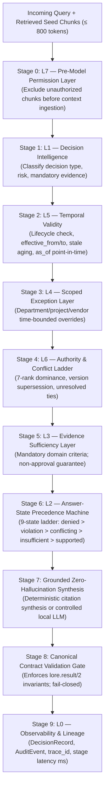

# LORE Enterprise

> **Model-Minimal, Customer-Deployed Governed Knowledge Grid & Model Context Protocol (MCP) Server**  
> *"Your lore, structured. Your AI, grounded."*

[](docs/enterprise/FINAL_ACCEPTANCE_MATRIX.md)
[](docs/LORE_ARCHITECTURE.md)
[](frontend/)
[](backend/)
[-8A2BE2?style=flat-square)](backend/mcp_server.py)
[](backend/apps/retrieval/)
[](LICENSE)

---

## Executive Summary

**LORE Enterprise** is an enterprise-grade, airgap-capable governed knowledge platform and **Model Context Protocol (MCP)** server. Designed for mission-critical enterprise engineering teams and autonomous AI coding agents (such as Google Antigravity, Cursor, Claude Desktop, VS Code Copilot, and Windsurf), LORE addresses the fatal flaws of modern RAG and agent architectures: **stale policies, contradictory requirements, hallucinated citations, silent security overrides, and unmonitored data leakage.**

Instead of blindly dumping unverified, raw document snippets into an LLM's context window, LORE executes a deterministic **9-layer governance pipeline** between hybrid vector/graph retrieval and context delivery. Lore emits typed verdicts (`supported`, `qualified`, `conflicting`, `insufficient`, `violation`, `denied`), clear directives (`proceed`, `proceed_and_cite`, `ask_user`, `stop`, `escalate`), strict citations, and mathematical guarantees—never settling human contradictions on its own.

Every retrieval and decision is recorded into an immutable audit trail with end-to-end `trace_id` lineage.

---

## Key Capabilities & Architectural Pillars

### 1. The 9-Layer Deterministic Governance Engine
LORE enforces an ordered evaluation machine between retrieval and generation. If any layer fails or detects missing mandatory evidence, the system **fails closed**:



- **L7 — Permission Layer**: Pre-model authorization gate. Chunks failing user role or tenancy boundaries are pruned *before* entering model memory.
- **L1 — Decision Intelligence**: Categorizes queries into risk levels (`statutory_compliance`, `vendor_approval`, `data_processing`, `deployment_approval`, `code_change`, `general_inquiry`).
- **L5 — Temporal Validity**: Strictly excludes unapproved/quarantined drafts and expired policies. Powers point-in-time historical reconstruction via `as_of` queries.
- **L4 — Scoped Exceptions**: Evaluates time-bounded corporate waivers (e.g. temporary vendor concessions). Every applied exception is disclosed in the result envelope.
- **L6 — Authority Hierarchy & Conflict Resolution**: Enforces a 7-rank authority ladder (`approved_policy` [Rank 7] down to `informal_note` [Rank 1]). High-rank formal rules dominate informal advice; equal-rank newer versions supersede older versions. Unresolved ties trigger `conflicting` $\to$ `ask_user` (LORE refuses to guess).
- **L3 — Evidence Sufficiency**: Validates that all mandatory prerequisites exist (e.g. executed Schedule D data residency addendum for cloud vendors). If missing, positive approval is mathematically blocked.
- **L2 — Answer-State Precedence Machine**: Deterministic 9-state ladder ensuring consistent verdict-to-directive mappings.
- **L0 — Observability & Lineage**: Every decision records a `DecisionRecord` containing cited chunk UUIDs, rule IDs, and sub-millisecond stage latencies.

### 2. Dual-Stream Document Ingestion & Optical Character Recognition (OCR)
- **High-Velocity Digital PDF Preservation**: Native text streams are extracted directly via `pdfplumber` (<1.5 ms/page, 0.00% Character Error Rate). Raster OCR is triggered *only* when digital text is absent or sparse ($\le 20$ chars).
- **Graceful Local Tesseract 5.4 OCR**: Local offline raster extraction with 300 DPI normalization, Lanczos contrast boosting, and Orientation & Script Detection (OSD) for 90°/180°/270° auto-rotation. Decoupled as an optional provider—missing binaries never crash ingestion.
- **Legacy Bengali Font Reconstruction**: Built-in deterministic phonetic syllable repair for legacy Bijoy / SutonnyMJ character sets, eliminating visual-order pre-consonant vowel split corruptions (tested 100% exact Unicode reconstruction).

### 3. Hybrid Retrieval & Bounded GraphRAG
- **Dense Vector Search**: SentenceTransformers (`all-MiniLM-L6-v2`, 384 dimensions) indexed into Qdrant collections with tenant and workspace isolation filters.
- **Lexical BM25 & SQLite FTS5**: Full-text keyword search running in tandem with dense embeddings.
- **Reciprocal Rank Fusion (RRF)**: Merges dense semantic and lexical candidate lists without fragile manual weight tuning.
- **Bounded 2-Hop GraphRAG Traversal**: Follows typed knowledge relationships (`DEPENDS_ON`, `SUPERSEDES`, `DERIVED_FROM`, `CONTRADICTS`) with cycle protection, maximum depth limits (2–3 hops), and 100 ms timeouts.

### 4. Enterprise MCP Server (`backend/mcp_server.py`)
- Standards-compliant Model Context Protocol server communicating over JSON-RPC stdio.
- Provides tools for coding agents: `lore.get_context`, `lore.search`, `lore.check_compliance`, `lore.get_authority_info`, `lore.query_as_of`, `lore.get_active_exceptions`, `lore.escalate_to_human`, `lore.bootstrap`, `lore.get_skill`, `lore.get_document`, and `lore.ocr_extract`.

### 5. Next.js 16 Web Application Console (`frontend/`)
- **Governed RAG Studio**: Interactive prompt and policy evaluation with live 9-layer governance telemetry, cited snippets, and graph expansion graphs.
- **Realtime OCR Studio**: Interactive document workbench with bounding box visualizer, extraction confidence scoring, and Bengali font repair inspector.
- **Ingestion Activity Pipeline**: Real-time worker monitoring with per-stage extraction timing breakdowns.
- **Review Queue**: Staged human-in-the-loop gate for quarantined documents, OCR low-confidence pages, and conflicting policies.
- **Audit & Decision Lineage**: Searchable log of every decision with immutable `trace_id` deep links.
- **Organization & Tenant Settings**: Workspaces, RBAC, API keys, data residency rules, and simulated/Stripe billing.

---

## Quick Start & Running Locally

### System Prerequisites
- **Python**: 3.10 to 3.14
- **Node.js**: v18.0.0 or later (Node v20+ / v24 recommended)
- **Git**
- *(Optional)* **Tesseract OCR 5.x** (for local image/raster OCR)
- *(Optional)* **Docker & Docker Compose** (for multi-container production deployment)

---

### Option A: Running Local Development Servers (Recommended)

LORE Enterprise is configured with zero-friction development fallbacks:
- Canonical PostgreSQL falls back automatically to local `backend/db.sqlite3` with pre-seeded enterprise fixtures.
- Qdrant runs in embedded local storage mode (`backend/qdrant_storage`).
- Celery operates synchronously in eager mode (`CELERY_ALWAYS_EAGER=True`).
- In `DEBUG=True`, guest authentication is enabled for frictionless exploration.

#### 1. Start the Django Backend Server
```bash
# Open a terminal in the project root
cd backend

# Install dependencies (if not already installed)
pip install -r requirements.txt

# Run migrations (already applied for demo SQLite)
python manage.py migrate

# Start the Django development server on port 8000
python manage.py runserver 127.0.0.1:8000
```
*The backend API is now live at [http://127.0.0.1:8000](http://127.0.0.1:8000).*

#### 2. Start the Next.js Frontend Server
```bash
# Open a second terminal in the project root
cd frontend

# Install Node dependencies (if not already installed)
npm install

# Start the Next.js dev server (with Turbopack)
npm run dev
```
*The frontend console is now live at [http://localhost:3000](http://localhost:3000).*

#### 3. Verify System Health
You can verify the backend status and dependencies:
```bash
# Health liveness probe
curl http://127.0.0.1:8000/api/v1/health/

# Deep readiness check (Database, Vector Engine, OCR)
curl http://127.0.0.1:8000/api/v1/health/ready/

# Realtime governance telemetry
curl http://127.0.0.1:8000/api/v1/health/telemetry/
```

---

### Option B: Running with Docker Compose

For multi-node production or staging environments with dedicated PostgreSQL, Redis, Qdrant, MinIO, and Celery workers:

```bash
# Copy and adjust the environment file
cp .env.example .env

# Build and start all 7 services
docker-compose up -d

# Check status of containers
docker-compose ps

# View backend and worker logs
docker-compose logs -f backend celery_worker
```

Services started by Docker Compose:
| Container Name | Service | Port | Description |
|---|---|---|---|
| `lore_enterprise_backend` | Django REST API & Core Engine | `8000` | Governed API, admin, RAG engine |
| `lore_enterprise_worker` | Celery Asynchronous Worker | — | OCR extraction, chunking, graph settlement |
| `lore_enterprise_frontend` | Next.js 16 Web Console | `3000` | Administrative UI & governance workbench |
| `lore_enterprise_db` | PostgreSQL 16 Alpine | `5432` | Canonical relational system of record |
| `lore_enterprise_redis` | Redis 7 Alpine | `6379` | Celery message broker and caching |
| `lore_enterprise_qdrant` | Qdrant Vector Engine v1.11.0 | `6333` | Dense vector indexing & similarity search |
| `lore_enterprise_minio` | MinIO Object Storage | `9000` / `9001` | Private S3-compatible document storage |

---

## Connecting LORE to AI Coding Agents (MCP)

LORE serves governed enterprise knowledge directly into coding agents over the **Model Context Protocol (MCP)** using stdio JSON-RPC.

### Testing the MCP Server Directly
```bash
cd backend

# Print registered tools manifest
python mcp_server.py --list-tools

# Run self-test suite (hybrid search, governance evaluation, deterministic synthesis)
python mcp_server.py --test
```

### 1. Cursor IDE Configuration
Add the following to your Cursor MCP settings (`~/.cursor/mcp.json` or project `.cursor/mcp.json`):
```json
{
  "mcpServers": {
    "lore": {
      "command": "python",
      "args": ["E:/LORE/backend/mcp_server.py"],
      "env": {
        "PYTHONIOENCODING": "utf-8"
      }
    }
  }
}
```

### 2. Google Antigravity Configuration
Add to `.gemini/antigravity-ide/mcp_config.json`:
```json
{
  "mcpServers": {
    "lore": {
      "command": "python",
      "args": ["E:/LORE/backend/mcp_server.py"]
    }
  }
}
```

### 3. Claude Desktop Configuration
Add to `claude_desktop_config.json`:
```json
{
  "mcpServers": {
    "lore": {
      "command": "python",
      "args": ["E:/LORE/backend/mcp_server.py"]
    }
  }
}
```

### 4. VS Code (GitHub Copilot Agent Mode)
Add to `.vscode/settings.json`:
```json
{
  "github.copilot.chat.mcp.servers": {
    "lore": {
      "command": "python",
      "args": ["${workspaceFolder}/backend/mcp_server.py"]
    }
  }
}
```

---

## MCP Tool Reference

| Tool Name | Parameters | Description |
|---|---|---|
| `lore.get_context` | `query`, `workspace_id`, `user_role`, `llm_model` | Evaluates a task or question through the 9-layer governance engine. Returns typed verdict, directive, and cited rule locators. |
| `lore.search` | `query`, `workspace_id`, `limit` | Performs hybrid dense vector + lexical search with Reciprocal Rank Fusion. |
| `lore.check_compliance` | `diff_content`, `file_path`, `intent`, `workspace_id` | Evaluates staged code changes against active policies; flags violations and MUST-rule breaches. |
| `lore.get_authority_info` | `source_id`, `workspace_id` | Returns 7-rank authority hierarchy, document version, staleness threshold, and access permissions. |
| `lore.query_as_of` | `query`, `as_of`, `workspace_id`, `limit` | Historical point-in-time retrieval evaluating rules active on a specific past date. |
| `lore.get_active_exceptions` | `workspace_id`, `rule_code`, `scope_type`, `as_of` | Lists active, time-bounded scoped exceptions for a department, project, or vendor. |
| `lore.escalate_to_human` | `query`, `state`, `workspace_id`, `context` | Dispatches an unresolved contradiction or high-risk decision to the compliance review queue. |
| `lore.bootstrap` | `workspace_id`, `phase` | Serves the Constitution (`agent.md`) and phase policies on agent connect. |
| `lore.get_skill` | `name`, `workspace_id` | Retrieves procedural step-by-step engineering guidelines and authority levels. |
| `lore.get_document` | `document_id` | Retrieves comprehensive document metadata, page OCR text, and bounding boxes. |
| `lore.ocr_extract` | `file_path` | Runs real-time dual-stream OCR extraction with Bengali font repair on a local file. |

---

## REST API Overview

All REST API endpoints are versioned under `/api/v1/`:

- **Health & Diagnostics**:
  - `GET /api/v1/health/` — Lightweight liveness probe.
  - `GET /api/v1/health/ready/` — Deep dependency readiness check (PostgreSQL, Qdrant, Tesseract).
  - `GET /api/v1/health/telemetry/` — Aggregate governance stats, verdict distributions, latency p95/p99, circuit breaker health.
- **Identity & Multi-Tenancy**:
  - `/api/v1/identity/users/`, `/api/v1/identity/organizations/`, `/api/v1/identity/token/`
- **Workspaces & Collections**:
  - `/api/v1/workspaces/` — Isolated tenant workspaces.
- **Sources & Documents**:
  - `/api/v1/sources/documents/` — Document metadata, status, authority ranking, and page streams.
- **Ingestion & Processing**:
  - `/api/v1/ingestion/jobs/` — Asynchronous ingestion job queue and stage progression.
- **Retrieval & RAG**:
  - `/api/v1/retrieval/search/` — Hybrid vector + lexical search endpoint.
  - `/api/v1/retrieval/governed-query/` — Complete 9-layer anti-hallucination RAG query.
- **Governance & Policy Adjudication**:
  - `/api/v1/governance/conflicts/` — Conflict records and human resolution interface.
  - `/api/v1/governance/exceptions/` — Time-bounded scoped exceptions.
  - `/api/v1/governance/review-queue/` — Quarantined documents and unverified extractions.
- **Decisions & Audit**:
  - `/api/v1/decisions/` — Immutable decision records.
  - `/api/v1/audit/` — Append-only audit events stream.
- **Subscriptions & Billing**:
  - `/api/v1/subscriptions/plans/`, `/api/v1/subscriptions/checkout/` — SaaS plan management with simulated local-dev and Stripe support.

---

## Testing & Verification

The test suite validates the system against real services (local SentenceTransformers embeddings, Qdrant vector store, SQLite/PostgreSQL):

```bash
cd backend

# Run the complete core governance completion test suite
pytest tests/test_governance_engine_completion.py -v

# Run the final enterprise acceptance suite
pytest tests/test_final_acceptance_suite.py -v

# Run deterministic execution and airgap tests
pytest tests/test_deterministic_execution_modes.py -v

# Run OCR and Bengali font benchmark
python tests/evaluation_ocr_benchmark.py

# Perform system integrity and configuration validation check
python manage.py check
```

### Disaster Recovery & Backup Drill
LORE includes automated enterprise disaster recovery commands with SHA-256 tamper detection:

```bash
cd backend

# Create an encrypted, tamper-evident backup archive
python manage.py backup_enterprise --output-dir backups/drill_run

# Restore database records, vector indexes, and media files from backup
python manage.py restore_enterprise --backup-dir backups/drill_run --fix-mismatches
```

---

## Project Structure

```
LORE/
├── backend/                        # Django 4.2 / REST Framework Enterprise Core
│   ├── apps/
│   │   ├── audit/                  # Immutable audit event persistence
│   │   ├── decisions/              # Decision records & lineage tracking
│   │   ├── governance/             # 9-layer governance engine, layers & contract
│   │   ├── identity/               # Multi-tenant auth, organizations & RBAC
│   │   ├── ingestion/              # Ingestion jobs, workers & state machines
│   │   ├── knowledge/              # Chunks, knowledge graph & relationships
│   │   ├── retrieval/              # Hybrid vector (Qdrant) + lexical search
│   │   ├── sources/                # Document storage, OCR router, repair
│   │   ├── subscriptions/          # SaaS billing adapters (Stripe / local_dev)
│   │   └── workspaces/             # Isolated tenant workspaces & collections
│   ├── lore_enterprise/            # Django settings, WSGI/ASGI, master URLs
│   ├── tests/                      # 21+ empirical verification suites & benchmarks
│   ├── manage.py                   # Django CLI & management commands
│   ├── mcp_server.py               # Model Context Protocol stdio server
│   ├── requirements.txt            # Python dependencies
│   ├── Dockerfile                  # Container definition for backend & worker
│   └── entrypoint.sh               # Migration, seeding & startup orchestration
├── frontend/                       # Next.js 16 Web Application Console
│   ├── src/
│   │   ├── app/                    # Next.js App Router (page.tsx, layout.tsx)
│   │   ├── components/             # GovernedRAGView, RealtimeOCRStudio, etc.
│   │   └── lib/                    # API client (api.ts), i18n, themes
│   ├── package.json                # Frontend dependencies (React 19, Tailwind 4)
│   └── Dockerfile                  # Production container definition
├── docs/                           # Architectural & Engineering Specifications
│   ├── LORE_OVERVIEW.md            # Comprehensive project overview & concepts
│   ├── LORE_ARCHITECTURE.md        # Detailed v2.0 target architecture
│   ├── GOVERNANCE_CONTRACT.md      # Canonical result contract & invariants
│   ├── PROJECT_REQUIREMENTS.md     # Requirements specification
│   ├── enterprise/                 # Benchmarks, layer maps & audit reports
│   └── ide/                        # Client configuration guides (Cursor, Claude, etc.)
├── docker-compose.yml              # Complete 7-container local/staging topology
├── .env.example                    # Master configuration reference matrix
└── README.md                       # Master project documentation
```

---

## License

This project is licensed under the [MIT License](LICENSE).
