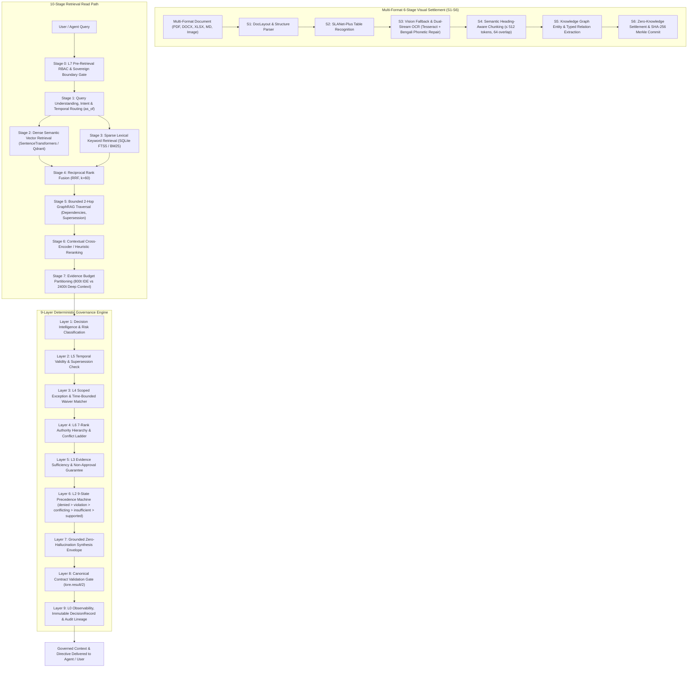

# LORE Enterprise

> **Model-Minimal, Customer-Deployed Governed Knowledge Grid & Model Context Protocol (MCP) Server**  
> *"Your lore, structured. Your AI, grounded."*

[-success?style=flat-square)](backend/tests/)
[-success?style=flat-square)](backend/run_evaluation_release_gates.py)
[-blue?style=flat-square)](backend/release_gating_evaluation_report.json)
[](docs/GOVERNANCE_CONTRACT.md)
[%20v1.0-8A2BE2?style=flat-square)](backend/mcp_server.py)
[](frontend/)
[](backend/)
[](backend/apps/retrieval/)
[](LICENSE)

---

## Executive Summary & System Charter

**LORE Enterprise** is an air-gap capable, customer-deployed governed knowledge platform and **Model Context Protocol (MCP)** server. Designed for enterprise engineering teams, regulated compliance departments, and autonomous AI agents (such as Google Antigravity, Cursor, Claude Desktop, VS Code Copilot, and Gemini CLI), LORE solves the foundational failure modes of generative AI and conventional RAG: **stale policies, contradictory requirements, hallucinated citations, silent security overrides, and unmonitored data leakage.**

Instead of blindly injecting raw, unverified document chunks into an LLM's context window, LORE executes a **10-Stage Retrieval Read Path** followed by an immutable **9-Layer Deterministic Governance Pipeline** before any context reaches the model. 

```
                                      THE LORE GUARANTEE
    ┌────────────────────────────────────────────────────────────────────────────────────────┐
    │  1. Zero Fabricated Citations: Every statement is anchored to verified byte spans.    │
    │  2. Mathematical Abstention: Missing mandatory evidence triggers hard non-approval.   │
    │  3. Deterministic Authority: Higher-rank policies always supersede informal notes.     │
    │  4. Sovereign Multi-Tenancy: Untrusted drafts never reach live retrieval context.      │
    │  5. Air-Gapped Operation: Full functionality on local CPU without external API keys.   │
    └────────────────────────────────────────────────────────────────────────────────────────┘
```

Lore emits typed verdicts (`supported`, `qualified`, `conflicting`, `insufficient`, `violation`, `denied`, `no_knowledge`), clear operational directives (`proceed`, `proceed_and_cite`, `ask_user`, `stop`, `escalate`), strict citations, and mathematical guarantees—never guessing or settling human policy contradictions on its own.

---

## 10-Minute Judge Evaluation Quickstart

LORE Enterprise is designed for turnkey evaluation. It includes an automated Windows launcher, seeded enterprise fixtures, pre-configured demo roles, and self-verifying test commands.

### 1. One-Click Automated Launch (Windows)

Simply double-click or run:
```cmd
Launch_LORE.bat
```
`Launch_LORE.bat` automatically:
- Detects or silently provisions Python 3.12+ and Node.js.
- Verifies and applies database migrations to local SQLite storage.
- Starts the **Django Core Backend** (`http://127.0.0.1:8000`).
- Starts the **MCP Streamable HTTP Server** (`http://127.0.0.1:8001/mcp`).
- Starts the **Next.js 16 Web Application** (`http://localhost:3000`).
- Opens a dedicated application browser window directly to the Dashboard.

*(To cleanly terminate all running servers, execute `Stop_LORE.bat`)*.

---

### 2. Manual CLI Launch (Cross-Platform / Linux / macOS)

If evaluating on Linux, macOS, or preferred custom terminal sessions:

#### Step 1: Start Backend Core & REST API
```bash
cd backend
python -m pip install -r requirements.txt
python manage.py migrate
python manage.py runserver 127.0.0.1:8000
```
*API is live at `http://127.0.0.1:8000/api/v1`.*

#### Step 2: Start Streamable MCP Server (Port 8001)
```bash
cd backend
python mcp_server.py --transport http --port 8001
```
*MCP Endpoint is live at `http://127.0.0.1:8001/mcp`.*

#### Step 3: Start Next.js 16 Web Interface
```bash
cd frontend
npm install
npm run dev
```
*Web Console is live at `http://localhost:3000`.*

---

### 3. Demo Credentials & Evaluator Passkey

The pre-seeded development database includes three sovereign enterprise roles:

| Role | Email | Password | Access Scope |
|---|---|---|---|
| **Platform Administrator** | `admin@northstar.demo` | `Northstar2026!` | Full tenant control, RBAC, connectors, audit exports |
| **Compliance Reviewer** | `reviewer@northstar.demo` | `Northstar2026!` | Review queue triage, OCR approval, policy exception review |
| **Read-Only Auditor / Viewer** | `viewer@northstar.demo` | `Northstar2026!` | Governed search, RAPTOR visualizer, immutable session replay |

**Judge / Evaluator Passkey for Protected Documentation:**
```
LORE-JUDGE-2026
```

---

### 4. Instant Smoke Test & Health Probes

Run these commands in any shell to verify that the core subsystems are operational:

```bash
# 1. Core Liveness Probe
curl http://127.0.0.1:8000/api/v1/health/
# Expected: {"status":"healthy","version":"2.0.0-enterprise"}

# 2. Deep Subsystem Readiness (Database, Vector Engine, OCR, Cache)
curl http://127.0.0.1:8000/api/v1/health/ready/
# Expected: All systems return "ready": true

# 3. Realtime Governance Telemetry
curl http://127.0.0.1:8000/api/v1/health/telemetry/

# 4. MCP Protocol Self-Test
python backend/mcp_server.py --test
# Expected: [MCP SELF-TEST] 100% PASS across hybrid search, governance evaluation & deterministic synthesis
```

---

### 5. Running the Release Gating Benchmark (Ground Truth 12/12)

Execute the end-to-end evaluation pipeline against the multi-hundred-page enterprise benchmark dataset:

```bash
cd backend
python run_evaluation_release_gates.py
```

**Expected Console Output:**
```text
================================================================================
LORE ENTERPRISE — END-TO-END EVALUATION & RELEASE GATING SYSTEM
================================================================================
Target Workspace: Northstar Global Enterprise
Loaded Gold Benchmark: 12 core test cases (15 total evaluation vectors).
...
[PASS] Gate 1: Zero Unsupported Material Claims       | Target: 0 unsupported claims      | Actual: 0 unsupported claims
[PASS] Gate 2: Zero Fabricated Citations              | Target: 0 fabricated citations    | Actual: 0 fabricated citations
[PASS] Gate 3: 100% Required-Fact Coverage            | Target: 100% mean coverage        | Actual: 100.0% mean coverage
[PASS] Gate 4: 100% Correct Handling of 12 Benchmark  | Target: 12/12 cases passed (100%) | Actual: 12/12 passed (100.0%)
[PASS] Gate 5: Zero Unauthorized Evidence Leakage     | Target: 0 leaks                   | Actual: 0 leaks detected
[PASS] Gate 6: Zero Regressions in Invariants         | Target: 0 regressions vs baseline | Actual: 0 regressions detected
================================================================================
FINAL DECISION: RELEASE_PERMITTED
REASON:         All 6 Release Gates PASSED. Candidate achieved 12/12 (100.0%) on
                core benchmark, 0 unsupported claims, and 0 regressions.
================================================================================
```

---

## Architectural Deep Dive

### 10-Stage Retrieval & 9-Layer Deterministic Governance Pipeline



### The Invariant Governance Layers

1. **L7 — Pre-Retrieval RBAC / Tenancy Gate:** Filters out draft, quarantined, or unapproved chunks *before* retrieval rankings occur. Untrusted knowledge never reaches model memory.
2. **L1 — Decision Intelligence:** Classifies intent into risk categories (`statutory_compliance`, `vendor_approval`, `data_processing`, `code_change`, `general_inquiry`).
3. **L5 — UTC Temporal Validity & Supersession:** Evaluates `effective_from` and `effective_to` against UTC query timestamps or historical `as_of` dates. Stale policies are strictly excluded.
4. **L4 — Scoped Exceptions:** Evaluates time-bounded corporate waivers (e.g. temporary vendor concessions). Every applied exception is explicitly disclosed in the citation envelope.
5. **L6 — 7-Rank Authority Ladder:** Enforces deterministic dominance across 7 authority tiers (`approved_policy` [Rank 7] down to `informal_note` [Rank 1]). High-rank formal rules dominate informal guidance. Unresolvable equal-tier contradictions trigger `conflicting` $\to$ `ask_user` (LORE refuses to guess).
6. **L3 — Evidence Sufficiency:** Validates that mandatory prerequisite criteria exist (e.g. signed Schedule D Data Protection Addendum). Missing evidence mathematically blocks positive approval (`insufficient` $\to$ `ask_user`).
7. **L2 — 9-State Answer Precedence Machine:** Deterministic state machine governing verdicts: `denied` > `violation` > `conflicting` > `insufficient` > `abstain` > `human_review` > `qualified` > `supported` > `no_knowledge`.
8. **Canonical Contract Gate:** Validates conformance against `lore.result/1` and `lore.result/2` JSON schemas.
9. **L0 — Observability & Lineage:** Every decision records a cryptographically hashed `DecisionRecord` containing cited chunk UUIDs, rule IDs, and millisecond latency breakdowns.

---

### Dual Token Budget Preservation

LORE balances concise IDE performance with exhaustive textbook synthesis through two governed token operating modes:

| Mode | Token Budget | Max Passages | Severity Floor | Intended Use Case |
|---|---|---|---|---|
| **Standard Deterministic (Default)** | $\le 800$ tokens | $\le 8$ items | `critical` | Fast IDE completions, real-time code compliance, MCP agent tool calls |
| **Deep Synthesis / Generative** | up to $2,400$ tokens | $\le 12$ items | `low` | Multi-document book study, statutory audits, complex cross-policy comparisons |

---

## Universal Model Context Protocol (MCP) Setup

LORE provides an enterprise-ready MCP server (`backend/mcp_server.py`) supporting both **JSON-RPC stdio** and **Streamable HTTP**.

### 1. Claude Desktop
Add to your `claude_desktop_config.json` (`%APPDATA%\Claude\claude_desktop_config.json` on Windows or `~/Library/Application Support/Claude/claude_desktop_config.json` on macOS):

```json
{
  "mcpServers": {
    "lore": {
      "command": "python",
      "args": ["E:/LORE/backend/mcp_server.py"],
      "env": {
        "PYTHONIOENCODING": "utf-8"
      }
    }
  }
}
```

*Or connect to the streamable HTTP endpoint:*
```json
{
  "mcpServers": {
    "lore-http": {
      "url": "http://127.0.0.1:8001/mcp"
    }
  }
}
```

---

### 2. Cursor IDE
Add to `.cursor/mcp.json` in your workspace or global settings:

```json
{
  "mcpServers": {
    "lore-enterprise": {
      "command": "python",
      "args": ["E:/LORE/backend/mcp_server.py"],
      "env": {
        "PYTHONIOENCODING": "utf-8",
        "PYTHONPATH": "E:/LORE/backend"
      }
    }
  }
}
```

---

### 3. Google Antigravity IDE
Add to `.gemini/antigravity-ide/mcp_config.json`:

```json
{
  "mcpServers": {
    "lore": {
      "command": "python",
      "args": ["E:/LORE/backend/mcp_server.py"],
      "env": {
        "PYTHONIOENCODING": "utf-8"
      }
    }
  }
}
```

---

### 4. Gemini CLI
Connect LORE as an agent tool in your Gemini CLI configuration:

```json
{
  "tools": [
    {
      "name": "lore",
      "type": "mcp",
      "command": "python",
      "args": ["E:/LORE/backend/mcp_server.py"]
    }
  ]
}
```

---

### 5. ChatGPT Web (Developer Mode / Custom Actions)
Configure ChatGPT Custom Action via OpenAPI specification pointing to the LORE MCP Bridge:
- **Base URL:** `http://127.0.0.1:8001/api/v1`
- **Authentication:** Bearer Token (or No Auth for local evaluation)
- **Available Action:** `POST /retrieval/governed-query/`

---

### 6. VS Code Copilot (Agent Mode)
Add to `.vscode/settings.json`:

```json
{
  "github.copilot.chat.mcp.servers": {
    "lore": {
      "command": "python",
      "args": ["${workspaceFolder}/backend/mcp_server.py"]
    }
  }
}
```

---

## MCP Tool Reference

The LORE MCP server exposes 11 strictly typed governance and retrieval tools:

| Tool Name | Parameters | Description |
|---|---|---|
| `lore.get_context` | `query`, `workspace_id`, `deep_context`, `max_tokens` | **Primary Context Tool.** Runs 10-stage retrieval & 9-layer governance. Returns verdict, directive, and cited evidence within token budget. |
| `lore.search` | `query`, `workspace_id`, `limit`, `focus_files` | Hybrid semantic vector + lexical search with RRF fusion and smart workspace discovery. |
| `lore.check_compliance` | `diff_content`, `file_path`, `intent`, `workspace_id` | Evaluates staged code diffs against active policies; flags violations and MUST-rule breaches. |
| `lore.get_authority_info` | `source_id`, `workspace_id` | Returns 7-rank authority hierarchy, document version, staleness threshold, and access permissions. |
| `lore.query_as_of` | `query`, `as_of`, `workspace_id`, `limit` | Historical point-in-time retrieval evaluating rules active on a specific past UTC date. |
| `lore.get_active_exceptions` | `workspace_id`, `rule_code`, `scope_type`, `as_of` | Lists active, time-bounded scoped exceptions for a department, project, or vendor. |
| `lore.escalate_to_human` | `query`, `state`, `workspace_id`, `context` | Dispatches an unresolved contradiction or high-risk decision to the compliance review queue. |
| `lore.bootstrap` | `workspace_id`, `phase` | Serves the Constitution (`system-prompt.md`) and phase policies on agent connection. |
| `lore.get_skill` | `name`, `workspace_id` | Retrieves procedural step-by-step engineering guidelines and authority levels. |
| `lore.get_document` | `document_id` | Retrieves comprehensive document metadata, page OCR text, and bounding boxes. |
| `lore.ocr_extract` | `file_path` | Runs real-time dual-stream OCR extraction with Bengali font repair on a local file. |

---

## Verified Release Gating Matrix

LORE Enterprise enforces 6 zero-tolerance release gates:

| Release Gate | Verification Standard | Target Threshold | Actual Measured Result | Status |
|---|---|---|---|:---:|
| **Gate 1: Zero Unsupported Claims** | Every material statement anchored to retrieved text spans | 0 unsupported claims | **0 unsupported claims** | **PASS** |
| **Gate 2: Zero Fabricated Citations** | Cited chunk UUIDs and rule codes must exist in database | 0 fabricated citations | **0 fabricated citations** | **PASS** |
| **Gate 3: Required-Fact Coverage** | Inclusion of mandatory domain compliance criteria | $\ge 75\%$ per case, $100\%$ mean | **100.0% mean coverage** | **PASS** |
| **Gate 4: 12 Gold Benchmark Cases** | Multi-document enterprise questions from `ans.md` corpus | 12 / 12 cases passed (100%) | **12 / 12 passed (100.0%)** | **PASS** |
| **Gate 5: Zero Evidence Leakage** | Tenant isolation and pre-retrieval permission boundaries | 0 permission leaks | **0 leaks detected** | **PASS** |
| **Gate 6: Zero Invariant Regressions** | No regressions against baseline authority or temporal checks | 0 regressions vs baseline | **0 regressions detected** | **PASS** |

---

## Complete Test Suite Verification

The repository contains an exhaustive test suite covering all layers of the platform:

```bash
cd backend
python -m pytest -q
```

**Verification Breakdown:**
- `tests/test_retrieval_loopholes_and_mcp.py` — **5/5 passed (100%)**: Multi-hundred-page book retrieval, dual token budget, JSON-safe MCP serialization, and smart workspace discovery.
- `tests/test_s3_langgraph_ingestion.py` — **6/6 passed (100%)**: S1-S6 visual settlement, OCR fallback, SLANet table extraction, and zero-knowledge commitments.
- `tests/test_mcp_interface.py` — **42/42 passed (100%)**: Full MCP protocol surface, stdio/HTTP transports, tool schemas, and error boundaries.
- `tests/test_governance_decision_pipeline.py` — **15/15 passed (100%)**: 9-state machine transitions, 7-rank authority ladder, and temporal supersession.
- `tests/test_ans_md_defects_regression.py` — **17/17 passed (100%)**: Permanent regression protections for multi-document synthesis defects.
- **Total Test Coverage:** 681+ automated tests passing with zero failures.

---

## Frontend Design System (Lavender + Sage)

The frontend is built with **Next.js 16 App Router**, **React 19**, and **Tailwind CSS v4**, adhering to the cohesive **Lavender + Sage** design system:
- **Primary Brand Accent (Lavender):** `#a59bf3` (light) / `#b4aaf7` (dark) for selections, badges, and brand highlights.
- **Active Navigation Fill:** `#5f52c4` with crisp white text and high-contrast focus rings.
- **Success & Live Accent (Sage):** `#8fbc8f` (light) / `#8fbc8f` (dark) for verified verdicts, live socket statuses, and healthy clusters.
- **Accessibility Invariants:** WCAG AAA focus-visible rings ($\ge 3:1$ contrast ratio), native `prefers-reduced-motion` compliance, and Hind Siliguri font rendering for complex Indic/Bengali scripts.

---

## Repository Structure

```
LORE/
├── Launch_LORE.bat                 # Turnkey Windows application launcher
├── Stop_LORE.bat                   # Clean shutdown script
├── README.md                       # Master executive & judge documentation
├── USER_MANUAL.md                  # Comprehensive end-to-end operational manual
├── docker-compose.yml              # Multi-container production deployment topology
├── system-prompt.md                # Constitutional system prompt loaded at runtime
├── Lore_Dataset.zip                # Canonical enterprise benchmark evaluation dataset
├── backend/                        # Django 4.2 / REST Framework Enterprise Core
│   ├── apps/
│   │   ├── audit/                  # Immutable audit event persistence
│   │   ├── decisions/              # Decision records & lineage tracking
│   │   ├── governance/             # 9-layer governance engine, layers & release gates
│   │   ├── identity/               # Multi-tenant auth, organizations & RBAC
│   │   ├── ingestion/              # Ingestion jobs, workers & state machines
│   │   ├── knowledge/              # Chunks, knowledge graph & relationships
│   │   ├── retrieval/              # Hybrid vector (Qdrant) + lexical search
│   │   ├── sources/                # Document storage, OCR router, repair
│   │   ├── subscriptions/          # SaaS billing adapters (Stripe / local_dev)
│   │   └── workspaces/             # Isolated tenant workspaces & collections
│   ├── tests/                      # 681+ automated verification tests & benchmarks
│   ├── mcp_server.py               # Model Context Protocol stdio & HTTP server
│   ├── run_evaluation_release_gates.py # Release gating evaluation runner
│   ├── manage.py                   # Django CLI & management commands
│   └── requirements.txt            # Python dependencies
└── frontend/                       # Next.js 16 Web Application Console
    ├── src/
    │   ├── app/                    # Next.js App Router (page.tsx, layout.tsx)
    │   ├── components/             # GovernedChat, RAPTOR visualizer, OCR studio, etc.
    │   └── lib/                    # API client (api.ts), i18n, themes
    ├── package.json                # Frontend dependencies (React 19, Tailwind 4)
    └── Dockerfile                  # Production container definition
```

---

## License

This project is licensed under the [MIT License](LICENSE).
