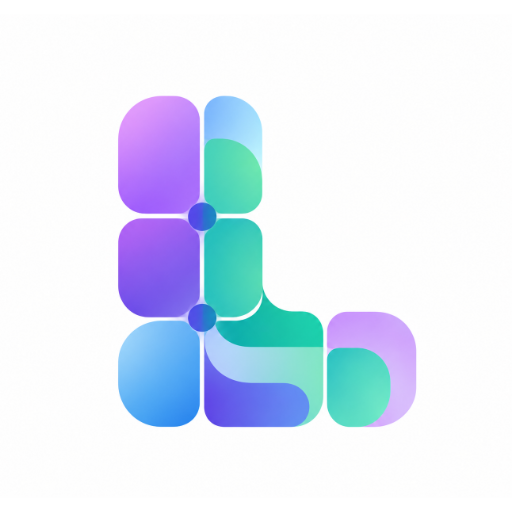

<p align="center">
  
</p>

<h1 align="center">LORE</h1>

<p align="center">
  <strong>Your lore, structured. Your AI, grounded.</strong><br />
  <em>Governed knowledge and MCP for coding agents — from a single developer to a regulated enterprise.</em>
</p>

<p align="center">
  <a href="LICENSE"></a>
  
  
  
  
</p>

<p align="center">
  Built for the <strong>International AI Builders Congress 2026</strong> by <strong>CloudCamp BD</strong><br />
  InfraSphere AI / Knowledge Grid track
</p>

<p align="center">
  <a href="#platform-tiers">Tiers</a> ·
  <a href="#1-lore-solo-solo-branch">Solo</a> ·
  <a href="#3-lore-enterprise-enterprise-branch">Enterprise</a> ·
  <a href="#connecting-your-ide">IDE setup</a> ·
  <a href="#documentation">Docs</a>
</p>

---

**LORE** is a governed knowledge platform and **Model Context Protocol (MCP)** suite for AI coding agents and enterprise engineering teams. Instead of dumping raw, unverified, or conflicting markdown and policy PDFs into an LLM's context window, Lore routes task-fit skills, evaluates deterministic governance rules, refuses to guess on contradictions, and records traceable decision receipts.

### Repository layout

| Branch | Role |
| --- | --- |
| [`main`](https://github.com/starrynight-web/LORE/tree/main) | Platform documentation, IDE guides, and landing site |
| [`solo`](https://github.com/starrynight-web/LORE/tree/solo) | **Lore Solo** — local-first skill & persona gateway for individual developers |
| [`enterprise`](https://github.com/starrynight-web/LORE/tree/enterprise) | **LORE Enterprise** — airgap-capable, customer-deployed 9-layer governed knowledge grid |
| [`dev`](https://github.com/starrynight-web/LORE/tree/dev) *(historical)* | Earlier Go prototype — superseded by `solo` and `enterprise` |

---

## Platform tiers

| Tier | Branch / status | Audience | Architecture & storage | MCP server | Capabilities |
| :--- | :--- | :--- | :--- | :--- | :--- |
| **Lore Solo** | [`solo`](https://github.com/starrynight-web/LORE/tree/solo) · **Built** | Individual developers & coding agents | Python 3.12 (`uvx`), local `.lore/` Markdown/OKF, OS persona library, Next.js setup dashboard, optional Graphify map | `lore-solo` | Persona-routed skills, draft-vs-approved governance, SkillSpector scan, decision receipts, auto-connect to IDEs |
| **Lore Team** | **Event Day showcase** *(in progress)* | Engineering teams & reviewers | Shared `.lore/` conventions + Git commit / PR comment adapter (`git_derived` drafts) + team activity feed | — | Collaborative conflict review, shared conventions, PR-derived rule/decision drafts — showcasing on Event Day |
| **LORE Enterprise** | [`enterprise`](https://github.com/starrynight-web/LORE/tree/enterprise) · **Built** | Enterprises & regulated engineering orgs | Django 4.2 + DRF, Next.js 16 + React 19, Qdrant Hybrid RRF + Bounded GraphRAG, PostgreSQL 16, Redis + Celery, MinIO | `lore-enterprise-mcp` | 9-layer fail-closed governance, 7-rank authority ladder, `as_of` temporal queries, dual-stream OCR + Bengali font repair, 11 MCP tools, audit lineage & RBAC |

---

## 1. Lore Solo (`solo` branch)

**Lore Solo** fixes skill overload for one developer's coding agent. Collect skills, file them under personas, connect Lore's MCP server to your IDE, and standing rules tell the agent to call Lore unprompted. Lore returns task-fit skill summaries and files to open — not the entire skill binder — and asks for a short receipt. The product promise is **better-guided work**, not guaranteed token savings.

### Capabilities

- **Project-as-database (`.lore/`)** — Personas and skills as plain Markdown/YAML under `.lore/`, plus an OS-level shared persona library.
- **Setup dashboard (`lore-solo setup`)** — Local Next.js UI with onboarding, persona/skill manager, codebase map viewer, decision replay, and token telemetry.
- **Graphify codebase map (`lore-solo map`)** — Optional `tree-sitter` binary-wheel map (`graphify-out/`) with no C/C++ toolchain required.
- **Coding MCP surface (`lore-solo`)** — `get_context`, `get_skill`, `map_codebase`, `check_applied`, `log_decision` (admin tools behind `lore-solo mcp --full`).
- **Containers** — Optional Docker `mcp` and `full` targets with strict `/workspace` and `/library` bind mounts.

### Quick start

```bash
uvx --managed-python --python 3.12 --no-build lore-solo==0.2.8 doctor
uvx --managed-python --python 3.12 --no-build lore-solo==0.2.8 install
lore-solo setup
lore-solo connect
```

Full CLI, Docker, and development instructions: [`solo` branch README](https://github.com/starrynight-web/LORE/blob/solo/README.md).

---

## 2. Lore Team *(Event Day showcase)*

**Lore Team** bridges individual developer workflows and full enterprise governance: shared team conventions, a Git commit / PR comment adapter (`git_derived` rule and decision drafts), and a team activity feed for collaborative conflict resolution.

> **Congress Day preview** — The Team approach will be showcased live on Event Day at the International AI Builders Congress 2026 by CloudCamp BD.

---

## 3. LORE Enterprise (`enterprise` branch)

**LORE Enterprise** is a model-minimal, airgap-capable, customer-deployed **Governed Knowledge Grid & MCP Server** for mission-critical engineering teams and autonomous coding agents. Instead of blindly passing raw RAG chunks into an LLM, LORE runs a deterministic **9-layer governance pipeline** and fails closed when mandatory evidence is missing or policies conflict.

### Capabilities

- **9-layer deterministic governance** — Permission gate → decision intelligence → temporal validity (`as_of`) → scoped exceptions → 7-rank authority & conflict ladder → evidence sufficiency → answer-state precedence → grounded synthesis → canonical contract gate (`lore.result/2`) → immutable observability & lineage.
- **Hybrid retrieval & Bounded GraphRAG** — Dense embeddings + lexical BM25/FTS merged via Reciprocal Rank Fusion, plus bounded 2-hop graph traversal.
- **Dual-stream ingestion & OCR** — Digital PDF extraction with Tesseract fallback and legacy Bengali font reconstruction (Bijoy / SutonnyMJ → Unicode).
- **11 enterprise MCP tools (`lore-enterprise-mcp`)** — Including `lore.get_context`, `lore.search`, `lore.check_compliance`, `lore.query_as_of`, `lore.escalate_to_human`, and more.
- **Next.js web console** — Governed RAG Studio, OCR Studio, ingestion pipeline, human review queue, audit explorer, multi-tenant RBAC, and tamper-evident backup drills.

### Quick start

```bash
git clone -b enterprise https://github.com/starrynight-web/LORE.git lore-enterprise
cd lore-enterprise
docker-compose up -d
```

Or run locally with Django `manage.py runserver` + Next.js `npm run dev` (SQLite & embedded Qdrant fallbacks). On Windows, use `Launch_LORE.bat` for turnkey setup.

Full API, MCP, testing, and disaster-recovery docs: [`enterprise` branch README](https://github.com/starrynight-web/LORE/blob/enterprise/README.md).

---

## Connecting your IDE

Both `lore-solo` and `lore-enterprise-mcp` speak standard MCP over stdio and support **Cursor**, **VS Code**, **Google Antigravity**, **Claude Desktop / Claude Code**, **OpenAI Codex**, **Devin**, **JetBrains**, and **Zed**.

> Always register distinct MCP server names (`lore-solo` vs `lore-enterprise-mcp`) so IDE schema caches never collide. Do not use the deprecated `lore` key.

See [docs/ide/README.md](docs/ide/README.md) for client setup guides and compatibility status.

---

## Documentation

| Document | Contents |
| :--- | :--- |
| [docs/LORE_OVERVIEW.md](docs/LORE_OVERVIEW.md) | Platform overview, Solo vs Team vs Enterprise, shared verdict vocabulary |
| [docs/LORE_ARCHITECTURE.md](docs/LORE_ARCHITECTURE.md) | Current architectures (`solo` & `enterprise`) + historical Congress spec |
| [docs/PROJECT_REQUIREMENTS.md](docs/PROJECT_REQUIREMENTS.md) | Functional & non-functional requirements with delivery status |
| [docs/PROJECT_CHARTER.md](docs/PROJECT_CHARTER.md) | Project scope, Congress milestones, and delivery status |
| [docs/ide/README.md](docs/ide/README.md) | IDE MCP setup, smoke test, and compatibility matrix |

## License

[MIT](LICENSE)
