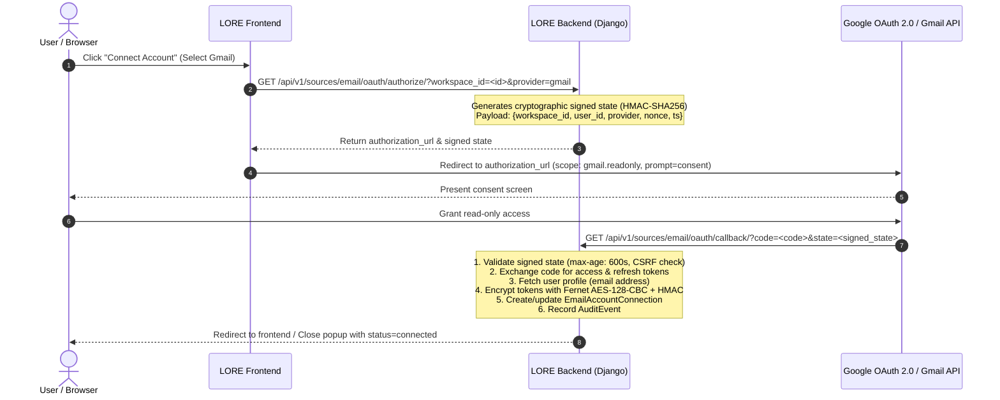

# LORE Secure Email Connector Architecture & Operational Guide

## 1. Overview & Provider Selection

This document specifies the architecture, security model, data flows, and configuration procedures for LORE's **Secure Email Connector**.

### Selected Provider: Google Workspace / Gmail
- **Provider Protocol**: Google OAuth 2.0 + Gmail REST API v1.
- **Provider-Neutral Foundation**: Implemented via `BaseEmailConnector` (`apps.sources.connectors.email_base`), allowing Microsoft 365 / Outlook or IMAP/Exchange connectors to be added without modifying the core ingestion, indexing, retrieval, or governance pipelines.
- **Single Provider Implementation**: Fully implemented, tested, and end-to-end verified with Google Workspace / Gmail (`GmailConnector` in `apps.sources.connectors.gmail`).

---

## 2. Core Non-Negotiable Architectural Principles

1. **Reuse Existing Pipelines**:
   Emails and extracted attachments flow through LORE's canonical `_ingest_single_file` pipeline. They are parsed, chunked, embedded into Qdrant/hybrid search, and indexed with full provenance without creating any disconnected email-only silos.
2. **Authority Rank 1 (Informal Note)**:
   In accordance with LORE Governance (§4 L6 Authority Matrix), all email communications and attachments are strictly assigned `authority_level = 1` (`informal_note`). Email statements cannot supersede corporate policies, signed contracts, or maintained procedures.
3. **Zero-Trust Privacy & L7 Visibility**:
   Email is private data. Each imported email and attachment document is assigned an L7 `SourcePermission` record (`AccessLevel.RESTRICTED`). Visibility is granted exclusively to the connecting user and workspace administrators. Other workspace members cannot retrieve or view email evidence chunks.
4. **Zero-Trust Credential Security**:
   User email passwords are never requested or stored. OAuth access and refresh tokens are encrypted at rest using Fernet authenticated encryption (AES-128-CBC + HMAC-SHA256). Tokens are never logged, serialized to the frontend, or returned in API representations.
5. **Deterministic Disconnect & Content Lifecycle**:
   Users can disconnect an account at any time. The system offers an explicit choice:
   - **Retain Content**: Indexed emails remain in the workspace under their existing restricted permissions, but synchronization halts.
   - **Purge Content**: All `SourceDocument` records and attachments tagged with `email_connection` are cascade-deleted immediately. Unrelated workspace documents remain untouched.

---

## 3. Data Models & Schema Design

### 3.1 `EmailAccountConnection` (`apps.sources.models`)
| Field | Type | Description |
| :--- | :--- | :--- |
| `id` | UUID (PK) | Unique connection identifier. |
| `organization` | ForeignKey | Owning organization for strict multi-tenant isolation. |
| `workspace` | ForeignKey | Owning workspace context. |
| `user` | ForeignKey | Connecting user (mailbox owner). |
| `provider` | CharField | Canonical provider (`gmail`, `outlook`). |
| `email_address` | CharField | Mailbox address (e.g. `alice@example.com`). |
| `status` | CharField | `connected`, `syncing`, `error`, `disconnected`. |
| `encrypted_access_token` | TextField | AES-128-CBC + HMAC-SHA256 ciphertext. |
| `encrypted_refresh_token` | TextField | AES-128-CBC + HMAC-SHA256 ciphertext. |
| `token_expires_at` | DateTimeField | Access token expiration timestamp. |
| `scopes` | JSONField | Granted OAuth scopes (`['https://www.googleapis.com/auth/gmail.readonly']`). |
| `sync_checkpoint` | JSONField | Resumable sync state (e.g. `{'last_synced_at': '...'}`). |
| `total_messages_synced` | PositiveInteger | Cumulative message count. |

### 3.2 `EmailSyncJob` (`apps.sources.models`)
Tracks every background or on-demand sync batch for observability and auditing:
- `connection`, `workspace`, `status` (`queued`, `running`, `completed`, `partial_success`, `failed`).
- `messages_detected`, `messages_imported`, `attachments_imported`.
- `errors` (JSON array of non-fatal warnings or attachment rejections).
- `started_at`, `completed_at`, `duration_ms`.

### 3.3 `SourceDocument` Provenance Extension
- `external_id`: Indexed string storing the provider message ID (`gmail:<msg_id>`). Enables instant duplicate prevention across sync runs.
- `email_connection`: ForeignKey linking imported email documents and attachments to the parent `EmailAccountConnection`. Enables surgical cascade deletion upon disconnect without affecting other workspace files.

---

## 4. OAuth 2.0 Connection Flow



---

## 5. Synchronization & Safe Processing

### 5.1 Query & Change Detection
- **Folder Exclusion**: Queries strictly filter out spam and trash: `q="-in:spam -in:trash"`.
- **Incremental Sync**: Uses `sync_checkpoint.last_synced_at` to construct `after:{timestamp - 300s}` queries with a 5-minute safety overlap to prevent clock skew data loss.
- **Duplicate Prevention**: Before ingesting any message, `SourceDocument.objects.filter(workspace=ws, external_id=external_id).exists()` ensures identical emails are never duplicated.

### 5.2 Content Sanitization & Security
- **Safe Base64url Decoding**: Implements RFC 4648 padding restoration and graceful error substitution.
- **HTML Sanitization**: BeautifulSoup strips `<script>`, `<style>`, `<iframe>`, `<object>`, `<embed>`, and `<noscript>` elements. Preserves clean text formatting and converts hyperlinks into readable Markdown `[text](url)`.
- **Attachment Controls**:
  - Size Limit: Attachments exceeding 25MB (`MAX_FILE_SIZE_BYTES`) are skipped with a logged warning.
  - Extension Whitelist: Only supported enterprise document types (`.pdf`, `.txt`, `.csv`, `.docx`, `.pptx`, `.md`, `.json`) are ingested. Disallowed files (`.exe`, `.bat`, `.sh`, etc.) are skipped.
  - Resilience: Attachment skipping does not abort the parent email message ingestion. The job records status as `partial_success` with explicit error logs.
- **Rate-Limit Handling**: Exponential backoff retry logic handles HTTP 429 and 503 responses gracefully.

---

## 6. Access Control & Retrieval Privacy

```
                                      [User Query: "Compensation Review"]
                                                      │
                                           [L7 Permission Layer]
                                                      │
                       ┌──────────────────────────────┴──────────────────────────────┐
                       ▼                                                             ▼
           [Connecting User (Alice)]                                    [Workspace Colleague (Bob)]
                       │                                                             │
        SourcePermission.is_user_permitted                               SourcePermission.is_user_permitted
             (Alice in allowed_users)                                        (Bob NOT in allowed_users)
                       │                                                             │
                  ✅ ALLOWED                                                     ❌ DENIED
                       │                                                             │
     Evidence Chunks Added to Model Context                         Private Email Chunks Filtered Out
```

---

## 7. Configuration & Environment Variables

Add the following environment variables to your `.env` file or deployment secret store:

```env
# LORE Email Connector Configuration
GMAIL_CLIENT_ID="<your-google-client-id>.apps.googleusercontent.com"
GMAIL_CLIENT_SECRET="<your-google-client-secret>"
GMAIL_REDIRECT_URI="http://localhost:8000/api/v1/sources/email/oauth/callback/"

# Optional custom 32-byte urlsafe base64 encryption key (defaults to derivation from SECRET_KEY)
CONNECTOR_ENCRYPTION_KEY=""
```

### Google Cloud Console Setup Steps:
1. Navigate to [Google Cloud Console](https://console.cloud.google.com/) -> **APIs & Services**.
2. Enable the **Gmail API**.
3. Go to **OAuth consent screen**:
   - Choose User Type: **Internal** (for Google Workspace) or **External**.
   - Add scope: `https://www.googleapis.com/auth/gmail.readonly`.
4. Go to **Credentials** -> **Create Credentials** -> **OAuth client ID**:
   - Application type: **Web application**.
   - Authorized redirect URIs: Add `http://localhost:8000/api/v1/sources/email/oauth/callback/` (and your production equivalent).
5. Copy the Client ID and Client Secret into your LORE configuration.
