# Lore — Project Overview

| Field | Value |
| --- | --- |
| Snapshot date | 2026-10-10 |
| Based on | `README.md`, [`PROJECT_CHARTER.md`](PROJECT_CHARTER.md) v1.0, [`LORE_ARCHITECTURE.md`](LORE_ARCHITECTURE.md) v2.0, [`PROJECT_REQUIREMENTS.md`](PROJECT_REQUIREMENTS.md) v1.0, the original project brief, [`docs/ide/`](ide/README.md), and the Go source in `cmd/` and `internal/` |
| Status legend used below | **Built** = works in the code today · **Partial** = a simpler stand-in exists · **Planned** = only in the design documents |

---

## 1. What is Lore?

Lore is a **governed knowledge server for AI coding agents**. It stores a team's rules, skills, procedures and the recorded conflicts between them as plain Markdown files in a `.lore/` folder. It serves them to any AI IDE through the **Model Context Protocol (MCP)**.

Before an agent edits a file, it asks Lore what applies. Lore does not return a pile of text. It returns a small, typed result:

- a **verdict** (is the knowledge consistent, conflicting, uncertain, or absent?)
- a **directive** (what the agent must do next)
- the **rule IDs** it relied on, with sources and confidence
- a **decision record** that can be traced later

Lore never settles a contradiction between rules on its own. It sends the question to a person.

> Tagline: *"Your lore, structured. Your AI, grounded."*
> Built for the International AI Builders Congress 2026 · InfraSphere AI · Knowledge Grid track.

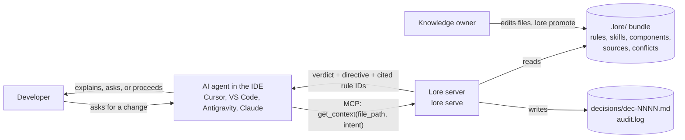

### Lore at a glance

| Aspect | Description |
| --- | --- |
| Product type | MCP server and CLI (single Go binary, `lore`) |
| Source of truth | OKF v0.2 bundle: Markdown files with YAML frontmatter in `.lore/` |
| Main question it answers | "Which governed rules apply to this file for this change, and do any of them disagree?" |
| Output contract | `lore.result/1` JSON envelope ([schema](https://github.com/starrynight-web/LORE/blob/dev/schemas/lore.result.v1.json), on the `dev` branch) plus a `<lore>` text block for agents |
| Token budget | At most 800 tokens and 8 items per result |
| Who decides conflicts | Always a person; never the LLM, never Lore |
| Roadmap | Personal Grid → Team Grid → Enterprise Grid |

### Shared vocabulary

Every surface (agent text, CLI, planned GUI) uses the same words.

| Verdict | Meaning | Directive | Human label |
| --- | --- | --- | --- |
| `denied` | Requester may not see this knowledge (Phase 3) | `stop` | Access denied |
| `violation` | A diff breaks a MUST / MUST NOT rule | `stop` | Violation |
| `conflict` | Active rules disagree; Lore will not choose | `ask_user` | Needs your decision |
| `abstain` | Evidence too uncertain to decide | `ask_user` | Lore can't verify |
| `ok_with_notes` | Consistent, with something to disclose (superseded, aging, exemption) | `proceed_and_cite` | Consistent, with notes |
| `ok` | Applicable rules found and consistent | `proceed_and_cite` | Consistent |
| `no_knowledge` | Nothing governed applies here | `proceed` | No rules apply |

Verdicts are listed in precedence order: when several apply, the higher one wins.

---

## 2. What does it aim to solve?

Organizational knowledge lives as **flat, version-less, often stale text** that AI systems cannot reason over. Developers make up for this by pasting context into every session. Enterprises live with answers built on outdated policies, and they have no audit trail.

### The developer's loop today

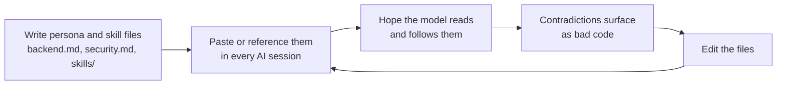

### Problems in detail

| # | Problem | Who feels it | Consequence | Lore's answer |
| --- | --- | --- | --- | --- |
| 1 | Knowledge is fragmented across files, chats, PDFs | Everyone | The AI sees a random subset | One governed bundle, mapped to code by component |
| 2 | No version control of rules | Developers, compliance | AI retrieves the 2025 policy instead of the 2026 one | `supersedes` chains, `effective_from/to`, `stale_after`; only the live version is served |
| 3 | Undetected contradictions | Teams | "Use raw SQL" vs "always parameterize": the model picks one at random | First-class conflict records; verdict `conflict` → `ask_user` |
| 4 | No decision lineage | Enterprises, auditors | "Why did the AI write it this way?" has no answer | Every `get_context` writes a decision record; `trace` explains it |
| 5 | Context explosion | Developers | 5–15k tokens of pasted context degrade model quality | At most 800 tokens of ranked, filtered rules |
| 6 | Untrusted knowledge treated as fact | Everyone | LLM-extracted or draft text steers code | Drafts, quarantine and unverified text never reach live context |
| 7 | Data sovereignty (Phase 3) | Regulated enterprises | EU data can't be queried from a US-hosted model | Residency tags, region router, `denied` verdict |
| 8 | Not available in every IDE | Developers | Each tool needs its own setup | Vendor-neutral MCP server |

Figures from the original brief (claims, not yet measured): **85–95 % fewer context tokens**, and rule compliance in AI-generated code rising from **~60 % to 95 %+**.

---

## 3. Who benefits from it?

### Personas

| ID | Persona | Surfaces | Key needs | What Lore gives them |
| --- | --- | --- | --- | --- |
| P-01 | Solo developer using AI IDEs | IDE (MCP), CLI, GUI | Correct context automatically, conflict warnings, low friction | `get_context` before every edit; no more pasting |
| P-02 | Team lead | GUI, CLI | Review drafts, resolve conflicts, capture decisions from git | Review queue, `lore promote`, conflict records, git-derived drafts (Phase 2) |
| P-03 | Knowledge / compliance owner | GUI | Authority, versions, lineage, residency audit | Authority ladder, version history, decision trace, sovereignty audit (Phase 3) |
| P-04 | AI agent (non-human) | MCP | Compact, unambiguous, typed results with next steps | `lore.result/1` envelope with verdict and directive |
| P-05 | Evaluator / judge | GUI, IDE | See grounding, conflicts, lineage and honesty in 3 minutes | Demo scenario, lineage explorer, metrics |

### Market segments and the wedge strategy

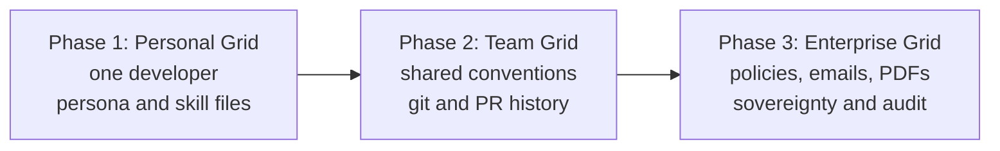

| Segment | Value proposition | Revenue path (from charter) |
| --- | --- | --- |
| Individual developers | Automatic context in any AI IDE; fewer tokens; higher rule compliance | Open-core, free |
| Startup and mid-market teams | Conflict-free shared conventions; decisions from git captured as knowledge | Team SaaS subscription |
| Regulated enterprises | Sovereign, auditable retrieval; policy contradictions flagged before harm | Enterprise licences, compliance packs (SOC 2, HIPAA, OWASP) |
| Ecosystem | IDE vendors, MCP ecosystem, cloud providers, integrators | Marketplace fees, partnerships |

"A developer is a team of one; an enterprise is a team at scale." One engine serves all three.

---

## 4. How does Lore solve their problem?

### Guiding principles

1. **Lore is the authority, not an LLM.** Deterministic code and typed judgments decide; LLMs only structure messy input.
2. **Precision over recall.** A false conflict is worse than a missed one. Abstain when unsure.
3. **Untrusted knowledge never reaches live context** until a person promotes it.
4. **One envelope, three renderers.** Agent text, CLI and GUI all show the same `lore.result/1`.
5. **The graph features are mandatory:** expansion, versioning, conflicts, lineage. Cut anything else first.

### End-to-end interaction (the demo scenario)

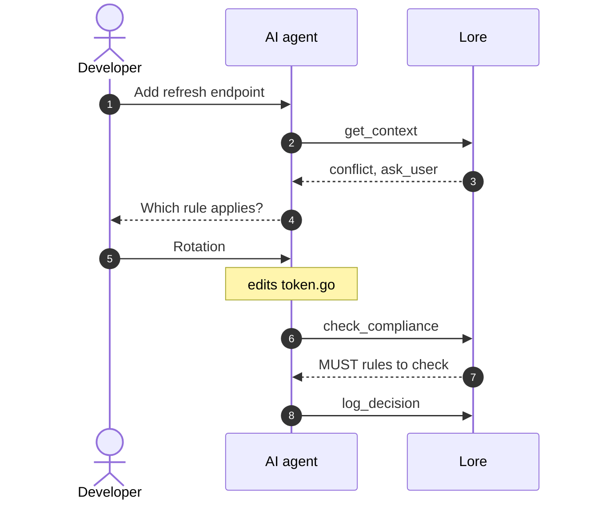

| Step | What happens |
| --- | --- |
| 1 | The developer asks: "Add a refresh-token endpoint in `src/auth/token.go`." |
| 2 | Before editing, the agent calls `get_context` with the file path and a one-line intent. |
| 3 | Lore matches the file to `component:auth`, filters and ranks the rules, and writes `dec-0001.md`. It returns `conflict` / `ask_user` because `conf-0031` is open: rotate on every use vs. 30-day static tokens. |
| 4 | The agent explains both rules neutrally and asks the developer to choose. It writes no refresh logic yet. |
| 5 | The developer picks rotation. The agent then edits `token.go`, citing the rule IDs it followed. |
| 6 | The agent calls `check_compliance` with its diff. |
| 7 | Lore returns the MUST rules the agent must check by hand: `abstain`, or `conflict` while `conf-0031` is still open. |
| 8 | The agent calls `log_decision`, and Lore appends the outcome to `dec-0001.md`. |

### Retrieval pipeline for `get_context`

The planned GraphRAG pipeline. Colours show what the code does today.

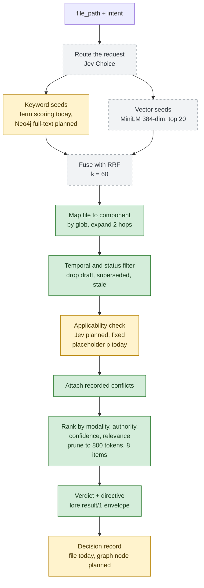

Green = Built · Yellow = Partial · Grey dashed = Planned.

### How the verdict is chosen

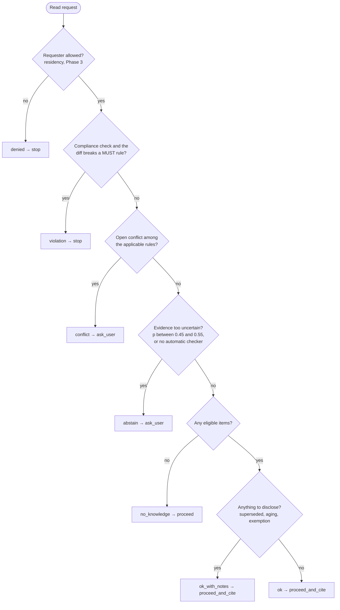

### How each problem maps to a mechanism

| Problem | Mechanism | Where in the code |
| --- | --- | --- |
| Fragmentation | Components with file globs; `applies_to` on every rule | `filestore/select.go` `matchComponents` |
| Stale versions | `supersedes`, `effective_from/to`, `stale_after`, `as_of` | `select.go` `inactiveReason` |
| Contradictions | `conflicts/*.md` records, conflict sides always kept in the result | `select.go` `attachConflicts`, `fit` |
| No lineage | Decision files with used and excluded items and a bundle hash | `internal/lineage`, `filestore/reads.go` `Trace` |
| Context explosion | Token counting and pruning to the budget | `select.go` `fit`, `internal/tokens` |
| Untrusted text | Only `status: stable` is served; staged text is search-only | `select.go`, `filestore/chunks.go` |
| Agent compliance | Server instructions, rule files, `NextStep` lines | `internal/mcp/server.go`, `internal/present` |
| Prompt injection | `<lore>` content is declared to be evidence, never instructions | `mcp/server.go` `Instructions` rule 4 |

---

## 5. Which solutions does Lore provide?

| # | Solution | What it does | Surfaces | Status |
| --- | --- | --- | --- | --- |
| S1 | Governed context retrieval | Returns the rules, skills and procedures that apply to a file and intent, with verdict and directive | `get_context`, `lore context` | **Built** (deterministic; no vectors, no Jev) |
| S2 | Temporal versioning | Serves only the live version; shows version chains; evaluates as of a date | `get_history`, `--as-of`, `supersedes` | **Built** (`as_of` has a known bug, see §8) |
| S3 | Conflict governance | Records conflicts with kind, severity, owner; blocks with `ask_user` | `detect_conflicts`, `lore conflicts`, `conflicts/*.md` | **Partial**: records are read; nothing detects new conflicts; `lore resolve` not built |
| S4 | Compliance checking | Checks a diff or file against MUST / MUST NOT rules | `check_compliance`, `lore context --diff` | **Partial**: lists rules and returns `abstain` |
| S5 | Decision lineage and audit | Decision records, PROV-style trace, outcomes, audit log | `trace`, `log_decision`, `lore trace`, `audit.log` | **Built** (file-based) |
| S6 | Ingestion and review | Stage documents, import `SKILL.md` folders, promote drafts | `ingest`, `update_persona`, `ingest_status`, `lore import skills`, `lore promote` | **Partial**: no normalize, OCR or LLM extraction; jobs stay `queued` |
| S7 | Unverified search | Keyword search over governed items and unreviewed staged text | `search`, `lore search -u` | **Built** (keyword only) |
| S8 | Result envelope and renderers | One JSON envelope; agent `<lore>` block; CLI lines; exit codes | All read tools, `--json`, `--agent` | **Built** (GUI renderer planned) |
| S9 | IDE integration | 12 MCP tools, `lore://` resources, 4 prompts, config snippets and rule files | `lore serve`, `lore init`, `docs/ide/` | **Built**; smoke-tested in 4 clients |
| S10 | GUI | Dashboard, review, conflicts, lineage explorer, try-context, search | `lore gui` (port 7420) | **Planned** |
| S11 | HTTP API | Shared API for GUI and CLI | `lore api` (port 7421) | **Planned** |
| S12 | Evaluation | Golden dataset, metrics against thresholds | `lore eval`, `testdata/golden/` | **Planned** |
| S13 | Team Grid slice | Git commits and PR comments become `git_derived` drafts | Git adapter, GUI activity list | **Planned** (Phase 2) |
| S14 | Enterprise PoCs | Enron/PDF ingestion, two-region residency router, Merkle inclusion proofs | GUI residency and proof panels | **Planned** (Phase 3) |

### Knowledge lifecycle (S2, S6)

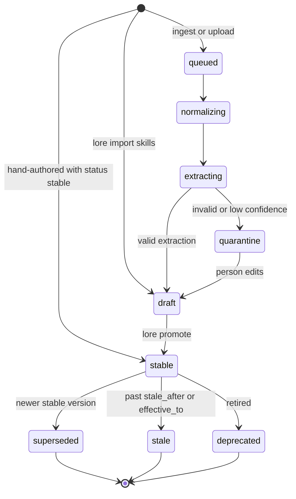

Only `stable` items reach `get_context` and `check_compliance`. The steps from `queued` to `extracting` need the worker, which is not built yet.

### Ingestion pipeline (S6)

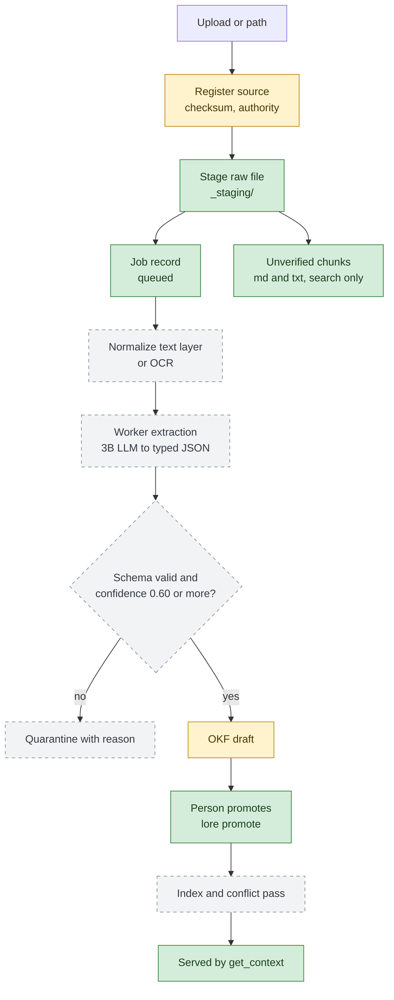

Skill import (`lore import skills`) already writes a source record and a draft entry. That is why "Register source" and "OKF draft" are shown as partial.

### Governance building blocks (S3)

**Authority ladder.** Set in config, never inferred by an LLM.

| Rank | Authority | Meaning | Served live? |
| --- | --- | --- | --- |
| 1 | `policy` | Approved organizational policy | Yes |
| 2 | `team_convention` | Approved project convention | Yes |
| 3 | `procedure` | Current maintained procedure | Yes |
| 4 | `reviewed` | Reviewed concept or derived rule | Yes |
| 5 | `draft` | Unreviewed or user-provided | No |
| 6 | `historical` | Expired or superseded | No (history and lineage only) |

**Conflict kinds.**

| Kind | Meaning | Planned detector |
| --- | --- | --- |
| `direct` | Same subject and conditions, incompatible outcomes | Deterministic allow/deny pairs + Jev |
| `partial` | Overlap for one scope, environment or role | Jev |
| `stale` | Older version disagrees with its active successor | Deterministic |
| `authority` | Disagreement with no valid precedence path | Deterministic ladder check |
| `extraction` | Contradiction may be an OCR or parsing error | Deterministic (`extraction_uncertain` flag) |
| `none` | Different scopes, windows, or an explicit `exempts` | Deterministic + Jev |

### Decision lineage (S5)

What `lore trace dec-0001` returns for the demo, drawn as a PROV graph:

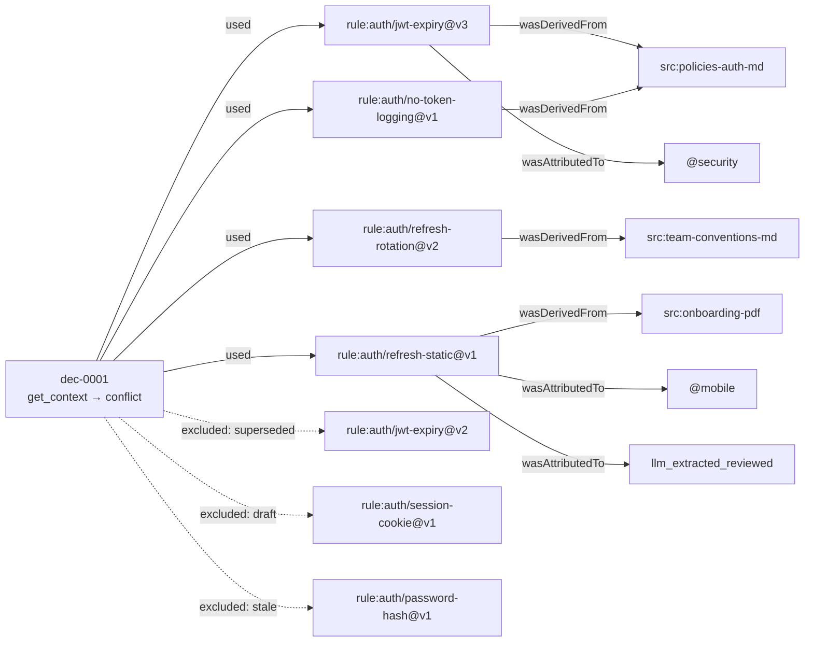

---

## 6. What technologies and frameworks does each solution need?

### Planned architecture (two-machine development setup)

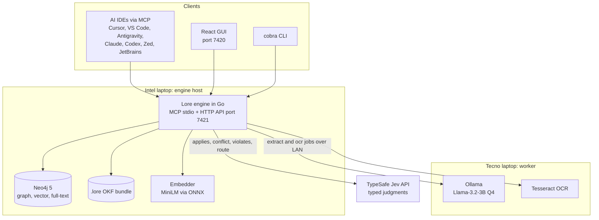

Only `lore serve` (MCP over stdio), the CLI and the `.lore/` bundle exist today. Everything else in this diagram is planned.

### Technologies per solution

| Solution | Planned technologies (design docs) | Used in the code today |
| --- | --- | --- |
| S1 Context retrieval | Neo4j 5 full-text and vector index; all-MiniLM-L6-v2 or bge-small via ONNX (`hugot` / `onnxruntime_go`); Reciprocal Rank Fusion; Jev `applies`; `tiktoken-go` | In-memory term matching (`internal/text`); `doublestar` globs; `tiktoken-go` with `cl100k_base`, offline |
| S2 Versioning | Neo4j `Version` nodes and `SUPERSEDES` edges; `go-git` for commit SHAs; `fsnotify` | OKF frontmatter fields; `yaml.v3`; `fsnotify` with a 300 ms debounced reload |
| S3 Conflicts | Deterministic Go checks; Jev `conflict_kind` (Choice) and `conflict_severity` (Score) | Hand-written `conflicts/*.md` only |
| S4 Compliance | Jev `violates` (yes/no probability) per diff hunk | Unified-diff parsing in Go; returns `abstain` |
| S5 Lineage | Neo4j `Decision` nodes with `USED_IN` / `EXCLUDED_IN`; W3C PROV shape; OpenTelemetry; Merkle proofs (Phase 3) | `decisions/dec-NNNN.md` via `yaml.v3`; IDs claimed with `O_EXCL`; PROV-shaped JSON; JSONL `audit.log` with argument hashes |
| S6 Ingestion | Ollama with Llama-3.2-3B Q4 (fallback Qwen2.5-3B); Tesseract; `pdftotext` or pure-Go PDF; Go or FastAPI worker; JSON Schema validation; DB-backed queue | File staging; JSON job files; `SKILL.md` importer with SHA-256 dedupe; `okf.SetField` for promotion |
| S7 Unverified search | Neo4j `Chunk` nodes with embeddings | Heading-aware chunker (1,600 chars, ⅛ overlap) over staged `.md`, `.txt`, `.mdx` |
| S8 Envelope | JSON Schema 2020-12; `santhosh-tekuri/jsonschema` | Same; schema embedded in the binary; `google/jsonschema-go` for tool input schemas |
| S9 MCP | `modelcontextprotocol/go-sdk`, stdio; Streamable HTTP + OAuth later; MCP Apps (`ui://`) | `go-sdk` v1.8.0 over stdio; in-memory transports in tests |
| S10 GUI | Vite + React + TypeScript; force-graph; dark theme; WCAG 2.2 AA | None |
| S11 HTTP API / CLI | `net/http` + `chi`; `cobra` | `cobra` v1.10.2 (no HTTP API) |
| S12 Evaluation | Go golden-dataset runner; CI gate | Unit and MCP integration tests; CI demo-scenario check |
| S13 Team Grid | `go-git` adapter for commits and PR comments | None |
| S14 Enterprise | EML/MBOX parsing (Enron); residency tags and router; Merkle trees; two AWS regions | `residency` field is parsed but unused |
| Observability | OpenTelemetry Go SDK; Prometheus `client_golang`; `slog` JSON; Jaeger and Grafana on AWS | `slog` text logs to stderr; `audit.log` |
| Delivery | Docker Compose; AWS demo stack; recorded backup video | GitHub Actions: `gofmt`, `go vet`, race tests, demo scenario, `govulncheck` |

### Current Go dependencies

| Module | Version | Purpose |
| --- | --- | --- |
| Go toolchain | 1.27.1 | Language |
| `github.com/modelcontextprotocol/go-sdk` | v1.8.0 | MCP server, tools, resources, prompts |
| `github.com/spf13/cobra` | v1.10.2 | CLI |
| `gopkg.in/yaml.v3` | v3.0.1 | OKF frontmatter, config, decision files |
| `github.com/fsnotify/fsnotify` | v1.10.1 | Reload the bundle on change |
| `github.com/bmatcuk/doublestar/v4` | v4.10.2 | `**` globs for components |
| `github.com/pkoukk/tiktoken-go` (+ offline loader) | v0.1.8 | Token counting for the 800-token budget |
| `github.com/santhosh-tekuri/jsonschema/v6` | v6.0.3 | Validate `lore.result/1` |
| `github.com/google/jsonschema-go` | v0.4.3 | Generate MCP tool input schemas |

---

## 7. What newer technologies could improve these solutions?

> These are **my recommendations**, not part of the project documents. They are based on tools I know of up to my training cutoff. Check current versions, licences and maturity before adopting any of them.

### By solution

| Solution | Today or planned | Newer option | Benefit | Trade-off |
| --- | --- | --- | --- | --- |
| S4 Compliance | Jev `violates`; `abstain` today | **Semgrep** or **ast-grep** patterns attached to each MUST rule (e.g. `no-token-logging` → "logger called with a token variable") | Turns many `abstain` results into real `violation`/`ok` verdicts, deterministically and offline | Someone must write a pattern per rule; covers code-shape rules only |
| Agent enforcement | Rule files and server instructions | **IDE agent hooks** (Claude Code `PreToolUse`, Cursor hooks) and a **git pre-commit hook** that runs `lore context --diff` and blocks on its exit code | The agent can't skip `get_context`; enforcement doesn't depend on the model obeying | Hook APIs differ per IDE |
| S1 Retrieval (personal tier) | Neo4j in Docker | **Bleve** (pure-Go BM25) + **chromem-go** (pure-Go embedded vector store) behind the existing `Store` interface | Keeps the single-binary, no-Docker install; adds real BM25 and vectors now | Less graph power; Neo4j still needed for Team/Enterprise scale |
| S1 Embeddings | all-MiniLM-L6-v2 / bge-small | **EmbeddingGemma**, **nomic-embed-text**, or **bge-m3** (multilingual) via `hugot` or the Ollama embeddings endpoint | Better recall on paraphrases; bge-m3 handles Bangla and other non-English sources | Larger models; more CPU per query |
| S1 Ranking | Rank by modality, authority, confidence | Local **cross-encoder reranker** (e.g. bge-reranker) via ONNX | Better ordering inside the 8-item cap | Extra 50–200 ms per query on CPU |
| S1/S2 Graph design | Custom Neo4j schema | Ideas from **Graphiti** (bi-temporal knowledge graph) and **LightRAG** / **Microsoft GraphRAG** | Proven designs for temporal edges and community summaries | Python-first; borrow the patterns, not the code |
| S6 Extraction | Llama-3.2-3B Q4 + JSON Schema validation | **Qwen3-4B** or **Gemma 3 4B** with **Ollama structured outputs** (JSON Schema passed as `format`) | Output is forced to match the schema, so fewer extractions fail and go to quarantine | 4B models are slower on the Tecno CPU than 3B |
| S6 Documents and OCR | Tesseract + `pdftotext` | **Docling** or **Marker** for layout-aware PDF parsing; **PaddleOCR** for scans | Keeps tables, headings and reading order, which makes anchors more accurate | Python services; heavier than Tesseract |
| S3 Conflicts | Jev Choice + Score | Local **NLI cross-encoder** (DeBERTa-v3 trained on MNLI) as a cheap pre-filter before Jev | Fewer Jev calls; an offline fallback when the Jev key is missing | NLI models are weaker on long, conditional rules |
| S9 MCP | stdio | **Streamable HTTP + OAuth 2.1**, **elicitation** for `resolve_conflict`, **MCP Apps** for `ui://lore/result`, listing in the **MCP Registry** | Remote and team use; a human-confirmed resolve flow; rich result cards inside the IDE | Auth and hosting work |
| S14 Residency | Custom router | **OPA (Rego)** or **Cedar** policies | Auditable, testable access policies instead of hand-written checks | One more policy language to learn |
| S14 Provenance | Custom Merkle proofs | Transparency-log tooling (**Trillian / Tessera**, **Sigstore Rekor**) with RFC 6962 inclusion proofs | Standard, verifiable proofs; less custom crypto | Running a log is extra infrastructure |
| S10 GUI lineage | force-graph | **React Flow (xyflow)** or **Cytoscape.js**, with **shadcn/ui** components | Readable directed PROV graphs; accessible UI building blocks | Bundle size |
| S13 Team sync (roadmap) | CRDT sync | **Automerge**, **Yjs**, or the **Loro** CRDT library | Offline-first shared bundles | Note the name clash: a CRDT library is already called "Loro" |
| Observability | OpenTelemetry | **OpenTelemetry GenAI semantic conventions** for Jev and LLM spans | Token, latency and cost metrics in a standard shape | Conventions are still evolving |
| S12 Evaluation | Custom `lore eval` | **promptfoo**, **Ragas** or **DeepEval** alongside the Go runner | Ready-made retrieval and faithfulness metrics; agent-behaviour tests | Mostly Python or Node |
| Token counting | `cl100k_base` | Add **`o200k_base`**; treat counts as estimates for Claude and Gemini | Closer to newer OpenAI models | Still approximate for other vendors |

### Suggested order, given the Oct 31 deadline

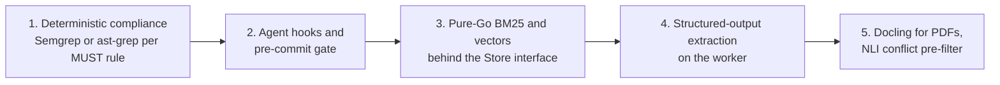

Items 1–3 need no new infrastructure and directly improve the demo: real violations, enforced calls and better recall. Items 4–5 depend on the worker being up.

---

## 8. Other important information

### Current status (2026-10-10, week 2 of the plan)

| Layer | Planned component | Status |
| --- | --- | --- |
| Access | MCP server (stdio) | Built: 12 tools, 7 resource templates, 4 prompts |
| Access | CLI | Partial: `serve`, `init`, `context`, `search`, `conflicts`, `import skills`, `promote`, `stats`, `trace`, `version` |
| Access | HTTP API, GUI | Planned |
| Knowledge | OKF bundle parse/write | Built |
| Knowledge | Neo4j graph and indexes | Planned (the `Store` interface is ready for it) |
| Retrieval | Deterministic filters, expansion, ranking, budget | Built |
| Retrieval | Embeddings, vector seeds, RRF | Planned |
| Decision | Jev integration | Planned; fixed placeholder confidences are used instead |
| Decision | Conflict detection | Planned; recorded conflicts only |
| Ingestion | Worker, OCR, extraction, quarantine | Planned |
| Lineage | Decision files, trace, outcomes, audit log | Built |
| Quality | Unit and MCP integration tests | Built: 37 tests, all passing |
| Quality | Golden dataset and `lore eval` | Planned |

### Timeline

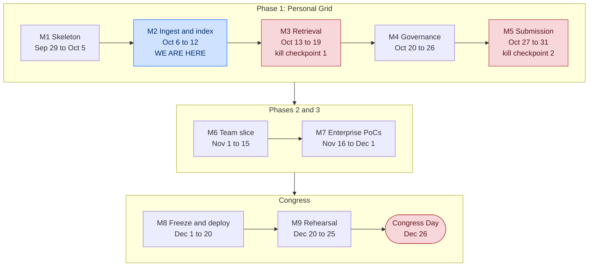

Blue = current week · Red = deadline or kill checkpoint.

**Kill criteria.** If graph retrieval isn't working by **Oct 19**, cut back to one IDE and two persona files, and make one conflict detection and one lineage trace flawless. If the full pipeline isn't end to end by **Oct 31**, freeze features and spend the next week on demo reliability and metrics.

### Competition and judging

| Criterion | Weight | How Lore plans to score |
| --- | --- | --- |
| Innovation | 20 % | Conflicts, temporal versions, verdicts and lineage in one graph, exposed through MCP |
| Technical execution | 20 % | Hybrid GraphRAG in Neo4j, Go engine, typed Jev decisions, working MCP, golden metrics |
| Business model and global readiness | 20 % | Open-core → team SaaS → enterprise licences; multi-region design |
| Real-world impact and ethical AI | 20 % | Audit trail, abstain-first governance, quarantine, residency audit, honest "ZKP-lite" wording |
| Scalability and NRB collaboration | 10 % | Two-region PoC, AWS demo, a defined role for the NRB collaborator |
| Presentation | 10 % | GUI lineage explorer and result card carry the 3-minute pitch |

Team rule: 3–5 builders plus 1 NRB (Non-Resident Bangladeshi) or international collaborator. Pitch format: 3 minutes in front of at least 5 judges.

### Team, hardware and budget

| Role | Owns |
| --- | --- |
| Project Manager (Golam Morshed Eashan) | Scope, schedule, risks, submissions, pitch |
| Lead Engineer — Engine | Go engine, Neo4j, retrieval, governance, MCP, API, CLI, CI |
| AI / Worker Engineer | Ollama + OCR worker, extraction prompts, Jev questions and thresholds |
| Frontend Engineer | React GUI, result card, lineage explorer, accessibility |
| Data, QA and Demo Lead | Starter pack, golden dataset, `lore eval`, demo bundle, backup video |
| NRB collaborator | Governance and sovereignty review, global go-to-market, pitch support |

| Machine | Specs | Role |
| --- | --- | --- |
| Intel laptop | i5-12450H, 16 GB, CachyOS | Engine, Neo4j, GUI, CLI, IDE |
| Tecno MEGABOOK K15S | Ryzen 5 7430U, 16 GB | Worker only: Ollama 3B Q4 + Tesseract |

Estimated budget: **≈ US$75–190** in total (Jev < $5, AWS $50–150, optional cloud LLM ≤ $20, extras ≤ $15).

### Top risks

| Risk | Level | Mitigation |
| --- | --- | --- |
| Looks like "another RAG wrapper" | Existential | Lead the pitch with the conflict verdict and lineage; graph features are mandatory |
| LLM extraction quality | Existential | JSON Schema, quarantine, human promotion; hand-authored starter pack for the demo |
| Deadline slip | Existential | Weekly Friday end-to-end demo; kill criteria |
| Conflict false positives | High | Deterministic kinds first; Jev confidence ≥ 0.70; abstain band |
| Live demo failure | High | Pre-seeded mode; AWS + Docker fallback; recorded backup; never live-extract on stage |
| Jev unavailable | Medium | Cache plus a deterministic fallback that returns `abstain` instead of guessing |
| Overclaiming ZKP | Medium (reputation) | Say "Merkle inclusion proof / ZKP-lite", reviewed by the NRB |

### Key configuration constants (`lore.config.yaml`)

| Key | Default | Used today? |
| --- | --- | --- |
| `token_budget` / `max_items` | 800 / 8 | Yes |
| `graph_hops` | 2 | Yes |
| `aging_window_days` | 14 | Yes |
| `tool_timeout_seconds` | 10 | Yes |
| `max_upload_mb` / `search_limit` | 50 / 20 | Yes |
| `abstain_band` / `conflict_min_confidence` | [0.45, 0.55] / 0.70 | Only echoed in results |
| `keyword_top_k` / `vector_top_k` / `rrf_k` | 20 / 20 / 60 | No (needs Neo4j) |
| `confidence.high` / `confidence.medium_min` | 0.80 / 0.55 | No (the 0.80 band cut-off is hard-coded) |
| `extract_min_confidence` / `ocr_min_confidence` | 0.60 / 0.80 | No (needs the worker) |
| `ports.gui` / `ports.api` / `ports.worker` | 7420 / 7421 / 8080 | No |

### IDE compatibility (smoke tests on 2026-10-08)

| Client | Status | Notes |
| --- | --- | --- |
| Cursor | Passed | Reads `.cursor/mcp.json` only at the workspace root; ran `log_decision` without asking for approval |
| VS Code (Copilot agent) | Passed | The first run labelled one option "Recommended"; the wording was fixed so options are presented neutrally |
| Google Antigravity | Passed | Ignores the workspace MCP config; use `~/.gemini/config/mcp_config.json` |
| Claude Desktop | Passed (chat only) | Can't edit files; reads its config only at startup |
| Claude Code, Codex, Devin, JetBrains, Zed | Config examples only | Not verified |

### Known gaps and mismatches between code and documents

| Area | Documents say | Code does |
| --- | --- | --- |
| CLI exit codes | 3 = conflict / violation / denied; 4 = abstain | 3 = `ask_user` (conflict, abstain); 4 = `stop` (violation, denied) |
| `as_of` queries | Return the version active at that date | A rule replaced by a newer version is excluded even before the newer one takes effect. Example: on 2025-06-01, neither `jwt-expiry@v2` nor `@v3` is served |
| Prompt arguments | `answer_with_lore(task)`, `explain_conflict(conflict_id)`, `prepare_review_packet(scope)` | `answer_with_lore(question, file_path)`, `explain_conflict(scope)`, `prepare_review_packet(decision_id)` |
| Tool field names | `get_context(file_path, task_intent)` | `get_context(file_path, intent)` |
| Missing CLI commands | `resolve`, `reject`, `check`, `history`, `index`, `ingest`, `eval`, `api`, `gui`, `review list` | Not implemented |
| Confidence | Jev probabilities mapped to bands | Fixed values: 0.92, 0.82, 0.70, 0.66 |
| Test coverage | ≥ 80 % for core packages | `filestore` 77.7 %, `mcp` 85.6 %, `okf` 58.9 %, `result` 61.5 %; `cmd/lore`, `review`, `text`, `tokens` have no tests |
### Repository layout

```text
Lore/
├── cmd/lore/                  CLI entry point: serve, init, context, search, conflicts, import, promote, stats, trace
├── internal/
│   ├── mcp/                   MCP tools, resources, prompts, audit log, idempotency
│   ├── store/                 Store interface (shared by future Neo4j/Jev engine)
│   │   └── filestore/         In-memory engine over .lore/: retrieval, writes, chunks, resources
│   ├── okf/                   OKF v0.2 parse and write
│   ├── result/                lore.result/1 envelope and schema validation
│   ├── present/               Agent <lore> block and CLI rendering
│   ├── lineage/               Decision records
│   ├── importer/skills/       SKILL.md folder importer
│   ├── review/                Human-only promote action
│   ├── config/                lore.config.yaml and root discovery
│   ├── chunk/ text/ tokens/   Chunking, keyword terms, token counting
│   └── demo/bundle/           Embedded demo .lore bundle
├── schemas/                   lore.result.v1.json (embedded)
├── examples/demo-app/         Ready-made workspace with configs for Cursor, VS Code, Antigravity
└── docs/
    ├── ide/                   Per-IDE setup, smoke test, compatibility matrix
    ├── LORE_OVERVIEW.md       This document
    ├── LORE_ARCHITECTURE.md   Locked architecture v2.0
    ├── PROJECT_CHARTER.md     Charter v1.0
    └── PROJECT_REQUIREMENTS.md  Requirements v1.0
```

### Try it

```bash
go install ./cmd/lore
cp -r examples/demo-app /tmp/lore-demo && cd /tmp/lore-demo
lore context --file src/auth/token.go --intent "add a refresh token endpoint"   # conflict, exit 3
lore context --file src/auth/token.go --intent "add a refresh token endpoint" --agent   # what the agent sees
lore trace dec-0001
```
