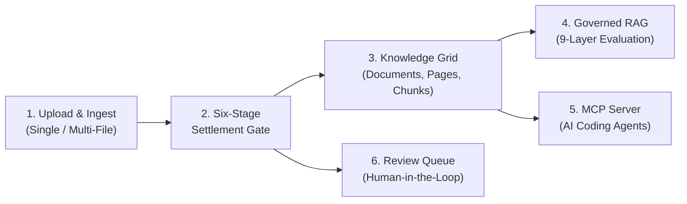
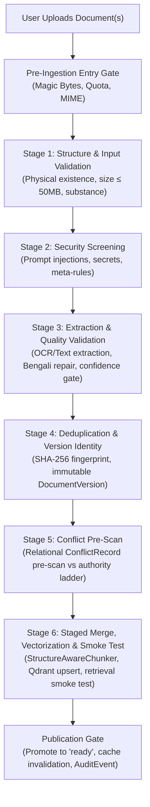
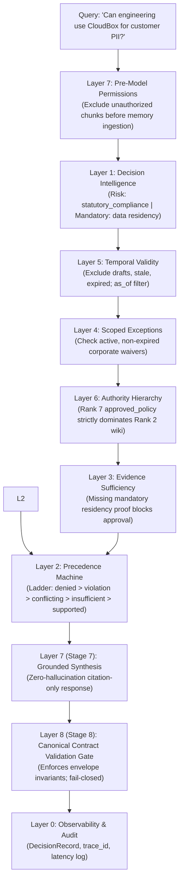

# LORE Enterprise — User Manual & Comprehensive Operational Workflow
> **Model-Minimal, Customer-Deployed Governed Knowledge Grid & Model Context Protocol (MCP) Server**  
> *"Your lore, structured. Your AI, grounded."*

---

## 1. System Overview & Core Philosophy

**LORE Enterprise** is an airgap-capable, governed knowledge platform and **Model Context Protocol (MCP)** server built for high-stakes enterprise engineering teams and autonomous AI coding agents (Google Antigravity, Cursor, Claude Desktop, VS Code Copilot).

Traditional Retrieval-Augmented Generation (RAG) platforms dump unverified document snippets into an LLM context window. This creates critical operational risks:
1. **Context Contamination & Hallucinations**: Multiple documents sharing generic titles or overlapping chunks.
2. **Authority Blindness**: An informal Slack note contradicting and overriding an official signed security policy.
3. **Ghost / Stale Policies**: Expired or draft documents continuing to influence generation.
4. **Missing Evidence Oversight**: Approving high-risk actions without mandatory contractual or security prerequisites.

LORE solves this by executing two strict, deterministic multi-stage pipelines:
- **Write Path (Ingestion & Settlement Gate)**: A 6-stage verification gate that screens, extracts, phonetically normalizes, deduplicates, and vectorizes incoming documents with atomic rollback and post-merge verification smoke tests.
- **Read Path (9-Layer Deterministic Governance Engine)**: A 9-layer evaluation machine between retrieval and generation that enforces authority rank dominance, temporal validity, scoped exceptions, and evidence sufficiency, emitting typed verdicts (`supported`, `qualified`, `conflicting`, `insufficient`, `violation`, `denied`) and strict citations.

---

## 2. End-to-End User Manual & UI Workflows



### 2.1 Accessing the Application
- **Web Console**: Navigate to [http://localhost:3000](http://localhost:3000) (Next.js 16 Console).
- **Backend API & Swagger**: Live at [http://127.0.0.1:8000](http://127.0.0.1:8000) (Django 4.2 REST Framework).
- **Development Guest Mode**: When running with `DEBUG=True`, guest authentication is enabled by default. Visitors automatically assume the `admin@northstar.demo` role in the default workspace.

---

### 2.2 Uploading Documents (Multi-File & Multi-Format)

LORE supports simultaneous multi-file upload across diverse formats without cross-document pollution or retrieval hallucination.

#### Supported File Formats:
| Format Group | Extensions | Ingestion & Extraction Engine |
| :--- | :--- | :--- |
| **PDF Documents** | `.pdf` | Dual-stream: `pdfplumber` (digital stream) or 300 DPI raster OCR (`pypdfium2` + Tesseract 5.4) |
| **Word Processing** | `.docx`, `.doc` | `python-docx` structured heading & table parser |
| **Spreadsheets & Data** | `.xlsx`, `.xls`, `.csv` | `openpyxl` sheet parser & native CSV tabular parser |
| **Presentations** | `.pptx`, `.ppt` | XML slide parser extracting structured slide headings & bullets |
| **Scanned Docs & Images** | `.png`, `.jpg`, `.jpeg`, `.tiff`, `.tif`, `.webp` | High-resolution PIL & Tesseract OCR with pixel bounding boxes |
| **Web & Structured Text** | `.html`, `.htm` | `BeautifulSoup` semantic extractor (strips `<script>` and `<style>` to prevent injection) |
| **Prose & Plaintext** | `.md`, `.markdown`, `.txt` | Native UTF-8 normalizer preserving Markdown hierarchy |

#### Step-by-Step Upload Workflow:
1. **Open Upload Dialog**: Click the **"Upload Document"** button in the top navigation bar or the Overview screen.
2. **Select or Drag Files**: Drag and drop one or dozens of files simultaneously into the dashed dropzone, or click **"browse from computer"**.
3. **Review Queued Files**:
   - Each file displays a format pill (`PDF`, `DOCX`, `XLSX`, `CSV`, `PPTX`, `TIFF`, etc.), file size, and calculated SHA-256 fingerprint.
   - **Anti-Hallucination Title Grounding**: Each file provides its own distinct title input (defaulting to the file's natural name). You can customize each title individually so contextual chunk headers anchor specifically to that document.
   - **Append or Remove**: Click **"+ Add more files"** to queue more documents, or click the trash icon next to any file to exclude it.
4. **Configure Governance Metadata**:
   - **Target Collection**: Assign the batch to a specific workspace collection (e.g. *Cloud Policies*, *Vendor Assessments*, *Executed Contracts*) or choose *Default Collection*.
   - **Source Authority Ladder (LORE L6)**: Select the legal authority rank (Rank 1 through 7) for the uploaded documents.
   - **Batch Notes**: Optionally enter ingestion notes.
5. **Start Ingestion**: Click **"Start Ingestion Pipeline"**. Live progress tracks each file through uploading and the Six-Stage Settlement Gate.

---

### 2.3 The Source Authority Ladder (Precedence Ranking)

Every document ingested into LORE is assigned an authority rank on the 7-level governance ladder:

| Rank | Level Name | Typical Document Type | Governance Effect |
| :---: | :--- | :--- | :--- |
| **7** | `approved_policy` | CISO signed security policies, board bylaws | Highest priority; strictly dominates Ranks 1–6 in conflicts |
| **6** | `signed_contract` | Executed vendor agreements, NDAs, DPAs | Legally binding obligations; overrides internal procedures |
| **5** | `team_convention` | Architecture Decision Records (ADRs), conventions | Official engineering and architectural standards |
| **4** | `maintained_procedure` | Runbooks, SOPs, step-by-step guides | Operational procedures; subordinated to signed policies |
| **3** | `reviewed_document` | Internal technical specifications, PRDs | Reviewed internal documentation |
| **2** | `wiki_entry` | Engineering wiki pages, Confluence posts | Provisional information; requires corroboration |
| **1** | `informal_note` | Meeting notes, Slack messages, memo drafts | Lowest priority; cannot override any formal document |

---

### 2.4 Navigating the Workspaces & Tools

- **Knowledge Grid ([/documents](file:///e:/LORE/frontend/src/app/page.tsx))**:
  - Browse documents, filter by collection, status (`ready`, `needs_review`, `quarantined`), or document format.
  - Click any document to view its metadata, extracted pages, token metrics, and generated vector chunks.
- **Realtime OCR Studio**:
  - Inspect pixel-accurate visual bounding box overlays for scanned documents and images.
  - Real-time Bengali visual phonetic syllable repair (correcting legacy Bijoy/SutonnyMJ font corruptions).
  - Inspect character confidence levels and token bounding coordinates.
- **Governed RAG Studio**:
  - Test queries against enterprise documents.
  - View the live 9-layer governance telemetry, cited snippets with character offsets, and authority dominance reasoning.
- **Review Queue**:
  - Staged human-in-the-loop review for documents flagged with low OCR confidence ($< 70\%$), detected contradictions, or quarantined prompt injections.
- **Audit & Lineage Explorer**:
  - Full cryptographic audit log tracking every `document_uploaded`, `ocr_completed`, `ingestion_completed`, and `retrieval_query` event with end-to-end `trace_id` lineage.

---

## 3. What Happens After Upload: Layer-by-Layer Settlement Gate

When files are submitted, LORE executes the **Six-Stage Settlement Gate** ([backend/apps/ingestion/settlement.py](file:///e:/LORE/backend/apps/ingestion/settlement.py)).



### Stage 1: Structure and Input Validation
- **Physical File & Stream Verification**: Confirms file presence on disk or S3/MinIO blob storage.
- **File Size Validation**: Enforces maximum upload ceiling (default $\le 50\text{ MB}$).
- **Magic Bytes Verification**: Inspects the first 2,048 bytes of the file stream to detect actual binary format rather than trusting the user's extension (e.g. `%PDF` for PDF, `PK\x03\x04` for Office OpenXML zip files, `\x89PNG` for PNG, `II*\x00` / `MM\x00*` for TIFF).
- **Substance Check**: Rejects empty files ($0\text{ bytes}$) with reason code `S1_EMPTY_OR_ZERO_SUBSTANCE`.

### Stage 2: Security Screening & Threat Sanitization
- **Prompt Injection Defense**: Evaluates raw content against adversarial injection patterns (e.g. *"ignore previous instructions"*, *"system prompt override"*, *"you are now unrestricted"*).
- **Credential & Secret Detection**: Scans for leaked cryptographic private keys, AWS access keys, GitHub personal access tokens, and API credentials.
- **Meta-Rule Creep Prevention**: Blocks text that attempts to redefine LORE's internal governance rules or simulate system commands.
- **Action**: Any detected threat flags the document and routes it to `quarantined` with reason code `S2_INJECTION_DETECTED` or `S2_SECRETS_EXPOSED`.

### Stage 3: Extraction, Groundedness & Quality Validation
- **Extractor Dispatch**:
  - Digital PDFs are extracted via `pdfplumber` retaining character coordinates.
  - Scanned pages ($\le 20$ characters of digital text) trigger 300 DPI rendering (`pypdfium2`) and Tesseract 5.4 OCR with contrast enhancement.
  - DOCX, XLSX, CSV, PPTX, and HTML files are extracted via their dedicated parsers.
- **Phonetic Normalization**:
  - Legacy Bengali font reconstruction repairs visual-order vowels (E-kar, I-kar) into valid Unicode.
  - Converts Bengali numerals to Arabic digits.
- **Substance & Groundedness Metric**:
  - Documents with zero extractable words are flagged `S3_EMPTY_EXTRACTION`.
  - Scanned documents with average OCR confidence $< 0.70$ are routed to `needs_review` (`S3_LOW_CONFIDENCE_QUARANTINE`).

### Stage 4: Deduplication & Version Identity
- **Cryptographic Hashing**: Computes full SHA-256 fingerprint of the document stream.
- **Exact Match Deduplication**: If an identical document (`file_hash`) already exists in the workspace:
  - If identical: Idempotently returns the existing document without creating duplicate vector chunks.
  - If modified content with same title/path: Increments `current_version_number` and creates an immutable `DocumentVersion` record.
- **Stale Worker Guard**: Re-reads database state before committing. If a newer document version was registered while a background worker was extracting, the stale worker immediately aborts (`S4_STALE_WORKER_ABORTED`).

### Stage 5: Conflict Pre-Scan
- **Relational Conflict Pre-Scan**: Evaluates the document's authority rank ($1 \le \text{Rank} \le 7$) against existing workspace documents in the same domain.
- **Contradiction Detection**: If an existing approved policy or signed contract covers the same policy domain, LORE registers a `ConflictRecord` in the database.
- **Authority Dominance**: High-rank policies dominate lower-rank procedures; equal-rank conflicts trigger review notifications for human operators.

### Stage 6: Staged Merge, Vectorization, Smoke Test & Publication
- **Structure-Aware Chunking ([StructureAwareChunker](file:///e:/LORE/backend/apps/knowledge/chunking.py))**:
  - Targets 400-token chunks with 50-token overlap, preserving heading hierarchies (`# Heading 1`, `## Heading 2`).
  - **Contextual RAG 2.0 Breadcrumb**: Prepends an explicit contextual header to every chunk:
    ```
    Document: POL-SEC-041: Cloud Security Policy v3.0 | Organization: Northstar Digital | Workspace: Governance | Page: 1 | Section: 1. Scope & Core Directives | Authority Rank: 7
    ```
    *This guarantees that every chunk maintains sovereign attribution, mathematically preventing vector search from confusing chunks across documents.*
- **Dense Vector Embedding Generation**:
  - Chunks are vectorized using `all-MiniLM-L6-v2` (384 dimensions) via local SentenceTransformers.
- **Atomic Vector Store Upsert**:
  - Chunks are upserted into Qdrant (`lore_chunks`) with metadata payloads (tenant ID, workspace ID, document ID, collection ID, authority rank).
- **Post-Merge Retrieval Smoke Test**:
  - Immediately executes an internal vector retrieval query for the newly upserted document ID.
  - **Automatic Rollback**: If the smoke test returns 0 hits, LORE triggers auto-rollback (`S6_ROLLBACK_EXECUTED`), removing any partial points and resetting document status to `failed`.
- **Publication Gate & Cache Invalidation**:
  - Document status transitions to `ready`.
  - `TenantSafeCacheService` purges the workspace query cache.
  - An immutable `AuditEvent` (`document_uploaded` / `ingestion_completed`) is logged with full SHA-256 and duration metrics.

---

## 4. Query Execution: The 9-Layer Deterministic Governance Engine

When an agent or user queries LORE via GUI, REST API (`/api/v1/retrieval/query/`), or MCP (`lore.get_context`), LORE processes the retrieved chunks through the **9-Layer Deterministic Governance Engine** ([backend/apps/governance/layers.py](file:///e:/LORE/backend/apps/governance/layers.py)).



### Layer Breakdown:
1. **L7 — Pre-Model Permission Layer**: Verifies user workspace permissions. Any chunks from workspaces or collections the user cannot access are pruned *before* entering model memory.
2. **L1 — Decision Intelligence**: Classifies query risk (`statutory_compliance`, `vendor_approval`, `data_processing`, `deployment_approval`, `code_change`, `general_inquiry`). Determines required mandatory evidence types.
3. **L5 — Temporal Validity**: Excludes unapproved drafts, quarantined files, and expired policies. Supports point-in-time historical reconstruction via `as_of` parameters.
4. **L4 — Scoped Exceptions**: Checks if any time-bounded corporate waivers exist (e.g. temporary vendor migration exceptions). Any applied exception is disclosed in the result envelope.
5. **L6 — Authority Hierarchy & Conflict Ladder**: Compares competing chunks. A Rank 7 `approved_policy` strictly dominates a Rank 2 `wiki_entry` or Rank 1 `informal_note`. Equal-rank contradictions are marked `conflicting` $\to$ `ask_user` (LORE never hallucinates a tie-breaker).
6. **L3 — Evidence Sufficiency**: Enforces mandatory evidence prerequisites. If a query requires data residency proof and no executed addendum exists, positive approval is mathematically impossible.
7. **L2 — Answer-State Precedence Machine**: Deterministic state machine enforcing strict precedence:
   $$\text{denied} > \text{violation} > \text{conflicting} > \text{insufficient} > \text{qualified} > \text{supported}$$
8. **Stage 7 — Grounded Zero-Hallucination Synthesis**: Generates the final answer strictly grounded in the cited chunks, including page numbers and exact character offsets.
9. **Stage 8 — Canonical Contract Validation Gate**: Validates that all result envelope invariants (`verdict`, `directive`, `confidence`, `citations`) match the canonical contract.
10. **L0 — Observability & Lineage**: Records a `DecisionRecord` containing the input query, verdict, cited chunk UUIDs, applied exceptions, and sub-millisecond stage latencies with an end-to-end `trace_id`.

---

## 5. Model Context Protocol (MCP) Server Integration

LORE includes a production MCP server ([backend/mcp_server.py](file:///e:/LORE/backend/mcp_server.py)) communicating over JSON-RPC stdio.

### Available MCP Tools for Coding Agents:
| Tool Name | Parameters | Purpose |
| :--- | :--- | :--- |
| `lore.get_context` | `query`, `workspace_id`, `risk_level` | Returns governed context with strict citations, verdict, and directives. |
| `lore.search` | `query`, `limit`, `collection_id` | Hybrid lexical (BM25) and dense vector search across workspace knowledge. |
| `lore.check_compliance` | `action_description`, `workspace_id` | Validates proposed code or architectural change against active enterprise policies. |
| `lore.get_authority_info` | `document_id` | Inspects legal authority rank, supersession chains, and conflict records. |
| `lore.query_as_of` | `query`, `as_of_timestamp` | Reconstructs historical policy state for point-in-time compliance audits. |
| `lore.get_active_exceptions` | `domain`, `workspace_id` | Retrieves active time-bounded corporate waivers. |
| `lore.escalate_to_human` | `reason`, `context` | Routes an ambiguous or conflicting decision to the human review queue. |
| `lore.ocr_extract` | `file_path`, `repair_bengali` | Invokes the dual-stream OCR pipeline directly on a scanned document. |

---

## 6. Common Operational Scenarios

### 6.1 Uploading a Batch of Diverse Enterprise Files
1. Open [http://localhost:3000](http://localhost:3000).
2. Click **"Upload Document"**.
3. Select multiple files at once (e.g. `Security_Policy.pdf`, `Vendor_Audit.xlsx`, `Contracts.docx`, `Notes.txt`).
4. Review the distinct titles assigned to each file. Adjust names if desired.
5. Select the target collection and authority rank (e.g. Rank 7 for Policies, Rank 6 for Contracts).
6. Click **"Start Ingestion Pipeline"**.
7. Watch real-time progress. Upon completion, all documents are immediately available in the Knowledge Grid.

### 6.2 Testing Policy Compliance via RAG
1. In the sidebar, select **"Governed RAG"**.
2. Enter a compliance query, for example:
   > *"Can engineering use CloudBox for storing customer PII?"*
3. Inspect the response envelope:
   - **Verdict**: `violation` or `denied`
   - **Directive**: `stop`
   - **Reasoning**: Cites `POL-SEC-041: Cloud Security Policy v3.0` (Rank 7) which prohibits customer PII on CloudBox without verified regional data residency.
   - **Conflict Resolution Telemetry**: Notes that `Engineering Wiki Entry` (Rank 2) permitted CloudBox, but was subordinated by Rank 7 policy dominance.

### 6.3 Inspecting Audit Lineage
1. In the sidebar, select **"Audit Trail"**.
2. Filter by event type (`document_uploaded`, `retrieval_query`, `decision_recorded`).
3. Click any entry to inspect its exact `trace_id`, execution duration (in milliseconds), evaluated chunks, and cryptographic SHA-256 hashes.
