# LORE Enterprise — P1–P4 Implementation Plan
**Document Version:** 1.0 (Master Execution Plan)  
**Target:** LORE Enterprise Knowledge Governance, Data Lifecycle, Evaluation & Integrations  
**Immediate Execution Focus:** **P1 — Governance Correctness and Anti-Hallucination**  
**Specification References:** `lore.md` (v3.0), `ICAIB_Knowledge_Grid_Enterprise_Research.pdf`, `PROJECT_REQUIREMENTS.md`

---

## 1. Executive Summary & Scope

LORE Enterprise is an enterprise knowledge-governance platform designed to deliver deterministically grounded, policy-governed context to AI agents and human operators without hallucination.

This plan addresses **P1, P2, P3, and P4** of the master specification:
- **P1 — Governance Correctness and Anti-Hallucination:** Canonical result contract, deterministic authority and temporal reasoning, evidence-sufficiency engine, stable-only serving, claim-level provenance, fail-closed governance behavior.
- **P2 — Enterprise Data Lifecycle and Reliability:** Canonical ingestion pipeline, cross-store consistency & reconciliation, durable background processing, connector synchronization & deletion propagation, tenant-safe cache correctness, backup & recovery runbooks.
- **P3 — Evaluation, Observability and Operational Telemetry:** Automated benchmark evaluation harness, baseline comparison (Search vs RAG vs LORE), CI quality release gates, structured metrics, operational resilience under failure.
- **P4 — Enterprise Integrations and Adoption:** Connector framework, enterprise identity & group synchronization (OIDC/SAML/SCIM), tenant administration & review queue workflows, data residency & transparency for end users.

> [!IMPORTANT]
> **P0 Security Hardening & Deployment Remediation:** Security controls, production secrets management, and standalone cluster deployments are handled in parallel. No work in P1–P4 shall bypass, weaken, or compromise security invariants.

---

## 2. Repository Architecture & Component Mapping

| Domain | Canonical Implementation | Location | Store / Technology |
|---|---|---|---|
| **Identity & Access** | Multi-tenant Org & Workspace RBAC | `backend/apps/identity/`, `backend/apps/workspaces/` | PostgreSQL |
| **Document Lifecycle** | Versioned Sources & Review Queue | `backend/apps/sources/` | PostgreSQL + S3/Local Storage |
| **Ingestion & OCR** | Dual-Stream Ingestion & Tesseract/PyMuPDF | `backend/apps/ingestion/` | Celery + Redis |
| **Knowledge Representation** | Chunks & Structured Knowledge Items | `backend/apps/knowledge/` | PostgreSQL |
| **Retrieval & Reranking** | Dense Vector + BM25 Lexical + ContextReranker | `backend/apps/retrieval/` | Qdrant + PostgreSQL FTS |
| **Governance Engine** | 9-Layer Stack (L7 to L0) | `backend/apps/governance/` | PostgreSQL (Rules, Permissions, Exceptions) |
| **Decisions & Provenance** | Immutable Decision Records & Traces | `backend/apps/decisions/` | PostgreSQL (Encrypted traces) |
| **Audit Ledger** | Append-Only Audit Log | `backend/apps/audit/` | PostgreSQL |
| **Client Protocols** | Model Context Protocol (MCP) Server | `backend/mcp_server.py` | JSON-RPC 2.0 / Stdio & SSE |
| **User Interface** | Enterprise Governance Dashboard & RAG Inspector | `frontend/src/` | Next.js (App Router, Turbopack, Tailwind) |

---

## 3. Shared Contracts Across P1–P4

1. **Canonical Result Contract (`lore.result/2`):**
   - Single versioned JSON schema validated on every query and MCP tool invocation.
   - Formally differentiates:
     - `verdict`: 9 canonical states (`denied`, `violation`, `conflicting`, `insufficient`, `abstain`, `human_review`, `qualified`, `supported`, `no_knowledge`).
     - `directive`: 5 action directives (`stop`, `ask_user`, `escalate`, `proceed_and_cite`, `proceed`).
     - `evidence_sufficiency`: explicit item-level statuses (`satisfied`, `partial`, `missing`, `pending`, `insufficient_authority`, `expired`, `conflicting`, `unavailable`).
     - `conflict_status`: resolved vs unresolved authority ties.
     - `provenance`: stable document, version, page, and chunk coordinates.
     - `temporal_validity`: effective dates, aging flags, point-in-time `as_of` markers.
     - `authorization`: user role clearance and restricted access outcomes.
     - `degraded_service`: fail-closed typed errors.

2. **Connector Framework Contract:**
   - Standard interface for source ingestion, incremental sync, check-pointing, deletion propagation, and permission syncing.

3. **Evaluation Harness Contract:**
   - Standard schema for benchmark cases (queries, gold evidence, ground-truth verdicts, expected directives).

---

## 4. Phase-by-Phase Execution Roadmap

```mermaid
flowchart TD
    subgraph P1["Phase 1: P1 Governance Correctness & Anti-Hallucination"]
        P1_1["1.1 Canonical Result Contract (lore.result/2)"]
        P1_2["1.2 Separate Relevance Ranking from Governance (ContextReranker)"]
        P1_3["1.3 Deterministic Authority & Temporal Reasoning (L6/L5)"]
        P1_4["1.4 Evidence-Sufficiency Engine with Typed Statuses (L3)"]
        P1_5["1.5 Stable-Only Serving & Lifecycle Enforcement (§6)"]
        P1_6["1.6 Claim-Level Provenance & Grounded Generation (§7)"]
        P1_7["1.7 Fail-Closed Governance Behavior & Invariant Matrix (§8)"]
        P1_8["1.8 P1 Unit & Integration Test Suite"]
    end

    subgraph P2["Phase 2: P2 Data Lifecycle & Reliability"]
        P2_1["2.1 Ingestion Pipeline Idempotency & Quotas"]
        P2_2["2.2 Cross-Store Consistency & Reconciliation Tooling"]
        P2_3["2.3 Durable Celery Tasks & Exponential Backoff"]
        P2_4["2.4 Deletion Propagation & Cache Correctness"]
        P2_5["2.5 Backup & Recovery Verification Runbook"]
    end

    subgraph P3["Phase 3: P3 Evaluation, Observability & CI Gates"]
        P3_1["3.1 Versioned Evaluation Dataset (Northstar E01-E10)"]
        P3_2["3.2 Baseline Benchmark Harness (Search vs RAG vs LORE)"]
        P3_3["3.3 Automated CI Release Gates & Regression Tests"]
        P3_4["3.4 Structured Metrics & Health Telemetry"]
    end

    subgraph P4["Phase 4: P4 Enterprise Integrations & Adoption"]
        P4_1["4.1 Generic Connector Framework & Ingestion Adapters"]
        P4_2["4.2 Enterprise SSO (OIDC/SAML) & SCIM Directory Sync"]
        P4_3["4.3 Tenant Administration & Review Queue Workflows"]
        P4_4["4.4 End-User Provenance & Policy Studio UI"]
    end

    P1 --> P2 --> P3 --> P4
```

---

## 5. Detailed P1 Work Breakdown (Immediate Execution)

### Step P1.1: ContextReranker & Retrieval Separation
- **Action:** Remove authority weighting multiplier from `ContextReranker`. Rerank purely on semantic RRF, token coverage, phrase bonuses, and contextual header relevance.
- **Action:** Remove unsafe fallback in `HybridRetrievalService.search` that randomly queried high-authority documents on empty searches.
- **Action:** Add minimum relevance gating so irrelevant documents cannot enter context.

### Step P1.2: Canonical Result Contract (`lore.result/2`)
- **Action:** Create `backend/apps/governance/contract.py` implementing Pydantic/dataclass schema for `lore.result/2` with backward compatibility for `lore.result/1`.
- **Action:** Define valid verdict-directive matrix. Validate all emissions; throw schema validation errors on invalid state-directive pairings and fail-closed to `denied` / `insufficient`.
- **Action:** Synchronize with MCP server (`backend/mcp_server.py`) and Next.js frontend (`frontend/src/lib/api.ts`).

### Step P1.3: Deterministic Authority & Temporal Reasoning (L6 & L5)
- **Action:** Implement strict 7-rank authority ladder conflict resolution with date-based tie arbitration and automatic escalation on unresolved conflicts.
- **Action:** Implement timezone-aware `effective_from`, `effective_to`, `stale_after_days`, and point-in-time `as_of` query evaluation.
- **Action:** Add boundary timestamp tests and timezone normalization.

### Step P1.4: Evidence-Sufficiency Engine (L3)
- **Action:** Implement versioned registry of decision types with explicit statuses (`SATISFIED`, `PARTIAL`, `MISSING`, `PENDING`, `INSUFFICIENT_AUTHORITY`, `EXPIRED`, `CONFLICTING`, `UNAVAILABLE`).
- **Action:** Structure missing requirements report with reasons and allowed next actions.
- **Action:** Enforce that missing mandatory evidence strictly prohibits any approval verdict.

### Step P1.5: Stable-Only Serving & Lifecycle Enforcement (§6)
- **Action:** Audit all retrieval paths (`search`, `governed_query`, `mcp_server`, document detail) to exclude documents with status in `quarantined`, `needs_review`, `uploaded`, `failed`, or `draft`.
- **Action:** Require human promotion or explicit verification before documents can be served live.

### Step P1.6: Claim-Level Provenance & Grounded Generation (§7)
- **Action:** Verify citation existence, version matching, and passage coordinates (page, heading, char offsets).
- **Action:** Implement strict untrusted-content encapsulation so prompt injections in retrieved chunks cannot steer the agent.

### Step P1.7: Fail-Closed Governance Behavior (§8)
- **Action:** Wrap all retrieval and governance boundaries with fail-closed error handlers.
- **Action:** Verify that missing metadata, schema mismatches, dependency timeouts, or policy errors return typed errors rather than silent approvals.

### Step P1.8: P1 Test Suite & Verification
- **Action:** Implement `backend/tests/test_governance_p1.py` with 100% pass rate.
