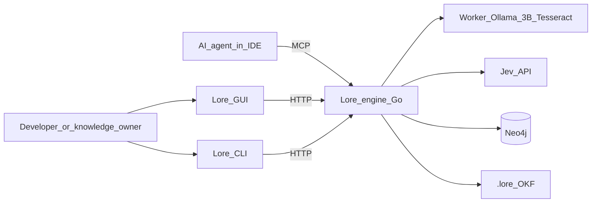

# Lore — Project Requirements Document

| Field | Value |
| --- | --- |
| Project | Lore — a Knowledge Grid engine for developers and enterprises |
| Document | Project Requirements Document (PRD) |
| Version | 1.0 |
| Date | 2026-09-29 |
| Status | Draft for approval |
| Owner | Project Manager (Golam Morshed Eashan); technical owner: Lead Engineer — Engine |
| Companion documents | `PROJECT_CHARTER.md` (v1.0), `LORE_ARCHITECTURE.md` (v2.0) |

---

## 1. Introduction

### 1.1 Purpose

This document specifies **what Lore must do** (functional requirements), **how well it must do it** (non-functional requirements), the **data and interfaces** it exposes, and **how each requirement is accepted**. It is the reference for building, testing, and demonstrating Lore for the International AI Builders Congress 2026 (InfraSphere AI · Knowledge Grid track).

### 1.2 Scope

Covers Phase 1 (Personal Grid) in full, the Phase 2 (Team Grid) demonstration slice, and the three Phase 3 (Enterprise Grid) proofs of concept, as defined in the charter. Roadmap items are listed in §13 for completeness but carry no build obligation.

### 1.3 Audience

Build team (engine, worker, frontend, QA), Project Manager, NRB collaborator, and reviewers of the preliminary submission.

### 1.4 Conventions

- **IDs:** `FR-<MODULE>-<NN>` functional, `NFR-<AREA>-<NN>` non-functional, `DR-` data, `IR-` interface, `UC-` use case.
- **Priority (MoSCoW):** **M** Must, **S** Should, **C** Could, **W** Won't (this timeline).
- **Phase:** **P1** Personal Grid, **P2** Team Grid slice, **P3** Enterprise PoC.
- "Shall" = mandatory; "should" = recommended.
- Every requirement has an acceptance criterion; "golden set" refers to `testdata/golden/` (§11).

### 1.5 References

- Knowledge Grid track brief (InfraSphere AI).
- Original Lore brief (internal, not published).
- Research notes: "Research topics for Lore" (Notion) — LLM, MCP & RAG, Jev, OKF, Integration.
- Open Knowledge Format (OKF) v0.2.
- Model Context Protocol specification 2026-07-28; MCP Apps extension (2026-01-26).
- TypeSafe Jev (System One) API documentation.

---

## 2. Glossary

| Term | Definition |
| --- | --- |
| **OKF** | Open Knowledge Format — folder of Markdown files with YAML frontmatter; Lore's source of truth |
| **Rule / Skill / Procedure** | Knowledge items: a constraint, a how-to, an ordered set of steps |
| **Component** | A part of a codebase or organization that knowledge applies to (mapped from file paths) |
| **Source** | A registered origin of knowledge (file, PDF, email export, git history) with an authority tier |
| **Authority tier** | `policy` > `team_convention` > `procedure` > `reviewed` > `draft` > `historical` |
| **Chunk** | Normalized raw text section, searchable but **unverified**; never used for decisions |
| **Draft / Quarantine** | Extracted items awaiting review / failed validation or low confidence |
| **Promote** | Human action that makes a draft `stable` and eligible for live context |
| **GraphRAG** | Retrieval combining keyword + vector seeds with graph expansion and filters |
| **Conflict** | A recorded disagreement between two rules, with kind, severity, status, owner |
| **Verdict** | Top-level outcome of a Lore result (`ok`, `ok_with_notes`, `conflict`, `abstain`, `no_knowledge`, `violation`, `denied`) |
| **Directive** | Instruction to the agent (`proceed`, `proceed_and_cite`, `ask_user`, `stop`) |
| **ABSTAIN** | Lore declines to decide because evidence is too uncertain |
| **Decision** | Lineage record of one Lore result: inputs, rules used, rules excluded, verdict |
| **`lore.result/1`** | The versioned result envelope returned by every read operation |
| **Jev** | TypeSafe System One model returning typed judgments (Noul, Choice, Score) |
| **Noul / Choice / Score** | Jev question types: yes-probability / option selection / scaled level |
| **MCP** | Model Context Protocol — how IDEs and agents call Lore |
| **Worker** | Extraction + OCR service on the Tecno laptop (Ollama 3B + Tesseract) |
| **NRB** | Non-Resident Bangladeshi or international collaborator (team rule) |

---

## 3. Product overview

### 3.1 Context

### 3.2 User classes and personas

| Persona | Description | Primary surfaces | Key needs |
| --- | --- | --- | --- |
| **P-01 Solo developer** | Uses AI IDEs daily; keeps persona/skill files | IDE (MCP), CLI, GUI | Automatic correct context, conflict warnings, low friction |
| **P-02 Team lead** | Owns team conventions and reviews | GUI, CLI | Review drafts, resolve conflicts, see decisions from git |
| **P-03 Knowledge / compliance owner** | Owns policies; accountable for audits | GUI | Authority, versions, lineage, residency audit |
| **P-04 AI agent** (non-human) | IDE model calling Lore tools | MCP | Compact, unambiguous, typed results with explicit next steps |
| **P-05 Evaluator / judge** | Assesses the demo in 3 minutes | GUI (projected), IDE | Visible grounding, conflicts, lineage, honesty |

### 3.3 Operating environment

| Environment | Description |
| --- | --- |
| Development | Intel laptop (CachyOS, 16 GB) runs engine, Neo4j (Docker), GUI, CLI, IDE; Tecno laptop (16 GB) runs worker over LAN |
| Demo | AWS stack (engine + GUI + Neo4j; second small region for sovereignty PoC) or Docker Compose single box; pre-seeded mode |
| Clients | VS Code, Cursor, Google Antigravity, Devin Desktop, Claude Code, OpenAI Codex, JetBrains IDEs, Zed (MCP stdio) |
| Browsers (GUI) | Current Chromium, Firefox, Safari |

### 3.4 Assumptions and dependencies

See charter §11. Requirements that depend on Jev specify a deterministic fallback (FR-JEV-06).

---

## 4. Use cases

| ID | Actor | Use case | Main flow (summary) | Outcome |
| --- | --- | --- | --- | --- |
| UC-01 | P-01 | Initialize Lore in a project | `lore init` creates `.lore/`, config, starter pack; `lore serve` starts | Project ready; IDE config printed |
| UC-02 | P-01/P-03 | Ingest documents | Drop files in GUI or `lore ingest <path>`; jobs run in background | Jobs reach `draft`/`quarantine`/`ready`; raw text searchable as Unverified |
| UC-03 | P-02/P-03 | Review extracted knowledge | Open review queue; compare draft with source excerpt; approve/edit/reject | Promoted items become `stable` and indexed |
| UC-04 | P-04 | Get context before editing | Agent calls `lore.get_context(file, intent)` | `lore.result/1` with verdict, directive, ≤ 800 tokens, Decision logged |
| UC-05 | P-04/P-01 | Check a change for compliance | Agent calls `lore.check_compliance(diff)` or `lore check --diff` | `ok` or `violation` with rule IDs; CLI exit code 3 on violation |
| UC-06 | P-02/P-03 | Review and resolve conflicts | Conflicts screen or `lore conflicts`; choose prefer left/right/scope/dismiss | Conflict status updated; lineage records the human decision |
| UC-07 | P-03/P-05 | Trace a decision | Open lineage explorer or `lore trace <id>` | PROV-style graph from decision to rules, sources, authors, exclusions |
| UC-08 | P-01 | Search knowledge | GUI search or `lore search` / `lore.search` | Stable items + Unverified chunks, clearly badged |
| UC-09 | P-01/P-03 | View version history | Version timeline or `lore history <file>` | `SUPERSEDES` chain with dates and freshness |
| UC-10 | P-02 | Ingest git decisions (P2) | Point adapter at repo; commits/PR comments become drafts | `git_derived` drafts in review; activity list in GUI |
| UC-11 | P-03 | Query with residency (P3) | Query from region A for region-B-only knowledge | `denied` verdict; audit entry; nothing leaked |
| UC-12 | P-03/P-05 | Verify provenance (P3) | Open proof panel for a decision | Merkle inclusion proof verifies the source hash without revealing text |
| UC-13 | P-01 | Evaluate quality | `lore eval` | Metrics report against thresholds |

---

## 5. Functional requirements

### 5.1 Ingestion and source registry — `FR-ING`

| ID | Requirement | Pri | Phase | Acceptance criteria |
| --- | --- | --- | --- | --- |
| FR-ING-01 | The system shall accept Markdown, plain text, HTML, and PDF files via GUI upload, `lore ingest <path>` (file or directory), and MCP `ingest`. | M | P1 | Each format ingests successfully from all three surfaces |
| FR-ING-02 | The system shall create a `Source` record before processing, storing source ID, connector type, path/URI, owner, authority tier, SHA-256 checksum, parser/OCR version, ingestion time. | M | P1 | Source record exists with all fields for every ingested file |
| FR-ING-03 | The system shall skip files whose checksum matches an existing source version and report "unchanged". | M | P1 | Re-ingesting an identical file creates no new version |
| FR-ING-04 | The system shall assign a default authority tier per ingest path from config and allow override at ingest time. | M | P1 | `--authority policy` sets the tier; default applied otherwise |
| FR-ING-05 | Ingestion shall be asynchronous: the user action returns a job ID immediately, and processing continues in the background. | M | P1 | Upload returns in < 1 s regardless of worker state |
| FR-ING-06 | The system shall expose job states `queued`, `normalizing`, `extracting`, `draft`, `quarantine`, `indexing`, `ready`, `failed` (with reason). | M | P1 | States visible in GUI, `lore ingest status`, MCP `ingest_status` |
| FR-ING-07 | If the worker is unreachable, jobs shall remain `queued` and retry with backoff; read paths remain fully functional. | M | P1 | Stop worker → ingest queues; `get_context` still works |
| FR-ING-08 | The system shall watch `.lore/` for changes (fsnotify) and re-index changed OKF files incrementally. | M | P1 | Editing a rule file updates the graph within 5 s |
| FR-ING-09 | The system shall capture the git SHA of OKF files when the project is a git repository. | S | P1 | Version nodes carry commit SHA |
| FR-ING-10 | The system shall ingest email exports (EML/MBOX, Enron sample) through the same pipeline. | M | P3 | Enron sample produces sources, chunks, and drafts |

### 5.2 Normalization, OCR, and chunks — `FR-NRM`

| ID | Requirement | Pri | Phase | Acceptance criteria |
| --- | --- | --- | --- | --- |
| FR-NRM-01 | The system shall extract the text layer from Markdown, HTML, text, and text-based PDFs on the engine host. | M | P1 | Text extracted with headings preserved |
| FR-NRM-02 | The system shall route scanned/image-only PDF pages to the worker's OCR endpoint. | M | P1 | A scanned PDF produces text blocks with OCR confidence |
| FR-NRM-03 | Every block shall retain document ID, version ID, page or line, heading path, and a stable citation anchor. | M | P1 | Anchors resolve to the correct location in GUI source view |
| FR-NRM-04 | Blocks with OCR confidence below `ocr_min_confidence` shall be flagged `extraction_uncertain`. | M | P1 | Low-quality scan blocks carry the flag |
| FR-NRM-05 | The original artifact shall be stored unchanged in `_staging/` (or object storage in demo) and linked to its source. | M | P1 | Original retrievable from source record |
| FR-NRM-06 | Normalized text shall be chunked by logical section first, with size-limited fallback and overlap, preserving parent-section links. | M | P1 | No chunk splits mid-sentence where a section boundary exists |
| FR-NRM-07 | Chunks shall be embedded and indexed as `Chunk` nodes with `authority: unreviewed`. | M | P1 | Chunks returned by search with Unverified badge |
| FR-NRM-08 | Chunks shall never be included in `get_context` or `check_compliance` results. | M | P1 | Golden leakage test returns 0 chunk items |

### 5.3 Extraction and review — `FR-EXT`

| ID | Requirement | Pri | Phase | Acceptance criteria |
| --- | --- | --- | --- | --- |
| FR-EXT-01 | The worker shall return typed objects (rules, skills, procedures, entities, dependencies, temporal facts, provenance) as JSON, not prose. | M | P1 | Worker output validates against `schemas/extract.v1.json` |
| FR-EXT-02 | Each extracted rule shall include subject, modality, scope/`applies_to`, conditions, exceptions, source anchor, and extractor confidence. | M | P1 | Missing required field → validation failure |
| FR-EXT-03 | The engine shall validate every extraction against the JSON Schema before writing anything. | M | P1 | Invalid output never reaches `rules/` |
| FR-EXT-04 | Invalid output or confidence < `extract_min_confidence` shall go to `_quarantine/` with a machine-readable reason. | M | P1 | Quarantine entries list reason codes |
| FR-EXT-05 | Valid output shall be written as OKF drafts with `status: draft` and `origin: llm_extracted`; promotion changes origin to `llm_extracted_reviewed`. | M | P1 | Drafts appear in review queue; promoted items carry the reviewed origin |
| FR-EXT-06 | Reviewers shall be able to approve, edit, or reject drafts in the GUI and via `lore promote` / `lore reject`. | M | P1 | Actions update status and are logged |
| FR-EXT-07 | The review view shall show the draft beside the highlighted source excerpt. | M | P1 | Anchor highlight visible in review screen |
| FR-EXT-08 | Extraction shall run single-flight (concurrency 1) and unload the model when idle. | M | P1 | Worker config enforces concurrency 1, `keep_alive=0` |
| FR-EXT-09 | The extractor shall be swappable (local Ollama or cloud LLM) behind one interface. | S | P1 | Config switch changes backend without code change |
| FR-EXT-10 | Hand-authored OKF files with `status: stable` shall bypass extraction and review. | M | P1 | Starter pack indexes directly |
| FR-EXT-11 | Entity resolution shall merge duplicate components/technologies across sources by normalized name and alias list. | S | P1 | "Postgres" and "PostgreSQL" resolve to one node |

### 5.4 OKF bundle — `FR-OKF`

| ID | Requirement | Pri | Phase | Acceptance criteria |
| --- | --- | --- | --- | --- |
| FR-OKF-01 | `lore init` shall create the `.lore/` layout (index, log, config, sources, components, rules, skills, procedures, conflicts, decisions, schemas, staging, quarantine). | M | P1 | Layout matches architecture |
| FR-OKF-02 | The system shall read and write OKF v0.2 (`type` required; natives preserved; unknown keys preserved round-trip). | M | P1 | Round-trip test preserves all frontmatter |
| FR-OKF-03 | The system shall support Lore frontmatter extensions (DR-01). | M | P1 | All extension keys parsed and validated |
| FR-OKF-04 | `index.md` shall be regenerated on change, listing concepts by type with titles and descriptions. | M | P1 | Index reflects current bundle |
| FR-OKF-05 | `log.md` shall record promotions, rejections, resolutions, and supersessions with timestamps. | M | P1 | Each action appends a log line |
| FR-OKF-06 | Lore shall write `conflicts/*.md` and `decisions/*.md` as OKF files mirroring graph records. | M | P1 | Files exist and match graph |
| FR-OKF-07 | The bundle shall remain valid Markdown readable without Lore (Git diff/review friendly). | M | P1 | Files render in any Markdown viewer |

### 5.5 Graph and indexing — `FR-GRA`

| ID | Requirement | Pri | Phase | Acceptance criteria |
| --- | --- | --- | --- | --- |
| FR-GRA-01 | The graph shall implement nodes and edges per DR-02. | M | P1 | Schema migration creates constraints and indexes |
| FR-GRA-02 | Each change to a knowledge item shall create a `Version` and a `SUPERSEDES` edge to the prior version. | M | P1 | History shows full chain |
| FR-GRA-03 | The graph shall maintain a native vector index on `Rule`, `Skill`, `Chunk` embeddings. | M | P1 | Vector query returns top-k |
| FR-GRA-04 | The graph shall maintain a full-text index on titles, text, tags, and IDs. | M | P1 | Exact ID query returns the item first |
| FR-GRA-05 | Semantic IDs shall be unique and stable across re-indexing. | M | P1 | Re-index yields identical IDs |
| FR-GRA-06 | `lore index --rebuild` shall rebuild the graph entirely from the OKF bundle. | M | P1 | Rebuild reproduces identical query results |
| FR-GRA-07 | The system shall support JSON export/import of the graph for backup and demo seeding. | S | P1 | Export → import on a clean DB restores demo |
| FR-GRA-08 | File paths shall map to Components via glob rules in config and `applies_to`. | M | P1 | `src/auth/**` maps to `component:auth` |

### 5.6 Retrieval — `FR-RET`

| ID | Requirement | Pri | Phase | Acceptance criteria |
| --- | --- | --- | --- | --- |
| FR-RET-01 | `get_context(file_path, task_intent)` shall run keyword (top-k 20) and vector (top-k 20) seed searches. | M | P1 | Both seed sets logged in trace |
| FR-RET-02 | Seeds shall be fused with Reciprocal Rank Fusion (k = 60). | M | P1 | Unit test on fusion ordering |
| FR-RET-03 | The system shall expand from seeds and the mapped component via `APPLIES_TO`, `DEPENDS_ON`, `EXEMPTS`, `SUPPORTED_BY` up to 2 hops. | M | P1 | Dependent rule 2 hops away is retrieved in golden case |
| FR-RET-04 | The temporal filter shall drop items that are deprecated, past `stale_after` or `effective_to`, or superseded. | M | P1 | 0 superseded items in live results |
| FR-RET-05 | Only `status: stable` items with authority ≥ `reviewed` shall be eligible for live context. | M | P1 | Drafts/quarantine/chunks never returned |
| FR-RET-06 | The system shall support `as_of` queries returning versions active at a past date. | S | P1 | Historical golden cases pass |
| FR-RET-07 | Candidates shall be ranked by modality, authority, confidence, then fused relevance. | M | P1 | `must` policy outranks `should` convention |
| FR-RET-08 | The assembler shall prune to ≤ `token_budget` (800) tokens and ≤ `max_items` (8) items, counted with `tiktoken-go`. | M | P1 | No result exceeds limits |
| FR-RET-09 | Every result item shall carry a source path and anchor. | M | P1 | Citation coverage = 100% |
| FR-RET-10 | Repeated identical queries on an unchanged graph snapshot shall be served from a versioned cache. | S | P1 | Cache hit rate visible; invalidated on any index change |
| FR-RET-11 | `search(query)` shall return stable items and Unverified chunks, each badged, with optional component filter. | M | P1 | Mixed results clearly labeled |

### 5.7 Governance — `FR-GOV`

| ID | Requirement | Pri | Phase | Acceptance criteria |
| --- | --- | --- | --- | --- |
| FR-GOV-01 | On indexing, the system shall evaluate new/changed rules against rules with compatible subject and scope. | M | P1 | Adding a contradicting rule creates a conflict |
| FR-GOV-02 | Deterministic checks shall classify `stale`, `authority`, and `extraction` conflicts and detect allow/deny pairs. | M | P1 | Unit tests per kind |
| FR-GOV-03 | Remaining candidate pairs shall be classified by Jev as `none`, `direct`, or `partial` with a severity Score. | M | P1 | Jev decisions recorded with probabilities |
| FR-GOV-04 | Jev confidence < `conflict_min_confidence` (0.70) shall yield an `abstain` conflict report, not a conflict. | M | P1 | Low-confidence pair shows as ABSTAIN |
| FR-GOV-05 | Each conflict shall be stored as a `Conflict` record (DR-04) in graph and `conflicts/*.md`. | M | P1 | Record fields complete |
| FR-GOV-06 | The authority ladder and precedence shall be configurable and never inferred by an LLM. | M | P1 | Config change alters precedence outcome |
| FR-GOV-07 | An exception shall override a general rule only when explicit (`exempts`), active, and of sufficient authority. | M | P1 | Golden exemption case → `none` conflict, `ok_with_notes` |
| FR-GOV-08 | Humans shall resolve conflicts as prefer-left, prefer-right, scope-both, or dismiss, with a note. | M | P1 | Resolution recorded and reflected in retrieval |
| FR-GOV-09 | `check_compliance(diff)` shall evaluate the diff against applicable `must`/`must_not` rules using Jev `violates` and return `violation` or `ok`. | M | P1 | Golden violating diff flagged with rule ID |
| FR-GOV-10 | The verdict shall be computed by precedence: `denied` > `violation` > `conflict` > `abstain` > `ok_with_notes` > `ok`; `no_knowledge` when no eligible items. | M | P1 | Verdict unit tests cover all combinations |
| FR-GOV-11 | The answer policy (architecture §Governance) shall be encoded as directives and notes in the envelope. | M | P1 | Stale-low-severity → `ok_with_notes` with disclosure |
| FR-GOV-12 | Retrieved text shall be treated as data; the envelope shall mark items as quoted evidence. | M | P1 | Prompt-injection golden docs do not change verdict/directive |

### 5.8 Jev integration — `FR-JEV`

| ID | Requirement | Pri | Phase | Acceptance criteria |
| --- | --- | --- | --- | --- |
| FR-JEV-01 | The system shall call the Jev System One endpoint with a state object and named questions (IR-05). | M | P1 | Integration test against live API |
| FR-JEV-02 | Questions shall be independent and understandable from the supplied state alone. | M | P1 | Question review checklist passed |
| FR-JEV-03 | The system shall batch questions per request where possible (e.g., `applies` for all candidates). | S | P1 | One Jev call per `get_context` on average |
| FR-JEV-04 | Decisions shall be cached by Jev model version + policy version + schema version + input hash. | M | P1 | Repeat call served from cache |
| FR-JEV-05 | Probabilities shall be mapped to bands: high ≥ 0.80, medium 0.55–0.80, unsure 0.45–0.55 (→ abstain), excluded < 0.45. | M | P1 | Band mapping unit tests |
| FR-JEV-06 | If Jev is unavailable, the system shall fall back to deterministic checks and return `abstain` where a Jev decision was required. | M | P1 | Kill API key → results degrade to abstain, never guess |
| FR-JEV-07 | Jev usage (tokens, latency, cost estimate) shall be recorded in metrics. | S | P1 | `/metrics` exposes Jev counters |
| FR-JEV-08 | A request router (Jev Choice) shall classify requests as lookup, policy check, conflict investigation, or history. | C | P1 | Router decision visible in trace |

### 5.9 Result presentation — `FR-PRS`

| ID | Requirement | Pri | Phase | Acceptance criteria |
| --- | --- | --- | --- | --- |
| FR-PRS-01 | Every read operation (MCP, HTTP, CLI) shall produce a `lore.result/1` envelope (DR-03). | M | P1 | Schema validation passes for all read tools |
| FR-PRS-02 | The envelope shall include `verdict`, `directive`, `summary`, `items`, `conflicts`, `excluded`, `budget`, `links`, `as_of`, `constants`, `decision_id`. | M | P1 | Required fields present |
| FR-PRS-03 | Items shall carry `id`, `kind`, `modality`, `role`, `authority`, `status`, `freshness`, `origin`, `confidence{band,p}`, `text`, `source{path,anchor,effective_from,last_verified}`. | M | P1 | Schema enforces enums |
| FR-PRS-04 | Directive mapping shall be: `ok`/`ok_with_notes` → `proceed_and_cite`; `conflict`/`abstain` → `ask_user`; `violation`/`denied` → `stop`; `no_knowledge` → `proceed`. | M | P1 | Mapping unit test |
| FR-PRS-05 | The agent renderer shall produce a single `<lore>`-tagged Markdown block, edge-loaded (verdict/directive first; next step last), ≤ 800 tokens. | M | P1 | Snapshot tests; token count check |
| FR-PRS-06 | The CLI renderer shall produce badge-worded human lines on TTY, `--json` envelope, and `--plain` TSV. | M | P1 | Snapshot tests for each mode |
| FR-PRS-07 | The GUI shall render the envelope as the result card (verdict banner, rule cards, conflict comparison, Not applied panel, actions). | M | P1 | Visual test on demo scenario |
| FR-PRS-08 | The `summary` headline shall be generated by deterministic templates, not an LLM. | M | P1 | Code review; identical input → identical text |
| FR-PRS-09 | Badge vocabulary shall be identical across agent text, GUI, and CLI. | M | P1 | Shared constants package used by all renderers |
| FR-PRS-10 | Semantic IDs shall be used in all outputs; UUIDs shall never appear. | M | P1 | Grep of outputs finds no UUIDs |
| FR-PRS-11 | Tools shall accept `response_format: concise | detailed`; detailed adds anchors, probabilities, and follow-up IDs. | S | P1 | Concise ≈ ⅓ tokens of detailed on golden set |
| FR-PRS-12 | An optional GUI "Explain" action may call a cloud LLM; its output shall be labeled "AI-generated summary" and cite rule IDs. | C | P1 | Label visible; uncited output rejected |
| FR-PRS-13 | A Phase 3 answer writer shall receive only the envelope, return a claim→citation map, and pass citation-existence validation and a Jev output gate before display. | C | P3 | Invalid citation → answer blocked |

### 5.10 Lineage — `FR-LIN`

| ID | Requirement | Pri | Phase | Acceptance criteria |
| --- | --- | --- | --- | --- |
| FR-LIN-01 | Every `get_context` and `check_compliance` call shall create a `Decision` node and `decisions/*.md` file. | M | P1 | 100% of calls produce a record |
| FR-LIN-02 | Decisions shall link rules used (`USED_IN`) and excluded (`EXCLUDED_IN` with reason), plus task, file, verdict, constants, and graph snapshot ID. | M | P1 | Trace shows both sets |
| FR-LIN-03 | `trace(decision_id)` shall return a PROV-style graph: decision (activity) → rules/versions (entities) → sources → agents (authors, reviewers, extractor model). | M | P1 | Lineage explorer renders the graph |
| FR-LIN-04 | A decision shall be reproducible: re-running with the recorded snapshot and constants yields the same verdict and items. | M | P1 | Reproduction test passes |
| FR-LIN-05 | `log_decision(task, rule_ids, outcome)` shall let agents attach outcomes (e.g., code written) to a decision. | S | P1 | Outcome visible in decision log |
| FR-LIN-06 | Merkle inclusion proofs shall be generated for source hashes and shown with lineage. | M | P3 | Proof verifies; tampered source fails verification |

### 5.11 MCP server — `FR-MCP`

| ID | Requirement | Pri | Phase | Acceptance criteria |
| --- | --- | --- | --- | --- |
| FR-MCP-01 | `lore serve` shall expose an MCP server over stdio using the Go MCP SDK. | M | P1 | Connects from VS Code and one agentic IDE |
| FR-MCP-02 | The server shall expose the read tools, controlled write tools, resources, and prompts listed in IR-01–IR-03. | M | P1 | `tools/list`, `resources/list`, `prompts/list` complete |
| FR-MCP-03 | Read tools shall declare `outputSchema` = `lore.result/1` and return `structuredContent` plus a text block. | M | P1 | Client-side schema validation passes |
| FR-MCP-04 | Results shall include `resource_link` items to referenced rules, conflicts, and the decision. | M | P1 | Links resolvable via `resources/read` |
| FR-MCP-05 | The server shall send `instructions` at initialization describing the agent behavior contract. | M | P1 | Instructions visible in client logs |
| FR-MCP-06 | Write tools shall only create drafts, jobs, or decision outcomes; they shall never promote knowledge or resolve conflicts. | M | P1 | Attempted activation via MCP is impossible |
| FR-MCP-07 | Errors shall return `isError: true` with an actionable hint; `denied`/`no_knowledge` are normal verdicts. | M | P1 | Error snapshot tests |
| FR-MCP-08 | Each tool call shall emit an audit event and carry a timeout; write tools accept an idempotency key. | M | P1 | Audit log entries; duplicate key is a no-op |
| FR-MCP-09 | Config examples shall ship for all listed IDEs. | M | P1 | `docs/ide/*.md` present |
| FR-MCP-10 | MCP Apps views (`ui://lore/result`, `ui://lore/lineage`) shall be offered to hosts that support them, with text fallback. | C | P1 | Renders in VS Code (supporting build) |
| FR-MCP-11 | Streamable HTTP transport with OAuth shall be supported for remote use. | W | P3 | Roadmap |
| FR-MCP-12 | `resolve_conflict` over MCP with elicitation confirmation. | W | P2 | Roadmap |

### 5.12 HTTP API — `FR-API`

| ID | Requirement | Pri | Phase | Acceptance criteria |
| --- | --- | --- | --- | --- |
| FR-API-01 | The engine shall expose a local HTTP API on `127.0.0.1:7421` (configurable) implementing IR-04. | M | P1 | All endpoints respond |
| FR-API-02 | GUI and CLI shall use only this API (no direct DB access). | M | P1 | Code review |
| FR-API-03 | Read endpoints shall return `lore.result/1`; list endpoints support pagination. | M | P1 | Schema validation |
| FR-API-04 | The API shall bind to localhost by default; remote binding requires explicit config and a token. | M | P1 | Default not reachable from LAN |
| FR-API-05 | `GET /health` shall report engine, Neo4j, worker, and Jev status. | M | P1 | Dashboard health tiles use it |

### 5.13 GUI — `FR-GUI`

| ID | Requirement | Pri | Phase | Acceptance criteria |
| --- | --- | --- | --- | --- |
| FR-GUI-01 | `lore gui` shall serve the React app at `127.0.0.1:7420`. | M | P1 | Opens in browser |
| FR-GUI-02 | **Dashboard:** graph stats, job queue, ready/draft/quarantine counts, open conflicts by severity, health. | M | P1 | Values match API |
| FR-GUI-03 | **Ingest:** drag-and-drop/upload, authority selection, live job status. | M | P1 | Status updates without refresh |
| FR-GUI-04 | **Review:** draft beside source excerpt; approve/edit/reject; reason display for quarantine. | M | P1 | Actions persist |
| FR-GUI-05 | **Graph overview:** force-directed graph filterable by type/component. | M | P1 | Renders demo graph ≤ 2 s |
| FR-GUI-06 | **Conflicts:** grouped by severity then kind; side-by-side comparison; resolve actions. | M | P1 | Resolution reflected immediately |
| FR-GUI-07 | **Version timeline:** `SUPERSEDES` chain per file with freshness colors. | M | P1 | Matches `lore history` |
| FR-GUI-08 | **Decision log:** list with verdict badges, filters by verdict/date/file. | M | P1 | Filters work |
| FR-GUI-09 | **Lineage explorer:** interactive PROV-style graph with excluded items greyed and reasons shown. | M | P1 | Demo decision traced end to end |
| FR-GUI-10 | **Try context:** enter file + intent; render result card. | M | P1 | Same output as MCP |
| FR-GUI-11 | **Search:** hybrid results with Unverified badges. | M | P1 | Badges visible |
| FR-GUI-12 | **Settings:** worker URL, Jev key presence (never the value), Neo4j, thresholds, token budget, paths. | M | P1 | Changes persist to config |
| FR-GUI-13 | Verdict banners shall use color + icon + word; `abstain` shown neutral. | M | P1 | Accessibility review |
| FR-GUI-14 | Confidence shown as High/Medium/Unsure with exact `p` on hover/focus. | M | P1 | Keyboard focus reveals value |
| FR-GUI-15 | Read-only views shall work when the worker is offline. | M | P1 | Worker off → views load |
| FR-GUI-16 | **Activity list** for git-derived decisions. | M | P2 | Items listed with commit links |
| FR-GUI-17 | **Residency panel** and sovereignty audit; **proof panel** beside lineage. | M | P3 | PoCs visible |

### 5.14 CLI — `FR-CLI`

| ID | Requirement | Pri | Phase | Acceptance criteria |
| --- | --- | --- | --- | --- |
| FR-CLI-01 | The CLI shall implement the command set in IR-06 using cobra, with no interactive TUI. | M | P1 | `lore --help` lists all commands |
| FR-CLI-02 | Global flags `--json`, `--plain`, `--verbose`, `--quiet`, `--dry-run` (mutating), `--config`. | M | P1 | Flags work on applicable commands |
| FR-CLI-03 | Data to stdout; progress, warnings, and logs to stderr. | M | P1 | Piping stdout yields clean data |
| FR-CLI-04 | Color disabled when `NO_COLOR` is set or stdout is not a TTY; no animations when not a TTY. | M | P1 | Tested in CI |
| FR-CLI-05 | Exit codes per IR-06 (0, 1, 2, 3, 4). | M | P1 | Tests per verdict |
| FR-CLI-06 | Errors shall state what failed and a suggested fix. | M | P1 | Error snapshot tests |
| FR-CLI-07 | Read commands shall work with the worker offline; `ingest` reports "worker unreachable, queued". | M | P1 | Tested |

### 5.15 Configuration — `FR-CFG`

| ID | Requirement | Pri | Phase | Acceptance criteria |
| --- | --- | --- | --- | --- |
| FR-CFG-01 | All thresholds and limits in §10 shall be read from `lore.config.yaml` with documented defaults. | M | P1 | Changing a value changes behavior |
| FR-CFG-02 | Secrets (`TYPESAFE_API_KEY`, API tokens) shall come from environment variables only, never config files or logs. | M | P1 | Secret scan clean |
| FR-CFG-03 | Config shall be validated at startup with clear errors. | M | P1 | Invalid value → startup error with key name |
| FR-CFG-04 | Every result shall echo the effective constants used. | M | P1 | `constants` present in envelope |

### 5.16 Observability — `FR-OBS`

| ID | Requirement | Pri | Phase | Acceptance criteria |
| --- | --- | --- | --- | --- |
| FR-OBS-01 | The engine shall expose Prometheus metrics at `/metrics` (list in architecture). | M | P1 | Scrape succeeds |
| FR-OBS-02 | One OpenTelemetry trace per request with correlation ID across MCP → retrieve → graph → Jev → assemble → persist. | S | P1 | Trace visible in Jaeger on AWS |
| FR-OBS-03 | Structured JSON logs (`slog`) for ingestion, conflicts, resolutions, tool calls, validation failures. | M | P1 | Logs parse as JSON |
| FR-OBS-04 | Traces and logs shall contain IDs only, never raw document text or secrets. | M | P1 | Log audit on golden run |
| FR-OBS-05 | Token usage with vs without Lore shall be measured for the metrics study. | M | P1 | Report in `lore eval` |

### 5.17 Evaluation — `FR-EVL`

| ID | Requirement | Pri | Phase | Acceptance criteria |
| --- | --- | --- | --- | --- |
| FR-EVL-01 | `lore eval` shall run the golden dataset and report the metrics in §11.2 against thresholds. | M | P1 | Report produced (text + `--json`) |
| FR-EVL-02 | The golden dataset shall be versioned in `testdata/golden/` with expected verdicts, items, and conflicts. | M | P1 | v1 ≥ 40 cases by Oct 31; v2 ≥ 120 by Dec 1 |
| FR-EVL-03 | CI shall run `lore eval` on the core subset and fail on regression below thresholds. | S | P1 | CI job present |

### 5.18 Team Grid slice — `FR-TEM`

| ID | Requirement | Pri | Phase | Acceptance criteria |
| --- | --- | --- | --- | --- |
| FR-TEM-01 | A git adapter shall read commit messages and PR review comments from a local repo (and GitHub export) and produce decision/rule drafts with `origin: git_derived`. | M | P2 | Demo repo yields drafts |
| FR-TEM-02 | Git-derived drafts shall go through the same review and conflict pipeline. | M | P2 | Conflict with a policy detected |
| FR-TEM-03 | Multi-repository ingestion. | C | P2 | Two repos ingested |
| FR-TEM-04 | CRDT sync, RBAC, SSO, Stripe, notifications. | W | P2 | Roadmap slides |

### 5.19 Enterprise PoCs — `FR-ENT`

| ID | Requirement | Pri | Phase | Acceptance criteria |
| --- | --- | --- | --- | --- |
| FR-ENT-01 | Enron email sample and policy PDFs (text and scanned) shall flow through the standard pipeline and appear in GUI ingest/review. | M | P3 | Visible in demo |
| FR-ENT-02 | Sources and items shall carry a `residency` tag (e.g., `eu`, `us`). | M | P3 | Tags visible |
| FR-ENT-03 | A query router shall answer from the requester's permitted region(s) only and return `denied` for restricted items without revealing content or counts beyond "restricted". | M | P3 | Cross-region golden case → `denied` |
| FR-ENT-04 | Denied and cross-region queries shall be written to a sovereignty audit log shown in the residency panel. | M | P3 | Audit entries visible |
| FR-ENT-05 | Two regional stacks (containers or AWS regions) shall run for the PoC. | S | P3 | Both reachable in demo |
| FR-ENT-06 | Merkle inclusion proofs per FR-LIN-06; pitch language shall say "ZKP-lite". | M | P3 | NRB review of wording |

### 5.20 Demo operations — `FR-DEM`

| ID | Requirement | Pri | Phase | Acceptance criteria |
| --- | --- | --- | --- | --- |
| FR-DEM-01 | A pre-seeded mode shall load the frozen demo bundle and graph and disable live extraction. | M | P1 | `lore serve --demo` starts seeded |
| FR-DEM-02 | Docker Compose shall start Neo4j + engine + GUI on one machine with one command. | M | P1 | `docker compose up` → working demo |
| FR-DEM-03 | An AWS deployment recipe shall reproduce the demo stack. | M | P3 | Stack reachable by URL |
| FR-DEM-04 | A recorded backup video (≈ 2 min) shall cover every pitch step. | M | P1 | Video file in release assets |

---

## 6. Data requirements

### DR-01 OKF frontmatter

| Field | Type | Required | Allowed values / notes |
| --- | --- | --- | --- |
| `type` | string | Yes | `rule`, `skill`, `procedure`, `component`, `source`, `conflict`, `decision`, `technology` |
| `title` | string | Yes (Lore) | ≤ 120 chars |
| `description` | string | Yes (Lore) | One sentence |
| `status` | enum | Yes | `draft`, `stable`, `deprecated` (+ Lore internal `quarantine`, `superseded`) |
| `resource` | URI | No | Link to underlying source |
| `tags` | string[] | No | Lowercase |
| `sources` | string[] | No | OKF native |
| `generated` / `verified` | datetime | No | OKF native |
| `stale_after` | date | No | Temporal filter |
| `modality` | enum | Rules: yes | `must`, `must_not`, `should`, `may` |
| `severity` | enum | Rules: yes | `critical`, `high`, `medium`, `low` |
| `authority` | enum | Yes | `policy`, `team_convention`, `procedure`, `reviewed`, `draft`, `historical` |
| `precedence` | int | No | Tie-breaker within a tier (higher wins) |
| `applies_to` | ID[] | Rules/skills: yes | Component IDs |
| `depends_on` / `exempts` / `supported_by` | ID[] | No | Item IDs |
| `supersedes` | ID | No | Prior version ID |
| `effective_from` / `effective_to` | date | No | Validity window |
| `source_id` | ID | Yes (non-hand-authored) | Source record |
| `anchor` | string | Yes | `path#L42` or `file.pdf#p4` |
| `origin` | enum | Yes | `human_authored`, `llm_extracted` (drafts only), `llm_extracted_reviewed`, `git_derived` |
| `owner` | string | No | Handle or team |
| `residency` | string[] | P3 | Region codes |

### DR-02 Graph schema

| Element | Kind | Key properties |
| --- | --- | --- |
| `Rule`, `Skill`, `Procedure` | Node | `id`, `title`, `text`, `modality`, `severity`, `authority`, `status`, `effective_from/to`, `stale_after`, `origin`, `embedding` |
| `Component`, `Technology` | Node | `id`, `name`, `aliases`, `globs` |
| `Version` | Node | `id`, `item_id`, `n`, `sha`, `created_at` |
| `Source` | Node | `id`, `path`, `connector`, `authority`, `checksum`, `owner`, `residency` |
| `Chunk` | Node | `id`, `text`, `anchor`, `embedding`, `authority: unreviewed` |
| `Conflict` | Node | DR-04 fields |
| `Decision` | Node | DR-05 fields |
| `APPLIES_TO`, `DEPENDS_ON`, `EXEMPTS`, `SUPPORTED_BY`, `SUPERSEDES` | Edge | `created_at` |
| `CONFLICTS_WITH` | Edge | `conflict_id` |
| `INVOLVES`, `DERIVED_FROM`, `HAS_CHUNK` | Edge | — |
| `USED_IN`, `EXCLUDED_IN` | Edge | `rank` / `reason` |

### DR-03 `lore.result/1` envelope

| Field | Type | Required | Notes |
| --- | --- | --- | --- |
| `schema` | const | Yes | `lore.result/1` |
| `decision_id` | string | Yes for `get_context`, `check_compliance` | `dec-NNNN` |
| `tool` | string | Yes | Tool or command name |
| `verdict` | enum | Yes | `ok`, `ok_with_notes`, `conflict`, `abstain`, `no_knowledge`, `violation`, `denied` |
| `directive` | enum | Yes | `proceed`, `proceed_and_cite`, `ask_user`, `stop` |
| `summary` | string | Yes | Deterministic template |
| `task` | object | Context tools | `file`, `intent` / `diff_ref` |
| `items` | Item[] | Yes (may be empty) | See FR-PRS-03 |
| `conflicts` | Conflict[] | Yes (may be empty) | Summary form of DR-04 |
| `violations` | object[] | `check_compliance` | `rule_id`, `severity`, `evidence`, `p` |
| `excluded` | object | Yes | Counts: `superseded`, `draft`, `quarantine`, `out_of_scope`, `stale`, `low_confidence`, `denied` |
| `budget` | object | Yes | `limit`, `used` |
| `links` | URI[] | Yes | `lore://…` |
| `data` | object | Optional | Payload for `stats`, `get_history`, `trace`, `ingest_status` |
| `as_of` | datetime | Yes | ISO 8601 with offset |
| `constants` | object | Yes | Effective thresholds |

### DR-04 Conflict record

`conflict_id`, `left_rule`, `right_rule`, `kind` (`direct|partial|stale|authority|extraction`), `severity`, `scope_overlap`, `temporal_status` (`both_active|one_superseded|window_disjoint`), `authority_comparison` (`left_higher|right_higher|equal|none`), `evidence[]` (anchors), `confidence`, `decision` (`block_until_review|disclose|auto_resolved_stale`), `status` (`open|resolved|dismissed`), `resolution` (`prefer_left|prefer_right|scope_both|dismiss`), `resolved_by`, `resolved_at`, `note`, `owner`.

### DR-05 Decision record

`decision_id`, `tool`, `task`, `file`, `verdict`, `directive`, `used[]` (id, rank), `excluded[]` (id, reason), `conflicts[]`, `constants`, `graph_snapshot`, `jev_model_version`, `created_at`, `outcome` (optional, via `log_decision`), `merkle_root` (P3).

### DR-06 Job

`job_id`, `source_id`, `state` (FR-ING-06), `attempts`, `error_code`, `error_message`, `created_at`, `updated_at`, `worker`, `durations{normalize,ocr,extract}`.

### DR-07 Retention

- OKF bundle, decisions, conflicts: retained indefinitely (versioned in Git).
- Raw artifacts: retained while the source exists; deleted with the source.
- Logs/traces: 14 days locally; demo stack per event duration.
- Jev cache: invalidated on policy/schema/model version change.

---

## 7. Interface requirements

### IR-01 MCP tools

| Tool | Type | Inputs | Output |
| --- | --- | --- | --- |
| `get_context` | Read | `file_path` (string, req), `task_intent` (string, req), `response_format` (`concise`/`detailed`), `as_of` (date) | `lore.result/1` |
| `check_compliance` | Read | `diff` (string, req), `file_path` (string) | `lore.result/1` with `violations` |
| `detect_conflicts` | Read | `scope` (component ID or path), `status` (`open`/`all`) | `lore.result/1` (conflicts) |
| `get_skill` | Read | `name` (string, req) | `lore.result/1` (one skill item) |
| `search` | Read | `query` (req), `component`, `include_unverified` (bool, default true), `limit` (≤ 20) | `lore.result/1` |
| `get_history` | Read | `file_path` or `item_id` | `lore.result/1` + `data.versions` |
| `trace` | Read | `decision_id` (req) | `lore.result/1` + `data.prov_graph` |
| `stats` | Read | — | `lore.result/1` + `data.stats` |
| `ingest_status` | Read | `job_id` (optional) | `lore.result/1` + `data.jobs` |
| `ingest` | Write (draft) | `path` or `content` + `filename`, `authority`, `idempotency_key` | Job ID |
| `log_decision` | Write (record) | `decision_id` or `task`, `rule_ids[]`, `outcome`, `note`, `idempotency_key` | Decision ID |
| `update_persona` | Write (draft) | `content`, `filename`, `idempotency_key` | Job ID |

### IR-02 MCP resources

`lore://sources/{id}`, `lore://rules/{id}`, `lore://skills/{id}`, `lore://conflicts/{id}`, `lore://decisions/{id}`, `lore://schemas/{name}`; P1 stretch: `ui://lore/result`, `ui://lore/lineage` (MCP Apps).

### IR-03 MCP prompts

| Prompt | Arguments | Purpose |
| --- | --- | --- |
| `answer_with_lore` | `task` | Standard pattern: call `get_context`, obey directive, cite IDs |
| `validate_change` | `diff` | Run `check_compliance` and explain violations |
| `explain_conflict` | `conflict_id` | Present both sides neutrally and ask the user |
| `prepare_review_packet` | `scope` | Summarize open conflicts and drafts for an owner |

### IR-04 HTTP API (`/api/v1`)

| Method & path | Purpose |
| --- | --- |
| `GET /health` | Engine, Neo4j, worker, Jev status |
| `GET /stats` | Graph and queue statistics |
| `POST /ingest` (multipart) | Upload files; returns job IDs |
| `GET /jobs`, `GET /jobs/{id}` | Job list/detail |
| `GET /review`, `POST /review/{id}/promote`, `POST /review/{id}/reject` | Review queue |
| `POST /context` | `get_context` |
| `POST /compliance` | `check_compliance` |
| `GET /conflicts`, `GET /conflicts/{id}`, `POST /conflicts/{id}/resolve` | Conflicts |
| `GET /search?q=&component=&unverified=` | Hybrid search |
| `GET /history?file=` or `?item=` | Version chain |
| `GET /decisions`, `GET /decisions/{id}`, `GET /decisions/{id}/trace` | Decision log and lineage |
| `GET /graph?component=&types=` | Graph data for visualization |
| `GET /sources/{id}`, `GET /sources/{id}/raw` | Source record and artifact |
| `GET/PUT /settings` | Config (secrets excluded) |
| `POST /eval` | Run evaluation |
| `GET /metrics` (root) | Prometheus |

### IR-05 Jev questions

Endpoint: TypeSafe System One (`POST /v1/systemone`), key from `TYPESAFE_API_KEY`.

| Question | Type | State supplied | Output use |
| --- | --- | --- | --- |
| `route` | Choice: `lookup`, `policy_check`, `conflict_investigation`, `history` | Normalized query, file, intent | Retrieval controls (C) |
| `applies` | Noul | Rule text, scope, conditions; task intent; file/component | Confidence band; exclusion |
| `conflict_kind` | Choice: `none`, `direct`, `partial` | Two normalized rules, scopes, conditions, dates, authorities | Conflict record |
| `conflict_severity` | Score: low / medium / high / critical (level descriptions) | Same as above | `severity` |
| `violates` | Noul | Rule text + modality; diff hunk; file | `violation` verdict |

### IR-06 CLI

| Command | Purpose |
| --- | --- |
| `lore init` | Create `.lore/` and config; print IDE config snippets |
| `lore serve [--demo]` | MCP (stdio) + HTTP API |
| `lore api` / `lore gui` | API only / GUI server |
| `lore index [--rebuild]` | Index or rebuild from OKF |
| `lore ingest <path> [--authority <tier>]` | Queue ingestion |
| `lore ingest status [<job-id>]` | Job states |
| `lore review list` | Review queue |
| `lore promote <id>` / `lore reject <id> [--reason]` | Review actions |
| `lore check [--diff <file>]` | Compliance |
| `lore conflicts [list|show <id>]` | Conflicts |
| `lore resolve <conflict-id> --prefer left|right|scope|dismiss [--note]` | Resolve |
| `lore search <query>` | Hybrid search |
| `lore history <file>` | Versions |
| `lore trace <decision-id>` | Lineage |
| `lore stats` | Statistics |
| `lore context --file <path> --intent "…" [--format concise|detailed]` | Context |
| `lore eval [--dataset <dir>]` | Evaluation |

**Exit codes:** `0` ok / ok_with_notes / no_knowledge · `1` runtime error · `2` usage error · `3` conflict / violation / denied · `4` abstain.

### IR-07 Worker API (Tecno)

| Endpoint | Request | Response |
| --- | --- | --- |
| `POST /extract` | `job_id`, `text` (sections with anchors), `source_meta`, `schema_version` | `items[]` per `extract.v1`, `confidence`, `model`, `duration_ms` |
| `POST /ocr` | `job_id`, page images or PDF bytes | `blocks[]` (`page`, `bbox`, `text`, `confidence`), `engine_version` |
| `GET /health` | — | `model_loaded`, `queue_depth`, `version` |

---

## 8. Non-functional requirements

### 8.1 Performance — `NFR-PERF`

| ID | Requirement | Target |
| --- | --- | --- |
| NFR-PERF-01 | `get_context` latency (warm, Jev cached) | p95 ≤ 1.0 s |
| NFR-PERF-02 | `get_context` latency (Jev uncached) | p95 ≤ 2.0 s |
| NFR-PERF-03 | `search` latency | p95 ≤ 500 ms |
| NFR-PERF-04 | Upload acknowledgment | ≤ 1 s |
| NFR-PERF-05 | OKF edit → re-indexed | ≤ 5 s |
| NFR-PERF-06 | Extraction throughput on Tecno (3B Q4) | Best effort; ≥ 1 typical 2-page document per 2 min |
| NFR-PERF-07 | GUI initial load (demo graph) | ≤ 2 s on local network |

### 8.2 Resources — `NFR-RES`

| ID | Requirement |
| --- | --- |
| NFR-RES-01 | Engine + Neo4j + GUI shall run within 16 GB alongside an IDE; Neo4j heap ≤ 1 GB. |
| NFR-RES-02 | No LLM or OCR process shall run on the engine host in development. |
| NFR-RES-03 | Worker shall hold at most one model in memory and unload when idle. |

### 8.3 Reliability — `NFR-REL`

| ID | Requirement |
| --- | --- |
| NFR-REL-01 | Read paths shall remain available when worker or Jev is down (degrading to `abstain` where Jev is required). |
| NFR-REL-02 | Jobs shall survive engine restarts (DB-backed queue) and retry with exponential backoff (max 5 attempts). |
| NFR-REL-03 | Graph shall be fully rebuildable from the OKF bundle. |
| NFR-REL-04 | The demo shall run three consecutive rehearsals without failure before Congress Day. |

### 8.4 Security — `NFR-SEC`

| ID | Requirement |
| --- | --- |
| NFR-SEC-01 | API and GUI bind to localhost by default; remote access requires explicit config and bearer token. |
| NFR-SEC-02 | Secrets from environment only; never logged, displayed, or written to OKF. |
| NFR-SEC-03 | Uploaded files are size-limited (default 50 MB) and type-checked by content, not extension. |
| NFR-SEC-04 | Retrieved content is never executed or treated as instructions (prompt-injection golden cases). |
| NFR-SEC-05 | MCP write tools cannot activate knowledge or resolve conflicts. |
| NFR-SEC-06 | Dependencies scanned in CI (`govulncheck`, `npm audit`). |

### 8.5 Privacy and ethics — `NFR-PRIV`

| ID | Requirement |
| --- | --- |
| NFR-PRIV-01 | Traces/logs carry IDs only, never raw document text. |
| NFR-PRIV-02 | Jev receives only the minimal state needed for each question (normalized rule text, scope, task), not whole documents. |
| NFR-PRIV-03 | Demo data limited to public datasets and hand-authored content. |
| NFR-PRIV-04 | Residency-restricted items never leave their region in the P3 PoC; denials audited. |
| NFR-PRIV-05 | Claims about privacy features use honest wording ("ZKP-lite / Merkle inclusion proof"). |

### 8.6 Accessibility and usability — `NFR-A11Y` / `NFR-USE`

| ID | Requirement |
| --- | --- |
| NFR-A11Y-01 | GUI meets WCAG 2.2 AA: contrast, keyboard operation, visible focus, labels, no color-only meaning. |
| NFR-A11Y-02 | Dynamic updates (job status, verdicts) announced via polite live regions. |
| NFR-A11Y-03 | Graph views provide a list/table alternative. |
| NFR-USE-01 | A new user completes UC-01 → UC-04 in ≤ 10 minutes following the README. |
| NFR-USE-02 | Every error message states the problem and a next step. |
| NFR-USE-03 | Vocabulary (verdicts, badges) is consistent across all surfaces. |

### 8.7 Portability and compatibility — `NFR-PORT`

| ID | Requirement |
| --- | --- |
| NFR-PORT-01 | Engine builds as a single static binary for Linux (amd64/arm64) and macOS; Windows best effort. |
| NFR-PORT-02 | MCP verified with VS Code + one agentic IDE; configs for all listed IDEs. |
| NFR-PORT-03 | Docker Compose runs the full demo on any Docker-capable host. |
| NFR-PORT-04 | OKF bundle readable without Lore. |

### 8.8 Maintainability and quality — `NFR-MAIN`

| ID | Requirement |
| --- | --- |
| NFR-MAIN-01 | Unit test coverage ≥ 80% for `retrieve`, `govern`, `assemble`, `present`, `okf`. |
| NFR-MAIN-02 | Integration tests for every MCP tool; snapshot tests for all renderers. |
| NFR-MAIN-03 | `lore.result/1` changes require a schema version bump. |
| NFR-MAIN-04 | CI: build, lint (`golangci-lint`, ESLint), tests, core `lore eval`. |

### 8.9 Licensing — `NFR-LIC`

| ID | Requirement |
| --- | --- |
| NFR-LIC-01 | All dependencies and models used under licences permitting the demo; attribution in README. |

---

## 9. Presentation requirements summary (cross-surface)

| Envelope field | Agent text block | GUI | CLI (TTY) |
| --- | --- | --- | --- |
| `verdict` | `<lore verdict=…>` attribute, first line | Banner (color + icon + word) | First word, uppercase |
| `directive` | Attribute + final "Next:" line | Banner subtitle / action buttons | Arrow line with next commands |
| `summary` | Implied by sections | Headline sentence | Headline after verdict |
| `items[].modality` | Section headers MUST / SHOULD | Row label | Row label |
| `authority`, `freshness`, `confidence.band` | Parenthesized badges | Badges; `p` on hover | Dot-separated words |
| `conflicts[]` | CONFLICT section with "do not resolve yourself" | Side-by-side card + resolve actions | CONFLICT line with owner |
| `excluded` | "Not applied:" line | Collapsed "Not applied" panel | "not applied:" line |
| `links` | `resource_link` items | "View lineage / Open sources" | Suggested commands |
| Unverified chunks | Never in context tools | Grey "Unverified" badge in search | `unverified` tag in search |

---

## 10. Configuration constants

| Key | Default | Used by |
| --- | --- | --- |
| `result_schema` | `lore.result/1` | FR-PRS |
| `token_budget` | 800 | FR-RET-08 |
| `max_items` | 8 | FR-RET-08 |
| `keyword_top_k` / `vector_top_k` | 20 / 20 | FR-RET-01 |
| `rrf_k` | 60 | FR-RET-02 |
| `graph_hops` | 2 | FR-RET-03 |
| `confidence.high` | 0.80 | FR-JEV-05 |
| `confidence.medium_min` | 0.55 | FR-JEV-05 |
| `abstain_band` | [0.45, 0.55] | FR-JEV-05 |
| `conflict_min_confidence` | 0.70 | FR-GOV-04 |
| `extract_min_confidence` | 0.60 | FR-EXT-04 |
| `ocr_min_confidence` | 0.80 | FR-NRM-04 |
| `aging_window_days` | 14 | Freshness badge |
| `worker.concurrency` / `worker.keep_alive` | 1 / 0 | FR-EXT-08 |
| `neo4j.heap` | 1g | NFR-RES-01 |
| `ports.gui` / `ports.api` / `ports.worker` | 7420 / 7421 / 8080 | FR-GUI-01, FR-API-01, IR-07 |
| `upload.max_mb` | 50 | NFR-SEC-03 |
| `logs.retention_days` | 14 | DR-07 |

---

## 11. Acceptance and evaluation

### 11.1 Golden dataset composition

| Category | v1 (Oct 31) | v2 (Dec 1) |
| --- | --- | --- |
| Unambiguous context tasks | 10 | 25 |
| Paraphrases / rare identifiers | 6 | 15 |
| Direct conflicts | 4 | 12 |
| Partial conflicts | 3 | 10 |
| Stale / superseded | 4 | 10 |
| Authority conflicts | 2 | 6 |
| Extraction (OCR-induced) conflicts | 1 | 5 |
| Explicit exemptions (non-conflict) | 2 | 6 |
| Historical `as_of` questions | 2 | 8 |
| Compliance violations / clean diffs | 4 | 12 |
| Prompt-injection documents | 1 | 5 |
| Should-abstain cases | 1 | 6 |
| Permission / residency denied (P3) | 0 | 4 |
| **Total** | **40** | **124** |

### 11.2 Metrics and thresholds

| Metric | Threshold v1 | Threshold v2 |
| --- | --- | --- |
| Authoritative-evidence recall (expected must-rules present) | ≥ 0.85 | ≥ 0.90 |
| Leakage (superseded/draft/unverified in live context) | 0 | 0 |
| Conflict precision | ≥ 0.85 | ≥ 0.90 |
| Conflict recall | ≥ 0.60 | ≥ 0.70 |
| Correct verdict rate | ≥ 0.80 | ≥ 0.90 |
| Correct abstain rate (should-abstain cases) | ≥ 0.70 | ≥ 0.80 |
| Compliance violation detection (precision / recall) | ≥ 0.85 / ≥ 0.70 | ≥ 0.90 / ≥ 0.80 |
| Citation coverage | 100% | 100% |
| Lineage reproducibility | 100% | 100% |
| Median / max tokens per result | ≤ 400 / ≤ 800 | ≤ 400 / ≤ 800 |
| Token reduction vs full persona pack | ≥ 85% | ≥ 85% |
| Prompt-injection resistance (verdict unchanged) | 100% | 100% |

### 11.3 First-demo acceptance scenario (M5)

1. Starter pack contains two documents: `security.md` (policy) and `backend.md` (team convention).
2. One active rule and its superseded predecessor exist (`jwt-expiry@v2` → `@v3`).
3. One deliberate contradiction exists ("use raw SQL for performance" vs "always use parameterized queries").
4. In VS Code, the agent calls `get_context` for `src/db/query.go`: result is `verdict: conflict`, `directive: ask_user`, superseded rule listed under "Not applied", ≤ 800 tokens.
5. The agent relays the conflict to the user instead of choosing.
6. The GUI result card shows the same verdict; the lineage explorer traces `dec-…` to both rules, their sources, and the excluded version.
7. `lore context … --json` returns the identical envelope; exit code 3.
8. (P3) The permission-boundary case returns `denied` with an audit entry.

### 11.4 Release criteria

| Release | Date | Criteria |
| --- | --- | --- |
| R1 Preliminary | Oct 31 | All **M/P1** requirements (S and C items may move to R2); §11.3 steps 1–7 pass; golden v1 thresholds met; demo video recorded |
| R2 Feature complete | Dec 1 | All **M** requirements P1–P3; golden v2 thresholds met; second IDE verified |
| R3 Congress | Dec 20 | Demo requirements FR-DEM-01–04; NFR-REL-04; pitch rehearsed |

---

## 12. Traceability

### 12.1 Track brief → requirements

| Brief example prompt | Requirements |
| --- | --- |
| Slack + PDF → unified temporal knowledge graph | FR-ING-01/10, FR-NRM-01–08, FR-EXT-*, FR-GRA-02, FR-ENT-01 |
| Conflict detection across policy versions | FR-GOV-01–08, FR-GRA-02, FR-RET-04 |
| ZKP — query without exposing raw text | FR-LIN-06, FR-ENT-06, NFR-PRIV-05 (ZKP-lite) |
| Federated RAG with data sovereignty | FR-ENT-02–05, NFR-PRIV-04 |
| Visual lineage to source node | FR-LIN-01–04, FR-GUI-09 |
| "RAG + GraphRAG + governance" | FR-RET-*, FR-GOV-*, FR-JEV-*, FR-PRS-* |

### 12.2 Charter objectives → requirements

| Objective | Requirements |
| --- | --- |
| O1 End-to-end Personal Grid | FR-ING, FR-EXT, FR-RET, FR-MCP, FR-GUI-09, §11.3 |
| O2 Compact context | FR-RET-08, FR-PRS-05 |
| O3 Token reduction | FR-OBS-05, FR-EVL-01 |
| O4 Conflict precision/recall | FR-GOV-*, §11.2 |
| O5 No stale/unreviewed leakage | FR-NRM-08, FR-RET-04/05 |
| O6 Correct abstain | FR-GOV-04, FR-JEV-05/06 |
| O7 Traceability | FR-LIN-* |
| O8 Latency | NFR-PERF-01/02 |
| O9 Compliance uplift | FR-GOV-09, FR-EVL-01 |
| O10 Team + Enterprise scope | FR-TEM-01/02, FR-ENT-* |
| O11 Judge-proof demo | FR-DEM-* |

### 12.3 Judging rubric → evidence

| Criterion | Evidence produced by |
| --- | --- |
| Innovation | FR-GOV, FR-PRS (verdict/directive), FR-LIN |
| Technical Execution | FR-RET (hybrid GraphRAG), FR-MCP, FR-EVL metrics |
| Business Model + Global Readiness | Charter §3.3; FR-ENT sovereignty |
| Real-World Impact + Ethical AI | FR-GOV-04, FR-NRM-08, NFR-PRIV-*, FR-LIN |
| Scalability + NRB | FR-ENT-05, FR-DEM-03, charter §9 |
| Presentation | FR-GUI-09, FR-PRS-07, FR-DEM-04 |

---

## 13. Deferred and out of scope

| Item | Status | Reference |
| --- | --- | --- |
| CRDT team sync, RBAC, SSO/OAuth, Stripe, Slack/Discord notifications | Roadmap (P2) | FR-TEM-04 |
| MCP `resolve_conflict` with elicitation | Roadmap (P2) | FR-MCP-12 |
| Redis cache; cloud adjudication LLM | Roadmap (P2) | Architecture |
| Streamable HTTP MCP + OAuth; Confluence/SharePoint/Drive/live Slack connectors | Roadmap (P3) | FR-MCP-11 |
| Q&A answer writer | Could (P3) | FR-PRS-13 |
| Unlimited-OCR on GPU; ELK; compliance packs; SAML/SCIM; air-gapped deployment | Roadmap (P3) | Architecture |
| Chroma / Weaviate / Pinecone | Not used | Architecture |
| Fine-tuning; local 7B+ models; interactive TUI; live extraction on stage | Out of scope | Charter §6.2 |

---

## 14. Open questions

| # | Question | Owner | Needed by |
| --- | --- | --- | --- |
| Q1 | Final choice of in-process embedding runtime (`hugot` vs `onnxruntime_go` vs sidecar) after a Week 1 spike | Lead Engineer | Oct 5 |
| Q2 | Jev early-access quota and rate limits for demo day | AI/Worker | Oct 10 |
| Q3 | Which agentic IDE is the second verified client (Cursor, Antigravity, Claude Code) | Lead Engineer | Oct 20 |
| Q4 | NRB collaborator identity and exact contribution | PM | Oct 20 |
| Q5 | AWS credits availability via the Congress partnership | PM | Nov 15 |
| Q6 | Whether organizers allow a pre-recorded ingest segment inside the live pitch | PM | Nov 30 |
| Q7 | Pure-Go PDF reader vs `pdftotext` dependency for the Docker image | Lead Engineer | Oct 10 |

---

## Revision history

| Version | Date | Author | Changes |
| --- | --- | --- | --- |
| 1.0 | 2026-09-29 | Lore team | Initial requirements aligned with `PROJECT_CHARTER.md` v1.0 and `LORE_ARCHITECTURE.md` v2.0 |
