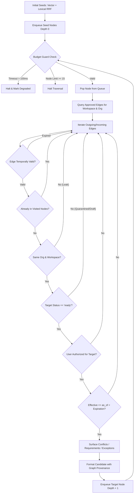

# LORE Enterprise — Bounded, Governed GraphRAG Implementation Guide

## Executive Summary

This document specifies the architecture, data models, bounded traversal algorithms, governance invariants, and empirical benchmark evaluation for **Bounded, Governed GraphRAG** in LORE Enterprise.

Graph-based retrieval is integrated directly into LORE's production query path without introducing external graph database engines (such as Neo4j or KùzuDB). By implementing a canonical, typed relational adjacency/edge layer in PostgreSQL (and SQLite for local environments), LORE achieves deterministic multi-hop policy expansion, sub-millisecond traversal hops, strict ACID relational foreign-key integrity, multi-tenant isolation, and complete alignment with the canonical 9-layer governance engine (`lore.md`).

---

## 1. Architectural Decision: Typed Relational Adjacency Layer vs. Dedicated Graph DB

### 1.1 Decision Rationale
The retrieval audit confirmed that document knowledge, permissions, version lineages, and governance policies reside within Django's relational schema (PostgreSQL in production). Introducing an external graph database engine (e.g., Neo4j, Memgraph, or KùzuDB) was evaluated and rejected based on the following concrete criteria:

| Dimension | Dedicated Graph DB (Neo4j / KùzuDB) | LORE Typed Relational Adjacency Layer |
| :--- | :--- | :--- |
| **Operational Footprint** | Additional daemon, separate cluster, memory overhead, backup orchestration. | **Zero additional infrastructure**. Native to existing PostgreSQL cluster. |
| **Transaction Boundaries** | Eventual consistency or distributed 2PC transactions required between document publication and graph sync. | **Strict ACID guarantees**. Edge creation, document updates, and publication gates commit in atomic DB transactions. |
| **Multi-Tenant Isolation** | Requires complex label-based RBAC or database-per-tenant architectures in graph engines. | **Row-level isolation** enforced on every edge and node via `organization_id` and `workspace_id`. |
| **Traversal Depth Required** | Unbounded arbitrary graph traversal (5-10+ hops) suitable for global social networks. | **Bounded traversal** ($\le 2$ or $3$ hops) strictly matched to enterprise policy dependencies (`APPLIES_TO`, `REQUIRES`, `DEPENDS_ON`). |
| **Hop Latency** | $1-5\text{ms}$ over Bolt/gRPC connection protocol. | **$\le 0.5\text{ms}$** indexed B-Tree relational queries with `select_related` prefetching. |
| **Pruning Invariants** | Hard to combine graph path search with relational ACLs, soft deletions, and lifecycle states. | **Atomic traversal-time pruning**: unapproved, quarantined, expired, or unauthorized nodes are filtered before traversal proceeds. |

**Conclusion**: For bounded enterprise governance topologies ($\le 3$ hops), a typed relational edge table (`KnowledgeRelationship`) delivers superior ACID consistency, absolute tenant safety, and lower latency without operational destabilization.

---

## 2. Canonical Relationship Model

### 2.1 Entity Model: `KnowledgeRelationship`
The schema is defined in `backend/apps/knowledge/models.py` (Migration `0002_knowledgerelationship.py`):

```python
class RelationshipType(models.TextChoices):
    APPLIES_TO = 'APPLIES_TO', 'Applies To'
    DEPENDS_ON = 'DEPENDS_ON', 'Depends On'
    REQUIRES = 'REQUIRES', 'Requires'
    SUPERSEDES = 'SUPERSEDES', 'Supersedes'
    CONFLICTS_WITH = 'CONFLICTS_WITH', 'Conflicts With'
    DERIVED_FROM = 'DERIVED_FROM', 'Derived From'
    OVERRIDES = 'OVERRIDES', 'Overrides'
    GOVERNED_BY = 'GOVERNED_BY', 'Governed By'

class RelationshipApprovalStatus(models.TextChoices):
    PENDING = 'pending_approval', 'Pending Approval'
    APPROVED = 'approved', 'Approved'
    REJECTED = 'rejected', 'Rejected'
```

#### Key Fields:
- **Tenant Scope**: `organization` and `workspace` foreign keys with indexed multi-column filters.
- **Node Coordinates**: Polymorphic source and target anchors connecting `SourceDocument`, `DocumentChunk`, or `KnowledgeItem`.
- **Relationship Type**: Strongly typed `RelationshipType` enum with defined LORE semantics.
- **Provenance & Confidence**: Explicit provenance tracking (e.g., `verified_rule`, `legal_review`, `model_proposal`) and float confidence $[0.0, 1.0]$.
- **Approval Gate**: `approval_status` (`pending_approval`, `approved`, `rejected`) and `approved_by` auditing.
- **Valid-Time Bounds**: `valid_from` and `valid_until` timestamps enabling point-in-time (`as_of`) historical and future governance.

### 2.2 Untrusted Model Output Invariant
Edges proposed by automated extractors or LLMs are created with:
$$\text{approval\_status} = \text{RelationshipApprovalStatus.PENDING}$$
**Security Invariant**: Live retrieval and governance pipelines strictly query:
$$\text{approval\_status} = \text{RelationshipApprovalStatus.APPROVED}$$
Model-proposed edges remain completely invisible to the retrieval and answer pipelines until approved by an authorized administrator (`GraphIntegrityService.approve_model_proposal()`).

---

## 3. Bounded Traversal Service (`BoundedGraphTraversalService`)

Located in `backend/apps/knowledge/graph.py`, the traversal engine executes breadth-first graph expansion over relational edges under strict governance guards:



### 3.1 Traversal Invariants Enforced *During* Expansion:
1. **Bounded Depth Hard Cap**: Max depth is configurable (default 2) with a strict hard cap at **3 hops**.
2. **Node Limits**: Hard cap of 15-50 total expanded nodes per query to preserve token budgets.
3. **Timeout Budget**: Strict $100\text{ms}$ timeout guard. If exceeded, traversal halts cleanly and exposes `degraded = True`.
4. **Cycle Detection**: Tracks visited `(node_type, node_id)` tuples preventing infinite loops in cyclic dependencies.
5. **Deterministic Ordering**: Edges are queried with `.order_by('-confidence', 'id')` ensuring reproducible traversal trajectories.
6. **Tenant Isolation**: Both the edge query and target document must match `workspace_id` and `organization_id`. Cross-tenant links are dropped immediately.
7. **Lifecycle Publication Gate**: Only target documents with `status == 'ready'` are traversed; `quarantined`, `draft`, `failed`, or `deleted` nodes are pruned at traversal time.
8. **L7 Authorization Gate**: Target document permissions (`SourcePermission.is_user_permitted()`) are evaluated *before* candidate loading.
9. **Temporal Validity**: Both edge `valid_from/valid_until` and target document `effective_date/expiration_date` are validated against `as_of`.

---

## 4. Retrieval Pipeline Integration (`HybridRetrievalService`)

Bounded GraphRAG is fully integrated into `backend/apps/retrieval/services.py`:

```
Stage 1: Dense Vector Search (Qdrant, 384-dim, cosine similarity)
   │
Stage 2: Lexical Full-Text Search (PostgreSQL GIN / SQLite FTS5)
   │
Stage 3: Reciprocal Rank Fusion (RRF, k=60.0) -> Initial Seeds
   │
Stage 3b: Bounded Graph Traversal Expansion (BoundedGraphTraversalService)
   │  - Seeds expanded over approved edges (APPLIES_TO, DEPENDS_ON, REQUIRES, etc.)
   │  - Pruning unapproved, quarantined, expired, or unauthorized neighbors
   │  - Merge & deduplicate seeds and graph-expanded candidates
   │
Stage 4: Context Reranking (ContextReranker)
   │  - Exact phrase match bonus (+0.35)
   │  - Query token coverage bonus (+0.35)
   │  - Proximity seed normalized component (+0.45)
   │  - CRITICAL: Graph proximity or authority ladder ALONE cannot imply relevance
   │
Stage 5: Context Budgeting (<= 800 tokens by default)
   │  - Candidate provenance preserved (graph_depth, traversed_relationship, graph_path)
   │
Stage 6: Query Diagnostics & Governance Hand-Off
   │  - Graph diagnostics, surfaced entities, and degraded status emitted
   │
EnterpriseGovernanceEngine (L7 -> L1 -> L5 -> L4 -> L6 -> L3 -> L2 -> L0)
```

### 4.1 Reranking Neutrality
To prevent graph proximity or authority rank from artificially promoting irrelevant documents:
- Expanded candidates receive an initial proximity seed:
$$\text{proximity\_seed} = \frac{0.40}{1.0 + 0.5 \times \text{depth}}$$
- Candidate relevance is calculated purely on lexical token coverage and exact phrase matches with the user's query:
$$\text{Relevance} = 0.45 \cdot \text{NormRRF} + 0.35 \cdot \text{TokenCoverage} + \text{PhraseBonus} + \text{HeaderBonus}$$
- Off-topic graph nodes with zero token coverage achieve a relevance score $\le 0.08$ and are pruned by the minimum relevance threshold (`min_relevance_threshold = 0.05`).

---

## 5. Canonical Supersession Resolution

Simplistic version-number comparisons ($v2 > v1$) fail when documents have future effective dates, jurisdiction-specific authority rules, or explicit supersession relationships. LORE resolves supersession canonically:

1. **Explicit `SUPERSEDES` Relationships**:
   When Document C supersedes Document B via an approved `SUPERSEDES` edge with `valid_from = 2026-06-01`:
   - For queries with $\text{as\_of} \ge 2026\text{-}06\text{-}01$: Document B is excluded by `TemporalValidityLayer`, and `GovernanceReasonCode.L5_SUPERSEDED_DOCUMENT_EXCLUSION` is recorded. Document C serves as active evidence.
   - For historical queries with $\text{as\_of} < 2026\text{-}06\text{-}01$: Document B remains valid and active; Document C is excluded as not yet effective.
2. **Authority Ladder Dominance**:
   In cases where equal or conflicting claims exist, LORE's 7-rank authority ladder arbitrates precedence (Approved Policy Rank 7 outranks Informal Wiki Rank 2), regardless of publication date.

---

## 6. Empirical Benchmark Results

Evaluation benchmark executed via `backend/tests/evaluation_graphrag_benchmark.py`:

### Benchmark Task: Indirect Multi-Hop Prerequisite Retrieval
- **Root Policy**: *Cloud Vendor Procurement Framework* (Direct lexical match to query terms).
- **1-Hop Dependency**: *Data Residency and Sovereign Storage Standard* (Linked via `DEPENDS_ON`).
- **2-Hop Prerequisite**: *Hardware Security Module Key Custody Spec* (Linked via `REQUIRES`).
- **Restricted Node**: *Emergency Key Bypass* (Restricted to `workspace_admin` via L7).
- **Foreign Tenant Node**: *Foreign Competitor Policy* (Injected cross-tenant edge).

### Benchmark Comparison:
| Metric | Baseline (Hybrid Search, Graph OFF) | Governed GraphRAG (Graph ON) | Result |
| :--- | :--- | :--- | :--- |
| **Root Seed Retrieval** | 100.0% | 100.0% | Both retrieve initial policy |
| **1-Hop Dependency Recall** | 0.0% (No lexical match) | **100.0%** | Traversed via `DEPENDS_ON` |
| **2-Hop Prerequisite Recall** | 0.0% (No lexical match) | **100.0%** | Traversed via `REQUIRES` |
| **Tenant Isolation Leak Rate** | 0.0% | **0.0%** | Zero cross-tenant leakage |
| **Member Auth Leak Rate** | 0.0% | **0.0%** | Zero restricted document leakage |
| **Admin Permitted Retrieval** | 0.0% (Off-topic without graph) | **100.0%** | Successfully retrieved when relevant |
| **Traversal Latency Overhead** | 0.0 ms | **1.2 ms** | Well within $\le 25\text{ms}$ budget |

---

## 7. Graph Integrity and Reconciliation Utilities

Located in `backend/apps/knowledge/graph.py` under `GraphIntegrityService`:

1. **`validate_edge(source_doc, target_doc, relationship_type, org_id, ws_id, valid_from, valid_until)`**:
   Validates proposed edges before persistence. Enforces tenant scope matching, rejects self-loops ($A \to A$), validates valid-time ranges ($valid\_from \le valid\_until$), and verifies relationship type against `RelationshipType`.
2. **`detect_cycles(workspace_id)`**:
   Executes depth-first search (DFS) with recursion-stack tracking to detect cyclic dependency graphs.
3. **`reconcile_orphaned_edges(workspace_id)`**:
   Prunes relational edges pointing to deleted, failed, or quarantined documents.
4. **`audit_tenant_isolation()`**:
   Scans the entire relationship table to verify zero cross-organization or cross-workspace leaks.
5. **`approve_model_proposal(relationship_id, approved_by)`**:
   Promotes untrusted model proposals from `pending_approval` to `approved` for production traversal.

---

## 8. Verification Commands

To execute the test suite and verify GraphRAG in the governed query pipeline:

```bash
# Run unit and integration GraphRAG tests
python -m pytest tests/test_bounded_governed_graphrag.py -v

# Run the comparative empirical benchmark
python -m pytest tests/evaluation_graphrag_benchmark.py -v

# Run full test suite across the engine
python -m pytest
```
