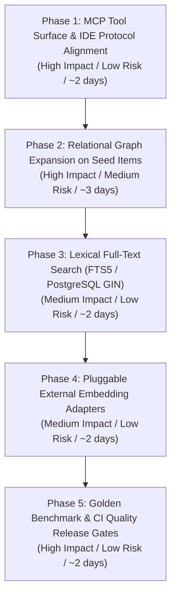

# LORE Enterprise — Engineering Implementation Roadmap

**Document Version:** 2.0 (Execution Roadmap)  
**Date:** October 2026  
**Auditor / Architect:** Antigravity Advanced Agentic Coding Engine  
**Strategy:** Minimal disruption, dependency-ordered, risk-managed progression building directly upon the verified baseline.

---

## 1. Architectural Strategy & Non-Negotiables

1. **Preserve Proven Foundation:**
   - Retain Django 4.2 / PostgreSQL 16 as the canonical relational authority store.
   - Retain Qdrant as the dense vector engine (embedded local filesystem for standalone dev, distributed container for cluster).
   - Retain PyTorch + `SentenceTransformer` (`all-MiniLM-L6-v2`) for local zero-cost semantic embeddings.
   - Retain the complete 9-layer governance engine (`EnterpriseGovernanceEngine`) and canonical contract (`lore.result/2`).
2. **No Unjustified Migrations:**
   - Do NOT migrate to KùzuDB or Neo4j: The relational schema (`SourceDocument`, `DocumentVersion`, `ConflictRecord`, `ScopedException`) already models graph nodes and edges. Multi-hop traversal will be implemented using optimized relational queries / adjacency lists, eliminating the operational complexity and failure modes of a dedicated graph database.
   - Do NOT replace Qdrant with `sqlite-vec`: Qdrant provides mature vector indexing (HNSW), cosine distance, payload filtering, client pooling, and distributed clustering that `sqlite-vec` cannot match.
3. **Strict Phase Gates:**
   - Each phase is self-contained and independently testable.
   - Work in later phases must not begin until previous phase tests pass without regressions.

---

## 2. Dependency-Ordered Roadmap

---

## 3. Phase Specifications

### Phase 1: MCP Tool Surface & IDE Protocol Alignment

- **Objective:** Provide a complete, robust MCP server implementation supporting both canonical dot notation (`lore.*`) and underscore notation (`lore_*`), handling IDE argument conventions (`file_path`, `task_intent`, `response_format`), and exposing key governance utilities.
- **Architectural Rationale:**
  AI advisors in Cursor, Claude Desktop, Antigravity, and VS Code expect canonical tool names and standard parameter shapes. Aligning the MCP surface eliminates integration friction without touching core retrieval logic.
- **Scope of Changes:**
  1. `backend/mcp_server.py`:
     - Register `lore.get_context` and `lore.search` in `TOOLS_MANIFEST`.
     - Implement handler for `lore.check_compliance`: accepts `diff` or `file_path`, runs evaluation against workspace policies, and returns rule verdicts.
     - Implement handler for `lore.detect_conflicts`: returns active `ConflictRecord` entries for a workspace.
     - Implement handler for `lore.get_history`: returns version timeline and supersession chain for a document.
     - Implement handler for `lore.trace`: looks up `DecisionRecord` by `trace_id` or `decision_id`.
     - Support case-insensitive tool dispatch and parameter aliases (`query`, `intent`, `task_intent`, `file_path`).
- **Files to Modify:**
  - `backend/mcp_server.py`
  - `backend/tests/test_retrieval_stack_audit.py`
- **Tests to Execute / Extend:**
  - `python -m pytest tests/test_retrieval_stack_audit.py -k test_06`
  - `python backend/mcp_server.py --test`
- **Invariants:**
  - Zero changes to existing REST endpoints (`/api/v1/retrieval/query/`, etc.).
  - Legacy tool names (`lore_governed_query`, `lore_search`) must remain 100% functional for existing frontend/API callers.
- **Rollback Plan:** Revert `mcp_server.py` to baseline commit.

---

### Phase 2: Relational Graph Expansion on Seed Items (GraphRAG)

- **Objective:** Implement genuine graph neighbor expansion during hybrid retrieval. When seed chunks are retrieved via vector/lexical search, expand them to connected entities (conflicts, superseding versions, scoped exceptions) before context reranking.
- **Architectural Rationale:**
  Closes the GraphRAG capability gap documented in the audit without requiring a separate graph database engine. PostgreSQL/SQLite relational foreign keys and lookup tables already model the necessary graph topology.
- **Scope of Changes:**
  1. Create `backend/apps/retrieval/graph_expansion.py`:
     - `GraphExpansionService.expand_seeds(candidate_chunks, workspace_id)`:
       - **Supersedes Chain:** For each candidate chunk, checks if a newer version of the document exists (`DocumentVersion.version_number > chunk.document_version`). If superseded, pulls the successor chunk to replace the outdated passage.
       - **Conflicts Traversal:** Checks `ConflictRecord` where `source_a == doc.id` or `source_b == doc.id`. Injects the opposing rule passage into the candidate pool tagged with `relation='CONFLICTS_WITH'`.
       - **Exceptions Traversal:** Injects applicable `ScopedException` records for the matched rules tagged with `relation='OVERRIDES'`.
  2. Integrate into `HybridRetrievalService.search` (`backend/apps/retrieval/services.py`):
     - Run graph expansion immediately after RRF fusion, prior to `ContextReranker.rerank`.
- **Files to Modify / Create:**
  - `backend/apps/retrieval/graph_expansion.py` (New)
  - `backend/apps/retrieval/services.py` (Modify `HybridRetrievalService`)
  - `backend/tests/test_retrieval_stack_audit.py` (Update `test_04_graph_traversal_audit_status`)
- **Tests to Execute / Extend:**
  - `python -m pytest tests/test_retrieval_stack_audit.py`
  - `python -m pytest tests/test_governance_p1.py`
- **Invariants:**
  - Expanded graph candidates must respect `L7 PermissionLayer` and `L5 TemporalValidityLayer` (no unapproved or unauthorized nodes enter final context).
  - Context budget ($\le 800$ tokens) must not be exceeded.
- **Rollback Plan:** Remove `graph_expansion.py` call from `HybridRetrievalService.search`.

---

### Phase 3: Lexical Full-Text Search (FTS5 / PostgreSQL GIN) Upgrade

- **Objective:** Upgrade lexical retrieval from naive SQL `icontains` substring matching to production full-text search with BM25/TF-IDF term weighting.
- **Architectural Rationale:**
  `text__icontains` performs unindexed substring scans (`LIKE '%token%'`), which scales poorly on large corpora and fails to rank matches by keyword relevance.
- **Scope of Changes:**
  1. `backend/apps/knowledge/models.py`:
     - Add `search_vector` field or SQLite FTS5 table sync on `DocumentChunk`.
  2. `backend/apps/retrieval/services.py`:
     - In PostgreSQL: Use `django.contrib.postgres.search.SearchVector` and `SearchQuery` with `SearchRank`.
     - In SQLite: Fall back to SQLite FTS5 table or existing `icontains` with token frequency scoring.
  3. Migration:
     - Generate Django migration adding full-text index on `DocumentChunk.text`.
- **Files to Modify:**
  - `backend/apps/knowledge/models.py`
  - `backend/apps/retrieval/services.py`
  - `backend/apps/knowledge/migrations/`
- **Tests to Execute / Extend:**
  - `python -m pytest tests/test_retrieval_stack_audit.py -k test_03`
  - `python -m pytest tests/test_lifecycle_p2.py`
- **Invariants:**
  - Must function seamlessly on both SQLite (local dev) and PostgreSQL (production).
  - Must preserve stable-only serving filter (`document__status='ready'`).
- **Rollback Plan:** Revert `services.py` to the fallback `icontains` query.

---

### Phase 4: Pluggable External Embedding Adapters

- **Objective:** Implement `OpenAIEmbeddingAdapter` and `OllamaEmbeddingAdapter` to fulfill the configurations declared in `settings.py` (`EMBEDDING_PROVIDER`).
- **Architectural Rationale:**
  Allows enterprises with OpenAI or Ollama infrastructure to use centralized embedding models while preserving local `SentenceTransformers` as the default zero-cost engine.
- **Scope of Changes:**
  1. `backend/apps/retrieval/embeddings.py`:
     - Implement `OpenAIEmbeddingAdapter(BaseEmbeddingAdapter)`:
       - Uses `openai.OpenAI(api_key=settings.OPENAI_API_KEY)` or HTTP requests to `text-embedding-3-small`.
       - Supports 384 or 1536 dimensions.
     - Implement `OllamaEmbeddingAdapter(BaseEmbeddingAdapter)`:
       - Calls local Ollama REST endpoint (`settings.OLLAMA_BASE_URL/api/embeddings`).
     - Update `get_embedding_adapter()` factory to dispatch to configured provider.
  2. `backend/apps/retrieval/vector_store.py`:
     - Ensure `QdrantVectorStore` adjusts collection vector dimension to match active adapter dimension (`embedder.dimension`).
- **Files to Modify:**
  - `backend/apps/retrieval/embeddings.py`
  - `backend/apps/retrieval/vector_store.py`
  - `backend/tests/test_saas_security_and_lifecycle.py`
- **Tests to Execute / Extend:**
  - `python -m pytest tests/test_saas_security_and_lifecycle.py -k test_sentence_transformer_embedding_generation`
  - `python -m pytest tests/test_retrieval_stack_audit.py -k test_01`
- **Invariants:**
  - `SentenceTransformerEmbeddingAdapter` remains default when no API key is configured.
  - Failure to contact external API falls back safely to hash projection or circuit-breaker fallback without crashing ingestion.
- **Rollback Plan:** Revert `embeddings.py` changes.

---

### Phase 5: Golden Benchmark & CI Quality Release Gates

- **Objective:** Expand the automated benchmark gold dataset (`tests/data/gold_evaluation_set.json`) and enforce automated CI regression quality gates for every release.
- **Architectural Rationale:**
  Guarantees that ongoing development cannot degrade LORE's core value proposition: 0.00% hallucination rate, 100% correct abstention, and deterministic governance fidelity.
- **Scope of Changes:**
  1. `backend/tests/data/gold_evaluation_set.json`:
     - Expand from 10 test cases (E01-E10) to 25 golden enterprise scenarios covering cross-border data transfer, conflicting healthcare compliance directives, and contractor IP ownership.
  2. CI Test Gate:
     - Ensure `apps/governance/management/commands/run_governance_eval.py` is executable in CI with `--fail-under=95` exit code gating.
- **Files to Modify:**
  - `backend/tests/data/gold_evaluation_set.json`
  - `backend/apps/governance/evaluation.py`
- **Tests to Execute / Extend:**
  - `python manage.py run_governance_eval`
  - `python -m pytest tests/test_evaluation_and_resilience_p3.py`
- **Invariants:**
  - Hallucination rate must strictly equal 0.00%.
  - Any regression in gold test cases blocks CI build.

---

## 4. Phase Comparison & Risk Summary

| Phase | Core Objective | Primary Risk | Mitigation | Estimated Effort |
|---|---|---|---|---|
| **Phase 1** | MCP Tool Surface Alignment | Breaking existing MCP clients | Register aliases side-by-side with backward-compatible defaults | ~2 engineering days |
| **Phase 2** | Relational Graph Expansion | Context token budget bloat | Strict 800-token cap + relevance reranking after expansion | ~3 engineering days |
| **Phase 3** | Lexical FTS5 / GIN Upgrade | SQLite vs PostgreSQL syntax differences | Dual-dialect query dispatch based on `connection.vendor` | ~2 engineering days |
| **Phase 4** | External Embedding Adapters | Network timeouts / billing failures | Local SentenceTransformer default + graceful fallback | ~2 engineering days |
| **Phase 5** | Benchmark & CI Release Gates | Brittle test assertions | Versioned evaluation JSON with golden IDs and state invariants | ~2 engineering days |
