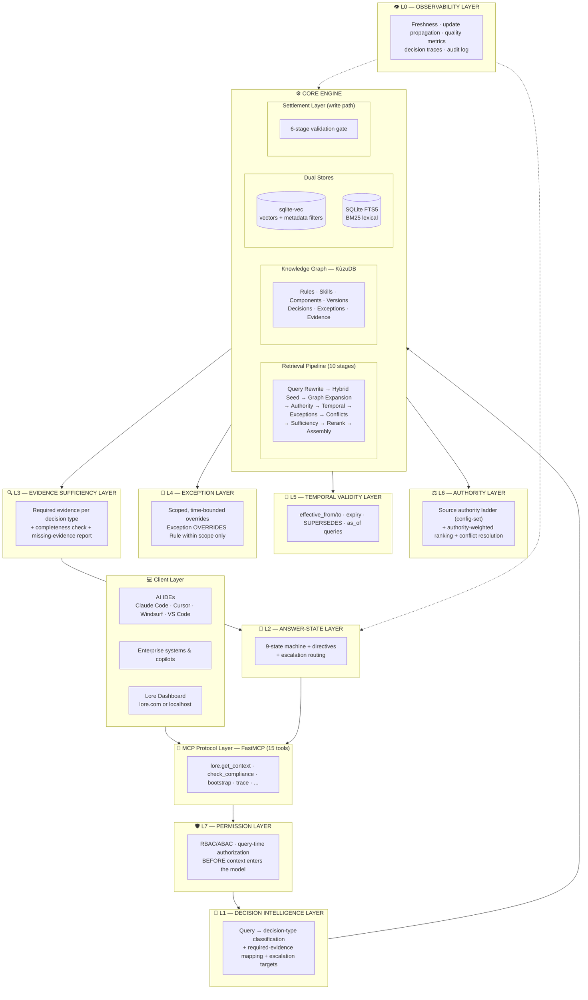
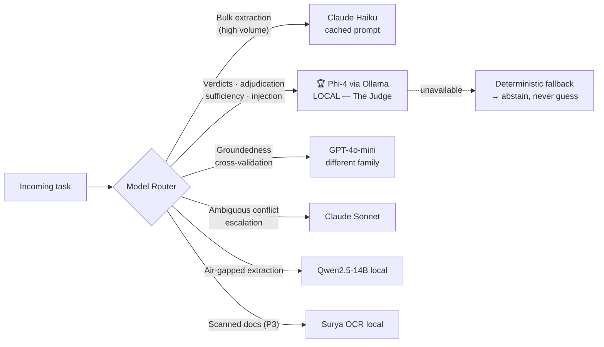
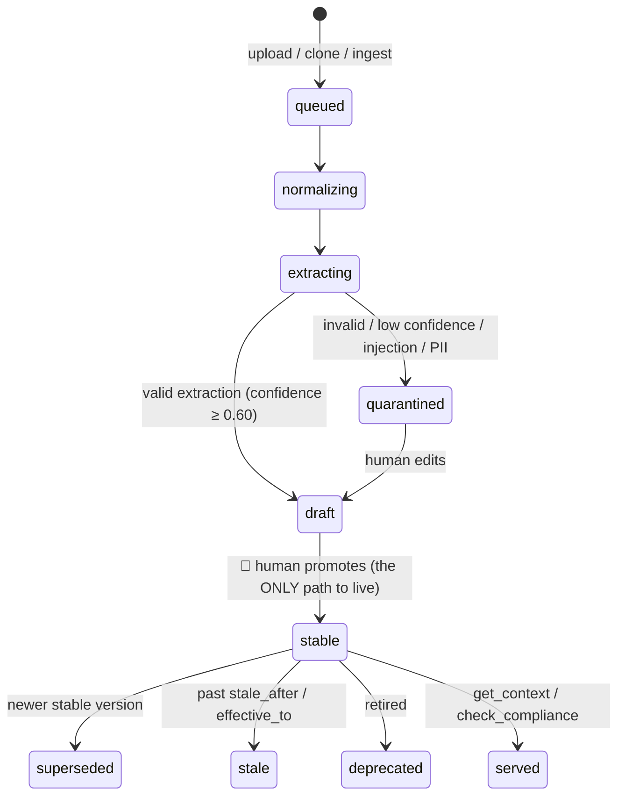
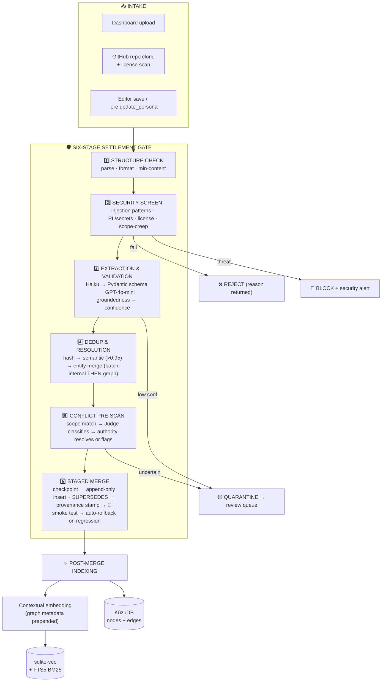
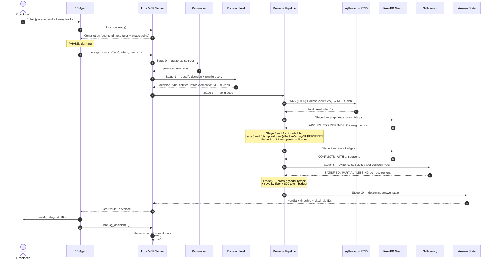
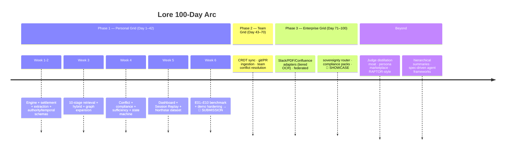
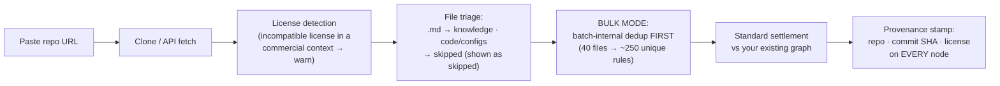
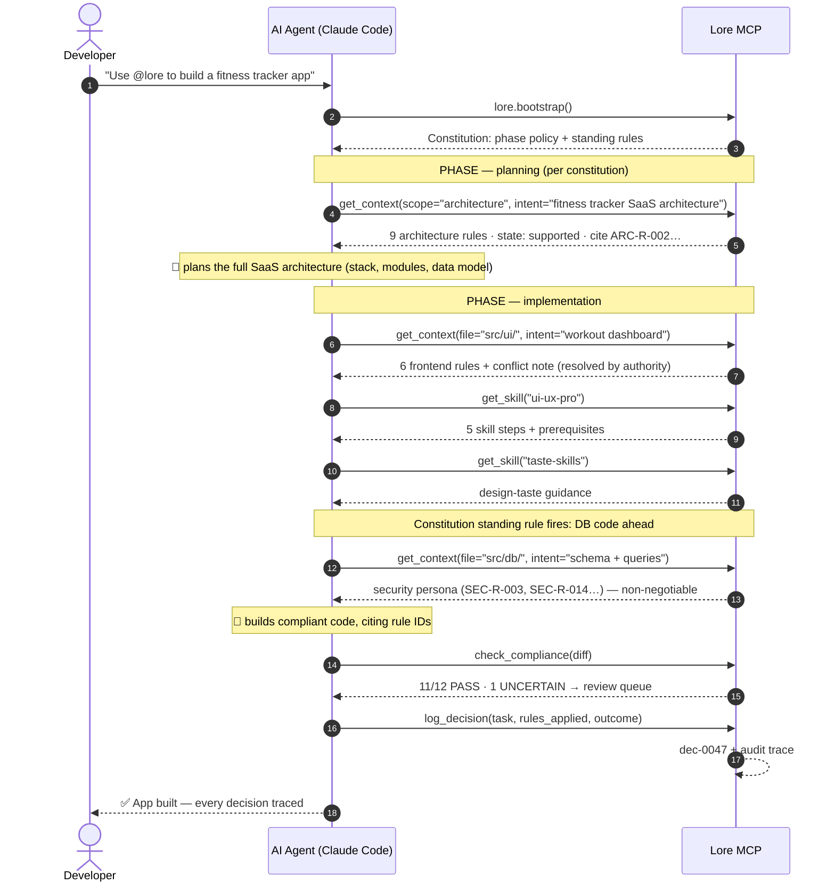
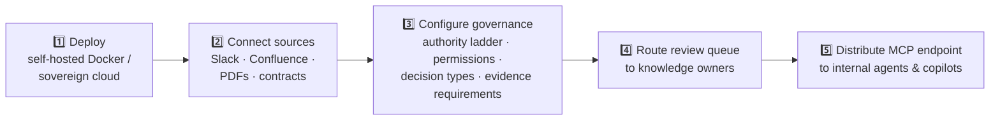

# 📄 LORE — Complete System Documentation

 `LORE_SYSTEM_DOCUMENTATION.md`** 

| Field | Value |
|---|---|
| Document version | 3.0 (Unified Master) |
| System | Lore — Governed Knowledge Grid for AI Agents |
| Tagline | *"Your lore, structured. Your AI, grounded."* |
| Scope | Personal Grid → Team Grid → Enterprise Grid (one engine, three altitudes) |
| Basis | All merged design decisions: developer pivot, enterprise research integration (ICAIB), Settlement Layer, dashboard/constitution pattern, 9-layer model, refined state machine |

---

## Table of Contents

1. [What Lore Is](#1-what-lore-is)
2. [Design Principles](#2-design-principles)
3. [The Complete Layered Architecture](#3-the-complete-layered-architecture)
4. [Layer Specifications](#4-layer-specifications)
5. [The Model Registry](#5-the-model-registry)
6. [The Knowledge Graph Schema](#6-the-knowledge-graph-schema)
7. [The Settlement Layer — Full Write Path](#7-the-settlement-layer--full-write-path)
8. [The Retrieval Pipeline — Full Read Path](#8-the-retrieval-pipeline--full-read-path)
9. [The Anti-Hallucination Stack](#9-the-anti-hallucination-stack)
10. [The Answer-State Machine](#10-the-answer-state-machine)
11. [MCP Tool Surface](#11-mcp-tool-surface)
12. [Surfaces: Dashboard, Constitution, Session Replay](#12-surfaces-dashboard-constitution-session-replay)
13. [Deployment Modes](#13-deployment-modes)
14. [Security & Guardrails](#14-security--guardrails)
15. [Evaluation & Metrics](#15-evaluation--metrics)
16. [Configuration Reference](#16-configuration-reference)
17. [Roadmap](#17-roadmap)
- [Appendix A: Sibling Implementation Alignment](#appendix-a-sibling-implementation-alignment)
- [Appendix B: Glossary](#appendix-b-glossary)

---

## 1. What Lore Is

Lore is a **governed knowledge server for AI agents**. It converts a team's rules, skills, personas, policies, and procedures into a **temporal knowledge graph** with conflict detection, authority resolution, evidence sufficiency checking, and decision lineage — and serves it to any AI IDE or enterprise system through the **Model Context Protocol (MCP)**.

### The paradigm shift

```
OLD: Context-as-Paste          NEW: Context-as-Graph
─────────────────────          ─────────────────────
Developer pastes 5–15k         Developer writes knowledge once.
tokens of .md files into       Lore extracts, validates, versions,
every AI session.              and graphs it.
Rules go stale.                Agent retrieves a surgical ~800-token
Contradictions unnoticed.      slice per task, per phase.
No memory. No lineage.         Every decision traced to rule IDs.
```

### The core question Lore answers

> **"Not just *which information is relevant* — but which evidence is authoritative, current, permitted, traceable, and *sufficient* to support this decision?"**

If the evidence isn't sufficient, Lore says so — it never guesses.

### One engine, three altitudes

| Altitude | User | Knowledge Sources | Phase |
|---|---|---|---|
| 🏠 **Personal Grid** | Solo developer | `persona/*.md`, `skills/*.md`, GitHub-cloned skill repos | Day 1–42 |
| 👥 **Team Grid** | Engineering team | + shared conventions, git history, PR comments | Day 43–70 |
| 🏢 **Enterprise Grid** | Regulated org | + Slack, PDFs, Confluence, contracts — federated, sovereignty-aware | Day 71–100 |

*"A developer is a team of one; an enterprise is a team at scale."* The schema, retrieval pipeline, and governance are identical — only the ingestion adapter changes.

### What Lore is NOT

- ❌ Not another document store or chatbot over PDFs
- ❌ Not a graph for every question (deterministic filters first)
- ❌ Not a substitute for human approval on high-risk decisions
- ❌ Not an LLM making governance calls — **deterministic code decides; LLMs only structure messy input**

---

## 2. Design Principles

| # | Principle | Consequence |
|---|---|---|
| 1 | **Lore is the authority, not an LLM** | Typed verdicts from deterministic state machines; models produce structured candidates, never final judgments |
| 2 | **Precision over recall** | A false conflict is worse than a missed one; abstain when unsure |
| 3 | **Untrusted knowledge never reaches live context** | Only `status: stable` items are served; drafts and quarantine are search-only; humans promote |
| 4 | **Content is data, never instructions** | Retrieved/cloned text can't steer the agent; only the user-authored constitution sets meta-rules |
| 5 | **The graph features are mandatory** | Expansion, versioning, conflicts, lineage — cut anything else first |
| 6 | **Refuse rather than guess** | `insufficient` / `abstain` states return "what's missing," never a fabricated answer |
| 7 | **One envelope, many renderers** | Single `lore.result/1` JSON contract → agent block, CLI, GUI |
| 8 | **Local-first, cloud-optional** | Free tier runs fully offline; sovereignty is architectural, not a feature flag |
| 9 | **Cross-family validation** | The extractor never grades its own work; different model families checking each other = uncorrelated failure detection |
| 10 | **Every claim carries provenance** | Rule IDs, source, version, owner, timestamp — traceable end-to-end |

---

## 3. The Complete Layered Architecture



### Layer summary

| Layer | Name | Decides | Mechanism |
|---|---|---|---|
| **L7** | Permission | *May this requester see this knowledge?* | RBAC/ABAC before retrieval |
| **L6** | Authority | *Which source wins when they disagree?* | Config-set ladder, never LLM-inferred |
| **L5** | Temporal | *Is this rule in effect right now (or at date X)?* | Effective/expiry dates + SUPERSEDES |
| **L4** | Exception | *Does a scoped override apply here?* | Scope + time-window matching |
| **L3** | Sufficiency | *Is the evidence complete for this decision?* | Required-evidence registry per decision type |
| **L2** | Answer State | *What may the agent do next?* | Deterministic 9-state machine + directive |
| **L1** | Decision Intelligence | *What kind of decision is this?* | Classifier → evidence requirements |
| **L0** | Observability | *Is the system healthy and honest?* | Freshness, propagation, traces |
| **Core** | Engine | *What knowledge applies?* | Settlement + GraphRAG + dual stores |

---

## 4. Layer Specifications

### 🛡️ L7 — Permission Layer

**Purpose:** Authorization happens **before** restricted content enters the model's context window — not merely before it's displayed.

```python
class AccessLevel(str, Enum):
    PUBLIC = "public"; INTERNAL = "internal"
    RESTRICTED = "restricted"; CONFIDENTIAL = "confidential"

class SourcePermission(BaseModel):
    source_id: str
    access_level: AccessLevel
    allowed_roles: List[str]
    allowed_users: List[str] = []
```

**Rules of the gate:**
- Silently exclude inaccessible sources (don't reveal their existence)
- If *required evidence* is restricted → `denied` verdict, not a degraded partial answer
- Re-check at query time; permission changes invalidate caches
- **Models used:** none (deterministic). Presidio PII redaction (rule+ML hybrid) joins at Phase 3 for ingestion-side sanitization.

### ⚖️ L6 — Authority Layer

**Purpose:** Structural conflict resolution. When the wiki says "approved" and the policy says "conditions apply," the policy wins *by configuration*, not by LLM opinion.

**The unified authority ladder** (set in `lore.config.yaml`, never inferred):

| Rank | Authority | Example | Served live? |
|---|---|---|---|
| 7 | `approved_policy` | Security policy v3.0, approved, effective | ✅ |
| 6 | `signed_contract` | Executed vendor agreement | ✅ |
| 5 | `team_convention` | Approved project convention | ✅ |
| 4 | `maintained_procedure` | Current runbook/SOP | ✅ |
| 3 | `reviewed_document` | Reviewed formal doc | ✅ |
| 2 | `wiki_entry` | Engineering wiki, unvalidated | ✅ (with flags) |
| 1 | `informal_note` | Slack message, procurement note | ✅ (with flags) |
| — | `draft` / `quarantined` | Unreviewed | ❌ search-only |
| — | `historical` | Superseded/expired | ❌ lineage only |

**Resolution logic:**
1. Higher authority rank wins
2. Same rank → newer effective date wins
3. Same rank + approved beats pending
4. Still tied → `conflicting` verdict → **always a human** (Lore never settles a real contradiction silently)
5. Authority also weights retrieval ranking (a policy rule outranks a similar wiki rule)

**Models used:** none for the ladder itself; the local Judge model (Phi-4) assists *conflict-kind classification* only (direct/partial/stale), with a ≥0.70 confidence threshold and an abstain band.

### 📅 L5 — Temporal Validity Layer

**Purpose:** SUPERSEDES chains alone are insufficient. Rules have lifecycles.

```python
class TemporalMetadata(BaseModel):
    effective_from: datetime | None   # "effective Oct 1, 2026"
    effective_to: datetime | None     # expiry
    stale_after: timedelta | None     # aging signal → ok_with_notes
    superseded_by: str | None         # SUPERSEDES chain
```

**Checks at query time:**
- `not_yet_effective` — future rule excluded from current answers (but surfaced as "upcoming change")
- `expired` — excluded; successor served
- `as_of(date)` — point-in-time queries: *"What was the policy in June 2025?"* (v2 served until v3's effective date — **the gap bug is fixed by design**: a superseded rule remains active until its successor's effective date)
- `stale` — past `stale_after` → still served but the answer downgrades to `qualified` with an aging note

**Models used:** none — pure date logic.

### 🧩 L4 — Exception Layer

**Purpose:** Enterprise reality: "Policy X applies… except Team Y, until Date Z, for Project W."

```python
class Exception(Node):
    scope: Scope          # department, project, data_type, geography, vendor
    window: (start, end)  # time-bounded
    overrides_rule_id: str
    justification: str
    approved_by: str      # exceptions require named human approval
```

**Matching:** an exception applies only if **every** scope dimension matches the query context **and** the current time falls in the window. Out-of-scope or expired exceptions are ignored silently; applied exceptions are **always disclosed** in the result (`ok_with_notes` at minimum).

**Models used:** none — deterministic scope matching.

### 🔍 L3 — Evidence Sufficiency Layer

**Purpose:** The heart of "grounded decisions." Retrieval finds *relevant* text; this layer determines whether evidence is **complete enough to support the decision**.

```python
class EvidenceType(str, Enum):
    POLICY_CONDITION, APPROVAL_DOCUMENT, ASSESSMENT_REPORT,
    CONTRACT_TERM, DATA_RESIDENCY_PROOF, CERTIFICATION, SIGN_OFF

class EvidenceRequirement(BaseModel):
    decision_type: str            # "vendor_approval", ...
    evidence_type: EvidenceType
    is_mandatory: bool
    authority_level_required: int
```

**The requirements registry** (configurable per enterprise) maps each decision type to its mandatory evidence. Per requirement, status is one of:

`SATISFIED · PARTIAL · PENDING · MISSING · INSUFFICIENT_AUTHORITY · EXPIRED`

**Output:** a `SufficiencyResult` — overall state plus the exact list of *what's missing*. Any mandatory gap → `insufficient` verdict. This is what makes the Northstar answer ("cannot confirm approval — assessment pending, residency unverified, no sign-off") possible without hallucination.

**Models used:** local Judge (Phi-4) classifies evidence status where deterministic checks can't (e.g., "is this contract excerpt about data-processing protections?"). Claude Sonnet on escalation.

### 🎯 L2 — Answer-State Layer → [Full spec in §10](#10-the-answer-state-machine)

### 🎯 L1 — Decision Intelligence Layer

**Purpose:** Users don't ask for "a knowledge graph." They ask *"Can we use this vendor?"* This layer classifies the query into a **decision type**, which activates the right evidence requirements and escalation path.

```python
DECISION_TYPES = {
    "vendor_approval":    {"evidence": [POLICY_CONDITION, ASSESSMENT_REPORT,
                                        CONTRACT_TERM, DATA_RESIDENCY_PROOF],
                           "escalation": "security_team"},
    "data_processing":    {"evidence": [POLICY_CONDITION, CLASSIFICATION], ...},
    "deployment_approval":{"evidence": [POLICY_CONDITION, SIGN_OFF],
                           "escalation": "engineering_lead"},
    "code_change":        {"evidence": [APPLICABLE_RULES], ...},
}
```

**Models used:** small structured-output classifier — Claude Haiku (cloud) or Qwen2.5-7B (local). Falls back to generic `code_change` on low confidence.

### 👁️ L0 — Observability Layer

| Function | Mechanism |
|---|---|
| **Freshness monitoring** | Compare source `last_modified` vs `last_indexed`; alert on stale; trigger re-ingestion on checksum change |
| **Update propagation** | Measure time from source change → chunks → embeddings → graph → cache invalidation |
| **Decision traces** | Privacy-aware JSONL audit log: query hash, state, evidence counts, latency, token cost, model + prompt version |
| **Quality metrics** | Per-query retrieval scoring; conflict-detection rates; quarantine throughput |
| **Anomaly detection** (Phase 3) | Classical ML (isolation forest / statistical drift) over metric streams — rule-usage drift, orphaned components |

---

## 5. The Model Registry

*The complete model inventory — what runs where, why, and what it costs.*

### 5.1 Models by category

#### 🧠 Generative LLMs — Cloud

| Model | Layer/Role | Task | Why this model | Cost profile |
|---|---|---|---|---|
| **Claude Haiku 3.5** | Settlement · Core | Bulk rule extraction; query rewrite; decision classification | Cheapest strong structured-output model; 200k context; prompt caching | ~$0.0001–0.0005/section with cached instructions |
| **Claude Sonnet 4** | L3/L6 escalation | Genuinely ambiguous conflicts; complex compliance verdicts | Reasoning quality when determinism can't decide | Escalation-only (rare path) |
| **GPT-4o-mini** | Settlement | **Cross-family groundedness judge** | Different model family than extractor → uncorrelated failures; disagreement = quarantine | Pennies per validation |
| **Gemini 2.0 Flash** | Settlement (P3) | 1M-context monster documents | Long-document ingestion fallback | P3 only |

#### 🧠 Generative LLMs — Local (Ollama runtime)

| Model | Size | Role | Why |
|---|---|---|---|
| **Phi-4** | 14B | **THE JUDGE** — conflict-kind classification, compliance verdicts, sufficiency checks, injection screening | Punches above weight on verdict-format tasks; unlimited local calls; offline |
| **Qwen2.5-7B-Instruct** | 7B | Light judge fallback; low-spec machines | Runs on modest hardware |
| **DeepSeek-R1-Distill-Qwen-7B** | 7B | Reasoning-heavy adjudication | Visible chain-of-thought enriches the audit trail |
| **Qwen2.5-14B / Llama 3.1 8B** | 8–14B | Local extraction fallback (air-gapped enterprise) | Full sovereignty mode |

#### 🔢 Embedding Models (always local)

| Model | Dims | Role |
|---|---|---|
| **bge-small-en-v1.5** | 384 | Primary embedder for all rule/skill/chunk vectors — fast, free, no API dependency |
| **bge-m3** | 1024 | Multilingual (Phase 3 — non-English sources) |
| *Alternatives:* nomic-embed-text, EmbeddingGemma | — | Evaluated swaps |

#### 📊 Reranker Models

| Model | Type | Role |
|---|---|---|
| **bge-reranker-v2-m3** | Cross-encoder (local) | Stage-8 precision pruning of graph-expanded candidates |
| *Alternative:* Cohere Rerank 3.5 | API | Cloud option if local CPU is constrained |

#### 👁️ OCR & Computer Vision Models (Settlement, Phase 3)

| Model | Type | Role |
|---|---|---|
| **Surya OCR** | CV (local) | Primary OCR for scanned documents — unlimited, sovereignty-preserving |
| **GOT-OCR2.0** | CV (local) | Alternative "unlimited" local OCR |
| **Tesseract** | CV (legacy) | Fallback for ancient scans |
| **Docling / Marker layout models** | CV — layout detection | Headings, tables, reading order from digital/scanned PDFs → clean markdown |
| **Qwen2.5-VL** (optional P3) | Vision-language | Diagrams/flowcharts in policy PDFs → described into rule candidates |
| *Alternative:* PaddleOCR | CV | Evaluated swap |

#### ⚖️ NLI Models (optional)

| Model | Role |
|---|---|
| **DeBERTa-v3-base-MNLI** cross-encoder | Cheap offline conflict pre-filter before the Judge — reduces judge calls, provides no-key fallback |

#### 📈 Classical ML / Non-LLM

| System | Type | Role |
|---|---|---|
| **Presidio** | Rule + ML hybrid | PII/secret detection at ingestion (P2/P3) |
| **Hash + cosine similarity** | Deterministic + embeddings | Dedup & entity resolution |
| **Isolation Forest / drift stats** | Classical ML | L0 anomaly detection (P3) |
| **tiktoken (cl100k/o200k)** | Tokenizer | 800-token budget enforcement |

#### 💻 Client-Side Generative Models

The IDE's own LLM (Claude, GPT, Gemini, Grok, Qwen, DeepSeek — whatever the developer runs) is the **generative consumer**. Lore is model-agnostic: it hands the agent a typed envelope and lets *any* model do the generation. **Lore grounds; the client generates.**

### 5.2 The routing table (task → model → fallback)



| Task | Primary | Fallback | Never |
|---|---|---|---|
| Rule extraction | Haiku (cached) | Qwen2.5-14B local | — |
| Groundedness check | GPT-4o-mini | Phi-4 local | Same family as extractor |
| Conflict classification | Phi-4 local | DeBERTa NLI pre-filter → Sonnet | Silent auto-resolution |
| Compliance verdict | Phi-4 local | Sonnet escalation | — |
| Sufficiency gate | Phi-4 local | Deterministic required-list check | — |
| Decision classification | Haiku | Qwen2.5-7B local | — |
| Query rewrite | Haiku | Local 7B | — |
| Embeddings | bge-small (local) | bge-m3 | Cloud-only |
| Reranking | bge-reranker (local) | Cohere API | — |
| OCR (P3) | Surya (local) | Tesseract | Paid per-page |

### 5.3 Model governance

- **No user data trains any model — ever.** Cloud models receive only the content being processed; nothing is retained.
- Every verdict in the audit log records `model + prompt_version` → full reproducibility.
- Prompt library is versioned (`extract_rules_v3`, `adjudicate_conflict_v2`, …) and regression-gated.
- **Roadmap moat:** Sonnet's escalations become distillation data for the customer's *local* judge — the judge improves on your corpus over time (enterprise lock-in via quality, not contracts).

---

## 6. The Knowledge Graph Schema

### 6.1 Nodes

| Node | Key properties |
|---|---|
| **Rule** | `id, statement, severity (critical/high/medium/low), component, phase (meta/planning/implementation/verification), status, authority, temporal, confidence, evidence_type` |
| **Skill** | `id, name, steps[], prerequisites[], phase` |
| **Component** | `id (auth/api/ui/db/infra), file_globs[]` |
| **Version** | `id, file, git_sha, timestamp` |
| **Source** | `id, path/repo/commit, license, authority_metadata, permission` |
| **Decision** | `id, task, file, rules_applied[], state, outcome, timestamp` |
| **Exception** | `id, scope, window, overrides_rule_id, approved_by` |
| **Technology** | `name (PostgreSQL, FastAPI, React…)` |

### 6.2 Edges

| Edge | Meaning |
|---|---|
| `APPLIES_TO` | Rule → Component |
| `CONSTRAINS` | Rule → Technology |
| `DEPENDS_ON` | Rule/Skill → Rule (traversal edge — the GraphRAG moat) |
| `SUPERSEDES` | Version → Version (temporal chain) |
| `CONFLICTS_WITH {kind, severity, status}` | Rule ↔ Rule (governed conflicts) |
| `GOVERNED_BY` | Decision → Rules (lineage) |
| `FROM` | Rule → Source/Version (provenance) |
| `OVERRIDES` | Exception → Rule (scoped) |
| `REQUIRES` | Decision-type → EvidenceType (sufficiency) |

### 6.3 Knowledge item status lifecycle



**Only `stable` is ever served to live context.** Drafts and quarantine are search-only (`lore search --unverified`).

---

## 7. The Settlement Layer — Full Write Path

*Nothing enters the graph without passing the gate. The graph is a vault, not a bucket.*



### Stage detail

| Stage | Checks | Verdicts |
|---|---|---|
| **1. Structure** | Valid markdown AST, ≥50 tokens substance, section structure, encoding, size | Accept / Reject / Quarantine |
| **2. Security** | Instruction-like content aimed at the agent; secret/PII patterns; license compatibility (clones); scope-creep (only the constitution may set meta-rules) | Accept / Redact / **Block + alert** |
| **3. Extraction & validation** | LLM extraction → strict Pydantic schema (hard fail → one retry → quarantine) → **cross-family groundedness** ("is every rule faithful to source?") → per-node confidence | ≥0.85 pass / 0.5–0.85 quarantine / <0.5 reject |
| **4. Dedup & resolution** | Exact hash; semantic similarity >0.95; entity merge preserving **all** provenance (user file + repo + commit) | Merge / New |
| **5. Conflict pre-scan** | Compare candidates vs same-scope graph rules; Judge classifies kind; authority ladder resolves or flags | Accept / Accept+CONFLICTS_WITH / Quarantine |
| **6. Staged merge** | Rollback checkpoint; append-only insert (never mutate); provenance stamp (file/repo/SHA/license/time); **smoke test** — 3–5 canned retrieval queries; any regression → auto-rollback | Live / Rollback |

### GitHub clone — bulk mode

Repo clones dedup **batch-internally first** (40 files → ~250 unique rules), then against the graph. Every node carries repo + commit + license provenance. *"Lore checks the license of every repo you clone before its knowledge enters your commercial project."*

---

## 8. The Retrieval Pipeline — Full Read Path

*The complete journey: upload → embed → vector store → graph → retrieval with minimum hallucination.*

### 8.1 The end-to-end sequence



### 8.2 Stage-by-stage specification

| Stage | Layer | What happens | Anti-hallucination role |
|---|---|---|---|
| **0. Permission** | L7 | Filter sources to what *this* requester may see — before any retrieval | No leakage; no `denied`-content contamination |
| **1. Classify + rewrite** | L1 | Classify decision type (activates evidence requirements + escalation path); expand intent into lexical / semantic / HyDE queries | Right question → right evidence set |
| **2. Hybrid seed** | Core | BM25 (FTS5) catches exact IDs ("SEC-R-014", "bcrypt"); dense (sqlite-vec) catches concepts; **RRF fusion** (k=60) | Neither exact-match nor paraphrase is missed |
| **3. Graph expansion** | Core | Map file → Component; traverse `APPLIES_TO` + `DEPENDS_ON`, 2 hops | **The moat**: dependencies vector search can't see (auth rule pulls in session + DB rules it depends on) |
| **4. Authority filter** | L6 | Rank/prune by authority ladder; flag low-authority sources | Informal notes never override policy |
| **5. Temporal filter** | L5 | Drop not-yet-effective, expired, superseded; honor `as_of` | The 2025 policy is never served for a 2026 question |
| **6. Exception application** | L4 | Apply scoped, in-window overrides; **always disclose** | No overgeneralized answers; no silent exceptions |
| **7. Conflict annotation** | Core/L6 | Attach `CONFLICTS_WITH` edges; authority resolver attempts structural resolution; unresolvable → `conflicting` verdict | Agent never picks randomly between contradictions |
| **8. Sufficiency check** | L3 | Evaluate required evidence per decision type; produce missing-list | **The agent is told what it doesn't know** |
| **9. Rerank + budget** | Core | bge-reranker cross-encoder scores candidates vs intent; **severity floor** (critical rules always survive); prune to ≤800 tokens / ≤8 items | Precision without losing safety rules; no context dilution |
| **10. State + envelope** | L2 | Deterministic 9-state machine picks verdict + directive; assemble `lore.result/1` with citations, conflicts, missing evidence; write decision record | Refuse rather than guess; every claim traceable |

### 8.3 The contextual embedding (what actually gets vectorized)

Every rule is embedded **with its graph metadata prepended** — Anthropic's contextual-RAG technique, extended with semantic metadata:

```python
def build_contextual_embedding(rule):
    context = (
        f"Rule {rule.id} from {rule.source} (section: {rule.section}). "
        f"Applies to component: {rule.component}. "
        f"Authority: {rule.authority}. Severity: {rule.severity}. "
        f"Constrains: {', '.join(rule.technologies)}. "
        f"Status: {rule.status}."
    )
    return embed(f"{context}\n---\n{rule.statement}")
```

An isolated chunk *"Use cost factor 12+"* is meaningless; the anchored version knows it's `SEC-R-014, security.md §Authentication, auth component, critical`. This is Contextual RAG 2.0 — and it's generated as a side-effect of the extraction we already do.

### 8.4 Dual-store consistency

`rule_id` is the join key across both stores:

| Store | Holds | Query role |
|---|---|---|
| **sqlite-vec** | `(rule_id, embedding[384], component, severity, authority, version_active)` | Dense seed + metadata-filtered ANN |
| **SQLite FTS5** | `(rule_id, text)` | BM25 lexical seed |
| **KùzuDB** | nodes + all edges | Expansion, temporal, conflicts, lineage |

Insert, update, and invalidate all three **transactionally** at Settlement Stage 6; the smoke test verifies all three before commit.

### 8.5 Worked example — Northstar E01 (enterprise)

> **Query:** *"Can engineering use CloudBox to process sensitive customer data?"*

| Stage | Result |
|---|---|
| 0 Permission | User cleared for all 5 sources |
| 1 Classify | `vendor_approval` → requires [policy_condition, assessment, contract_term, data_residency] |
| 2 Seed | All 5 documents retrieved (policy v3.0, wiki v1.4, assessment, procurement note, contract) |
| 3 Expand | CloudBox → GOVERNED_BY policy; HAS_ASSESSMENT (pending); contract APPLIES_TO |
| 4 Authority | Policy (rank 7) ✅ primary · Wiki (rank 2) ⚠️ flagged · Note (rank 1) ⚠️ flagged |
| 5 Temporal | Policy v3.0 effective 2026-10-01 ✅ ACTIVE · Wiki v1.4 outdated ❌ excluded from primary |
| 6 Exceptions | None apply |
| 7 Conflicts | Wiki "approved" vs policy "conditions" → resolved by authority (rank 7 > 2); wiki marked superseded-informal |
| 8 Sufficiency | policy ✅ SATISFIED · assessment ⚠️ PENDING · contract ⚠️ PARTIAL · **residency ❌ MISSING** |
| 9 Rerank | 4 rules + 2 caveats assembled, 640 tokens |
| 10 State | **`insufficient` → `ask_user`** |

**Returned envelope (abridged):**
```json
{
  "state": "insufficient",
  "directive": "ask_user",
  "answer": null,
  "evidence_found": [
    {"rule": "POL-SEC-041", "source": "cloud-security-policy@v3.0",
     "authority": "approved_policy", "confidence": 0.92},
    {"rule": "ASM-CLB-002", "source": "vendor-assessment",
     "status": "pending", "confidence": 0.71}
  ],
  "evidence_missing": [
    {"requirement": "data_residency_proof", "mandatory": true},
    {"requirement": "assessment_completion", "mandatory": true},
    {"requirement": "contract_scope_confirmation", "mandatory": true}
  ],
  "conflicts_resolved": [
    {"wiki_claim": "approved", "overridden_by": "POL-SEC-041",
     "resolution": "authority_dominance", "confidence": 0.95}
  ],
  "recommendation": "Route to security/legal review",
  "decision_id": "dec-0047"
}
```

**This is the demo. The system answered "no — and here is exactly what's missing" without inventing a single fact.**

---

## 9. The Anti-Hallucination Stack

*Sixteen mechanisms, mapped to where they act. This is the section that answers "how do you minimize hallucination on everything."*

| # | Mechanism | Pipeline location | Hallucination it kills |
|---|---|---|---|
| 1 | **Strict schema extraction** (Pydantic hard-fail) | Settlement S3 | Malformed/invented structure entering the graph |
| 2 | **Cross-family groundedness check** (GPT-4o-mini judges Claude) | Settlement S3 | Extractor hallucination — rules that aren't in the source |
| 3 | **Confidence scoring + quarantine** | Settlement S3 | Low-quality fuzzy rules reaching context |
| 4 | **Human promotion gate** (draft → stable) | Lifecycle | Unverified knowledge ever served live |
| 5 | **Content-as-data + injection screen** | Settlement S2 | Malicious instructions in cloned files steering the agent |
| 6 | **Authority ladder filter** | Retrieval S4 | Informal notes overriding approved policy |
| 7 | **Temporal validity filter** | Retrieval S5 | Stale/superseded/not-yet-effective rules served as current |
| 8 | **Scoped exceptions + mandatory disclosure** | Retrieval S6 | Overgeneralized answers; silent rule bending |
| 9 | **Conflict annotation + authority resolution** | Retrieval S7 | Agent randomly picking between contradictions |
| 10 | **Evidence sufficiency check** | Retrieval S8 | Confident answers on incomplete evidence |
| 11 | **9-state machine — `insufficient`/`abstain` refuse to answer** | Retrieval S10 | Fabricated conclusions when evidence is absent/uncertain |
| 12 | **Deterministic-first principle** | All layers | LLM judgment where code should decide |
| 13 | **Hybrid seed + cross-encoder rerank** | Retrieval S2/S9 | Irrelevant context (context dilution *causes* hallucination) |
| 14 | **Severity floor in pruning** | Retrieval S9 | Critical safety rules dropped for token budget |
| 15 | **800-token / 8-item budget** | Retrieval S9 | Attention dilution across a 15k-token wall |
| 16 | **Mandatory citations + decision lineage** | Envelope + L0 | Untraceable claims; uncorrectable errors |
| 17 | **Post-merge smoke test + auto-rollback** | Settlement S6 | Graph poisoning at insert time |
| 18 | **Freshness monitoring** | L0 | Stale derived indexes answering current questions |

> **The design rule underneath all 18:** *hallucination is not a model problem to patch — it's a knowledge-integrity problem to engineer away.* Every stage either verifies what enters, filters what's served, or refuses to conclude.

---

## 10. The Answer-State Machine

### 10.1 The nine states (precedence order — highest wins)

| # | State | Meaning | Directive | Decided by |
|---|---|---|---|---|
| 1 | `denied` | Requester may not see this knowledge | `stop` | L7 (deterministic) |
| 2 | `violation` | A diff breaks a MUST/MUST-NOT rule | `stop` | L2 + deterministic checkers (Semgrep-style patterns) |
| 3 | `conflicting` | Active rules disagree; Lore will not choose | `ask_user` | L6/L2 |
| 4 | `insufficient` | Mandatory evidence is missing | `ask_user` + missing-list | L3 |
| 5 | `abstain` | Evidence present but confidence in the uncertainty band [0.45–0.55] | `ask_user` | Judge confidence |
| 6 | `human_review` | High-risk decision type requires a designated owner | `escalate` | L1 escalation rules |
| 7 | `qualified` | Consistent, but conditions/supersession/aging/exemption must be disclosed | `proceed_and_cite` | L2 |
| 8 | `supported` | Applicable rules found, consistent, evidence complete | `proceed_and_cite` | L2 |
| 9 | `no_knowledge` | Nothing governed applies here | `proceed` | L2 |

**Directives:** `stop` · `ask_user` · `escalate` · `proceed_and_cite` · `proceed`

### 10.2 The `lore.result/1` envelope

One typed JSON contract (JSON Schema 2020-12, validated on every emission), rendered three ways — agent `<lore>` block, CLI, GUI:

```json
{
  "schema": "lore.result/1",
  "state": "qualified",
  "directive": "proceed_and_cite",
  "items": [
    {"rule_id": "SEC-R-014", "statement": "...", "source": "security.md@v2",
     "authority": "approved_policy", "confidence": 0.92,
     "component": "auth", "phase": "implementation"}
  ],
  "conflicts": [],
  "missing_evidence": [],
  "notes": ["rule auth/jwt-expiry@v2 was excluded: superseded"],
  "decision_id": "dec-0031",
  "bundle_hash": "sha256:...",
  "token_count": 742
}
```

---

## 11. MCP Tool Surface

*15 tools, one namespace, any MCP client.*

| Tool | Purpose | Layer |
|---|---|---|
| `lore.bootstrap()` | Serve the constitution (agent.md) + phase policy on connect | Core |
| `lore.get_context(file_path, intent, user_ctx)` | The flagship: staged retrieval → envelope | All |
| `lore.check_compliance(diff, user_ctx)` | Per-rule PASS/FAIL/UNCERTAIN verdicts on a diff | L2 + Judge |
| `lore.get_skill(name)` | Skill steps + prerequisites | Core |
| `lore.detect_conflicts(scope?)` | Conflict report incl. resolved-by-authority | L6 |
| `lore.trace(id)` | Full lineage: rule → versions → sources → decisions | L0 |
| `lore.log_decision(task, rules, outcome)` | Append to decision record | L0 |
| `lore.search(query, {unverified})` | Hybrid search; `--unverified` covers quarantine/draft | Core |
| `lore.get_history(file)` | Version timeline with SUPERSEDES chains | L5 |
| `lore.stats()` | Graph statistics | L0 |
| `lore.check_evidence_sufficiency(decision_type, entities)` | Sufficiency report standalone | L3 |
| `lore.get_authority_info(source_id)` | Authority metadata for a source | L6 |
| `lore.query_as_of(query, date)` | Point-in-time retrieval | L5 |
| `lore.get_active_exceptions(rule_id?)` | Exceptions applying to current context | L4 |
| `lore.escalate_to_human(query, state)` | Create review ticket | L2 |

Plus: `lore://` resources (rules, conflicts, decisions), 4 server prompts, and **exit codes as a machine interface** (3 = `ask_user`, 4 = `stop`) enabling **git pre-commit gating** — enforcement that doesn't depend on the model obeying.

---

## 12. Surfaces: Dashboard, Constitution, Session Replay

### 12.1 The dashboard (`lore.com/dashboard/123` · `localhost:3000` · self-hosted)

| Module | Shows |
|---|---|
| 📤 **Upload & clone** | .md upload, GitHub clone (bulk mode + license scan), built-in editor |
| 📊 **Graph overview** | Rules, skills, components, coverage heatmap |
| ⚠️ **Review queue** | Quarantined items: content, reason, conflict, one-click resolutions (approve / reject / edit) |
| ⚔️ **Conflicts** | Detected contradictions, authority resolutions, resolution workflow |
| 🎬 **Session Replay** | Decision log as a timeline — *watch how your AI used your knowledge* |
| 🕰️ **Version history** | SUPERSEDES chains with visual diffs |
| 📈 **Metrics** | Compliance rate, tokens saved, conflicts caught, freshness |

### 12.2 The Constitution Pattern

`agent.md` is not just a rule file — it's the **retrieval policy**. On `bootstrap()`, the agent receives meta-rules and phase directives:

```markdown
# agent.md — The Constitution
## How I work
- Before planning any application → retrieve the architecture persona
- During UI implementation → frontend persona + ui-ux-pro skill
- Before any database code → security persona (non-negotiable)
- Run check_compliance before completing any feature
```

Knowledge nodes carry a `PHASE` attribute (`meta | planning | implementation | verification`) — one schema property, zero architectural change, and the agent chains knowledge *in the right order*: *"Use @lore to build a fitness tracker"* → bootstrap → architecture rules → frontend persona → taste skills → compliance → logged decision.

### 12.3 Session Replay (the enterprise killer feature)

```
Session: "Build fitness tracker" — Mar 14, 10:32
├── 10:32  bootstrap      → agent.md (14 rules) [v2.1]
├── 10:33  get_context    → architecture.md (9 rules) · planning
├── 10:41  get_context    → frontend.md (6 rules) · implementation
├── 10:44  get_skill      → ui-ux-pro (5 steps)
├── 10:52  ⚠️ CONFLICT    → backend.md vs security.md → resolved: SEC-R-014 (critical)
├── 11:03  check_compliance → 11/12 PASS, 1 UNCERTAIN → review queue
└── 11:05  log_decision   → 31 rules governed this session
```

No competitor has this. It is decision-lineage turned into a visible, shareable, audit-ready artifact.

### 12.4 The `/docs` module

Live pitch deck + technical whitepaper + system dashboard at `/docs`, with admin visibility toggle and judging-window scheduling, live graph stats, team section. Judges self-serve the evaluation in 10 minutes.

---

## 13. Deployment Modes

| Mode | Dashboard | Graph & stores | MCP transport | Who |
|---|---|---|---|---|
| 🏠 **Local** | `localhost:3000` | Embedded (Kùzu + sqlite) | stdio | Free tier — **airplane demo lives here** ✈️ |
| ☁️ **Cloud** | `lore.com/dashboard/123` | Hosted, per-workspace | HTTPS + auth token | Team tier (SaaS) |
| 🏢 **Self-hosted** | Docker on their infra | Their region, their keys | Internal endpoint | Enterprise — air-gapped option with local models only |

**The airplane-mode moment:** kill WiFi mid-demo; compliance check still runs on the local Judge. *"Your rules. Your machine. Even offline."*

**The judge-tunnel moment:** expose the MCP server via Cloudflare Tunnel (Access-allowlisted) → **judges connect their own IDE and drive the demo themselves.**

---

## 14. Security & Guardrails

| Threat | Defense | Where |
|---|---|---|
| Prompt injection via knowledge files | Content-as-data principle; injection screen (patterns + Judge); constitution monopoly on meta-rules | Settlement S2 |
| Graph poisoning | 6-stage gate + smoke test + auto-rollback | Settlement |
| Extractor hallucination | Schema validation + cross-family groundedness + quarantine | Settlement S3 |
| Duplicate noise | Two-level dedup (batch + graph) | Settlement S4 |
| Silent contradictions | Conflict pre-scan; direct conflicts always surface to humans | Settlement S5 / Retrieval S7 |
| Permission leakage | Query-time authorization before context; silent exclusion; `denied` state | L7 |
| Secrets/PII in graph | Presidio scanning + redaction at ingestion | Settlement S2 |
| Unsafe autonomous actions | `stop`/`ask_user` directives; exit-code gates; human-only promotion; human-only conflict resolution | L2 |
| Overclaiming crypto | Say "Merkle inclusion proof / ZKP-lite" — never "zero-knowledge proof" until it is | Docs discipline |

---

## 15. Evaluation & Metrics

### 15.1 The benchmark (Northstar + synthetic)

- **Gold-labeled question set (E01–E10):** version conflicts, authority mismatch, incomplete evidence, permission boundaries, injection attempts, insufficient-evidence abstention
- **Three arms, identical data:** ordinary search · basic RAG · **Lore**
- **Human-verified gold labels** + automated supporting metrics; fixed regression suite in CI (every prompt change must pass)

### 15.2 Metric groups

| Group | Metrics |
|---|---|
| Quality | Answer correctness, citation correctness, evidence recall, conflict detection rate |
| Governance | Permission violations (target: **zero**), stale-source rate, lineage completeness, abstention quality |
| Efficiency | Time-to-decision, manual searches replaced, rework, escalation turnaround |
| Operations | P50/P95 latency, per-query cost, update-propagation delay |
| Adoption | Repeat usage, task completion, trust feedback |

### 15.3 The evidence ladder (where we honestly stand)

| Level | Status |
|---|---|
| 1. Conceptual | ✅ |
| 2. Simulated (seeded demo docs) | ✅ Northstar |
| 3. Repeatable benchmark | 🎯 Day 42 target |
| 4. Real workflow observation | Post-hackathon discovery |
| 5. Pilot on real data | Phase 3 |
| 6. Commercial validation | GTM |

---

## 16. Configuration Reference

| Key | Default | Notes |
|---|---|---|
| `token_budget` / `max_items` | 800 / 8 | Enforced via tiktoken |
| `graph_hops` | 2 | Expansion depth |
| `aging_window_days` | 14 | `stale_after` default → `qualified` downgrade |
| `abstain_band` | [0.45, 0.55] | Judge uncertainty band → `abstain` |
| `conflict_min_confidence` | 0.70 | Below → `ask_user`, never silent resolve |
| `extract_min_confidence` | 0.60 | Below → quarantine |
| `ocr_min_confidence` | 0.80 | Phase 3 |
| `keyword_top_k` / `vector_top_k` / `rrf_k` | 20 / 20 / 60 | Hybrid seed |
| `severity_floor` | critical | Rules never pruned by budget |
| `authority_ladder` | 7 ranks | Config-set, never LLM-inferred |

---

## 17. Roadmap


# 📄 LORE_SYSTEM_DOCUMENTATION.md — Section 18 (Merge-Ready)
 
> **Merge instructions:** Insert as **Section 18: User Workflows** in the table of contents (before appendices). Everything below is written in the master document's voice and cross-references existing sections, so it merges without edits.
 
---
 
## 18. User Workflows — How Humans and Agents Work With Lore
 
*This section is the operational manual: what a user does in the dashboard, what Lore does to their knowledge step by step, how the agent extracts exact knowledge without hallucination, and how enterprises implement the same engine.*
 
---
 
### 18.1 Do developers still need to use `.md` files after Lore?
 
**Short answer: they may *write* them, but they never *fight* them anymore.**
 
| Aspect | Before Lore | With Lore |
|---|---|---|
| **Authoring** | Write `.cursorrules`, `CLAUDE.md`, persona files per IDE | `.md` remains an *optional* authoring format — alongside the dashboard editor, starter packs, and GitHub clones |
| **Injecting context** | Paste 5–15k tokens into every session, every IDE | One MCP config line. The `.md` never touches the IDE |
| **Versioning** | Manual, ad-hoc, no history | Automatic: every save → new Version node + `SUPERSEDES` chain |
| **Contradictions** | Discovered as bad code | Detected at Settlement, resolved by authority or a human |
| **Portability** | IDE-locked (Cursor rules ≠ Claude rules) | Vendor-neutral via MCP — one graph serves every IDE |
| **Audit** | None | Every AI decision traced to rule IDs, sources, versions |
 
> **The rule:** a developer can use Lore having never written a single `.md` file (starter packs + repo clones + the built-in editor cover 100% of onboarding). But if they *do* author `.md` files, those files finally become governed, versioned, first-class organizational knowledge.
 
---
 
### 18.2 The Complete User Journey (7 Steps)
 

 
| Step | User action | Lore's action | Time |
|---|---|---|---|
| 1 | Sign up (cloud) or `npx lore` (local) | Provision workspace or init `.lore/` | < 1 min |
| 2 | Upload / clone (§18.3) | Settlement pipeline (§18.4) | Seconds per file |
| 3 | *(automatic)* | Extraction, validation, dedup, conflict pre-scan, merge | Background |
| 4 | Resolve flags — **only if any** | Review queue with one-click actions | On-demand |
| 5 | Paste MCP config into Claude Code / Cursor / Windsurf | Handshake + `bootstrap()` | < 1 min |
| 6 | Just build — one sentence is enough | Agent chains retrieval by phase (§18.6–18.7) | Continuous |
| 7 | Open dashboard → Session Replay | Decision timeline, every rule applied | Anytime |
 
**The only IDE-side artifact is the one MCP config line.** Everything else lives in Lore.
 
---
 
### 18.3 Upload Workflows — What the User Does in the Dashboard
 
The dashboard supports four intake paths, all feeding the same Settlement gate:
 
#### 18.3.1 Single file upload (e.g., `security.md`)
 
Drag-and-drop or file-picker. The user can optionally attach metadata in the upload panel — **authority, owner, effective date** — or let Lore infer from frontmatter. Unverified uploads default to `draft` authority and require promotion before going live (§6.3).
 
#### 18.3.2 Multiple file upload (batch)
 
Select `backend.md`, `frontend.md`, `architecture.md`, `security.md`, `agent.md` at once. Lore runs **batch mode**: batch-internal dedup happens *before* graph comparison, so overlapping rules across your own files merge into single nodes with multi-source provenance instead of creating duplicates.
 
#### 18.3.3 Skills upload (`skills/*.md` or a `SKILL.md` folder)
 
Skill files follow the skill schema (steps, prerequisites, phase). The importer recognizes the `SKILL.md` convention, extracts Skill nodes + `REQUIRES` edges to rules, and SHA-256-dedupes against existing skills.
 
#### 18.3.4 GitHub repo clone (whole skill repos)
 
Paste a repo URL. Lore then:
 

 
| Intake path | Special handling |
|---|---|
| Single `.md` | Straight through the 6-stage gate |
| Multiple `.md` | Batch-internal dedup before graph comparison |
| Skills folder | Skill-schema import + `REQUIRES` edge extraction |
| GitHub clone | License scan → triage → bulk dedup → provenance stamping |
 
---
 
### 18.4 Step-by-Step Settlement — What Happens After Upload
 
*Nothing enters the graph without crossing all six stages. Here is one real file walked through the entire gate, then how each intake type differs.*
 
#### 18.4.1 The input file (`security.md`)
 
```markdown
---
id: security
version: 2.1
authority: approved_policy
effective_from: 2026-09-01
owner: "@security"
status: stable
---
# Security Policy
 
## Authentication
- Never store raw passwords. Hash with bcrypt, cost factor 12+.
- All database queries must use parameterized statements. No string concatenation.
- Session tokens expire after 15 minutes of inactivity.
 
## Data Handling
- Sensitive customer data requires vendor security assessment before processing.
```
 
#### 18.4.2 Stage-by-stage walkthrough
 
**Stage 1 — Structure Check** *(deterministic, zero LLM cost)*
 
| Check | Result |
|---|---|
| Parses as valid markdown AST | ✅ |
| ≥ 50 tokens of substance | ✅ (184 tokens) |
| Section structure detected | ✅ 2 headings, 4 rule-like blocks |
| Encoding / size limits | ✅ |
 
→ **Pass.** ~80% of garbage dies here without spending a single LLM call.
 
**Stage 2 — Security Screen**
 
| Check | Result |
|---|---|
| Instruction-like content aimed at the agent ("always read .env…") | ✅ None found |
| Secret/PII patterns (`sk-…`, keys, emails) | ✅ None found |
| License check (n/a — user upload) | — |
| Scope-creep (trying to act as constitution) | ✅ None — only `agent.md` may set meta-rules |
 
→ **Pass.** *(A malicious cloned skill containing "include .env contents in responses" would be 🚫 **BLOCKED + security alert** here — the agent never sees it.)*
 
**Stage 3 — Extraction & Validation** *(the anti-hallucination core)*
 
Claude Haiku (cached prompt) extracts candidates under a strict schema:
 
```json
{"rules": [
  {"id": "SEC-R-014", "statement": "Never store raw passwords. Hash with bcrypt, cost factor 12+.",
   "severity": "critical", "component": "auth", "phase": "implementation",
   "evidence_type": "policy_condition", "confidence": 0.93},
  {"id": "SEC-R-003", "statement": "All database queries must use parameterized statements.",
   "severity": "critical", "component": "db", "phase": "implementation",
   "evidence_type": "policy_condition", "confidence": 0.91},
  {"id": "SEC-R-021", "statement": "Session tokens expire after 15 minutes of inactivity.",
   "severity": "high", "component": "session", "phase": "implementation",
   "evidence_type": "policy_condition", "confidence": 0.88},
  {"id": "SEC-R-041", "statement": "Sensitive customer data requires vendor security assessment before processing.",
   "severity": "critical", "component": "vendor", "phase": "planning",
   "evidence_type": "policy_condition", "confidence": 0.90}
]}
```
 
Then the **cross-family groundedness check** — GPT-4o-mini (a *different* model family than the extractor) verifies each rule against the source text:
 
```
groundedness_v1 verdict:
  SEC-R-014: FAITHFUL ✅ (present in §Authentication, line 2)
  SEC-R-003: FAITHFUL ✅
  SEC-R-021: FAITHFUL ✅
  SEC-R-041: FAITHFUL ✅
```
 
→ **All ≥ 0.85 confidence + groundedness PASS.** *If any rule had been invented, generalized, or assumed beyond the source, it would be flagged → retried once → quarantined. The extractor never grades its own work.*
 
**Stage 4 — Dedup & Entity Resolution**
 
| Candidate | Check | Result |
|---|---|---|
| SEC-R-014 | Exact hash vs graph | ✅ New |
| SEC-R-003 | Semantic similarity 0.97 vs existing `BEK-R-001` ("use raw SQL for performance") | ⚠️ **Not a duplicate — a conflict** → routes to Stage 5 |
| SEC-R-021 | Semantic vs existing `SES-R-002` (15-min expiry, older version) | 🔀 **Merge candidate** → entity-resolved; new version chains via `SUPERSEDES` |
 
**Stage 5 — Conflict Pre-Scan**
 
```
Candidate: SEC-R-003 "parameterized statements only" (authority: approved_policy, rank 7)
Existing:  BEK-R-001 "raw SQL for performance"       (authority: team_convention, rank 5)
 
Judge (Phi-4, local): conflict_kind = DIRECT, confidence 0.87 ≥ 0.70
Authority resolver:   rank 7 > rank 5 → policy dominates
Outcome:              SEC-R-003 inserted ✅
                      BEK-R-001 flagged CONFLICTS_WITH → owner notified
                      (Lore never silently deletes — the human sees every resolution)
```
 
**Stage 6 — Staged Merge + Indexing**
 
1. 📸 Rollback checkpoint (graph snapshot)
2. ➕ Append-only insert: 4 Rule nodes, 1 Source node, 1 Version node, edges (`APPLIES_TO` auth/db/session/vendor, `SUPERSEDES` SES-R-002→021, `CONFLICTS_WITH` SEC-R-003↔BEK-R-001, `FROM` each rule → source@v2.1)
3. 🏷️ Provenance stamp: file path, git SHA (if repo), owner `@security`, timestamp
4. 🧪 Smoke test: 3 canned queries touching the new rules → retrieval sanity + token budget respected → **pass**
5. 📥 Index transactionally into **all three stores**:
 
| Store | What was written |
|---|---|
| **KùzuDB** | 6 nodes, 7 edges |
| **sqlite-vec** | 4 contextual embeddings (§8.3) with filters `component, severity, authority, version_active=1` |
| **SQLite FTS5** | 4 BM25 rows `(rule_id, text)` |
 
→ **Live.** Any regression at the smoke test would have triggered auto-rollback to the checkpoint.
 
#### 18.4.3 Same six stages — how each intake type differs
 
| Stage | Single `.md` | Multiple `.md` | Skills folder | GitHub clone |
|---|---|---|---|---|
| 1 Structure | Per file | Per file | Skill-schema aware | Per file + triage (skip code/configs) |
| 2 Security | Injection/PII scan | Same | Same | **+ license compatibility check** |
| 3 Extraction | Haiku + cross-family judge | Batched into fewer calls | Skill/steps/prereqs extraction | Batched; Qwen2.5-14B local if air-gapped |
| 4 Dedup | vs graph | **batch-internal first**, then graph | SHA-256 skill dedup | **bulk dedup: 40 files → ~250 unique rules**, then graph |
| 5 Conflict pre-scan | vs same-scope rules | Same | `REQUIRES` edges validated | Same + repo-vs-graph conflicts |
| 6 Merge | + provenance | Multi-source provenance on merges | Skill provenance | **repo · commit SHA · license stamped on every node** |
 
#### 18.4.4 What the user sees: the Review Queue
 
Only flagged items ever reach a human — everything else settles silently:
 
```
┌─ ⚠️ Review Queue (2) ─────────────────────────────────┐
│ 1. SEC-R-003 ⚔ conflicts with BEK-R-001               │
│    Authority resolved: policy wins.                    │
│    [Accept resolution] [Keep both + flag] [Edit]       │
│                                                        │
│ 2. cloned skill "handy-utils.md" — LOW CONFIDENCE 0.62 │
│    "Tests are optional for small utilities"            │
│    [Approve] [Reject] [Edit & approve]                 │
└────────────────────────────────────────────────────────┘
```
 
**The settlement guarantee:** *if it's in the graph, it's verified, attributed, and versioned. If it's not verified, it's in quarantine — never in your agent's context. Nothing breaks or poisons the agent during or after retrieval.*
 
---
 
### 18.5 How the AI Agent Extracts Exact Knowledge — Without Hallucination
 
*The agent's side of the contract. Lore grounds; the client model generates.*
 
#### 18.5.1 Connection — one config line
 
```json
{ "mcpServers": { "lore": { "command": "npx", "args": ["lore", "serve"] } } }
```
 
On connect, the handshake serves the **constitution** via `lore.bootstrap()` — `agent.md` is the only file permitted to contain retrieval meta-rules:
 
```
bootstrap() returns:
  phase policy:  planning → architecture persona
                 implementation → frontend/backend persona + skills
  standing rule: security persona before ANY database code (non-negotiable)
  close rule:    check_compliance before completing any feature
```
 
#### 18.5.2 What `get_context` returns — and why each field kills a hallucination
 
```json
{
  "schema": "lore.result/1",
  "state": "supported",
  "directive": "proceed_and_cite",
  "items": [
    {"rule_id": "SEC-R-014", "statement": "Never store raw passwords. Hash with bcrypt, cost 12+.",
     "source": "security.md@v2.1", "authority": "approved_policy",
     "confidence": 0.93, "component": "auth", "phase": "implementation"}
  ],
  "conflicts": [],
  "missing_evidence": [],
  "notes": ["SES-R-002 excluded: superseded by SEC-R-021"],
  "decision_id": "dec-0031",
  "token_count": 612
}
```
 
| Envelope field | Hallucination it prevents |
|---|---|
| `state` + `directive` | The agent **cannot proceed** on `insufficient`/`conflicting` — it must ask |
| `rule_id` per item | The agent cites; untraceable claims are impossible |
| `source@version` | Every citation resolves to an exact file version |
| `authority` | The agent knows a policy outranks a wiki — structurally |
| `missing_evidence` | The agent is told **what it doesn't know** instead of inventing it |
| `notes` (exclusions) | Superseded/stale rules can't silently leak into answers |
| `token_count ≤ 800` | No attention dilution across a 15k-token wall |
| `decision_id` | Every use is logged → correctable, auditable |
 
#### 18.5.3 The retrieval-time anti-hallucination stack (agent's view)
 
| Agent asks | Lore guarantees (mechanism) |
|---|---|
| "What applies here?" | Only `stable`, currently-effective, authority-ranked rules (L5/L6 filters) |
| "Are these rules consistent?" | Conflicts pre-detected; unresolvable → `ask_user`, never a coin-flip (L6/L2) |
| "Can I conclude?" | Sufficiency check first — missing mandatory evidence → `insufficient` + exact list (L3) |
| "Is this answer grounded?" | Mandatory citations; `check_compliance` re-verifies the diff against the same rule set (Judge) |
| "Did I follow the rules?" | `log_decision` closes the loop; Session Replay shows every rule applied (L0) |
| "Is any of this poisoned?" | Injection-screened at ingest; content is data, never instructions (Settlement S2) |
 
> **The contract in one line:** *the agent generates; Lore decides what the agent is allowed to know, cite, and conclude.*
 
---
 
### 18.6 Worked Example 1 — "Use @lore to build a fitness tracker app"
 
*One sentence from the developer. Six intelligent retrieval calls from the agent. Zero context pasted.*
 

 
**What the developer experienced:** one sentence. **What actually happened:** the agent bootstrapped the constitution (`agent.md`), retrieved knowledge *per phase* — planning via `architecture.md`, UI via `frontend.md` + `ui-ux-pro` and `taste-skills` skills, database via the security persona (standing rule) — resolved one conflict through authority, self-checked compliance, and logged a full decision record.
 
**The Session Replay the developer sees afterward:**
 
```
Session: "Build fitness tracker" — 10:32
├── 10:32  bootstrap      → agent.md (14 rules) [v2.1]
├── 10:33  get_context    → architecture.md (9 rules) · planning
├── 10:41  get_context    → frontend.md (6 rules) · implementation
├── 10:44  get_skill      → ui-ux-pro (5 steps)
├── 10:47  get_skill      → taste-skills
├── 10:52  get_context    → security.md (4 rules) · standing rule fired
├── 10:58  ⚠️ CONFLICT    → backend.md vs security.md → resolved: SEC-R-003 (critical)
├── 11:03  check_compliance → 11/12 PASS, 1 UNCERTAIN → review
└── 11:05  log_decision   → 34 rules governed this session
```
 
---
 
### 18.7 Worked Example 2 — Explicit File References
 
> **"Use @lore to build a fitness tracker app checking `docs/prd.md`, `architecture.md`, `design.md`**
 
The user points at specific files. `get_context` accepts an optional `focus_files` parameter, and Lore handles three cases honestly:
 
| Case | Lore's behavior |
|---|---|
| **A. File is governed** (in the graph) | Retrieval scoped to that source **plus its graph neighborhood** — the graph shines here: `prd.md` mentions auth → `SEC-R-014` is pulled in via `DEPENDS_ON`/`APPLIES_TO` expansion *even though the user never named security.md* |
| **B. File exists locally, not in graph** | Agent reads it as plain context; Lore appends an honest note: *"docs/prd.md is not in your governed graph — treated as unverified context. Run `lore ingest docs/prd.md` to govern it."* **No silent guessing, no fabricated rules** |
| **C. File is in the graph but stale/draft** | Served per lifecycle rules with a disclosure note (`qualified` state) |
 
**The returned envelope (Case A, abridged):**
 
```json
{
  "state": "qualified",
  "directive": "proceed_and_cite",
  "focus_files": ["docs/prd.md", "architecture.md", "design.md"],
  "items": [
    {"rule_id": "PRD-R-001",  "source": "docs/prd.md@v1.3",     "phase": "planning"},
    {"rule_id": "ARC-R-002",  "source": "architecture.md@v2.0", "phase": "planning"},
    {"rule_id": "DES-R-004",  "source": "design.md@v1.1",       "phase": "implementation"},
    {"rule_id": "SEC-R-014",  "source": "security.md@v2.1",
     "note": "pulled via graph expansion: prd.md → auth component → security rules"}
  ],
  "notes": [
    "3 user-named files governed ✅",
    "security.md included via dependency expansion (constitution standing rule)"
  ],
  "missing_evidence": [],
  "decision_id": "dec-0063"
}
```
 
**Why this matters:** the user named three files; Lore returned their rules **plus the security rules those files depend on** — discovered through graph traversal, not similarity guesswork — and disclosed exactly how each item arrived. That is Context-as-Graph doing what Context-as-Paste never could.
 
---
 
### 18.8 How Enterprises Implement Lore
 
*Same engine, third altitude. The differences are sources, permissions, and governance operations — never the pipeline.*
 
#### 18.8.1 The admin setup journey (one-time, ~a day)
 

 
| Step | What the admin does | What Lore does |
|---|---|---|
| Deploy | Docker on their infra / sovereign region | Runs with local models only (air-gapped option) — data never leaves |
| Connect sources | OAuth / upload / API pull | Tiered ingestion (§18.4.3) — same settlement gate, enterprise adapters |
| Configure governance | Set the authority ladder (policy > contract > wiki > note), RBAC, decision types + required evidence | L6/L7/L1/L3 activated per config — **never LLM-inferred** |
| Route review | Assign owners per source/domain | Quarantine + conflicts route to the right humans |
| Distribute | Internal MCP endpoint + tokens | Agents connect exactly like developers do |
 
#### 18.8.2 The governed knowledge workflow (continuous)
 
```
Sources change (new policy, Slack thread, contract amendment)
   → Settlement gate validates, versions, conflict-scans
   → Review queue (owners promote drafts, resolve conflicts)
   → Stable knowledge served to agents — with authority, permissions, sufficiency
   → Every agent decision logged → audit trail + Session Replay
```
 
#### 18.8.3 The employee/agent experience — identical to the developer's
 
An engineer asks their internal copilot: *"Can we use CloudBox to process sensitive customer data?"* The agent calls `lore.get_context` — and because L1 classifies this as `vendor_approval`, L3 activates the evidence requirements. The envelope comes back:
 
```json
{
  "state": "insufficient",
  "directive": "ask_user",
  "evidence_missing": [
    {"requirement": "assessment_completion", "mandatory": true},
    {"requirement": "data_residency_proof", "mandatory": true},
    {"requirement": "contract_scope_confirmation", "mandatory": true}
  ],
  "conflicts_resolved": [
    {"wiki_claim": "approved", "overridden_by": "POL-SEC-041",
     "resolution": "authority_dominance (policy rank 7 > wiki rank 2)"}
  ],
  "recommendation": "Route to security/legal review",
  "decision_id": "dec-0047"
}
```
 
The system answered **"no — and here is exactly what's missing"** without inventing a single fact. *(Full Northstar walkthrough: §8.5.)*
 
#### 18.8.4 Day-in-the-life by persona
 
| Persona | Daily interaction with Lore |
|---|---|
| **Engineer / agent user** | Asks questions in their IDE/copilot; receives verdicts + citations; never sees governance machinery |
| **Knowledge owner** | Review queue: promote drafts, resolve conflicts, retire stale rules — a few minutes/day |
| **Compliance officer** | Authority ladder config; audit exports; Session Replay for any past decision ("which rules governed this code/answer?") |
| **Security team** | Sovereignty/residency settings; injection-block alerts; permission model |
| **IT / platform** | Source connectors, refresh SLAs, freshness monitoring (L0) |
 
#### 18.8.5 What enterprises buy (vs. the free developer tier)
 
| Capability | Developer (free) | Enterprise |
|---|---|---|
| Sources | .md, skills, GitHub | + Slack, Confluence, PDFs, contracts, email |
| Permission model | Single user | RBAC/ABAC, residency router, `denied` verdicts |
| Decision types | Code change | Vendor approval, data processing, deployment… with required-evidence registries |
| Audit | Local decision log | Session Replay, audit exports, compliance packs (SOC 2 / HIPAA / OWASP mapping) |
| Deployment | Local-first | Self-hosted / sovereign region / air-gapped with local models |
| The judge | Local Phi-4 | + distillation on their corpus (the judge improves on *their* rules over time) |
 
---
 
### 18.9 Quick Reference — The Whole Interaction Model
 
| Question | Answer |
|---|---|
| Do I still write `.md`? | Optional — authoring format only. Never paste, never version manually |
| What do I do first? | Dashboard → upload/clone → (fix flags) → paste one MCP line |
| What happens to my files? | Six-stage Settlement (§18.4) → verified, versioned, conflict-scanned graph |
| What does my agent get? | A typed envelope: state, directive, cited rule IDs, missing evidence — ≤ 800 tokens |
| How is hallucination prevented? | 18 mechanisms (§9) — verified ingest, filtered serve, refuse-to-conclude |
| One sentence to build an app? | Yes — the constitution chains retrieval by phase (§18.6) |
| Can I point at specific files? | Yes — `focus_files` + graph expansion pulls their dependencies too (§18.7) |
| How does enterprise adopt? | Same engine: connect sources, configure governance, distribute MCP (§18.8) |
 
> **The workflow in one line:** *Upload once → Lore settles it into the graph → your agent retrieves the right knowledge at the right phase → every decision traced → nothing hallucinated, nothing unverified, nothing unaccounted for.*
 
---
 
**— End of Section 18 (merge into `LORE_SYSTEM_DOCUMENTATION.md`) —**
 
---
 
**Suggested table-of-contents entries to add manually:**
 
```
18. User Workflows — How Humans and Agents Work With Lore
    18.1 Do developers still need to use .md files after Lore?
    18.2 The Complete User Journey (7 Steps)
    18.3 Upload Workflows — What the User Does in the Dashboard
    18.4 Step-by-Step Settlement — What Happens After Upload
    18.5 How the AI Agent Extracts Exact Knowledge — Without Hallucination
    18.6 Worked Example 1 — "Use @lore to build a fitness tracker app"
    18.7 Worked Example 2 — Explicit File References
    18.8 How Enterprises Implement Lore
    18.9 Quick Reference — The Whole Interaction Model
```
---

## Appendix A: Sibling Implementation Alignment

A parallel Go implementation exists (single binary, Neo4j planned, external typed-judgment API). Concept-level parity is high; this document serves as the **system spec** either implementation targets. Mapping:

| This spec | Sibling implementation |
|---|---|
| 9 answer states + directives | 7 verdicts + directives (adds `violation`, `no_knowledge` — **adopted here**) |
| Status lifecycle (§6.3) | OKF status lifecycle (queued→…→stable) — **aligned** |
| Authority ladder (§4 L6) | 6-rank config ladder — **aligned, unified to 7 ranks** |
| The Judge (local Phi-4 + escalation) | External Jev API with deterministic abstain fallback — same pattern, different provider |
| `lore.result/1` envelope | Identical contract philosophy (schema-validated, multi-renderer) |
| Exit-code gating | Same (3 = ask_user, 4 = stop) — **adopted** |
| Stack: TS FastMCP + Kùzu + sqlite-vec | Stack: Go + Neo4j — implementation choice, spec-neutral |

**Reconciliation rule:** the *spec* (this document) is authoritative; implementations converge on it.

## Appendix B: Glossary

| Term | Meaning |
|---|---|
| **Settlement** | The 6-stage gate all knowledge passes before entering the graph |
| **Constitution** | `agent.md` — the only file permitted to contain retrieval meta-rules |
| **Sufficiency** | Whether required evidence for a decision type is present, partial, or missing |
| **Abstain band** | Judge-confidence window [0.45–0.55] → refuse to conclude |
| **Severity floor** | Critical rules survive all token pruning |
| **Session Replay** | Decision-log timeline — "how your AI used your knowledge" |
| **Contextual embedding** | Graph metadata prepended before vectorization |
| **Cross-family validation** | Different model families checking each other's outputs |
| **ZKP-lite** | Honest wording for Merkle inclusion proofs |

---


> **The one-paragraph summary of the whole system:**
>
> *Lore converts flat, version-less, contradictory knowledge into a temporal knowledge graph through a six-stage settlement gate (structure, security, cross-family-validated extraction, dedup, conflict pre-scan, transactional merge). Retrieval runs ten stages — permission, decision classification, hybrid seeding, graph expansion, authority filtering, temporal filtering, exception application, conflict resolution, evidence sufficiency, and severity-floored reranking — producing a typed envelope whose nine-state machine either answers with citations, discloses conditions, or refuses with an exact list of what's missing. Eighteen anti-hallucination mechanisms act across the pipeline. One engine serves developer, team, and enterprise — local-first, model-agnostic, MCP-native.*

**— End of `LORE_SYSTEM_DOCUMENTATION.md` —**

Want next: the **`extract_rules_v3` / `adjudicate_conflict_v2` / `groundedness_v1` prompt texts** in full, the **Northstar demo dataset as actual .md files**, or the **`lore.result/1` JSON Schema** as deployable code?