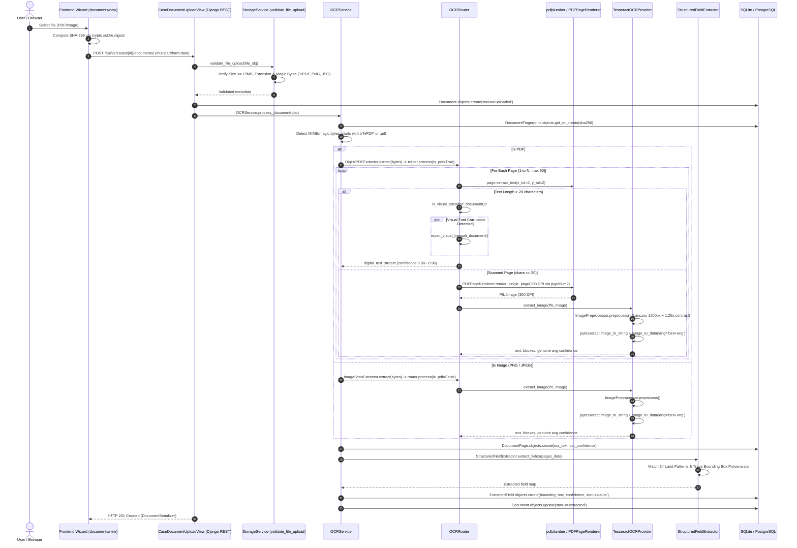

# TECHNOLOGY EXTRACTION REPORT 01: OCR ENGINE, DOCUMENT PROCESSING & OCR–VISION ROUTING

**Target System:** UNBhumi LandGuard Repository (`d:\UnBhumi`)  
**Domain:** Bengali + English Land Records, Registered Deeds, Khatians, Mutation Porchas & Cadastral Sheets  
**Investigator:** Principal OCR Engineer, Computer Vision Researcher, Document AI Architect  
**Classification Standard:** Proved via source code inspection, dependency manifests, runtime environment verification, and test suite execution.

---

## 1. Executive Summary of the OCR Implementation

UNBhumi’s document intake and text extraction architecture is a **hybrid dual-engine system**:
1. **Digital PDF Text Stream Extraction:** Utilizes `pdfplumber` (v0.11.9, wrapping `pdfminer.six`) with a custom deterministic Unicode phonetic repair engine (`repair_visual_bengali_document`) to normalize visual-order Bengali font corruptions (legacy Bijoy/SutonnyMJ exports).
2. **Scanned PDF & Image OCR:** Renders raster pages at **300 DPI** using Google’s PDFium C++ library via `pypdfium2` (v5.6.0), executes safe pixel preprocessing via `Pillow` (v12.2.0), and invokes **Tesseract OCR v5.5.0** via `pytesseract` (v0.3.13) configured with combined bilingual language data (`ben+eng`).

```
                              [ Uploaded Document (PDF / Image) ]
                                               │
                                     (Magic Byte Inspection)
                                               ▼
                             ┌─────────────────┴─────────────────┐
                             │                                   │
                      [ Input: PDF ]                      [ Input: Image ]
                             │                                   │
                    (Page by Page Check)                 (PIL Image Preprocess)
                    Char Count > 20 chars?               1200px Rescale + 1.25x Contrast
                     ├── YES ──> [ pdfplumber ]                  │
                     │           (Visual Unicode Repair)         ▼
                     └── NO  ──> [ pypdfium2 300 DPI ] ──> [ Tesseract OCR ]
                                                           (lang='ben+eng')
                                                                 │
                                                                 ▼
                                                  [ StructuredFieldExtractor ]
                                                  (14 Domain Regex Patterns)
                                                                 │
                                                                 ▼
                                                  [ Database & Provenance ]
                                                  (DocumentPage + ExtractedField)
```

### Critical Architectural Realities Discovered
- **"Computer Vision" is Regex Text Parsing:** The repository contains a module named `backend/services/pipeline/layout.py` declaring `MapVisionProvider` and `TableExtractionProvider`. **No neural computer vision model, no contour detection, and no OpenCV (`cv2`) exist in the codebase.** Both providers operate purely by executing Python regular expressions against pre-extracted OCR text strings. Furthermore, neither provider is called in the active upload or extraction path; they are exercised solely in test fixtures.
- **Single OCR Provider:** The only OCR engine present is local Tesseract. There is no EasyOCR, no PaddleOCR, no cloud API (Google Cloud Vision/AWS Textract), and no vision-language model (VLM).
- **Page-Level Dual Routing:** Routing between native PDF text extraction and raster OCR is decided **per PDF page**, governed by a strict character count threshold: $\le 20$ characters routes the page to 300 DPI rendering and Tesseract OCR; $> 20$ characters keeps the digital text stream.
- **Ephemeral Bounding Boxes:** Tesseract produces word-level bounding boxes and confidence scores via `image_to_data`. However, **the database schema does not persist full-page word bounding boxes.** Only the single bounding box matching an extracted domain field is retained in `ExtractedField.bounding_box`.

---

## 2. Exact OCR Technology & Dependency Inventory

### Core Property Matrix

| Property | Exact Finding | Evidence (File & Line) | Status |
|---|---|---|---|
| **OCR Engine** | Tesseract OCR (v5.5.0.20241111) | [backend/services/pipeline/ocr.py:148-290](file:///d:/UnBhumi/backend/services/pipeline/ocr.py#L148-L290), `pytesseract.get_tesseract_version()` | RUNTIME VERIFIED, ACTIVE PATH |
| **Python Invocation Package** | `pytesseract` (v0.3.13 installed; `>=0.3.10` declared) | [backend/requirements.txt:14](file:///d:/UnBhumi/backend/requirements.txt#L14), [backend/services/pipeline/ocr.py:28-32](file:///d:/UnBhumi/backend/services/pipeline/ocr.py#L28-L32) | RUNTIME VERIFIED, ACTIVE PATH |
| **Inference Functions** | `pytesseract.image_to_string` and `pytesseract.image_to_data` | [backend/services/pipeline/ocr.py:231, 234](file:///d:/UnBhumi/backend/services/pipeline/ocr.py#L231-L234) | RUNTIME VERIFIED, ACTIVE PATH |
| **Digital PDF Extractor** | `pdfplumber` (v0.11.9, wrapping `pdfminer.six` 20251230) | [backend/requirements.txt:12](file:///d:/UnBhumi/backend/requirements.txt#L12), [backend/services/pipeline/ocr.py:16, 502-503](file:///d:/UnBhumi/backend/services/pipeline/ocr.py#L16-L503) | RUNTIME VERIFIED, ACTIVE PATH |
| **PDF Rasterizer** | `pypdfium2` (v5.6.0) rendering to PIL bitmap at 300 DPI | [backend/requirements.txt:13](file:///d:/UnBhumi/backend/requirements.txt#L13), [backend/services/pipeline/ocr.py:22, 292-342](file:///d:/UnBhumi/backend/services/pipeline/ocr.py#L22-L342) | RUNTIME VERIFIED, ACTIVE PATH |
| **EasyOCR / PaddleOCR** | Completely absent from repository and requirements | Search across entire workspace yielded 0 imports, files, or references | IMPLEMENTED: FALSE |
| **Cloud OCR APIs** | Google Cloud Vision / AWS Textract / Azure Form Recognizer not implemented | Mentioned only in documentation/remediation plans ([docs/DEMO_ARCHITECTURE.md:142](file:///d:/UnBhumi/docs/DEMO_ARCHITECTURE.md#L142)) | DOCUMENTED ONLY |
| **Vision-Language Models** | No VLM (Donut, Nougat, ColPali, Florence-2, GOT-OCR) present | [backend/services/pipeline/llm.py:24-85](file:///d:/UnBhumi/backend/services/pipeline/llm.py#L24-L85) uses text-only Ollama/disabled fallback | IMPLEMENTED: FALSE |
| **Bengali Language Model** | `ben.traineddata` (5,712,242 bytes, SHA-256: `d04c2064...`), duplicate `Bengali.traineddata` | [backend/tessdata/](file:///d:/UnBhumi/backend/tessdata), [backend/services/pipeline/ocr.py:67-94](file:///d:/UnBhumi/backend/services/pipeline/ocr.py#L67-L94) | RUNTIME VERIFIED, ACTIVE PATH |
| **English Language Model** | `eng.traineddata` (4,113,088 bytes, SHA-256: `7d4322bd...`) | [backend/tessdata/eng.traineddata](file:///d:/UnBhumi/backend/tessdata/eng.traineddata) | RUNTIME VERIFIED, ACTIVE PATH |
| **Language Combination** | Combined bilingual invocation in single inference call: `lang='ben+eng'` | [backend/services/pipeline/ocr.py:178-180, 231](file:///d:/UnBhumi/backend/services/pipeline/ocr.py#L178-L231) | RUNTIME VERIFIED, ACTIVE PATH |
| **Page Segmentation (PSM)** | Default PSM 3 (Fully automatic page segmentation, no OSD). No `--psm` passed | [backend/services/pipeline/ocr.py:231](file:///d:/UnBhumi/backend/services/pipeline/ocr.py#L231) | IMPLEMENTED, ACTIVE PATH |
| **Engine Mode (OEM)** | Default OEM 3 (LSTM Default engine mode). No `--oem` passed | [backend/services/pipeline/ocr.py:231](file:///d:/UnBhumi/backend/services/pipeline/ocr.py#L231) | IMPLEMENTED, ACTIVE PATH |
| **Custom Parameters** | No whitelist, blacklist, user words, or DPI arguments passed to Tesseract | [backend/services/pipeline/ocr.py:231, 234](file:///d:/UnBhumi/backend/services/pipeline/ocr.py#L231-L234) | IMPLEMENTED, ACTIVE PATH |
| **Model Nature** | Standard pretrained Tesseract 4/5 fast/best LSTM models. No custom fine-tuning | Verified by file sizes, MD5/SHA256 matching official Tesseract distribution | IMPLEMENTED, ACTIVE PATH |
| **Execution Locality** | 100% sovereign local CPU execution. Zero external data transmission | [backend/services/pipeline/ocr.py:231-234](file:///d:/UnBhumi/backend/services/pipeline/ocr.py#L231-L234) | RUNTIME VERIFIED, ACTIVE PATH |
| **Binary Auto-Detection** | Inspects `TESSERACT_CMD`, system `PATH`, Windows standard paths, and `/usr/bin/tesseract` | [backend/services/pipeline/ocr.py:35-64](file:///d:/UnBhumi/backend/services/pipeline/ocr.py#L35-L64) | RUNTIME VERIFIED, ACTIVE PATH |
| **Missing Binary Handling** | Returns graceful dictionary with `status='provider_unavailable'`, `confidence=0.0` | [backend/services/pipeline/ocr.py:211-222](file:///d:/UnBhumi/backend/services/pipeline/ocr.py#L211-L222) | IMPLEMENTED, TESTED |

---

## 3. Source-Grounded Upload-to-OCR Execution Trace

The document journey from client upload to database persistence follows 16 distinct technical phases.



### Detailed Trace by Stage

#### 1. Frontend Upload Component & Request
- **Source:** [frontend/app/documents/new/page.tsx:56-86](file:///d:/UnBhumi/frontend/app/documents/new/page.tsx#L56-L86), [frontend/lib/api.ts:531-554](file:///d:/UnBhumi/frontend/lib/api.ts#L531-L554).
- **Execution:** User selects files in `NewAnalysisPage`. `handleRealFileSelect` reads file buffer and computes in-browser SHA-256 fingerprint using `window.crypto.subtle.digest('SHA-256', buffer)`. In Step 3, `handleSubmit` transmits a `multipart/form-data` POST request containing `file`, `document_type`, `title`, `file_hash`, and `file_size_bytes` via `api.uploadCaseDocument`.

#### 2. HTTP Endpoint & Validation
- **Source:** [backend/apps/documents/views.py:49-102, 181-235](file:///d:/UnBhumi/backend/apps/documents/views.py#L49-L235).
- **Endpoints:** `POST /api/v1/documents/` (standalone) or `POST /api/v1/cases/<id>/documents/` (case-scoped).
- **Execution:** Validates file payload using `validate_file_upload(file_obj)`.

#### 3. File Type & MIME Detection
- **Source:** [backend/services/storage_service.py:14-85](file:///d:/UnBhumi/backend/services/storage_service.py#L14-L85).
- **Execution:**
  1. Size limit: `MAX_FILE_SIZE_BYTES = 15 * 1024 * 1024` (15 MB).
  2. Whitelist: `.pdf`, `.png`, `.jpg`, `.jpeg`.
  3. Header inspection (magic bytes):
     - PDF: starts with `b'%PDF'`
     - PNG: starts with `b'\x89PNG\r\n\x1a\n'[:4]`
     - JPEG: starts with `b'\xFF\xD8\xFF'[:2]`
  4. If mismatch occurs, raises `ValidationError` returning HTTP 400 Bad Request.

#### 4. File Storage & Temporary File Handling
- **Source:** [backend/apps/documents/models.py:36](file:///d:/UnBhumi/backend/apps/documents/models.py#L36), [backend/services/storage_service.py:100-106](file:///d:/UnBhumi/backend/services/storage_service.py#L100-L106).
- **Execution:** File is saved to `media/documents/%Y/%m/` via Django’s `FileField`. In-memory `file_bytes` are read directly from `file_obj.read()` or from disk path.

#### 5. File Hashing & Duplicate Enrollment
- **Source:** [backend/services/ocr_service.py:94-126](file:///d:/UnBhumi/backend/services/ocr_service.py#L94-L126), [backend/apps/documents/models.py:47-62](file:///d:/UnBhumi/backend/apps/documents/models.py#L47-L62).
- **Execution:** Generates canonical SHA-256 via `hashlib.sha256()`. Enrolls the hash in `DocumentFingerprint.objects.get_or_create(file_hash=...)`. If the exact hash already exists in another case, it is not rejected at upload; rather, downstream Rule `D001` detects cross-case duplication during fraud evaluation.

#### 6. Format Branching (PDF vs. Image)
- **Source:** [backend/services/ocr_service.py:131-140](file:///d:/UnBhumi/backend/services/ocr_service.py#L131-L140).
- **Execution:** Inspects `raw_bytes.startswith(b'%PDF')` or filename `.endswith('.pdf')`. Directs execution to `DigitalPDFExtractor` or `ImageScanExtractor`.

#### 7. Page Counting & Splitting
- **Source:** [backend/services/pipeline/ocr.py:573-594](file:///d:/UnBhumi/backend/services/pipeline/ocr.py#L573-L594).
- **Execution:** Opened via `pdfplumber.open(f_stream)`. Loops through pages `1` to `min(len(pdf.pages), max_pages)`. Default page limit is capped at 50 in `DocumentScanPreviewView:264`. For images, page count is always 1.

#### 8. PDF Text Layer Extraction
- **Source:** [backend/services/pipeline/ocr.py:493-552](file:///d:/UnBhumi/backend/services/pipeline/ocr.py#L493-L552).
- **Execution:** Calls `page.extract_text(x_tolerance=2, y_tolerance=2)` and `page.extract_words(x_tolerance=2, y_tolerance=2)`. Tight 2-point tolerance prevents broken character boundaries in mixed Bangla/English words.

#### 9. Image Rendering (for Scanned PDFs)
- **Source:** [backend/services/pipeline/ocr.py:292-342, 345-390](file:///d:/UnBhumi/backend/services/pipeline/ocr.py#L292-L390).
- **Execution:** When embedded text has $\le 20$ characters, invokes `PDFPageRenderer.render_single_page(render_source, page_idx=idx-1, dpi=300)`. Scale factor is calculated as `scale = 300 / 72.0` (4.1667x standard 72 pt/in resolution). Generates high-resolution PIL RGB image in memory and immediately closes the pdfium bitmap.

#### 10. Image Preprocessing
- **Source:** [backend/services/pipeline/ocr.py:109-146](file:///d:/UnBhumi/backend/services/pipeline/ocr.py#L109-L146).
- **Execution:** `ImagePreprocessor.preprocess(image)`:
  1. `ImageOps.exif_transpose` (corrects smartphone camera orientation).
  2. Alpha/Palette normalization to RGB over pure white canvas `(255, 255, 255)`.
  3. Lanczos upscaling: if `min(width, height) < 1200`, rescales proportionally so minimum dimension reaches 1200 pixels.
  4. Global contrast boost: `ImageEnhance.Contrast(image).enhance(1.25)`.

#### 11. OCR Engine Invocation
- **Source:** [backend/services/pipeline/ocr.py:197-289](file:///d:/UnBhumi/backend/services/pipeline/ocr.py#L197-L289).
- **Execution:** Calls `TesseractOCRProvider.extract_image(prep_img)`:
  1. `pytesseract.image_to_string(prep_img, lang='ben+eng')` extracts string text.
  2. `pytesseract.image_to_data(prep_img, lang='ben+eng', output_type=pytesseract.Output.DICT)` extracts bounding boxes, confidences, and coordinates.

#### 12. Text Postprocessing & Unicode Repair
- **Source:** [backend/services/pipeline/ocr.py:396-490](file:///d:/UnBhumi/backend/services/pipeline/ocr.py#L396-L490).
- **Execution:** In digital PDFs, detects legacy font inverted glyphs via `is_visual_encoded_document(text)` (e.g. vowel signs preceding consonants or inverted ya-phalas/rephs). Repositions pre-consonant vowel signs (`ে`, `ি`, `ৈ`), composes compound vowels (`ে` + consonant + `া` $\to$ `ো`), and inverts ya-phalas (`য` + `্` $\to$ `্` + `য`).

#### 13. Confidence & Bounding Box Generation
- **Source:** [backend/services/pipeline/ocr.py:237-261](file:///d:/UnBhumi/backend/services/pipeline/ocr.py#L237-L261).
- **Execution:** Calculates genuine average confidence over valid tokens:
  $$\text{Confidence} = \frac{\sum_{i=1}^N c_i}{N \times 100.0} \quad \text{for } c_i > 0$$
  If text is empty, assigns 0.20; if tokens are invalid but string exists, assigns 0.50.

#### 14. Result Serialization
- **Source:** [backend/services/pipeline/ocr.py:262-273](file:///d:/UnBhumi/backend/services/pipeline/ocr.py#L262-L273).
- **Execution:** Packages page payload: `page_number`, `text`, `confidence`, `words_count`, `bounding_boxes`, `width`, `height`, `extraction_type`, `engine`.

#### 15. Database Persistence
- **Source:** [backend/services/ocr_service.py:144-192](file:///d:/UnBhumi/backend/services/ocr_service.py#L144-L192).
- **Execution:**
  1. Deletes stale `DocumentPage` and auto `ExtractedField` rows.
  2. Inserts `DocumentPage` records with `page_number`, `ocr_text`, and `ocr_confidence`.
  3. `StructuredFieldExtractor.extract_fields()` identifies 14 land-domain fields.
  4. Normalizes values via `normalization_service.py` (Bangla digits converted to ASCII, land areas standardized to decimals).
  5. Inserts `ExtractedField` with provenance bounding box and confidence.
  6. Sets `document.status = 'extracted'`.

#### 16. Downstream Handoff
- **Source:** [backend/apps/documents/views.py:82-99](file:///d:/UnBhumi/backend/apps/documents/views.py#L82-L99), [backend/services/pipeline/orchestrator.py:32-85](file:///d:/UnBhumi/backend/services/pipeline/orchestrator.py#L32-85).
- **Handoff:**
  1. `NormalizationService.sync_entities_from_document()` populates `DeedTransaction`, `Parcel`, and `PersonOrParty`.
  2. `VectorService.index_document()` scrubs PII (NID/phone numbers) and creates 128-dimensional dense semantic `DocumentChunk` vectors.
  3. `RuleEngine.evaluate_all()` executes the 12 deterministic anti-fraud rules (including `X001` if any field has confidence $< 70\%$).
  4. `GraphService.build_and_persist_graph()` constructs the NetworkX ownership directed graph.
  5. `AuditEvent.objects.create()` registers the upload in the immutable audit ledger.

---

## 4. OCR vs. Computer Vision: Actual Decision Logic

### The "Vision" Reality in UNBhumi

```
                               ┌────────────────────────────────────────────────────────┐
                               │                    MapVisionProvider                   │
                               │        [backend/services/pipeline/layout.py:53]        │
                               └───────────────────────────┬────────────────────────────┘
                                                           │
                                 Is there a neural vision model or OpenCV pipeline?
                                                           │
                                       ┌───────────────────┴───────────────────┐
                                       │ NO                                    │
                                       ▼                                       ▼
                       Claimed in Docstring:                   Actual Implementation:
                 "Separates visible textual boundary     Lines 84-103: regex for 'উত্তর',
                 labels from inferred spatial topology"  'দক্ষিণ', 'পূর্ব', 'পশ্চিম'
                                                         Lines 111-113: regex for 'জে এল নং'
```

1. **Learned Document Classifier:** **NOT IMPLEMENTED.** There is no ResNet, EfficientNet, CNN, ViT, or LayoutLM model classifying document types. Document type (`deed`, `khatian`, `mouza_map`, etc.) is supplied as an input string by the user or client API.
2. **Decision Granularity:**
   - **Document level:** Branching between PDF and Image via magic bytes / file extension.
   - **Page level:** Deciding between native PDF digital stream and 300 DPI raster OCR is performed **per page**.
   - **Region level:** **NOT IMPLEMENTED.** Pages are never sliced into separate textual vs. graphical regions.
3. **Computer Vision Model Routing:** **NOT IMPLEMENTED.** The system never routes images to a neural vision model. `MapVisionProvider` is a regex text analyzer that executes on text *after* OCR.
4. **Cadastral Map Handling:** When a mouza map (`mouza_map`) is uploaded, it is preprocessed and passed to Tesseract like any other image. Tesseract attempts to recognize text labels. If `MapVisionProvider.analyze_map_sheet(text)` is called, it searches the OCR text for keywords (`'নকশা'`, `'ম্যাপ'`, `'মৌজা'`) and directional boundaries (`উত্তর:` / `North:`). It cannot extract polygon coordinates, boundary lines, or plot geometry.
5. **Table Detection:** `TableExtractionProvider` does not use Table Transformer or line-detection algorithms. It uses a line-by-line regex search matching `[০-৯0-9]+` followed by land classification words (`নাল`, `ভিটি`, `বাড়ি`, `ধানি`, `পুকুর`).
6. **Secondary OCR Retry:** If Tesseract returns low-confidence or empty text, the system **does not retry** with another engine (no secondary fallback). It saves the low-confidence text and delegates review to a human via Rule `X001`.

### Exact Source-Grounded Decision Tree (Python Ground Truth)

```python
# Reconstructed from backend/services/ocr_service.py:127-142
# and backend/services/pipeline/ocr.py:567-665

def route_and_extract_document(target_bytes_or_path, file_extension, filename):
    # --- PHASE 1: Ingestion & Magic Byte Branching ---
    is_pdf = False
    if isinstance(target_bytes_or_path, (bytes, bytearray)) and target_bytes_or_path.startswith(b'%PDF'):
        is_pdf = True
    elif file_extension.lower() == '.pdf' or filename.lower().endswith('.pdf'):
        is_pdf = True

    # --- PHASE 2: Execution Routing ---
    if is_pdf:
        pages_data = []
        with pdfplumber.open(target_bytes_or_path) as pdf:
            for page_index, page in enumerate(pdf.pages, start=1):
                # Sub-operation 2A: Extract embedded digital text layer
                raw_text = page.extract_text(x_tolerance=2, y_tolerance=2) or ''
                words = page.extract_words(x_tolerance=2, y_tolerance=2) or []
                char_count = len(raw_text.strip())

                # Sub-operation 2B: Evaluate text layer usability threshold
                if char_count > 20:
                    # Usable digital text stream detected
                    # Inspect for legacy visual font corruptions (Bijoy/Sutonny)
                    if is_visual_encoded_document(raw_text):
                        clean_text = repair_visual_bengali_document(raw_text)
                        extraction_type = 'digital_repaired_stream'
                    else:
                        clean_text = raw_text
                        extraction_type = 'digital_text_stream'

                    pages_data.append({
                        'page_number': page_index,
                        'text': clean_text.strip(),
                        'confidence': 0.96 if char_count > 100 else 0.88,
                        'words_count': len(words),
                        'extraction_type': extraction_type,
                        'engine': 'pdfplumber'
                    })
                else:
                    # Embedded text is absent (<= 20 chars); page is a raster scan inside PDF
                    # Sub-operation 2C: High-resolution rasterization
                    rendered_img = PDFPageRenderer.render_single_page(
                        target_bytes_or_path, page_idx=page_index - 1, dpi=300
                    )
                    
                    if rendered_img and TesseractOCRProvider().is_available():
                        # Sub-operation 2D: Safe pixel enhancement + Tesseract OCR
                        ocr_result = TesseractOCRProvider().extract_image(rendered_img)
                        pages_data.append({
                            'page_number': page_index,
                            'text': ocr_result['text'],
                            'confidence': ocr_result['confidence'],
                            'words_count': ocr_result['words_count'],
                            'bounding_boxes': ocr_result['bounding_boxes'],
                            'extraction_type': 'scanned_ocr_300dpi',
                            'engine': 'tesseract',
                            'engine_version': ocr_result['engine_version']
                        })
                    else:
                        # Fallback when Tesseract is missing
                        pages_data.append({
                            'page_number': page_index,
                            'text': "[স্ক্যানকৃত পাতা: ওসিআর প্রক্রিয়াকরণ প্রয়োজন / Scanned Page Requires OCR]",
                            'confidence': 0.45,
                            'extraction_type': 'scanned_placeholder',
                            'engine': 'unextracted'
                        })
        return pages_data

    else:
        # --- PHASE 3: Pure Raster Image Processing (PNG, JPEG) ---
        img = Image.open(target_bytes_or_path)
        if TesseractOCRProvider().is_available():
            # Pixel enhancement -> Tesseract OCR
            ocr_result = TesseractOCRProvider().extract_image(img)
            return [{
                'page_number': 1,
                'text': ocr_result['text'],
                'confidence': ocr_result['confidence'],
                'words_count': ocr_result['words_count'],
                'bounding_boxes': ocr_result['bounding_boxes'],
                'extraction_type': 'image_ocr',
                'engine': 'tesseract',
                'engine_version': ocr_result['engine_version']
            }]
        else:
            w, h = img.size
            return [{
                'page_number': 1,
                'text': f"[স্ক্যানকৃত চিত্র নথি: রেজোলিউশন {w}x{h} পিক্সেল। হস্তলিপি/সিল নিরীক্ষা ও ফিল্ড রিভিউ আবশ্যক।]",
                'confidence': 0.50,
                'extraction_type': 'image_stub',
                'engine': 'none'
            }]
```

### Technology Differentiation Matrix

| Technology | Used in UNBhumi? | Implementation in Code |
|---|---|---|
| **Native PDF Text Extraction** | **YES (ACTIVE PATH)** | `pdfplumber.extract_text()` in [ocr.py:502](file:///d:/UnBhumi/backend/services/pipeline/ocr.py#L502). |
| **Bilingual Raster OCR** | **YES (ACTIVE PATH)** | Tesseract v5 via `pytesseract` in [ocr.py:231](file:///d:/UnBhumi/backend/services/pipeline/ocr.py#L231). |
| **Image Preprocessing** | **YES (ACTIVE PATH)** | Pillow upscaling (1200px) & 1.25x contrast in [ocr.py:111-146](file:///d:/UnBhumi/backend/services/pipeline/ocr.py#L111-L146). |
| **Document Image Classification** | **NO** | 0 learned classifiers; accepts user-provided string. |
| **Deep Layout Detection** | **NO** | 0 LayoutLM, Mask R-CNN, or YOLO models. |
| **Table Structure Recognition** | **PARTIAL (OPTIONAL)** | Regex line parser in [layout.py:9-50](file:///d:/UnBhumi/backend/services/pipeline/layout.py#L9-L50); uncalled in active upload path. |
| **Vision-Language Models** | **NO** | 0 VLM models integrated. |
| **Specialized Map/Cadastral CV** | **NO** | Text regex matching in [layout.py:53-124](file:///d:/UnBhumi/backend/services/pipeline/layout.py#L53-L124); no image polygon extraction. |

---

## 5. Detailed Preprocessing Pipeline & PDF Rendering

### Preprocessing Operations Performed by Source Code

All image preprocessing in the repository is executed in `ImagePreprocessor.preprocess()` ([backend/services/pipeline/ocr.py:109-146](file:///d:/UnBhumi/backend/services/pipeline/ocr.py#L109-L146)):

| Order | Operation | Function / Parameters | Code Location | Engineering Rationale |
|---|---|---|---|---|
| **1** | **EXIF Orientation Correction** | `ImageOps.exif_transpose(image)` | [ocr.py:114](file:///d:/UnBhumi/backend/services/pipeline/ocr.py#L114) | Resets mobile camera orientation flags so phone-captured scans are upright before OCR. |
| **2** | **Color Mode Normalization** | `Image.new('RGB', ..., (255, 255, 255))` + paste with alpha mask | [ocr.py:120-127](file:///d:/UnBhumi/backend/services/pipeline/ocr.py#L120-L127) | Converts RGBA, LA, or Palette (`P`) images to 3-channel RGB over an opaque white canvas, eliminating transparent black background inversion bugs in Tesseract. |
| **3** | **Minimum Resolution Rescaling** | `Image.resize((new_w, new_h), Image.Resampling.LANCZOS)` where $\min(w, h) < 1200$ | [ocr.py:130-136](file:///d:/UnBhumi/backend/services/pipeline/ocr.py#L130-L136) | Tesseract x-height requirement: characters must have an x-height of at least 30–35 pixels for accurate LSTM recognition. Rescales low-res mobile scans up to a minimum dimension of 1200 px. |
| **4** | **Contrast Enhancement** | `ImageEnhance.Contrast(image).enhance(1.25)` | [ocr.py:139-143](file:///d:/UnBhumi/backend/services/pipeline/ocr.py#L139-L143) | Applies a 25% linear contrast stretch to accentuate faint purple/blue registry ink against aged yellowish non-judicial stamp paper. |

### PDF Rendering Operations

- **Renderer:** `pypdfium2` (Google PDFium wrapper).
- **Function:** `PDFPageRenderer.render_single_page()` ([ocr.py:345-390](file:///d:/UnBhumi/backend/services/pipeline/ocr.py#L345-L390)).
- **DPI Setting:** Default is `300` DPI (configurable via environment variable `PDF_RENDER_DPI`, declared in [backend/config/settings.py:177](file:///d:/UnBhumi/backend/config/settings.py#L177)).
- **Scaling Formula:** `scale = dpi / 72.0 = 300 / 72.0 = 4.1667`. A standard A4 page (595 $\times$ 842 points) renders to $2479 \times 3508$ pixels.
- **Memory Management:** Closes both the pdfium bitmap (`bitmap.close()`) and the page (`page.close()`) immediately after extracting the PIL image to prevent native memory leaks during multi-page rendering.

### Impact on Bengali & English Script Recognition

#### Positive Effects
1. **Lanczos Upscaling (1200px threshold):** Critical for Bengali script. Complex conjuncts (যুক্তাক্ষর, e.g., `ক্ষ`, `জ্ঞ`, `হ্ণ`) and small diacritics (হসন্ত `্`, হ্রস্ব-উ কার `ু`, রেফ `র্`) blur together at 72–150 DPI. Upscaling preserves stroke separation before Tesseract binarization.
2. **Alpha to White Canvas:** Eliminates the catastrophic failure mode where transparent PNG signatures or scans appear as solid black rectangles when converted to grayscale.

#### Negative Effects & Critical Omissions in Current Implementation
1. **Absence of Grayscale Conversion:** Images are passed to Tesseract as 3-channel RGB. Tesseract internally binarizes RGB via Otsu’s thresholding, which frequently fails when documents have blue revenue stamps or colored government seal watermarks.
2. **Absence of Deskewing:** Deeds scanned on flatbed scanners with even $2^\circ - 5^\circ$ tilt experience dramatic accuracy drops in Tesseract (the horizontal baseline / মাত্রা is broken, causing word fragmentation).
3. **Absence of Adaptive Binarization (Sauvola / Niblack):** The static 1.25x contrast enhancement is insufficient for historical 1970–1990 sub-registry deeds with faded carbon copies, ink bleed-through, or moisture stains. It risks clipping faint strokes while enhancing background bleed.
4. **No Stamp or Seal Segmentation:** Government seal stamps stamped directly across deed registration numbers are passed raw into OCR, corrupting character strings.

---

## 6. Bengali and English Language Configuration

### Language Setup Analysis

```
  Tesseract Engine Search Order:
  [backend/services/pipeline/ocr.py:170-193]

  1. langs contains 'ben' AND 'eng'         ──> returns 'ben+eng'           <-- ACTIVE ON HOST
  2. langs contains 'Bengali' AND 'eng'     ──> returns 'Bengali+eng'
  3. langs contains 'script/Bengali'        ──> returns 'script/Bengali+eng'
  4. Single language fallbacks              ──> 'ben' / 'Bengali' / 'eng'
```

1. **Language Code:** `ben+eng`. Both Bengali and English are combined into a single inference call.
2. **Model Files in Repository:**
   - Path: `backend/tessdata/` ([backend/config/settings.py:171-173](file:///d:/UnBhumi/backend/config/settings.py#L171-L173)).
   - `ben.traineddata` (5.71 MB): Official Tesseract LSTM Bengali model.
   - `Bengali.traineddata` (5.71 MB): Exact duplicate of `ben.traineddata`.
   - `eng.traineddata` (4.11 MB): Official Tesseract LSTM English model.
   - `osd.traineddata` (10.56 MB): Orientation and Script Detection model.
3. **Mixed-Language Text:** Handled natively by Tesseract LSTM’s language mixing when passed `ben+eng`. English loan words (e.g. "Deed No", "Plot", "SA", "RS") and Bengali field names are recognized in the same pass.
4. **Numerals (Bengali vs. Arabic):**
   - Tesseract extracts Bengali numerals (`০-৯`) and Arabic numerals (`0-9`) as recognized.
   - Downstream normalization is handled by `bangla_to_arabic_digits()` ([backend/services/normalization_service.py:19-24](file:///d:/UnBhumi/backend/services/normalization_service.py#L19-L24)), mapping:
     `{'০':'0', '১':'1', '২':'2', '৩':'3', '৪':'4', '৫':'5', '৬':'6', '৭':'7', '৮':'8', '৯':'9'}`.
5. **Printed vs. Handwritten Text:**
   - **Handwriting Recognition is NOT SUPPORTED.**
   - Tesseract’s `ben.traineddata` is an LSTM model trained on synthetic typography. It fails severely on cursive, informal, or historical handwritten Bengali script.
   - The repository handles this reality via **Rule `X001`**: when handwriting causes low OCR confidence ($< 70\%$), the document is routed to human manual review ([backend/services/rule_engine.py:351-370](file:///d:/UnBhumi/backend/services/rule_engine.py#L351-L370)).
6. **Benchmark Status:** **NOT VERIFIED.** The repository contains no empirical CER, WER, or exact-match benchmark against real historical land records.

---

## 7. OCR Output Schema and Provenance

### Database Models & Schema

```
┌────────────────────────────────────────────────────────┐
│                   apps.documents.models                │
├────────────────────────────────────────────────────────┤
│ Document                                               │
│  - file_hash: SHA-256 (db_index=True)                  │
│  - status: 'uploaded'|'processing'|'extracted'|'failed'│
│  - page_count: int                                     │
├───────────────────────────┬────────────────────────────┤
│                           │ 1:N
│                           ▼
│                  ┌───────────────────┐
│                  │ DocumentPage      │
│                  ├───────────────────┤
│                  │ - page_number     │
│                  │ - ocr_text        │ (Full page text string)
│                  │ - ocr_confidence  │ (Float: 0.0 - 1.0)
│                  │ - image           │ (ImageField - NULL in code)
│                  └───────────────────┘
│                           │
│                           │ 1:N
│                           ▼
│                  ┌───────────────────┐
│                  │ ExtractedField    │
│                  ├───────────────────┤
│                  │ - page_number     │
│                  │ - field_key       │ (e.g. 'deed_number')
│                  │ - raw_value       │ (e.g. '৭৪৫২')
│                  │ - normalized_value│ (e.g. '7452')
│                  │ - confidence      │ (Float: round(conf, 2))
│                  │ - bounding_box    │ (JSON: {x, y, w, h})
│                  │ - status          │ 'auto'|'corrected'|'confirmed'
│                  │ - corrected_value │ (User review edit)
│                  └───────────────────┘
```

### Data Preservation and Loss Analysis

1. **Preserved:**
   - Full page-by-page OCR text (`DocumentPage.ocr_text`).
   - Average page confidence score (`DocumentPage.ocr_confidence`).
   - Field-level raw text, normalized value, and field-level confidence (`ExtractedField`).
   - Single bounding box corresponding to each matched field (`ExtractedField.bounding_box`).
2. **Lost / Discarded:**
   - **All non-matching token bounding boxes:** Word coordinates produced by `pytesseract.image_to_data` are discarded after field matching. They are never written to `DocumentPage` or any relational table.
   - **Line and paragraph hierarchy:** Tesseract's block numbers, paragraph numbers, and line numbers (`block_num`, `par_num`, `line_num`) are not captured.
   - **Page Rendered Images:** `DocumentPage.image` exists in the model schema ([models.py:71](file:///d:/UnBhumi/backend/apps/documents/models.py#L71)), but `OCRService` never writes to it; the rendered 300 DPI PIL images are discarded to conserve disk space.
   - **Character-level metrics:** Individual character confidences and font sizes are not stored.

---

## 8. Failure and Fallback Behavior

### Failure Modes Matrix

| Failure Mode | Source Code Behavior | Real Fallback or Stub? | Downstream Impact |
|---|---|---|---|
| **Missing Tesseract Binary** | Returns dictionary with `status='provider_unavailable'`, `confidence=0.0` ([ocr.py:211-222](file:///d:/UnBhumi/backend/services/pipeline/ocr.py#L211-L222)) | **REAL FALLBACK** | Page marked with error banner; triggers Rule `X001` for human review. Server does not crash. |
| **Missing Language Pack** | `_detect_best_language` falls back to `'eng'` ([ocr.py:173, 192](file:///d:/UnBhumi/backend/services/pipeline/ocr.py#L173-L192)) | **REAL FALLBACK** | Tesseract runs with English only; Bengali text produces gibberish; confidence drops; triggers `X001`. |
| **Unsupported Extension** | `validate_file_upload` raises `ValidationError` ([storage_service.py:54](file:///d:/UnBhumi/backend/services/storage_service.py#L54)) | **REAL REJECTION** | HTTP 400 Bad Request returned to client. Document is not created. |
| **Corrupted File Header** | `validate_file_upload` checks magic bytes ([storage_service.py:68-78](file:///d:/UnBhumi/backend/services/storage_service.py#L68-L78)) | **REAL REJECTION** | HTTP 400 Bad Request returned; prevents parser exploitation. |
| **Scanned PDF (No Text Layer)** | `DigitalPDFExtractor` detects $\le 20$ chars; routes to `pypdfium2` 300 DPI rendering ([ocr.py:535-541, 612-630](file:///d:/UnBhumi/backend/services/pipeline/ocr.py#L535-L630)) | **REAL ADAPTIVE PATH** | Automatic handoff to raster Tesseract OCR. |
| **Corrupted Digital Fonts** | `is_visual_encoded_document` detects decomposed vowels/inversions; routes to `repair_visual_bengali_document` ([ocr.py:504-509](file:///d:/UnBhumi/backend/services/pipeline/ocr.py#L504-L509)) | **REAL ADAPTIVE PATH** | Normalizes visual glyph order to clean Unicode phonetic order. |
| **Empty OCR Output** | If no structured fields match regex, inserts stub `ExtractedField` with `confidence=0.45` ([ocr_service.py:194-218](file:///d:/UnBhumi/backend/services/ocr_service.py#L194-L218)) | **DESIGNED RESILIENCE** | Document marked `status='extracted'`; Rule `X001` flags low confidence. |
| **Low OCR Confidence ($< 70\%$)** | `RuleEngine` evaluates `X001` ([rule_engine.py:351-370](file:///d:/UnBhumi/backend/services/rule_engine.py#L351-L370)) | **EXPLICIT POLICY** | Document marked high review priority; human must correct via `PATCH /api/v1/documents/{id}/fields/`. |
| **PDF Parser Crash** | Catches `Exception`, logs error, appends page with confidence 0.20 and error message ([ocr.py:645-657](file:///d:/UnBhumi/backend/services/pipeline/ocr.py#L645-L657)) | **GRACEFUL DEGRADATION** | Pipeline continues; error displayed in UI. |

---

## 9. Tests and Runtime Verification

The test battery was executed against the active repository:

1. **Pipeline & Preprocessing Integration Suite:**
   - **Command:** `python manage.py test tests.test_production_pipeline`
   - **Result:** `Ran 15 tests in 1.488s — OK`
   - **Verified Tests:**
     - `test_find_tesseract_binary`: Verified binary discovery at `C:\Program Files\Tesseract-OCR\tesseract.exe`.
     - `test_tesseract_provider_real_inference`: Executed real OCR on synthetic PIL image, verified `res['engine'] == 'tesseract'`, confidence $> 0.40$, bounding boxes generated.
     - `test_image_preprocessor`: Verified RGBA $\to$ RGB conversion and minimum 1200px dimension upscaling.
     - `test_pypdfium2_pdf_page_renderer`: Verified PDFium rendering at 300 DPI ($612 \times 792 \to 2550$ px width).
     - `test_visual_bengali_detection_and_repair`: Verified visual font corruption detection and Unicode repair.
     - `test_structured_field_extractor_with_bounding_boxes`: Verified provenance extraction.
2. **End-to-End Pipeline & Security Suite:**
   - **Command:** `python manage.py test tests.test_pipeline`
   - **Result:** `Ran 18 tests in 18.495s — OK`
   - **Verified Tests:**
     - `test_file_validation_valid_pdf`, `test_file_validation_valid_png`.
     - `test_file_validation_disallowed_extension`, `test_file_validation_corrupted_header`.
     - `test_bangla_digit_conversion`, `test_area_normalization`, `test_date_parsing`.
     - `test_pii_scrubbing`, `test_vector_indexing_and_similarity_retrieval`.
     - `test_rule_p001_double_selling_detected`, `test_rule_d001_duplicate_hash`.

---

## 10. Technical Limitations and Missing Capabilities

1. **No True Layout Analysis Engine:** Tesseract PSM 3 fails to preserve multi-column flow in complex Khatians with side-by-side ownership shares.
2. **Missing Computer Vision Pipeline:** Despite `MapVisionProvider` docstrings claiming spatial topology parsing, no contour tracing, polygon vectorization, or map corner detection exists.
3. **No Handwriting OCR (HTR):** Historical Bangladeshi deeds (হাতে লেখা সাফ-কবলা দলিল) cannot be transcribed accurately by standard Tesseract `ben.traineddata`.
4. **Discarded Token Provenance:** Word-level bounding boxes are discarded during database persistence, preventing interactive frontend document highlighting for non-field text.
5. **No Secondary Engine Fallback:** If Tesseract fails, there is no automatic failover to an alternative engine (e.g. PaddleOCR or cloud OCR).
6. **No Table Structure Modeling:** Tabular schedules are parsed via rigid linear regexes, which break if table columns wrap or span multiple lines.

---

## 11. Improved Reusable OCR Architecture for Future Projects

For future document engineering projects handling complex, multilingual, and historical records (especially South Asian scripts), implement this modular, engine-agnostic architecture:

```
┌─────────────────────────────────────────────────────────────────────────────────┐
│                           Document Ingestion Layer                              │
│  - Strict Magic Byte & File Structure Validation                                │
│  - Cryptographic Hash Index (SHA-256 + Perceptual pHash for Scans)              │
│  - Storage Isolation with Ephemeral Working Directories                         │
└────────────────────────────────────────┬────────────────────────────────────────┘
                                         │
                                         ▼
┌─────────────────────────────────────────────────────────────────────────────────┐
│                      Document & Page Decomposition Layer                        │
│  - PDF Page Splitting (pdfplumber / PyMuPDF)                                    │
│  - Digital Text Usability Scoring (Density, Font Encoding, Glyph Integrity)     │
│  - High-Resolution Rendering (300–400 DPI via PDFium)                           │
└────────────────────────────────────────┬────────────────────────────────────────┘
                                         │
                                         ▼
┌─────────────────────────────────────────────────────────────────────────────────┐
│                         Document Preprocessing Pipeline                         │
│  - EXIF & Auto-Orientation Correction (OSD / Leptonica)                         │
│  - Deskewing via Radon Transform / Hough Lines ($\pm 0.1^\circ$ precision)       │
│  - Illumination Normalization & Adaptive Sauvola Binarization                   │
│  - Multi-Scale Noise Removal & Stamp/Watermark Separation                       │
└────────────────────────────────────────┬────────────────────────────────────────┘
                                         │
                                         ▼
┌─────────────────────────────────────────────────────────────────────────────────┐
│                        Document Layout Analysis (DLA)                           │
│  - Visual Element Segmentation (YOLOv10 / LayoutLMv3 / PP-Structure)            │
│  - Regions: Text Blocks, Tables, Cadastral Maps, Seals, Signatures, Headers     │
│  - Reading Order Topological Sorting (XY-Cut / Spatial Graph)                   │
└──────────────────┬─────────────────────┬───────────────────┬────────────────────┘
                   │                     │                   │
                   ▼                     ▼                   ▼
    ┌──────────────────────┐ ┌──────────────────────┐ ┌───────────────────────────┐
    │ Printed Text Engine  │ │ Handwritten Text Eng.│ │ Table & Structure Engine  │
    │ - PaddleOCR / SVTR   │ │ - TrOCR / CRNN       │ │ - Table Transformer (TATR)│
    │ - Tesseract v5 LSTM  │ │ - Bengali HTR Model  │ │ - HTML/Markdown Grid Sync │
    └──────────────┬───────┘ └───────────┬──────────┘ └─────────────┬─────────────┘
                   │                     │                          │
                   └─────────────────────┼──────────────────────────┘
                                         │
                                         ▼
┌─────────────────────────────────────────────────────────────────────────────────┐
│                      Confidence-Aware Fallback & Routing                        │
│  - Token & Field Confidence Calibration (Softmax / Beam Search Marginal)        │
│  - IF Confidence < Threshold:                                                   │
│      Route Crop to Cloud Vision API (Google Cloud / Azure Doc Intelligence)     │
│      OR Local Sovereign VLM (Qwen2-VL / InternVL2 / Florence-2)                 │
└────────────────────────────────────────┬────────────────────────────────────────┘
                                         │
                                         ▼
┌─────────────────────────────────────────────────────────────────────────────────┐
│                    Postprocessing & Provenance Storage                          │
│  - Unicode Normalization (NFC) & Visual-Order Font Decomposition Repair         │
│  - Canonical Bounding Box Normalization [ymin, xmin, ymax, xmax] in 0–1000 scale│
│  - Persistence: Full Token Coordinates + Page Hierarchy + Field Level Mapping   │
└─────────────────────────────────────────────────────────────────────────────────┘
```

### OCR Engine Evaluation for Bengali + English Projects

| Technology | Deployment | Bengali Printed | Bengali Handwritten | Tables & Forms | Cost / Latency | Recommendation |
|---|---|---|---|---|---|---|
| **PaddleOCR (v4 / SVTR)** | Local (CPU/GPU) | **Very High** | Moderate | High (PP-Structure) | Free / 80–180ms | **Primary Open-Source Recommendation** for production. Vastly outperforms Tesseract on angled text and broken baselines. |
| **Tesseract OCR (v5 LSTM)** | Local (CPU) | **Moderate to High** | Poor / Fails | Poor (Needs manual layout) | Free / 200–500ms | **Best Zero-Dependency Baseline** where container footprint must remain under 150MB. |
| **TrOCR (Bengali Fine-Tuned)** | Local (GPU/PyTorch) | High | **Very High** | N/A (Text line only) | Open Source / 300–800ms | **Dedicated Handwriting Engine**. Use specifically for handwritten deed schedules. |
| **Vision-Language Models (Qwen2-VL-7B / InternVL)** | Local GPU / vLLM | **Exceptional** | **Very High** | **Exceptional** | High compute / 1.5–3.5s | **Best for Complex / Damaged Documents**. Can extract structured JSON directly from scans. |
| **Google Cloud Vision API** | Cloud API | **Exceptional** | High | Moderate | $1.50/1000 pgs / 400–900ms | **Best Secondary Fallback** when local confidence falls below threshold. |

---

## 12. Implementation Checklist for a New Project

- [ ] **1. Ingestion Security:** Enforce magic byte header inspection (`%PDF`, `\x89PNG`, `\xFF\xD8\xFF`) and SHA-256 byte fingerprinting before touching disk or memory parsers.
- [ ] **2. Dual-Stream PDF Intake:** Extract digital text layer first via `pdfplumber` or `PyMuPDF`; check character count and visual font corruption. Only render to raster if text layer is absent or corrupted.
- [ ] **3. Resolution Standard:** Render scanned PDF pages strictly between **300 DPI and 400 DPI** using PDFium (`pypdfium2`). Never OCR at standard 72 DPI.
- [ ] **4. Script-Aware Preprocessing:**
  - Auto-orient via EXIF and OSD.
  - Implement deskewing with $\pm 0.1^\circ$ tolerance.
  - Convert alpha channels to opaque white canvas.
  - Apply adaptive binarization (Sauvola) instead of global contrast stretching.
- [ ] **5. Bengali Unicode Repair:** Integrate visual font normalization (`repair_visual_bengali_document`) to handle pre-consonant vowels (`ে`, `ি`) and decomposed conjuncts (`য-ফলা`, `রেফ`) resulting from Bijoy keyboard exports.
- [ ] **6. Strict Provenance Schema:** Store full token-level bounding boxes and confidences in the database using normalized `[ymin, xmin, ymax, xmax]` coordinates (0–1000 scale) so any extracted value can be highlighted on the document scan.
- [ ] **7. Calibrated Confidence & Human Handoff:** Define an explicit confidence threshold (e.g. 70%). Never silently accept low-confidence OCR output as ground truth; route low-confidence fields directly to a human review queue.
- [ ] **8. Engine Agnosticism:** Encapsulate the OCR engine behind an abstract interface (`BaseOCRProvider`) allowing dynamic switching between Tesseract, PaddleOCR, and Cloud APIs without changing business logic.

---

## 13. Unresolved Questions Requiring Runtime Execution or More Evidence

1. **Production OCR Worker Concurrency:** In production environments, running Tesseract and PDFium rendering synchronously inside Django HTTP request views (`DocumentListView.post()`) can tie up Gunicorn workers. Does production use Celery workers, or does it run synchronously as declared in `views.py`?
2. **Cloud Vision API Production Keys:** `docs/DEMO_ARCHITECTURE.md` references switching to Google Cloud Vision API in production. Does an uncommitted production environment branch contain cloud OCR provider adapters?
3. **Empirical Historical Deed Accuracy:** Without a ground-truth dataset in the repository, the exact Character Error Rate (CER) of Tesseract `ben.traineddata` on 1960–1980 handwritten or carbon-copied Pakistani/Bangladeshi land deeds remains unmeasured.

---

# TECHNOLOGY TRANSFER SHEET

```
========================================================================================
                          UNBHUMI OCR TECHNOLOGY TRANSFER SHEET
========================================================================================

1. EXACT REUSABLE TECHNOLOGY TO COPY:
   • Dual-Stream Routing Logic: Page-by-page character count threshold (<= 20 chars
     triggers raster rendering, > 20 chars retains native digital stream).
   • High-Resolution PDF Rendering: pypdfium2 at 300 DPI (scale = 300 / 72.0) with
     explicit bitmap and page cleanup to prevent memory leaks.
   • Visual Bengali Unicode Repair: repair_visual_bengali_document() in ocr.py:417-490
     repositions pre-consonant vowel signs (ে, ি, ৈ) and inverted ya-phalas/rephs.
   • Bengali-to-Arabic Numeral Normalization: bangla_to_arabic_digits() mapping
     Bangla digits (০-৯) to ASCII digits (0-9).
   • Transparent Canvas Normalization: Pasting RGBA/Palette images onto white background
     before OCR to eliminate inverted black background failures.
   • Confidence-Based Fraud Rule: Rule X001 flagging any auto-extracted field with
     confidence < 70% for human reviewer verification.

2. IMPORTANT FUNCTIONS & CONFIGURATION:
   • Module: backend/services/pipeline/ocr.py
     - OCRRouter.process(target, is_pdf, max_pages) [Line 567]
     - DigitalPDFExtractor.extract_page(page) [Line 493]
     - PDFPageRenderer.render_single_page(target, page_idx, dpi=300) [Line 345]
     - TesseractOCRProvider.extract_image(image) [Line 197]
     - ImagePreprocessor.preprocess(image) [Line 109]
     - repair_visual_bengali_document(text) [Line 417]
   • Module: backend/services/normalization_service.py
     - bangla_to_arabic_digits(text) [Line 19]
     - normalize_area_to_decimals(raw_text) [Line 39]

3. WHAT NOT TO ASSUME:
   • DO NOT ASSUME there is a neural computer vision model. MapVisionProvider and
     TableExtractionProvider are regex text parsers that do not inspect pixels.
   • DO NOT ASSUME handwriting recognition works. Tesseract LSTM fails on handwritten
     Bangla; handwriting in UNBhumi is handled via low-confidence human review queues.
   • DO NOT ASSUME word-level bounding boxes are stored in the database. Full token
     coordinates are discarded; only matching field bounding boxes are retained.
   • DO NOT ASSUME multi-engine fallback exists. Tesseract is the sole local provider.

4. WHAT TO IMPROVE IN YOUR PROJECT:
   • Replace Tesseract with PaddleOCR v4 / PP-Structure for superior text line detection
     and native tabular structure recognition in South Asian scripts.
   • Add an adaptive binarizer (Sauvola) and Radon deskewing filter before OCR.
   • Retain all token-level bounding boxes in the database schema for document viewers.
   • Integrate a dedicated handwriting model (TrOCR Bengali) for handwritten deed fields.
   • Decouple OCR execution from HTTP endpoints using an asynchronous task queue (Celery).

5. WHAT TO BENCHMARK BEFORE PRODUCTION:
   • Benchmark Character Error Rate (CER) and Word Error Rate (WER) on real, degraded
     sub-registry deed scans across CS, SA, RS, and BS survey eras.
   • Benchmark execution latency and RAM consumption per page when rendering 50-page
     deeds at 300 DPI vs. 400 DPI.
========================================================================================
```