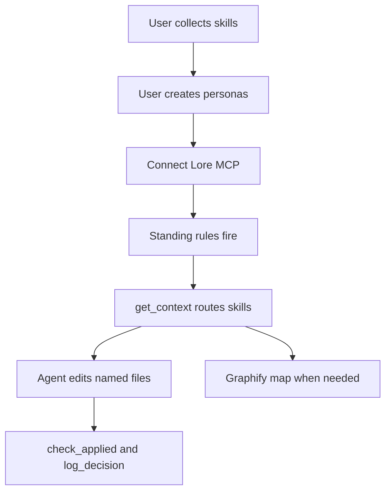
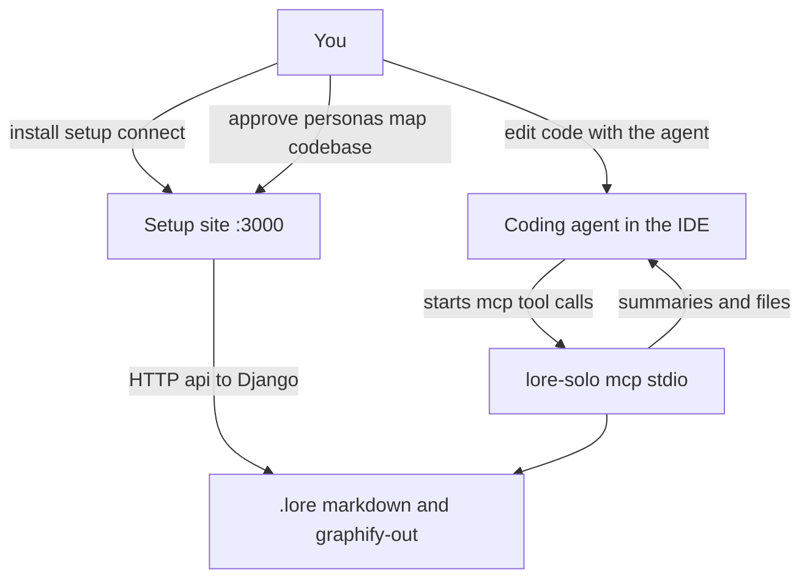
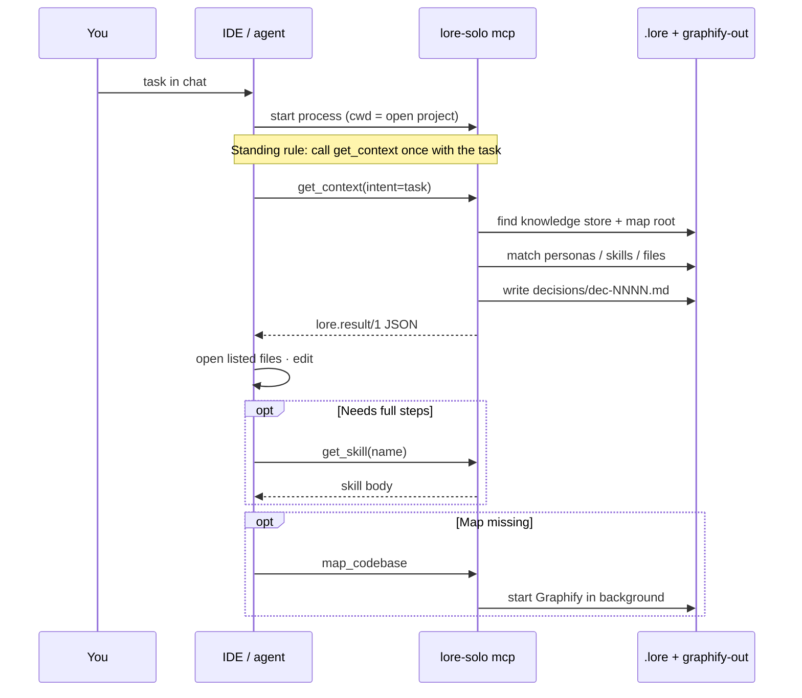
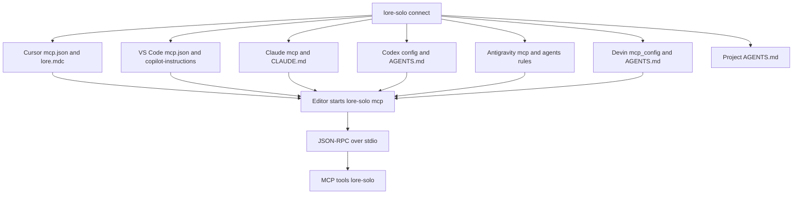
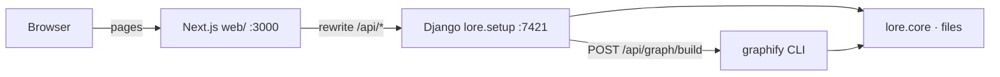
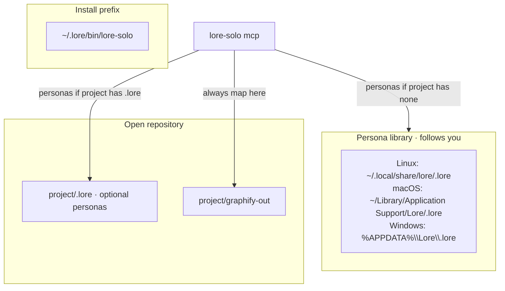
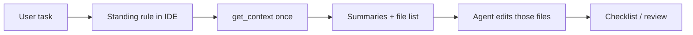

# How Lore Solo flows

This page is the picture of Solo: what you get, what you can do, how agents talk to Lore, and how the pieces connect inside the machine. Detail and tables live in [HOW_IT_WORKS.md](HOW_IT_WORKS.md). Page layout is in [UI.md](UI.md).



North star: collect skills → personas → connect MCP → standing autopilot → route → edit → receipt. Detail below. Product promise: [QUALITY_PLAN.md](QUALITY_PLAN.md).



Two surfaces share one file store. The **setup site** is for people. The **MCP process** is for agents. Closing the site does not stop the agent.

---

## What Lore gives you

| You get | What it is |
| --- | --- |
| Personas | Role files (e.g. frontend engineer) that own a set of skills |
| Skills | Short instruction packs; the agent sees one-line summaries first |
| Codebase map | Graphify output the agent can search without walking the whole tree |
| Decisions | Every `get_context` answer is written under `.lore/decisions/` |
| Editor wiring | Connect registers Lore so the agent can call it without a pasted dump of skills |

| You do not get in Solo | Why |
| --- | --- |
| Org policies / OCR / tenancy governance | That is Enterprise — [HOSTING.md](HOSTING.md) |
| Cloud accounts / team sync | Not built on Solo; see HOSTING |
| Conflict detection across orgs | Empty fields in the Solo envelope |
| Full skill bodies on every turn | Summaries only unless the agent calls `get_skill` (coding surface) |

---

## What you can do (human path)

```mermaid
flowchart LR
  Z[uvx lore-solo doctor] --> A[uvx lore-solo install]
  A --> B[uvx lore-solo setup]
  B --> C[Save provider key]
  C --> D[Add skills from skills.sh or files]
  D --> E[Create / draft persona]
  E --> F[Approve drafts on Personas]
  F --> G[uvx lore-solo connect]
  G --> H[Map codebase on Codebase page]
  H --> I[Work in the IDE with the agent]
```



1. **Install** puts `lore-solo` in `~/.lore/bin` (needs `uv`; Graphify and the rest install from binary wheels under the packaged constraints — no C toolchain).
2. **Setup** opens `http://127.0.0.1:3000/?key=…`. Django API is on `:7421`. `/api` is rewritten from Next to Django.
3. **Provider** key stays in the persona library; used only to draft personas.
4. **Skills** land in the inbox, then under a persona as drafts.
5. **Approve** runs governance (ATR scan + optional SkillSpector; freshness stamp), then flips `status: draft` → `stable` (or 409 until fixed / accept risk). Only stable skills are served to agents. See [GOVERNANCE.md](GOVERNANCE.md).
6. **Connect** writes MCP + standing rules into editors that already exist on this machine.
7. **Codebase** runs Graphify into `graphify-out/` for the chosen project.

Stopping setup with Ctrl+C leaves personas, skills, and editor configs in place.

---

## What the agent can do (MCP path)



### Tools

| Tool | Role |
| --- | --- |
| `get_context` | Main call. Task sentence → matching skill summaries + files to open. Or name a persona for that persona’s stable summaries. |
| `map_codebase` | Build the codebase map (coding surface) |
| `check_applied` | Receipt: cited skill ids must match what that decision served |
| `log_decision` | Append a one-line outcome to the decision |
| `get_skill` | Full skill body when summaries are not enough (coding surface) |
| `list_personas` | Stable persona names (full surface) |
| `locate` / `map_status` | Map helpers (full surface; locate also folded into task-mode `get_context`) |
| `ingest` / `trace` | Draft ingest / read a decision (full surface) |

The standing instruction tells the agent to call `get_context` once, edit the files it returns, then `check_applied` and `log_decision`. It should not read `.lore/skills` or `graphify-out/graph.json` by hand. See [QUALITY_PLAN.md](QUALITY_PLAN.md).

### What the agent receives

```text
lore.result/1
  verdict      ok | abstain | no_knowledge
  directive    proceed_and_cite | ask_user | proceed
  summary      short human sentence
  items[]      skill summaries (and sometimes map chunks)
  data.files   paths to open (task mode)
  data.personas / data.persona
  budget       limit 800 · used …
  decision_id  dec-NNNN
```

Skill **bodies** stay on disk until `get_skill`. Cap: 800 tokens / 8 items from `.lore/lore.config.yaml`.

---

## How the agent connects



- **No port** for MCP. Stdio only.
- Working directory is the open project (or `LORE_WORKSPACE` when set).
- Knowledge (personas) may come from the project `.lore` or the OS persona library.
- The **map** is always for the open workspace, not the library.

Backup: project `.cursor/mcp.json` from the Connect page if connect cannot run.

---

## Internal wiring (endpoints and modules)

### Process layout when setup is running



MCP does **not** go through Next or Django. It imports the same `lore.core` modules in-process.

### Setup HTTP API (Django)

All of these are under `http://127.0.0.1:7421` (browser hits them as `/api/...` via Next). Guarded by the setup-key cookie except `/api/health`.

```mermaid
flowchart TB
  subgraph human [You · browser]
    pages[Setup · Personas · Codebase · Replay · Connect · Settings]
  end

  subgraph api [Django lore/setup/urls.py]
    health["/api/health"]
    ws["/api/workspace · browse · pick-folder"]
    prov["/api/provider · models · draft"]
    inbox["/api/inbox · skills · catalog"]
    pers["/api/personas · approve"]
    graph["/api/graph · graph/build · codebases"]
    conn["/api/connect · connect/agents"]
    dec["/api/decisions · stats · settings · onboarding"]
  end

  subgraph disk [.lore store]
    personas[personas/]
    skills[skills/]
    decisions[decisions/]
    config[lore.config.yaml]
    gout[graphify-out/]
  end

  pages --> api
  ws --> config
  prov --> config
  inbox --> skills
  pers --> personas
  pers --> skills
  graph --> gout
  conn --> editors[Editor config files]
  dec --> decisions
```

| Area | Endpoints (representative) | Disk / side effect |
| --- | --- | --- |
| Workspace | `/api/workspace`, `/api/browse`, `/api/pick-folder` | Choose project; refuse paths outside project + library |
| Provider | `/api/provider`, `/models`, `/draft` | `provider.json` in library; LLM only for drafts |
| Skills / inbox | `/api/skills/*`, `/api/inbox/*`, `/api/catalog` | Inbox → persona skill folders |
| Personas | `/api/personas`, `/api/items/.../approve` | Markdown OKF files; draft → stable |
| Map | `/api/graph`, `/api/graph/build`, `/api/codebases` | `graphify-out/`, `graph-status.json` |
| Connect | `/api/connect` | Same as CLI `connect` |
| Replay | `/api/decisions` | Read `decisions/` |

### MCP → core (no HTTP)

```mermaid
flowchart TB
  mcp["lore/mcp_server.py"]
  ctx["lore.core.context.get_context"]
  pers["lore.core.personas"]
  graph["lore.core.graph"]
  job["lore.setup.graph_job"]
  paths["lore.core.paths"]
  dec["lore.core.decisions"]

  mcp --> ctx
  mcp --> pers
  mcp --> graph
  mcp --> job
  mcp --> paths
  ctx --> pers
  ctx --> graph
  ctx --> job
  ctx --> dec
  paths -->|"find_project · map_root · library_root"| disk[(Project .lore / library / graphify-out)]
  pers --> disk
  graph --> disk
  dec --> disk
```

| Concern | Module |
| --- | --- |
| Which folder holds personas | `paths.find_project` |
| Which folder to map | `paths.map_root` |
| Build the answer | `context.get_context` / `_for_task` |
| Skill / persona files | `personas` |
| Read / search the map | `graph` |
| Start Graphify | `setup.graph_job` |
| Decision files | `decisions` |
| Standing text for agents | `instructions.STANDING_INSTRUCTIONS` |

---

## Where files live



```text
.lore/
  lore.config.yaml
  personas/*.md
  skills/<persona-slug>/*.md
  decisions/dec-NNNN.md
  graph-status.json          # map job only; does not count as a persona store alone
graphify-out/
  graph.json
  graph.html
```

---

## One-turn agent loop (happy path)



If the map note says building or missing, the agent may call `map_codebase` once and keep working from the skill summaries.

---

## Related pages

| Doc | Use |
| --- | --- |
| [HOW_IT_WORKS.md](HOW_IT_WORKS.md) | Full behavior, envelope fields, verdicts |
| [UI.md](UI.md) | Setup site routes and components |
| [HOSTING.md](HOSTING.md) | Solo vs Enterprise tiers |
| [QUALITY_PLAN.md](QUALITY_PLAN.md) | Product promise and bake-off arms |
| [TASKLIST.md](TASKLIST.md) | Build record for Solo |
| [FUNCTION_AUDIT.md](FUNCTION_AUDIT.md) | Point-in-time tool check |
