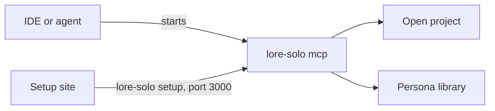
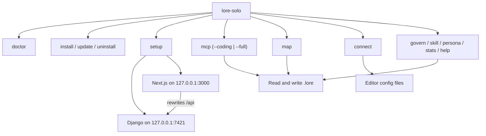
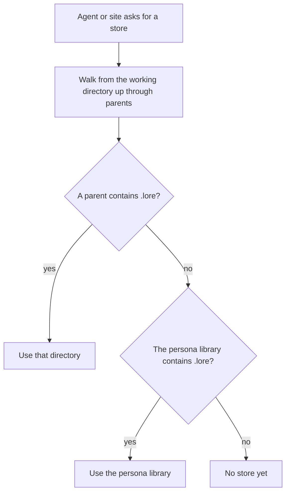
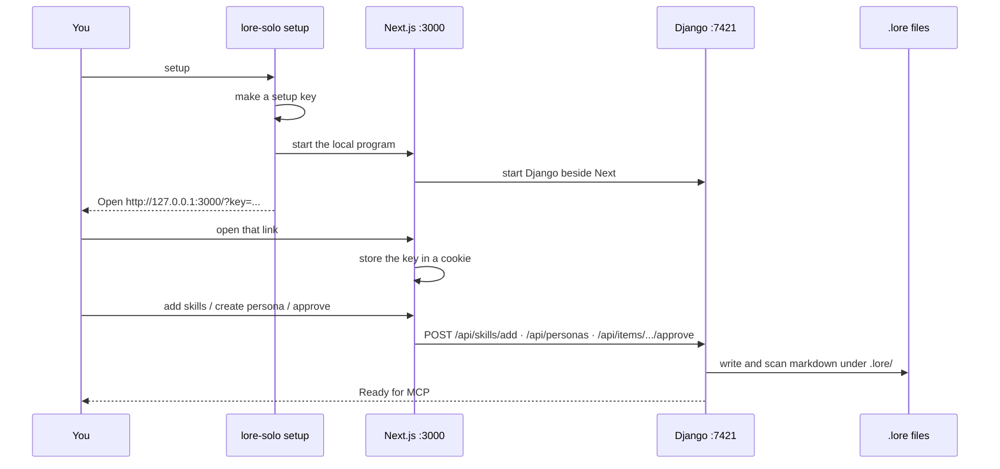
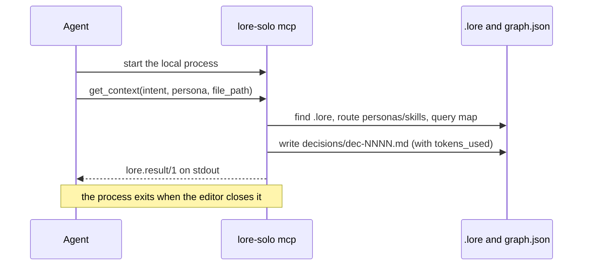

# How the solo slice works

Diagrams of the end-to-end flow (user path, agent path, API ↔ MCP ↔ disk) are in [FLOW.md](FLOW.md).

One developer. One coding agent. Lore is a **gateway + policy layer**: MCP tools are the I/O; standing IDE rules are advisory nudges the agent is asked to follow — not enforced (DevRelay-shaped); **personas** route which approved skills apply so the agent is not left guessing among an overloaded skill folder. Every answer is written down as a decision. The Solo promise is better-guided work — not guaranteed token savings. See [QUALITY_PLAN.md](QUALITY_PLAN.md).

The project folder is the database. Personas and skills are markdown under `.lore/`. The editor starts Lore as a normal local process. The setup site makes those files easier to create. Closing the site does not stop the agent.

Default MCP surface (coding): `get_context`, `get_skill`, `map_codebase`, `check_applied`, `log_decision`. Admin tools stay behind `lore-solo mcp --full`. Enterprise (org policies, OCR, tenancy) lives on the `enterprise` branch — [HOSTING.md](HOSTING.md).

## One local program

`uvx --managed-python --python 3.12 --no-build lore-solo==0.2.7 install` puts the `lore-solo` command on this computer (`--managed-python --python 3.12` picks the interpreter before dependencies resolve; `--no-build` accepts binary wheels only). After install, `lore-solo setup` starts the setup site. The same two commands work on macOS, Linux, and Windows. `./scripts/lore-solo install` from a clone of the `solo` branch does the same install into `~/.lore`. The computer does not need a system Python. The editor then starts `lore-solo mcp` itself. While the editor is open, Lore is one process waiting on stdin. When the editor closes, the process exits.



| Command | Who starts it | What it does |
| --- | --- | --- |
| `lore-solo doctor` | You, optional | Checks uv, Python, Node/npm, `~/.lore` write access, install, map, editors, SkillSpector, and knowledge governance counts. Exit `1` if a required tool is missing. |
| `lore-solo install` | You, once | Installs Lore Solo into `~/.lore/bin` on macOS, Linux, and Windows. Tries map (Graphify) via wheels; falls back to core when a wheel is unavailable (`--map` requires it, `--no-map` skips it). |
| `lore-solo update` | You, when upgrading | Upgrades `lore-solo` from PyPI and refreshes the cached setup site. |
| `lore-solo setup` | You, while setting up | Prints `http://127.0.0.1:3000/?key=...` and serves the dashboard until Ctrl+C. |
| `lore-solo connect` | You, or the agent | Writes Lore MCP and standing rules into editors already installed on this computer; sets `LORE_WORKSPACE` and `LORE_CLIENT`. |
| `lore-solo mcp` | The editor, for the session | Reads and writes `.lore/` over stdio. Default coding tools (5): `get_context`, `get_skill`, `map_codebase`, `check_applied`, `log_decision`. Pass `--full` (or `LORE_MCP_SURFACE=full`) for the 14 admin/autonomous tools. |
| `lore-solo map` | You, or a git hook | Starts a codebase map rebuild for the open project and waits for completion. |
| `lore-solo govern` | You, or an autonomous agent | `scan`, `check`, or `approve` skills and personas (`--json`, `--accept-risk`, `--note`). |
| `lore-solo skill` | You, or an autonomous agent | `featured`, `search`, `install`, `add`, `inbox`, `adopt`, `list`, `create`, `approve`, `remove` (`--json`). |
| `lore-solo persona` | You, or an autonomous agent | `list`, `show`, `create`, `update`, `approve`, `delete` (`--json`). |
| `lore-solo stats` | You, or an autonomous agent | Shows call counts, token usage telemetry (`total`, `avg`, `max`, `budget`), and top agents/personas/skills (`--json`). |
| `lore-solo container mcp\|setup\|map` | You, or the editor via `connect --runtime docker` | Runs the same verbs inside a locally built image with only `/workspace` and `/library` writable mounts. |
| `lore-solo help` | You | Prints the command catalog or per-command help (`lore-solo help <command>`). |
| `lore-solo uninstall` | You, when you want the command gone | Removes the `lore-solo` command from `~/.lore`. Personas, skills, and editor registrations stay. |

A clone uses the same verbs via `./scripts/lore-solo <command>` (or `.\scripts\lore-solo.ps1 <command>` on Windows). `python -m lore <command>` reaches the same command router. `$HOME/.lore` is the install prefix only; the persona library is the XDG/AppData path below. Parent walks skip `$HOME` so the install prefix cannot hide the library.



The setup key is generated when the site starts. It changes every start. It guards only the website. The browser stores it in a cookie named `lore_key`. Pages opened without that cookie show the lock screen. MCP never sees the key.

The setup site needs Node.js 22 or newer to serve the prebuilt Next.js page. The agent does not need Node at all. npm is only used when a developer builds the page from source — published installs serve the bundled standalone output (see `lore/site_bundle.py`), and a source checkout falls back to `npm run dev` only when its standalone stamp is missing or stale.

## Where the files live

Lore looks at two directories.

| Directory | Where it is | What it is |
| --- | --- | --- |
| The open project | The editor’s working directory, or `LORE_WORKSPACE` | The project you are working in. |
| The persona library | The operating system’s application-data folder, or `LORE_LIBRARY` | Personas that follow you to projects that do not keep their own. |

The library is `~/.local/share/lore` on Linux, `~/Library/Application Support/Lore` on macOS, and `%APPDATA%\Lore` on Windows. The page names the project. It does not print that path or call it a folder to put your work in.

A project that already contains `.lore` uses that directory. Every other project uses the library. The setup site creates the library’s `.lore` the first time you open it when the project does not have one.



During setup, “no store yet” means the site creates `.lore` in the library and uses it. During an MCP call, “no store yet” means the call fails with no `.lore` folder found. Create the files from the site first, or add a `.lore` directory in the project.

The site will only read and write the open project and the persona library. A path outside those two roots is refused.

### What `.lore` contains

```text
.lore/
  lore.config.yaml        token budget (default 800) and max_items (default 8)
  onboarding.json         setup wizard progress (welcome / connect / skills / persona / codebase / done)
  codebases.json          registered project folders for the Codebase page
  idempotency.json        deduplication cache for ingest and log_decision keys
  provider.json           saved draft provider key and model (in the persona library only, chmod 0600)
  inbox/                  waiting skills before they are attached to a persona
  personas/               one markdown file per persona
  skills/<persona>/       one markdown file per skill owned by that persona
  decisions/              one markdown file per get_context call, dec-0001.md and up (with token telemetry)
  graph-status.json       canonical map build status for this repository
  map.lock / map.log      map worker lock and log (map-only artifacts do not hide the persona library)
  map-fingerprint.json    source tree fingerprint for auto-refresh coalescing
graphify-out/
  graph.json              the codebase map, when you have built it
  graph.html              the interactive HTML map served by /api/codebases/<id>/graph
```

Each persona and skill is a markdown file with a YAML header and a body. That shape is the store. There is no database.

```yaml
---
type: persona
id: persona:frontend-engineer
title: Frontend engineer
status: stable
summary: Frontend work uses the React and Tailwind skills only.
skill_ids:
  - skill:frontend-engineer/react-practices@v1
---
You are the frontend engineer. Use only the skills filed under this persona.
```

`status` is `draft` or `stable`. A draft is stored and visible on the Personas page. The agent does not receive it until you approve it. Approving runs governance (ATR static scan, optional SkillSpector, freshness stamp) and then sets `status` to `stable`. Critical or high findings block approve unless you accept the risk. Soft-stale skills still serve with `freshness: aging`. Detail: [GOVERNANCE.md](GOVERNANCE.md).

A skill file lives in `.lore/skills/<persona-slug>/` and its header names the same persona. A skill in another persona’s folder is not returned with this persona, even if someone lists it in `skill_ids`.

## The setup site

`lore-solo setup` runs the setup site in the foreground. Django listens on `127.0.0.1:7421`. The page listens on `127.0.0.1:3000` and rewrites `/api` to Django. You open `127.0.0.1` on your own machine. The command does not guess a LAN address. Press Ctrl+C to stop the site.



The page is the Intellecta dashboard (`web/`). A floating left icon rail on desktop (`web/components/app-sidebar.tsx`) and a circular pill top bar on mobile (`web/components/site-header.tsx`) link to **Dashboard** (`/`), **Personas** (`/personas`), **Skills** (`/skills`), **Codebase** (`/codebase`), **Decisions** (`/replay`), and **Settings** (`/settings`), with a light/dark theme toggle. The Dashboard (`/`) opens with installed skill and persona counts, a `+ Add` quick-add menu (`Add skill`, `Create persona`), an Editor & MCP quickstart card (`Connect IDE`, `MCP`, `Store` tabs, plus a link to `/connect`), a `Most called skills` bar chart, a `Personas` card, and a `Summary` token telemetry spline chart. File paths and component conventions are in [UI.md](UI.md).

A new empty library opens the four-step onboarding wizard (`web/components/onboarding.tsx`):

1. **1. Connect.** Auto-connect installed editors (`POST /api/connect/agents`), copy the universal `uvx lore-solo connect` command, or write project MCP configs (`.mcp.json`, `.cursor/mcp.json`, `.vscode/mcp.json`), and check the optional SkillSpector security addon.
2. **2. Skills.** Search skills.sh, or choose markdown skill files / `SKILL.md` folders from this computer. Those skills wait in `.lore/inbox/` until attached to a persona.
3. **3. Role (Persona).** A persona is a ruleset that owns a set of skills. Write it yourself, or save a provider key (Groq, OpenRouter, Gemini, OpenAI, or Anthropic) and draft it with a live chat model returned by that provider. Saving files the selected waiting skills under that persona as drafts. Approve them on the Personas or Skills page before the agent can use them. Deleting a persona returns its skills to the inbox so you can attach them to a new role; skills whose persona file is missing are recovered the same way when the inbox is listed.
4. **4. Project (Codebase).** Register a project folder and optionally start a Graphify map build.

The project fallback button (`POST /api/connect`) writes `.mcp.json`, `.cursor/mcp.json`, and `.vscode/mcp.json` in the open project with server name `lore-solo`. Use it when an agent cannot run `lore-solo connect`.

## How an editor calls Lore

Connect writes an MCP entry only for editors whose config directory already exists. Other servers in those files stay, and any legacy `"lore"` entry is stripped. The first write keeps a `.lore.bak` copy beside the file.

| Editor | Config | Entry shape |
| --- | --- | --- |
| Cursor | `~/.cursor/mcp.json` + `~/.cursor/rules/lore.mdc` | `mcpServers["lore-solo"]` |
| VS Code | user `Code/User/mcp.json` + `.github/copilot-instructions.md` | `servers["lore-solo"]`, `type: "stdio"` |
| Claude Code | `~/.claude.json` + `~/.claude/CLAUDE.md` | `mcpServers["lore-solo"]` |
| Claude Desktop | OS Claude `claude_desktop_config.json` | `mcpServers["lore-solo"]` |
| Codex | `~/.codex/config.toml` + `~/.codex/AGENTS.md` | `[mcp_servers."lore-solo"]` |
| Antigravity | `~/.gemini/config/mcp_config.json` + `.agents/rules/lore.md` | `mcpServers["lore-solo"]` |
| Devin | `~/.config/devin/mcp_config.json` + `.devin/mcp_config.json` | `mcpServers["lore-solo"]` |

Connect also upserts `AGENTS.md` in the workspace root. Paths differ on macOS and Windows.

When `lore-solo` is installed in `~/.lore/bin` (or found on `PATH`), connect stores that binary path with `args: ["mcp"]`; otherwise it falls back to `uvx --managed-python --python 3.12 --no-build lore-solo==<version> mcp`. Every entry includes `env` with `LORE_WORKSPACE` (and `LORE_CLIENT` when known).

```json
{
  "mcpServers": {
    "lore-solo": {
      "command": "uvx",
      "args": ["lore-solo", "mcp"]
    }
  }
}
```

The editor starts that command with the open project as the working directory. After you restart the editor, it starts Lore when it needs Lore. Stdio is the whole conversation. There is no HTTP MCP server.



### Tools the agent can call

Default **coding** surface (`lore-solo mcp`, 5 tools):

| Tool | What it returns |
| --- | --- |
| `get_context` | Main call (once per task). With a task `intent` and empty `persona`, routes matching stable personas/skills and returns skill summaries (`items`), `data.cite_ids`, and advisory files to inspect (`data.files`). With a named `persona`, returns that persona's stable skill summaries and a `file_path` map slice. |
| `get_skill` | Full body for one stable skill (`name=...`) or a batch of stable skills in a single call (`names=[...]`), paginated up to 24,000 chars with `has_more`, `next_offset`, and `body_sha256`. |
| `map_codebase` | Starts a background Graphify map build for the workspace and returns its status. |
| `check_applied` | Confirms cited `rule_ids` were served by that `decision_id` (`pass`, `fail`, or `skip`) and appends a citation receipt. |
| `log_decision` | Appends an outcome (and auto-runs `check_applied` if no receipt exists yet) to `.lore/decisions/<decision_id>.md`. Supports `idempotency_key`. |

Full **autonomous / admin** surface (`lore-solo mcp --full` or `LORE_MCP_SURFACE=full`, adds 14 tools):

| Tool | What it returns |
| --- | --- |
| `list_personas` | Stable personas (or all personas including drafts when `include_drafts=True`) with `skill_ids` and governance summary. |
| `search_skills` | Searches the skills.sh registry, or returns featured skills when `query` is empty. |
| `install_skill` | Installs a skill from skills.sh (`source` + `skill_id`), a local folder, or raw text into the inbox, and optionally adopts it into a persona. |
| `list_inbox` | Lists waiting skills in `.lore/inbox/`. |
| `list_skills` | Lists skills (optionally filtered by `persona` or `include_drafts`) with governance and freshness metadata. |
| `setup_persona` | Creates or updates a persona, optionally adopts inbox `skill_ids`, and optionally runs governance approval (`approve=True`). |
| `approve_item` | Runs ATR + optional SkillSpector scan and freshness check, then promotes a draft skill or persona to `stable` (or blocks on high/critical findings unless `accept_risk=True`). |
| `check_security` | Runs ATR + optional SkillSpector security scan on one item or the whole store. |
| `check_freshness` | Checks freshness and cited repo claims for one item or the whole store. |
| `get_telemetry` | Returns call counts, token usage telemetry (`total`, `avg`, `max`, `budget`, `series`, `tokens_by_persona`), and top agents/personas/skills. |
| `ingest` | Saves a new skill under a persona as `draft`. Supports `idempotency_key`. |
| `trace` | Reads one decision file back (`id`, `header`, `body`). |
| `map_status` | Map state (`missing`, `running`, `ready`, `interrupted`, `unavailable`, or `failed`) plus commit/freshness details. |
| `locate` | Up to eight ranked files for a task sentence (`intent` + optional `file_path`) and the relation that justified each one. |

Personas are read from the project `.lore`, or from the persona library when the project has none. The map is written in the open repository. A `.lore` folder that contains only map artifacts (`graph-status.json`, `map.lock`, `map.log`, `map-fingerprint.json`, `maps/`) does not hide the library. When the map is missing or stale, `get_context` triggers a background refresh (`ensure_fresh`) and still returns skills immediately.

## What `get_context` puts in the answer

`get_context` has two modes:

1. **Task mode (default when `persona` is empty):** scores stable personas against `intent` (using literal token matches weighted 2×, `_ALIASES` expansions weighted 1×, and `_PATH_HINTS` from `file_path`, falling back across all stable personas if none match by name), selects matching stable skills round-robin across matched personas, and calls `locate()` on the codebase map to populate `data.files`. `data.persona` is `"task"` and `data.personas` lists the matched persona IDs.
2. **Named-persona mode (when `persona` is provided):** loads that single persona and its stable skills, plus a map node slice (`chunk:*` items) when a map exists.

```mermaid
flowchart TD
  call["get_context(intent, persona, file_path)"]
  mode{"persona provided?"}
  task["Task mode: score personas & skills + locate(intent, file_path)"]
  find["Named mode: find persona file"]
  none{"Persona exists?"}
  draft{"status is stable?"}
  skills["Load stable skills + map slice"]
  fit["Fit summary + items + files into token_budget (800) & max_items (8)"]
  write["Write decisions/dec-NNNN.md with tokens_used & token_budget"]
  call --> mode
  mode -->|no| task --> fit
  mode -->|yes| find --> none
  none -->|no| write
  none -->|yes| draft
  draft -->|draft| write
  draft -->|stable| skills --> fit --> write
```

| Situation | Verdict | Directive | What the agent is told |
| --- | --- | --- | --- |
| Unknown persona, or task matched no personas and no files | `no_knowledge` | `proceed` | Nothing governed applies. |
| Named persona is still a draft | `abstain` | `ask_user` | Approve it in Lore setup before using it. |
| Named persona is stable with no skills/map items | `no_knowledge` | `proceed` | The persona has no skills to apply. |
| Task matched personas or map items, but 0 skill items fitted | `ok_with_notes` | `proceed` | Proceed with persona/file notes; no skill IDs to cite. |
| At least one stable skill item fitted | `ok` | `proceed_and_cite` | Use these skills, call `get_skill` when needed, and cite `data.cite_ids`. |

The size cap comes from `.lore/lore.config.yaml`. The defaults are 800 tokens and 8 items. Tokens are counted with the `cl100k_base` encoding (or one token per three UTF-8 bytes, rounded up, if `tiktoken` cannot load).

Fitting enforces `max_items` on `items[]` first, then checks `count_tokens(context_content_text(final_summary, items, files)) <= token_budget`. If over budget, it drops entries from `data.files` first (recording `"file:<path>"` in `data.omitted`), then items from `items[]`, so skill summaries win over map suggestions. Lore never cuts an item in the middle.

`get_context` returns each skill’s one-line summary, not the full body. The agent calls `get_skill(name=...)` or `get_skill(names=[...])` when it needs the full instructions.

### The map slice

If `graphify-out/graph.json` is missing, unreadable, or an unknown `schema_version`, the answer includes the note `"Map this project"` in `summary` and `data.graph_notes`.

- In **task mode**, map orientation comes from `locate(maps, intent, file_path)`, which ranks repository files against the task tokens (down-ranking config files unless asked) and returns up to 8 file suggestions in `data.files`.
- In **named-persona mode**, `slice_for` adds `chunk:*` items (`unreviewed`) for `file_path` and its direct import/call neighbors (or the top 3 hub nodes when `file_path` is empty).

### The envelope

Every `get_context` answer is one JSON object with `"schema": "lore.result/1"`. The shape is fixed in `schemas/lore.result.v1.json`.

Fields the agent can rely on:

| Field | Meaning |
| --- | --- |
| `decision_id` | The file just written, such as `dec-0007`. |
| `verdict` | `ok`, `ok_with_notes`, `abstain`, or `no_knowledge`. |
| `directive` | `proceed_and_cite`, `ask_user`, or `proceed`. |
| `summary` | Persona/task summary, suggested files, any size-cap or map notes, and `Cite: ...` IDs. |
| `items` | Skill summaries (and named-persona map chunks) that fitted. |
| `budget` | `limit` and `used`. |
| `data.persona` | `"task"` in task mode, or the persona ID such as `persona:frontend-engineer`. |
| `data.personas` | Matched persona IDs in task mode. |
| `data.files` | Ranked file suggestions (`path`, `relation`, `label`) in task mode. |
| `data.cite_ids` | Skill IDs included in `items` that the agent should cite in `check_applied` / `log_decision`. |
| `data.omitted` / `data.omitted_count` | IDs (up to 128) and total count of items/files omitted due to the cap. |
| `data.graph_notes` / `data.map` | Map status notes and capability/freshness metadata. |
| `excluded.draft` / `excluded.stale` | Count of withheld draft skills and served `aging` skills. |
| `links` | `lore://personas/...` and `lore://skills/...` pointers for the included items. |

`conflicts` and `violations` are present and empty. Conflict detection is not part of this slice.

Each answer also creates `.lore/decisions/dec-NNNN.md`. The header records `tool`, `verdict`, `directive`, `persona`, `included`, `omitted`, `client`, `tokens_used`, and `token_budget`. The body is the summary. `log_decision` appends the citation receipt and outcome the agent reports. `trace` reads that file back. The Decisions page (`/replay`) and `lore-solo stats` / `get_telemetry` aggregate the same files.

## What stays on the computer

`~/.lore` holds the private tool environment and `~/.lore/bin/lore-solo`. Your project files stay in the project directory. Personas saved for every project stay in the application-data library. Stopping the site with Ctrl+C leaves both in place. Running `lore-solo uninstall` (or removing `~/.lore`) removes the program. Removing the library removes the shared personas. A project that keeps its own `.lore` is unaffected, because those files are in the project directory.

The older documents in `docs/` (`LORE_ARCHITECTURE.md`, `LORE_OVERVIEW.md`, `PROJECT_CHARTER.md`, `PROJECT_REQUIREMENTS.md`) are preserved as historical Congress / Go-era specifications. This page describes the Python `lore-solo` engine that ships on `solo`.
