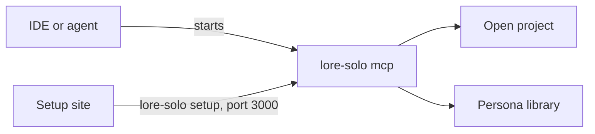
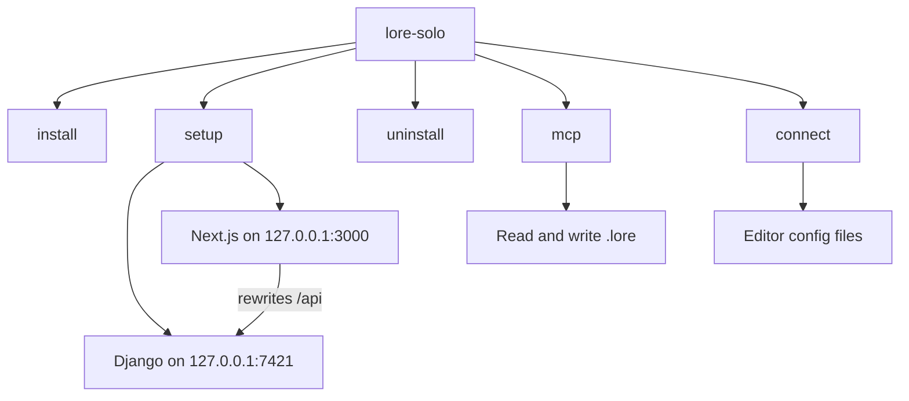
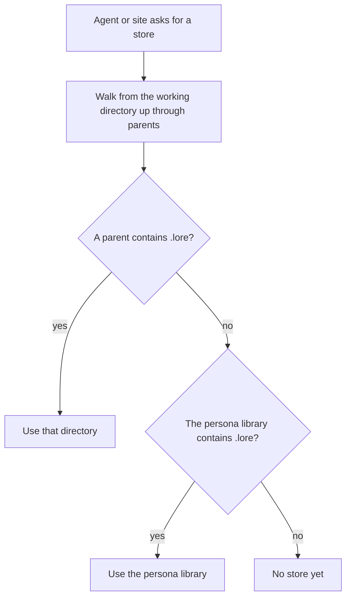
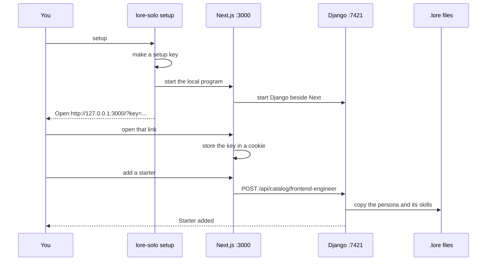
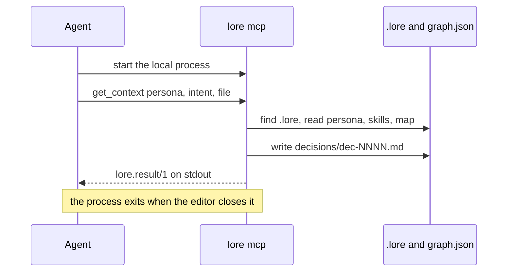

# How the solo slice works

One developer. One coding agent. Lore gives that agent a persona, the skills filed under that persona, and a short map of the codebase. Every answer is written down as a decision.

The project folder is the database. Personas and skills are markdown under `.lore/`. The editor starts Lore as a normal local process. The setup site makes those files easier to create. Closing the site does not stop the agent.

Team rules, accounts, and a paid host are later. This page describes the solo slice only. [HOSTING.md](HOSTING.md) is the note about what a later host would sync.

## One local program

`uvx lore-solo install` puts the `lore-solo` command on this computer. `uvx lore-solo setup` starts the setup site. The same two commands work on macOS, Linux, and Windows. `./scripts/lore-solo install` from a clone of the `solo` branch does the same install into `~/.lore`. The computer does not need a system Python. The editor then starts `lore-solo mcp` itself. While the editor is open, Lore is one process waiting on stdin. When the editor closes, the process exits.



| Command | Who starts it | What it does |
| --- | --- | --- |
| `uvx lore-solo install` | You, once | Installs Lore Solo into `~/.lore/bin` on macOS, Linux, and Windows |
| `uvx lore-solo setup` | You, while setting up | Prints `http://127.0.0.1:3000/?key=...` and serves the site until Ctrl+C |
| `uvx lore-solo connect` | You, or the agent from the prompt | Writes Lore into editors already installed on this computer |
| `uvx lore-solo mcp` | The editor, for the session | Reads and writes `.lore/` over stdio. No port. No setup key. |
| `uvx lore-solo uninstall` | You, when you want the command gone | Removes the `lore-solo` command from `~/.lore`. Personas, skills, and editor registrations stay. |

A clone uses the same verbs: `./scripts/lore-solo install`, `setup`, `connect`, `mcp`, and `uninstall`. On Windows those are `.\scripts\lore-solo.ps1 install`, `setup`, `connect`, `mcp`, and `uninstall`.

The program entry is `lore-solo`, with `install`, `setup`, `uninstall`, `connect`, or `mcp` as the first argument. `python -m lore` reaches the same program.



The setup key is generated when the site starts. It changes every start. It guards only the website. The browser stores it in a cookie named `lore_key`. Pages opened without that cookie show the lock screen. MCP never sees the key.

The setup site needs Node.js, because the page is a Next.js app. The agent does not. The first `setup` builds the page when it is not already built.

## Where the files live

Lore looks at two directories.

| Directory | Where it is | What it is |
| --- | --- | --- |
| The open project | The editor’s working directory, or `LORE_WORKSPACE` | The project you are working in. |
| The persona library | The operating system’s application-data folder, or `LORE_LIBRARY` | Personas that follow you to projects that do not keep their own. |

The library is `~/.local/share/lore` on Linux, `~/Library/Application Support/Lore` on macOS, and `%APPDATA%\Lore` on Windows. The page names the project. It does not print that path or call it a folder to put your work in.

A project that already contains `.lore` uses that directory. Every other project uses the library. The setup site creates the library’s `.lore` the first time you open it when the project does not have one.



During setup, “no store yet” means the site creates `.lore` in the library and uses it. During an MCP call, “no store yet” means the call fails with no `.lore` folder found. Create the files from the site first, or add a `.lore` directory in the project.

The site will only read and write the open project and the persona library. A path outside those two roots is refused.

### What `.lore` contains

```text
.lore/
  lore.config.yaml      token budget and item cap
  graph-status.json     last map build, when one has been run
  personas/             one markdown file per persona
  skills/<persona>/     one markdown file per skill
  decisions/            one markdown file per answer, dec-0001.md and up
graphify-out/
  graph.json            the codebase map, when you have built it
  graph.html            the same map as a page
```

Each persona and skill is a markdown file with a YAML header and a body. That shape is the store. There is no database.

```yaml
---
type: persona
id: persona:frontend-engineer
title: Frontend engineer
status: stable
summary: Frontend work uses the React and Tailwind skills only.
skill_ids:
  - skill:frontend-engineer/react-practices@v1
---
You are the frontend engineer. Use only the skills filed under this persona.
```

`status` is `draft` or `stable`. A draft is stored and visible on the Personas page. The agent does not receive it until you approve it. Approving rewrites that one field to `stable`.

A skill file lives in `.lore/skills/<persona-slug>/` and its header names the same persona. A skill in another persona’s folder is not returned with this persona, even if someone lists it in `skill_ids`.

## The setup site

`uvx lore-solo setup` runs the setup site in the foreground. Django listens on `127.0.0.1:7421`. The page listens on `127.0.0.1:3000` and rewrites `/api` to Django. You open `127.0.0.1` on your own machine. The command does not guess a LAN address. Press Ctrl+C to stop the site.



The page is a dashboard. An inset sidebar lists Setup, Personas, Codebase, Replay, and Connect, with Settings at the bottom. On a narrow screen that sidebar becomes a drawer. The header shows the current page. Setup opens with four cards for the project name, the provider, the number of waiting skills, and the draft model, then the four steps below. Colors follow the system theme. File paths, components, and the shadcn rules for editing the page are in [UI.md](UI.md).

The page has four steps.

1. **Provider key.** Choose Groq, OpenRouter, Gemini, OpenAI, or Anthropic, and save a key. The key stays in the persona library. Lore sends it only when you ask for a drafted persona. Each provider starts on one default model. Settings lists the models that key can call, and the one you save there is the model later drafts use.
2. **Add skills.** Search skills.sh, or choose markdown skill files you already have. Those skills wait until a persona is saved.
3. **Create a persona.** The persona is a ruleset for the waiting skills. Write it yourself, or draft it with the saved key and edit the result. Saving files the waiting skills under that persona as drafts. Approve them on the Personas page before the agent can use them.
4. **Add Lore to an editor.** Copy the prompt and give it to your agent, or run the connect command yourself. A project `.cursor/mcp.json` stays available as a backup.

The backup button writes `.cursor/mcp.json` in the open project. That file’s command is `lore mcp`. Use it when an agent cannot run the connect command. It covers that one project.

## How an editor calls Lore

Connect writes an MCP entry only for editors whose config directory already exists. Other servers in those files stay. The first write keeps a `.lore.bak` copy beside the file.

| Editor | Config | Entry shape |
| --- | --- | --- |
| Cursor | `~/.cursor/mcp.json` | `mcpServers`, command `uvx`, args `lore-solo mcp` |
| VS Code | the user `mcp.json` | `servers`, type `stdio` |
| Claude Code | `~/.claude.json` | `mcpServers` |
| Claude Desktop | the Claude config for this OS | `mcpServers` |
| Codex | `~/.codex/config.toml` | `[mcp_servers.lore]` |
| Antigravity | `~/.gemini/config/mcp_config.json` | `mcpServers` |

Paths differ on macOS and Windows. Connect runs on the computer where the editors are installed, so the write lands in your editor config.

The entry the editor stores uses `uvx` when Lore Solo was started that way. A clone install stores the absolute path of `~/.lore/bin/lore-solo` and the argument `mcp`.

```json
{
  "mcpServers": {
    "lore": {
      "command": "uvx",
      "args": ["lore-solo", "mcp"]
    }
  }
}
```

The editor starts that command with the open project as the working directory. After you restart the editor, it starts Lore when it needs Lore. Stdio is the whole conversation. There is no HTTP MCP server.



### Tools the agent can call

| Tool | What it returns |
| --- | --- |
| `list_personas` | Stable personas only. Drafts are omitted. |
| `get_context` | One persona, one-line skill summaries, and a short map slice. This is the call the agent makes for a task. |
| `get_skill` | The full body of one stable skill for that persona. |
| `ingest` | Saves a new skill as a draft. It is not served until you approve it. A repeated idempotency key returns the first result. |
| `log_decision` | Appends what the agent did to an existing decision file. |
| `trace` | Reads one decision file back. |

`get_context` takes a persona name, an optional intent, and an optional file path. The file path chooses which part of the codebase map to include. The intent is recorded on the answer. It does not search the skills.

## What `get_context` puts in the answer

One call returns one persona and only the skills that belong to it. The persona itself is named in `summary` and `data.persona`. It is not an item. Items are skills, then map nodes, because an item id has to look like `skill:…` or `chunk:…`.

```mermaid
flowchart TD
  call["get_context"]
  find["Find the persona file"]
  none{"Persona exists?"}
  draft{"status is stable?"}
  skills["Load stable skills for this persona"]
  map["Read graph.json if it exists"]
  fit["Fit summaries into 800 tokens and 8 items"]
  write["Write a decision file"]
  empty["verdict no_knowledge, directive proceed"]
  ask["verdict abstain, directive ask_user"]
  ok["verdict ok, directive proceed_and_cite"]
  call --> find --> none
  none -->|no| empty --> write
  none -->|yes| draft
  draft -->|draft| ask --> write
  draft -->|stable| skills --> map --> fit
  fit -->|nothing fitted| empty
  fit -->|at least one item| ok --> write
```

| Situation | Verdict | Directive | What the agent is told |
| --- | --- | --- | --- |
| No persona with that name | `no_knowledge` | `proceed` | Nothing governed applies. |
| The persona is still a draft | `abstain` | `ask_user` | Approve it in setup before using it. |
| Stable, and nothing fitted | `no_knowledge` | `proceed` | The persona has no skills to apply. |
| Stable, with at least one item | `ok` | `proceed_and_cite` | Use these skills and cite them. |

The size cap comes from `.lore/lore.config.yaml`. The defaults are 800 tokens and 8 items. Tokens are counted with the `cl100k_base` encoding. If that encoder cannot load, the count is one token per three UTF-8 bytes, rounded up.

Fitting walks the skill summaries first, then the map nodes. The summary line is counted before any item. An item that would pass 800 tokens, or that would be the 9th item, is left out whole. Lore does not cut an item in the middle. Left-out ids are listed in the summary (“size cap”) and in `data.omitted`.

`get_context` returns the skill’s one-line summary, not the steps. The agent calls `get_skill` when it needs the full body.

### The map slice

If `graphify-out/graph.json` is missing, unreadable, or an unknown version, the answer includes the note “Map this project” and no map items.

When a file path is given, the slice is that file’s node plus the nodes linked to it by an import or a call. When no file path is given, the slice is the three nodes with the most links. Each map item is a `chunk`, marked `unreviewed`, with a one-line description of those links. Extracted and inferred links are labeled as such. The map is background. It is not a skill.

### The envelope

Every `get_context` answer is one JSON object with `"schema": "lore.result/1"`. The shape is fixed in `schemas/lore.result.v1.json`.

Fields the agent can rely on:

| Field | Meaning |
| --- | --- |
| `decision_id` | The file just written, such as `dec-0007`. |
| `verdict` | `ok`, `abstain`, or `no_knowledge`. |
| `directive` | `proceed_and_cite`, `ask_user`, or `proceed`. |
| `summary` | The persona’s summary, plus any size-cap or map note. |
| `items` | Skill summaries, then map nodes, that fitted. |
| `budget` | `limit` and `used`. |
| `data.persona` | The persona id, such as `persona:frontend-engineer`. |
| `data.omitted` | Ids that did not fit. |
| `excluded.draft` | How many draft skills for this persona were withheld. |
| `links` | `lore://` pointers to the persona and the skills that were included. |

`conflicts` and `violations` are present and empty. Conflict detection is not part of this slice.

Each answer also creates `.lore/decisions/dec-NNNN.md`. The header records the tool, verdict, persona, included ids, and omitted ids. The body is the summary. `log_decision` appends the outcome the agent reports. `trace` reads that file back. The Decisions page on the site lists the same files.

## What stays on the computer

`~/.lore` holds the private Python and the `lore` command. Your project files stay in the project directory. Personas saved for every project stay in the application-data library. Stopping the site with Ctrl+C leaves both in place. Removing `~/.lore` removes the program. Removing the library removes the shared personas. A project that keeps its own `.lore` is unaffected, because those files are in the project directory.

The older documents in `docs/` describe the previous Go design. This page describes the Python solo slice that replaced it.
