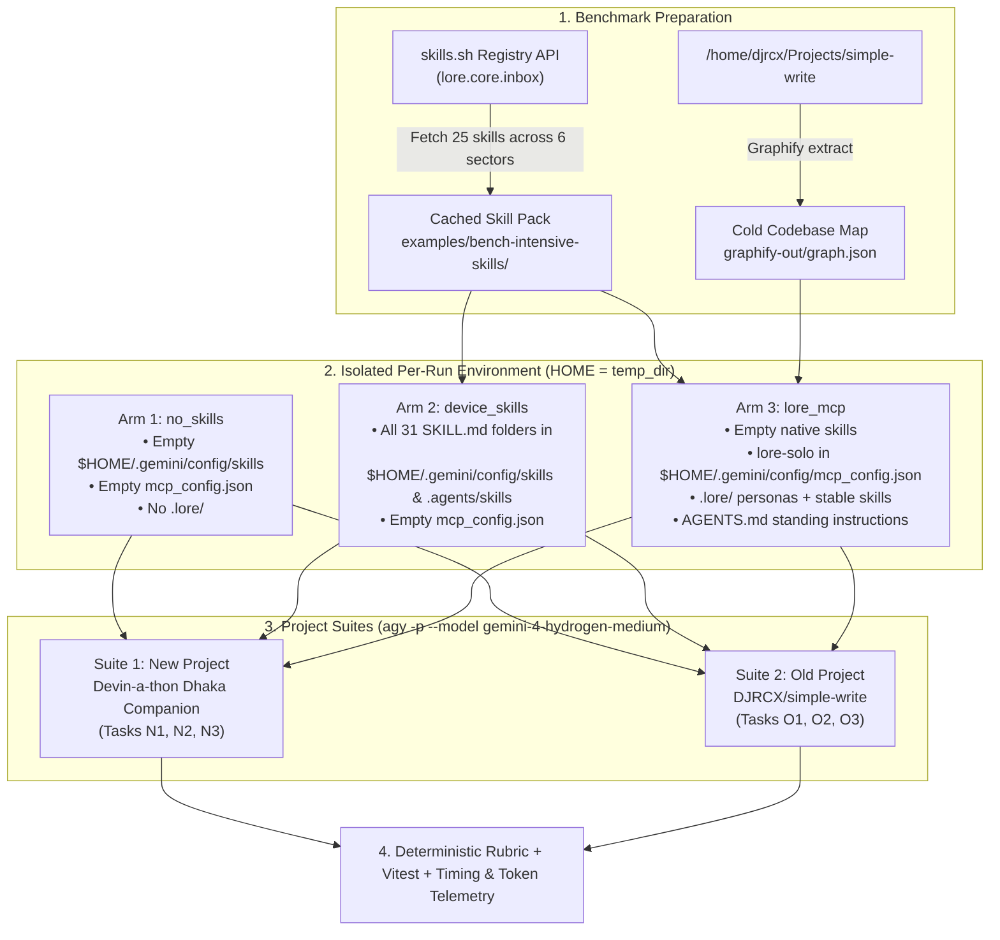

# Intensive 2×3 Benchmark Plan for Lore Solo (`agy` + Gemini 4 Hydrogen Medium)

> **Status:** Implemented and executed. See [INTENSIVE_BENCHMARK_RESULTS.md](./INTENSIVE_BENCHMARK_RESULTS.md) and [results-intensive-2x3.json](../../examples/bench-library/results-intensive-2x3.json) for the latest run results.

## 1. Benchmark Matrix Overview

We test **2 Project Contexts × 3 Arms × 3 Multi-Sector Tasks = 18 isolated `agy` runs** per pass:

| Project Context | Arm 1: `no_skills` | Arm 2: `device_skills` | Arm 3: `lore_mcp` |
| :--- | :--- | :--- | :--- |
| **1. New Project (Greenfield)**<br>*Devin-a-thon Dhaka Companion*<br>(`examples/bench-devin-dhaka/`) | • Empty `$HOME/.gemini/config/skills/`<br>• Empty `mcp_config.json`<br>• No `.lore/`, no `AGENTS.md` | • All 31 `SKILL.md` folders installed natively in `$HOME/.gemini/config/skills/` & `.agents/skills/`<br>• Empty `mcp_config.json` | • Empty native device skills<br>• `lore-solo` MCP in `$HOME/.gemini/config/mcp_config.json`<br>• `.lore/` personas + stable skills<br>• `STANDING_INSTRUCTIONS` in `AGENTS.md` |
| **2. Old Project (Brownfield)**<br>`DJRCX/simple-write` (`/home/djrcx/Projects/simple-write`) | • Clean worktree of `simple-write`<br>• Empty `$HOME/.gemini/config/skills/`<br>• Empty `mcp_config.json` | • Clean worktree of `simple-write`<br>• All 31 `SKILL.md` folders installed natively on device<br>• Empty `mcp_config.json` | • Clean worktree of `simple-write`<br>• Pre-built Graphify map (`graphify-out/graph.json`)<br>• `.lore/` personas + stable skills<br>• `lore-solo` MCP enabled |



---

## 2. Four Critical Harness Bugs Found During Research (Fixed in This Plan)

Inspecting `scripts/run_benchmark.py` and prior logs in `.tmp/bench-runs/agy-quality-wrong-file-lore-1.jsonl` surfaced four issues we will fix before running:

1. **`agy` Global MCP Config Path under Isolated `HOME`:**
   - When `_agy()` sets `HOME=isolated` (`run_benchmark.py`), `_write_workspace_mcp()` only writes `<work>/.agents/mcp_config.json`.
   - Testing `HOME=$tmp agy mcp list` confirmed that `agy` ignores `<work>/.agents/mcp_config.json` for MCP server startup and reads **`$HOME/.gemini/config/mcp_config.json`** (as noted in `docs/ide/antigravity.md`). We will write `mcp_config.json` into `$isolated/.gemini/config/mcp_config.json` (and `<work>/.agents/mcp_config.json`).
2. **`--disable-slash-commands` Suppresses Native Skills:**
   - `_agy()` (`run_benchmark.py`) currently passes `--disable-slash-commands`, which `agy --help` defines as *"Disable slash command and skill expansion in print mode"*.
   - We will remove `--disable-slash-commands` across all arms so `agy` naturally loads `<skills>` from `$HOME/.gemini/config/skills/` and `<work>/.agents/skills/` in the `device_skills` arm.
3. **Git Parent-Walk Confusion (`~35s` & 6 Turns Wasted per Run):**
   - In `.tmp/bench-runs/agy-quality-wrong-file-no_skills-1.jsonl`, because `.tmp/` is inside `/home/djrcx/Work/Lore` and gitignored, the agent ran `git status` / `git diff`, saw empty diffs and parent repo files, and spent 6 extra turns running `git check-ignore`.
   - Every benchmark worktree will now initialize its own clean Git repo (`git init -q && git add -A && git commit -qm "bench-init"`), preventing parent walks and making `git diff` work cleanly.
4. **Un-spoiled Prompts:**
   - Earlier prompts in `examples/bench-quality-app/tasks/` gave away the exact file path and code literal in the prompt, allowing `no_skills` to score 100%. Our new tasks put the architectural/convention requirements inside the skills and omit file-path spoilers on the old project.

---

## 3. Multi-Sector Skill Pack Downloaded from `skills.sh`

`scripts/fetch_bench_skills.py` uses `lore.core.inbox.search_registry` and `_fetch_skill` to download **25 real skills from `skills.sh`** across **6 sectors** (verified live against `https://skills.sh/api/search`):

| Sector | Lore Persona | Downloaded `skills.sh` Skills (`source/skill_id`) |
| :--- | :--- | :--- |
| **Frontend** | `persona:frontend-engineer` | `anthropics/skills/frontend-design`, `leonxlnx/taste-skill/design-taste-frontend`, `leonxlnx/taste-skill/design-taste-frontend-v1`, `leonxlnx/taste-skill/imagegen-frontend-web`, `leonxlnx/taste-skill/imagegen-frontend-mobile` |
| **Backend** | `persona:backend-engineer` | `wshobson/agents/nodejs-backend-patterns`, `affaan-m/ecc/backend-patterns`, `clerk/skills/clerk-backend-api`, `wshobson/agents/dotnet-backend-patterns`, `microsoft/azure-skills/azure-aigateway` |
| **Database** | `persona:database-engineer` | `prisma/skills/prisma-database-setup`, `wshobson/agents/database-migration`, `microsoft/azure-skills/azure-storage`, `samber/cc-skills-golang/golang-database` |
| **Motion** | `persona:motion-engineer` | `heygen-com/hyperframes/hyperframes-animation`, `heygen-com/hyperframes/motion-graphics`, `heygen-com/hyperframes/remotion-to-hyperframes`, `heygen-com/hyperframes/hyperframes-creative` |
| **Security** | `persona:security-engineer` | `addyosmani/agent-skills/security-and-hardening`, `better-auth/skills/better-auth-security-best-practices`, `firebase/agent-skills/firebase-security-rules-auditor`, `samber/cc-skills-golang/golang-security` |
| **Accessibility & Testing** | `persona:accessibility-engineer` | `addyosmani/web-quality-skills/accessibility`, `jakubkrehel/skills/better-accessibility`, `ibelick/ui-skills/fixing-accessibility`, `mattpocock/skills/tdd` |

Alongside the 25 downloaded `skills.sh` skills, each sector includes one **sector standards skill** (`frontend-standards@v1`, `backend-standards@v1`, `database-standards@v1`, `motion-standards@v1`, `security-standards@v1`, `a11y-standards@v1`) encoding exact, deterministic conventions required by the test rubrics:
* **In `device_skills`:** All 31 skills are installed as native `<slug>/SKILL.md` directories in `$HOME/.gemini/config/skills/` and `<work>/.agents/skills/` (including competing/off-stack skills like `.NET`, `Go`, `Azure`, `Firebase`, `v1` vs `v2` design skills).
* **In `lore_mcp`:** Off-stack/competing skills remain `status: draft` (held back by Lore's governance gate), while approved `status: stable` skills are filed under their 6 personas and served on demand via `get_context` + `get_skill`.

---

## 4. Suite 1: New Project (Greenfield) — *Devin-a-thon Dhaka Companion*

### Project Concept (from the Luma Event Brief)
* **Event:** **Devin-a-thon Dhaka** — Saturday, November 21, 2026 · 4:00–6:00 PM BST (UTC+6) · North End, Dhaka, Bangladesh · Hosted by Shahriyar Al Mustakim Mitul, Devin (Cognition), Matt Bergland, and Nader Dabit.
* **What We Are Building (`examples/bench-devin-dhaka/`):** A greenfield TypeScript + React + Vitest application (**"Devin-a-thon Dhaka Builder Companion"**) starting from only `package.json`, `tsconfig.json`, `vitest.config.ts`, `README.md`, and `src/types.ts` (no pre-existing codebase map).

### The 3 Greenfield Tasks & Rubrics
1. **`new-registration` (Sectors: `security` + `database` + `backend`):**
   - **Task:** Implement `src/registration.ts` to handle `Request to Join` submissions (`submitRegistration`), host approval transitions (`reviewRegistration`), and venue details (`getVenueInfo`), following the project's security, database, and backend skills.
   - **Skill-Gated Rules (verified by Vitest):**
     - Event metadata constants: date `"2026-11-21"`, schedule `"16:00-18:00 BST (UTC+6)"`, area `"North End, Dhaka"`.
     - Approval-gated venue privacy: while a participant's status is `"pending_approval"` or `"rejected"`, `exactAddress` must be redacted as `"Revealed after host approval"`; only `"approved"` status reveals the confirmed branch address.
     - Repository URL sanitization: reject `javascript:`, `data:`, `vbscript:`, or non-HTTPS URLs with `{ ok: false, error_code: "ERR_UNSAFE_URL" }`.
     - Deterministic storage record versioning (`schema_version: 1`).
2. **`new-pipeline-board` (Sectors: `frontend` + `motion` + `accessibility`):**
   - **Task:** Implement `src/SprintBoard.tsx` for the event's 6 hands-on AI building stages (`Brainstorming`, `Planning`, `Writing Code`, `Implementing Features`, `Debugging`, `Shipping`), following the frontend, motion, and accessibility skills.
   - **Skill-Gated Rules (verified by Vitest + `happy-dom`):**
     - Board root uses `data-surface="devin-dhaka-board"` and `data-motion-policy="respect-reduced-motion"`.
     - Stages render in an accessible `role="tablist"` with `role="tab"`, `aria-selected`, and `ArrowRight` / `ArrowLeft` keyboard focus/selection wrapping.
     - Includes an `aria-live="polite"` status banner (`data-stage-live`) announcing `"Current stage: <Stage Name>"`.
3. **`new-readiness-planner` (Sectors: `backend` + `security` + `frontend`):**
   - **Task:** Implement `src/readiness.ts` to score a participant's pre-event preparation checklist (meaningful project idea, laptop & charger, GitHub repo, Next.js/React workflow plan, agent autonomy/cost questions) and validate agent task-delegation cards according to the backend and security skills.
   - **Skill-Gated Rules (verified by Vitest):**
     - Returns structured envelope `{ ok: true, data: { ready: boolean, score: number, missing: string[] } }`.
     - Rejects delegation cards containing path traversal (`../`) or shell-injection tokens in target paths with `error_code: "ERR_UNSAFE_TARGET_PATH"`.

---

## 5. Suite 2: Old Project (Brownfield) — `DJRCX/simple-write`

We use the local clone at `/home/djrcx/Projects/simple-write` (Tauri v2 + React 19 + TipTap v3 + Tailwind v4 + Vitest desktop Markdown editor, with a separate marketing site under `website/src/App.tsx` that acts as a real-world decoy).
- Each trial copies the source tree into an isolated git-initialized worktree and symlinks `/home/djrcx/Projects/simple-write/node_modules` so `vitest run` executes in `<2s`.
- For `lore_mcp`, Graphify pre-maps `simple-write` into `graphify-out/graph.json`.
- **No file paths are named in the task prompts**, testing how fast and accurately each arm navigates an existing multi-file repository.

### The 3 Brownfield Tasks & Rubrics
1. **`old-reading-callout` (Sectors: `frontend` + `accessibility`):**
   - **Task (no file paths in prompt):** Add a reading-time helper to the document utilities and display it in the editor's status footer, and add a Callout block item to the slash command menu. Follow the frontend and accessibility skills for the exact reading-time formula, footer `data-stat` attribute, and slash command definition. Do not modify the marketing website.
   - **Skill-Gated Rules (verified by `vitest run`):**
     - `readingTime(text: string): number` exported from `src/lib/documents.ts` returning `0` for blank text and `Math.max(1, Math.ceil(wordCount(text) / 200))` for non-empty text.
     - Footer in `src/App.tsx` renders `<span data-stat="reading-time">{readingTime(active.draft)} min read</span>`.
     - `slashDefinitions` in `src/editor/extensions.tsx` includes `id: "callout"`, `label: "Callout"`, `keywords: "note warning info"`.
     - `website/src/App.tsx` is untouched, and existing `src/editor/roundtrip.test.ts` still passes.
2. **`old-security-links` (Sectors: `security` + `backend`):**
   - **Task (no file paths in prompt):** Harden link insertion and wikilink target validation in the Markdown editor's document utilities and editor component according to the security standards skill so unsafe link protocols and path-traversal wikilink targets are blocked.
   - **Skill-Gated Rules (verified by `vitest run`):**
     - Export `sanitizeLinkHref(raw: string): string | null` and `isSafeWikilinkTarget(target: string): boolean` in `src/lib/documents.ts`.
     - Block `javascript:`, `vbscript:`, `data:text/html`, and control characters (returning `null`), while allowing `https://`, `http://`, `mailto:`, and `#anchor`.
     - Block wikilink targets containing `..`, `/`, `\`, or null bytes, and guard `openLinked` / `applyLink` in `src/App.tsx` / `src/components/write-editor.tsx`.
3. **`old-find-a11y` (Sectors: `accessibility` + `frontend` + `motion`):**
   - **Task (no file paths in prompt):** Upgrade the in-document Find bar in the desktop editor so match status is announced accessibly (`"X of Y matches"` or `"No matches"`) and the find bar container carries the accessibility and motion attributes required by the skills. Do not modify the marketing website.
   - **Skill-Gated Rules (verified by `vitest run`):**
     - Find bar wrapper in `src/App.tsx` carries `role="search"`, `aria-label="Find in document"`, and `data-motion-policy="respect-reduced-motion"`.
     - Match status element carries `aria-live="polite"` and `data-find-status="match-count"`.
     - `website/src/App.tsx` is untouched and existing tests pass.

---

## 6. Files to Create / Modify

1. **[NEW] `scripts/fetch_bench_skills.py`:** Downloads the 24 multi-sector skills from `skills.sh`, merges the 6 sector standards skills, and builds both `examples/bench-intensive-skills/device_skills/` (native `SKILL.md` folders) and `examples/bench-intensive-skills/.lore/` (governed Lore personas + skills).
2. **[NEW] `examples/bench-devin-dhaka/`:** Greenfield project scaffold (`package.json`, `tsconfig.json`, `vitest.config.ts`, `README.md`, `src/types.ts`, and `tasks/*.txt`).
3. **[MODIFY] `scripts/run_benchmark.py`:**
   - Set model to `gemini-4-hydrogen-medium` (or via `LORE_BENCH_MODEL`).
   - Fix `_agy()` to write `mcp_config.json` into `$isolated_home/.gemini/config/mcp_config.json`, stage `device_skills` into `$isolated_home/.gemini/config/skills/` and `<work>/.agents/skills/`, remove `--disable-slash-commands`, and `git init` each trial worktree.
   - Add the `intensive` subcommand (`python scripts/run_benchmark.py intensive [runs]`) that runs all 6 tasks across the 3 arms on both projects, executes `vitest run` + deterministic AST/source checks, and writes `examples/bench-library/results-intensive-2x3.json`.
4. **[MODIFY] `lore/core/tests/test_benchmark_score.py`:** Add unit tests for the `intensive` 2×3 scorer and environment staging.

---

## 7. Verification & Execution Steps

1. Run `.venv/bin/python scripts/fetch_bench_skills.py` and verify all 6 sectors are populated from `skills.sh`.
2. Run `.venv/bin/ruff check lore scripts/ && .venv/bin/mypy && .venv/bin/pytest` to verify all unit tests pass.
3. Run the 2×3 benchmark via `agy` with `gemini-4-hydrogen-medium`:
   ```bash
   LORE_BENCH_ALLOW_PAID=1 LORE_BENCH_MODEL=gemini-4-hydrogen-medium .venv/bin/python scripts/run_benchmark.py intensive 1
   ```
4. Produce a full comparison report (`walkthrough.md` + `results-intensive-2x3.json`) comparing **Work Quality (check pass % & Vitest pass rate)**, **Wall-Clock Time (seconds)**, **Turns**, and **Tokens** across New vs. Old Project and `no_skills` vs. `device_skills` vs. `lore_mcp`.
