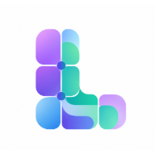

<p align="center">
  
</p>

# LORE marketing site

Next.js App Router landing and docs experience for the `main` branch.

## Develop

```bash
cd web
npm install
npm run dev
```

Open [http://127.0.0.1:3000](http://127.0.0.1:3000).

## Notes

- Stack aligns with Lore Solo `web/` (Next 15, React 19, Tailwind 4, `next-themes`).
- Brand assets live in `../assets/` and `public/` (favicon package + web app manifests).
- Windows Enterprise turnkey install is covered in the Enterprise quick-start (`Launch_LORE.bat` / `start_lore.ps1`).
